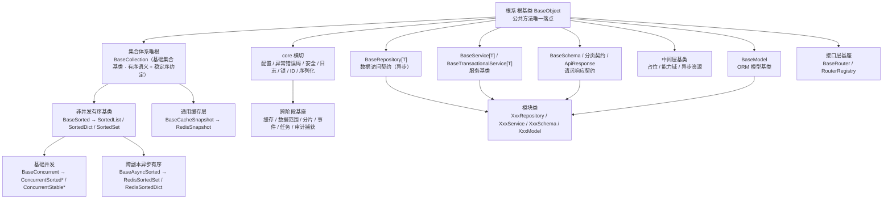

# 后端基类清单

> 后端基类权威清单：**基类登记表**（分层、继承、代码位置、状态）。体系口径与集合体系结构见《[后端基类体系说明](设计/基类体系/后端基类体系说明.md)》；逐类契约与继承链见《[后端基类实现契约](设计/基类体系/后端基类实现契约.md)》；护栏、基线与实现登记见《[后端基类治理台账](设计/基类体系/后端基类治理台账.md)》。

[文档首页](文档首页.md) › 后端基类清单　|　[配套：《后端开发规范》](规范/后端开发规范.md) · [后端基类体系说明](设计/基类体系/后端基类体系说明.md) · [后端基类实现契约](设计/基类体系/后端基类实现契约.md) · [后端基类治理台账](设计/基类体系/后端基类治理台账.md) · [前端基类清单 →](前端基类清单.md)

## 1. 用途与维护 

- **定位**：后端基类**权威登记表**——回答「有哪些基类、在哪一层、父层是谁、代码在哪、是否已交付」。强制用法见《[后端开发规范](规范/后端开发规范.md)》「后端基座体系（强制）」节；体系口径见《[后端基类体系说明](设计/基类体系/后端基类体系说明.md)》。
- **口径**：所有可继承的后端类收敛为一套分层体系（根系 根基类 + 集合体系 / 模块基类 / core 横切 / 跨阶段基座 + 中间层基类）；**公共字段 / 方法只在对应层基类维护，任何模块不得重复实现**；调整某一层基类即全链生效。
- **状态取值**：`已交付` / `占位`（接口或结构就位、真实实现待回补）/ `待交付`（已设计未落地）；与平台架构节点登记一致。
- **维护**：新增 / 调整基类须同步本清单 + 平台《架构设计 · 后端基础类体系》登记 + 对应阶段任务基座登记 + 相关详细设计；状态列随实施回写。
- **代码路径口径**：本清单「代码位置」为**包根相对路径**——共享基座库路径根为 `backend/libs/bms_core/src/`（`bms_core/...`），各服务路径根为 `backend/services/<服务>/src/`（平台服务包 `bms_<服务>/...`，产品服务包 `{包前缀}_{服务}/...`——包前缀经 `[app].package_prefix` 配置）；共 8 个**平台**服务：platform / identity / tenant / file / notification / search / ai / report（`org` 已退役，组织主数据归 mdm 产品服务）；工程结构与依赖方向见《[后端开发规范](规范/后端开发规范.md)》「目录与分层职责」节。

## 2. 分层总览 

| 层 / 支线 | 基类 / 能力 | 父层 | 代码位置 | 状态 |
| --- | --- | --- | --- | --- |
| 根系 | 根基类 `BaseObject` | — | `bms_core/core/base.py` | 已交付 |
| 根系 | 值容器 `ValueHolder` | `BaseObject` | `bms_core/core/base.py` | 已交付 |
| 体系基类 | 值对象 `BaseValueObject` | 根系 | `bms_core/core/roots.py`（`core/objects/roots.py` 为薄再导出，08-5 破环） | 已交付 |
| 体系基类 | 数据契约 `BaseDataContract` | 根系 | `bms_core/core/roots.py`（`core/objects/roots.py` 为薄再导出，08-5 破环） | 已交付 |
| 体系基类 | 框架对象 `BaseFrameworkObject` | 根系 | `bms_core/core/roots.py`（`core/objects/roots.py` 为薄再导出，08-5 破环） | 已交付 |
| 集合 | 基础集合基类 `BaseCollection`（集合体系**唯根**） | 根系 | `bms_core/core/collections.py` | 已交付 |
| 集合 | 非并发有序基类 `BaseSorted` → `SortedList` / `SortedDict` / `SortedSet` | `BaseCollection` | `bms_core/core/collections.py`（`BaseSorted`）+ `bms_core/core/sorted_collections.py`（`Sorted*`） | 已交付 |
| 集合 | 基础并发 `BaseConcurrent` → `ConcurrentStable*`（插入序，**业务与契约唯一落点**）/ `ConcurrentSorted*`（升序，体系内部） | `BaseSorted` | `bms_core/core/concurrent.py`（`BaseConcurrent` / `ConcurrentStable*`）+ `bms_core/core/sorted_collections.py`（`ConcurrentSorted*`） | 已交付 |
| 集合 | 跨副本异步有序 `BaseAsyncSorted` → `RedisSortedSet` / `RedisSortedDict` | `BaseSorted` | `bms_core/core/redis_collections.py` | 已交付 |
| 集合 | 通用缓存层 `BaseCacheSnapshot` → `RedisSnapshot` | `BaseCollection` | `bms_core/core/redis_collections.py` | 已交付 |
| 模块基类 | 数据访问契约 `BaseRepository[T]` / 作用域过滤 `BaseScopedRepository[T]` / 内存基线 `BaseMemoryRepository[T]` / DB 实现 `BaseDbRepository[T]` | 根系 | `bms_core/repositories/` | 已交付 |
| 模块基类 | 服务基类 `BaseService[T]` / 事务扩展层 `BaseTransactionalService[T]` | 根系 | `bms_core/services/` | 已交付 |
| 模块基类 | 请求/响应基类 `BaseSchema` / 分页契约 / `ApiResponse` | 根系 | `bms_core/schemas/` | 已交付 |
| 模块基类 | ORM 模型基类 `BaseModel` | 根系 | `bms_core/models/base.py` | 已交付 |
| 接口层 | 路由基类 `BaseRouter` / 登记表 `RouterRegistry` | 根系 | `bms_core/api/base.py` | 已交付 |
| 中间层 | 占位 `BasePlaceholder` / `BaseNullObject` / `BaseStub` | `BaseFrameworkObject` | `bms_core/core/capability.py` | 已交付 |
| 中间层 | 能力域 `BaseCapability` | `BaseFrameworkObject` | `bms_core/core/capability.py` | 已交付 |
| 事件域 | 事件工作单元 `BaseEventWorker` | `BasePluggable` | `bms_core/events/base.py` | 已交付 |
| 事件域 | 发布侧基类 `BaseEventPublisher` | `BaseEventWorker` | `bms_core/events/base.py` | 已交付 |
| 事件域 | 消费侧基类 `BaseEventConsumer` | `BaseEventWorker` | `bms_core/events/base.py` | 已交付 |
| 中间层 | 插件化 `BasePluggable` | `BaseCapability` + `BaseAsyncResource` | `bms_core/core/plugin.py` | 已交付 |
| 中间层 | 提供者注册表 `BaseProviderRegistry[ItemT]` | `BasePluggable` | `bms_core/core/provider.py`（03-2 归位；`registry.py` 过渡导出） | 已交付 |
| 中间层 | 注册项 `BaseProvider` | `BaseCapability`（组合轨，不入插件注册表） | `bms_core/core/provider.py` | 已交付 |
| 中间层 | 异步资源 `BaseAsyncResource` | `BaseObject` | `bms_core/core/capability.py` | 已交付 |
| 数据访问横切 | 工作单元 `UnitOfWork`（`NullUnitOfWork` / `DbUnitOfWork`） | — | `bms_core/db/unit_of_work.py`、`bms_core/db/null.py` | 已交付 |
| 数据访问横切 | 异步引擎 `EngineFactory` / 会话 `get_db`·`get_read_db`·`get_write_db`·`get_platform_read_db`·`get_platform_write_db`·`get_uow`·`get_platform_uow` / 读写绑定 / 主库可用性 `PrimaryHealth` | `BaseAsyncResource` | `bms_core/db/engine.py`、`session.py`、`routing.py`、`health.py` | 已交付 |
| 多租户 | 租户上下文 `TenantContext` / 租户源 `TenantSource` / 全局中间件 `TenantMiddleware` / 解析链 / 引擎注册表 `EngineRegistry` | `BaseObject` / `BaseAsyncResource` | `bms_core/db/tenant.py`、`tenant_source.py`、`api/middleware.py`、`registry.py` | 已交付 |
| cross 横切 | `BizError` 体系 / 配置 / 安全 / 日志 | — | `bms_core/core/` | 部分交付 |
| 能力域横切 | 数据脱敏 `BaseMasker` / 权限校验 `BasePermissionChecker` | `BasePluggable` | `bms_core/masking/`、`bms_core/permission/` | 已交付 |
| 能力域横切 | 分布式锁 `BaseDistributedLock` | `BasePluggable` | `bms_core/lock/` | 部分交付 |
| 能力域横切 | 验证码 `BaseCaptcha`（图形 / 滑块 / 短信三形态）/ 密码策略 `BasePasswordPolicy` | `BasePluggable` | `bms_core/captcha/`、`bms_core/password/` | 已交付 |
| 能力域横切 | 降级 `BaseFallbackPolicy` / 熔断 `BaseCircuitBreaker` | `BasePluggable` | `bms_core/fallback/`、`bms_core/circuit/` | 占位 |
| 能力域横切 | 限流 `BaseRateLimiter` / 幂等 `IdempotencyStore` / 防重放 `BaseReplayGuard` | `BasePluggable` | `bms_core/ratelimit/`、`bms_core/idempotency/`、`bms_core/replay/` | 占位 |
| 能力域横切 | 一致性屏障 `BaseConsistencyBarrier`（`null` / `redis`） | `BasePluggable` | `bms_core/consistency/`（`base.py` / `null.py` / `redis.py`） | 已交付 |
| 能力域横切 | 跨服务事务 `BaseTransactionManager` / `BaseTransactionParticipant` / `BaseTransactionRecovery`（`null` / `xa`；**恢复器实现落 `txn` 服务**） | `BasePluggable` | `bms_core/transaction/`（`base.py` / `null.py` / `xa.py`） | 已交付 |
| 能力域横切 | 指标 `BaseMetrics` / 链路 `BaseTracer` | `BasePluggable` | `bms_core/metrics/`、`bms_core/tracing/` | 占位 |
| 能力域横切 | 健康检查项注册表 `BaseHealthCheck` / `BaseHealthCheckRegistry` | `BaseProvider` / `BaseProviderRegistry` | `bms_core/health/`（`base.py` / `registry.py` / `checks.py` / `null.py`） | 已交付 |
| 能力域横切 | 开放接口服务端 / scope / 服务 JWT 签发校验 `BaseOAuthServer` / `BaseScopeChecker` / `BaseServiceTokenIssuer` / `BaseUserTokenIssuer` / `BaseTokenVerifier` | `BasePluggable` | `bms_core/oauth/` | 部分交付 |
| 能力域横切 | OIDC Provider 服务端 `BaseOidcProvider` / `NullOidcProvider` / `JwtOidcProvider` | `BasePluggable` | `bms_core/oauth/`（`oidc_provider.py` / `oidc_jwt.py` / `null.py`） | 已交付 |
| 能力域横切 | 缓存 Region `CacheRegion` / `NullCacheRegion` / `MemoryCacheRegion` / `RedisCacheRegion` | `BasePluggable` | `bms_core/cache/`（`base.py` / `null.py` / `memory.py` / `redis.py`） | 已交付 |
| 能力域横切 | 审计捕获 `AuditCapturer` / `NullAuditCapturer` | `BasePluggable` | `bms_core/audit/`（`base.py` / `null.py`） | 已交付 |
| 能力域横切 | 任务调度 `BaseTask` / `NullTask` | `BasePluggable` | `bms_core/tasks/`（`base.py` / `null.py`） | 已交付 |
| 能力域横切 | 事件发布 / 处理器 `EventPublisher` / `EventConsumer` 与 `NullEventPublisher` / `NullEventConsumer` | `EventPublisher` → `BaseEventPublisher` → `BaseEventWorker`、`EventConsumer` → `BaseEventConsumer` → `BaseEventWorker`（处理器轨，域键 `event_handler`，不参与装配） | `bms_core/events/`（`base.py` / `null.py`） | 部分交付（发布实现已交付，处理器随业务组接入） |
| 能力域横切 | 事件消费组运行时 `BaseEventConsumerGroup` / `RocketMqEventConsumerGroup` / `NullEventConsumerGroup` | `BaseEventConsumerGroup`（域键 `event_consumer`，兼 `BaseAsyncResource`）→ `BasePluggable` | `bms_core/events/`（`base.py` / `rocketmq_consumer.py` / `null.py`）；声明 `consumer_records.py`、执行器 `lane.py`、幂等 `dedup.py`、死信 `dead_letter.py`、通道编解码 `topic.py`、发布 `rocketmq_publisher.py` | 已交付（01_01） |
| 能力域横切 | 对象存储 `BaseObjectStorage` | `BasePluggable` | `bms_core/storage/`（`base.py` / `null.py` / `local.py` / `minio.py`） | 已交付 |
| 能力域横切 | LLM 适配 `BaseLlmProvider` | `BasePluggable` | `bms_core/llm/` | 占位 |
| 能力域横切 | 全文检索 `BaseSearchIndex` | `BasePluggable` | `bms_core/search/` | 占位 |
| 能力域横切 | 通知渠道 `BaseNotifier` | `BasePluggable` | `bms_core/notify/` | 占位 |
| 能力域横切 | 实时推送 `BaseRealtimePublisher` | `BasePluggable` | `bms_core/ws/` | 占位 |
| 能力域横切 | 出站集成 `BaseHttpClient` / `BaseWebhookSender` | `BasePluggable` | `bms_core/outbound/` | 占位 |
| 能力域横切 | 工作流引擎 `BaseWorkflowEngine` | `BasePluggable` | `bms_core/workflow/` | 占位 |
| 能力域横切 | 身份源 `BaseIdentityProvider` / 会话存储 `BaseSessionStore` | `BasePluggable` | `bms_core/idp/`、`bms_core/session/` | 部分交付 |
| 能力域横切 | 流程状态存储 `BaseIdpStateStore` / `NullIdpStateStore` / `MemoryIdpStateStore` / `RedisIdpStateStore` | `BasePluggable` | `bms_core/idp/state/`（`base.py` / `null.py` / `memory.py` / `redis.py`） | 已交付 |
| 能力域横切 | 数据查询提供者 `BaseQueryProvider` / `BaseQueryProviderRegistry` / `LocalQueryProviderRegistry` | `BaseProvider` / `BaseProviderRegistry` | `bms_core/query/`（`base.py` / `null.py` / `local.py`） | 已交付 |
| 能力域横切 | 导入导出 `BaseImporter` / `BaseExporter` | `BasePluggable` | `bms_core/transfer/` | 占位 |
| 能力域横切 | 审计哈希链 `BaseHashChain` | `BasePluggable` | `bms_core/audit/` | 占位 |
| 能力域横切 | 归档 `BaseArchivePolicy` / `BaseArchiveQueryRouter` | `BasePluggable` | `bms_core/archive/` | 占位 |
| 能力域横切 | 字段类型 `BaseFieldType` / `BaseFieldTypeRegistry` / `LocalFieldTypeRegistry` | `BaseProvider` / `BaseProviderRegistry` | `bms_core/fieldtype/`（`base.py` / `null.py` / `local.py`） | 已交付（内建类型：`text` / `longtext` / `number` / `datetime` / **`option` / `option_multi`**（枚举，选项集常量，默认 `radio` / `checkbox`）/ `switch` / `file` / **`dict` / `dict_multi`**（字典，绑定条目整数 `id`，列类型 `bigint` / `text`）；下拉形态语义键 `dropdown` / `dropdown-multi` 登记供字段属性层使用；旧名 `select` / `multi_select` 已废弃且不保留别名，2026-10-21 任务 02-14） |
| 能力域横切 | 选项集 `BaseOptionSet` / `BaseOptionSetRegistry` / `NullOptionSetRegistry` / `LocalOptionSetRegistry` | `BaseProvider` / `BaseProviderRegistry` | `bms_core/optionset/`（`base.py` / `null.py` / `local.py`） | 已交付（2026-10-21，Kiwi 2336；装载期冲突校验与双向引用校验已落，占位缺省 `null` / 真实注册表 `local`；内建平台选项集条目、表单元数据下发与服务端动态校验随表单定制阶段回补） |
| 能力域横切 | 国际化翻译 `BaseTranslator` | `BasePluggable` | `bms_core/i18n/` | 占位 |
| 能力域横切 | 工作台卡片 `BaseDashboardCardProvider` / `BaseDashboardCardRegistry` | `BaseProvider` / `BaseProviderRegistry` | `bms_core/dashboard/` | 占位 |
| 跨阶段基座 | 缓存 Region / 数据范围 / 分片路由 / 事件 / 任务 / 审计捕获 | `BasePluggable` 等 | `bms_core/cache/`、`scope/`、`sharding/`、`events/`、`tasks/`、`audit/` | 部分交付（数据范围已交付，分片路由 / 任务占位） |
| — | 模块类 | 对应基类 | 各模块 | — |

> 上表为全量分层索引（状态为简况，交付明细见 §5~§9 分域登记与《[后端基类实现契约](设计/基类体系/后端基类实现契约.md)》）。

## 3. 根系 根基类 

- **根基类 `BaseObject`**（`bms_core/core/base.py`）：非 ABC 普通类，一切可继承后端类之根——公共方法唯一落点（序列化、稳定序序列化、统一字符串输出、主键相等与哈希）；体系根清单与承接见《[后端基类实现契约](设计/基类体系/后端基类实现契约.md)》§7。
- **值容器 `ValueHolder`**（`bms_core/core/base.py`）：`get_locked` 上下文内可替换值容器。

## 4. 集合体系（非并发有序 / 基础并发 / 跨副本 / 通用缓存） 

| 形态 | 基类 / 封装 | 代码位置 | 职责 |
| --- | --- | --- | --- |
| 基础集合基类（**集合体系唯根**） | `BaseCollection` | `core/collections.py` | 集合通用**语义约定**：有序语义 + 对外输出稳定序（禁止裸无序集合）+ `collection_kind` 标记；**所有集合类一律继承本根、无任何例外** |
| 非并发有序（无锁高效） | `BaseSorted` → `SortedList` / `SortedDict` / `SortedSet` | `core/collections.py`（`BaseSorted`）+ `core/sorted_collections.py`（`Sorted*`） | 进程内**无锁**有序：稳定序列化 / 排序视图 / 分批 / 集合运算（同步读）；`Sorted*` 为无锁高效形态，也是并发形态的数据底座——**业务与契约不得直接声明 / 继承**（业务排序走排序契约） |
| 基础并发 | `BaseConcurrent` | `core/concurrent.py` | 锁策略守卫 + 原子复合操作 + 快照遍历模板（`BaseSorted` 之**并发子层**，承载 `LockStrategy` 显式传入与 SNAPSHOT 写时复制） |
| 进程内并发（插入序，**业务与契约唯一落点**） | `BaseConcurrent` → `ConcurrentStable*` | `core/concurrent.py` | **插入序稳定输出、不比较元素**（`collection_kind="stable"`）；**分段写 + 插入序号归并**（`SHARDED`，写并发 ≈ 段数；序号分配用独立轻量锁，读按整数序号归并还原插入序）；只读面补齐为 `Sequence` / `Mapping` / `Set`；**通用功能面补齐**为内置容器日常写法（写糖 / 通用方法 / 输出可读性，见下「通用功能面」小节）；承载 Pydantic 模型 / `dict` / ORM 模型等不可比较元素与须保序的清单（08_02 / 08-4）；**不可哈希**（`__hash__ = None`，与内置 `list` / `dict` / `set` 一致——可变对象做内容哈希会在内容变化后破坏容器桶定位） |
| **不可变层（值对象集合字段唯一落点）** | `BaseConcurrent` → `BaseImmutable` → `ConcurrentStableFrozen*` | `core/collections.py`（`BaseImmutable`）+ `core/concurrent.py`（三形态） | **构造期写、构造后恒冻结**（`collection_kind="stable_frozen"`）：构造期走分段写路径（`__init__` 末行 `self.update(items)`，需分段写锁与全局序号锁——故承 `BaseConcurrent` 而非 `BaseSorted`），构造完成即置 `_frozen`，此后一切写操作抛 `TypeError`；**不复用 `freeze()`**（其实质是 `_freeze_clone` 完整重构造，会付两遍写路径成本）；**内容哈希**（与 `__eq__` 语义对齐：列表按序、集合与映射用 `frozenset`，哈希值缓存）；派生运算（`\|` / `union` / `difference` / `symmetric_difference`）走「先算可变临时实例、最后一次冻结」；**`BaseValueObject`（frozen dataclass）的集合字段一律落本层**（其生成 `__hash__` 依赖字段可哈希）（08-5） |
| 进程内并发（升序，**体系内部**） | `BaseConcurrent` → `ConcurrentSorted*` | `core/sorted_collections.py` | 多线程共享：原子复合方法 + 快照遍历；**只读面补齐为 `Sequence` / `Mapping` / `Set`**（索引 / 切片 / `keys` / `items` / `values` / 集合运算 / 与内置容器内容相等）；**通用功能面与插入序形态同一套写法**（两形态 API 不分叉，08-4）；锁策略 `LockStrategy` 显式传入（`RW` 默认 / `RLCK` / `SHARDED` / `SNAPSHOT`）；**业务与契约不得直接声明 / 继承**（升序需比较 + 维护有序结构，写并发天生受限；业务排序走排序契约）（只读 API 与内部化口径随 08_02） |
| 跨副本异步有序 | `BaseAsyncSorted` → `RedisSortedSet` / `RedisSortedDict` | `core/redis_collections.py` | 跨副本 / 多 worker：外部存储为事实源 + 版本号（`{key}:version` 惰性比对）；**并发由 Lua 原子脚本 + `WATCH` / `MULTI` 乐观重试承载，无同步锁层**；公共段＝`async size()` / `async version()` / `version_key()`，读写方法留各自类，**无同步读入口、禁 sync 到 async 桥接** |
| 通用缓存层 | `BaseCacheSnapshot` → `RedisSnapshot` | `core/redis_collections.py` | 跨副本只读快照的公共段（`async get()` 取快照 / `async invalidate()` 本地失效）；**通用缓存分支**（非有序集合，不经有序公共段） |

### 4.1 通用功能面（写糖 / 通用方法 / 输出可读性） 

**口径（08-4）**：**写糖一律等价于对应原子方法、不新增写路径**——`append` ≡ `add`、`extend` ≡ `update`、`d[k] = v` ≡ `set`、`del d[k]` ≡ `delete`；不额外加锁、不额外快照拷贝。

| 类 | 通用方法面 |
| --- | --- |
| `ConcurrentStableList` / `ConcurrentSortedList` | `append` / `extend` / `+=` / `+`（返回同类新实例）/ `pop(i)` / `l[i] = v` / `del l[i]` / `sorted(key=, reverse=)` / `merge`（顺序拼接）/ `copy` |
| `ConcurrentStableSet` / `ConcurrentSortedSet` | `remove(x)`（缺失抛 `KeyError`）/ `pop()` / `copy` / `union` / `intersection` / `difference` / `symmetric_difference` 及四个 `*_update` / `update` |
| `ConcurrentStableDict` / `ConcurrentSortedDict` | `d[k] = v` / `del d[k]` / `clear` / `pop(k[, default])` / `popitem` / `setdefault` / `fromkeys` / `update(映射 \| 键值对 \| kwargs)` / `\|` / `\|=` / `sorted_items` / `sorted_keys` / `copy` |

**输出可读性**：`__str__` / `__repr__` 统一为「类名 + 内置字面量」（序列 `[..]`、集合 `[..]`、字典 `{..}`），超 `REPR_ITEM_LIMIT`（10）项截断并提示「共 N 项」；**跨副本形态（`RedisSortedSet` / `RedisSortedDict`）为描述式**（`类名(key='…')`，不读远端），**任何形态打印均不抛错**。

**冻结只读快照**：`freeze()` 返回**冻结副本**（内容独立），此后**一切写操作抛 `TypeError`**；`PluginRegistry.snapshot()` 等「只读快照」场景以它落成**真实机制**（不再依赖「碰巧没有 `__setitem__`」）。跨副本形态与缓存快照不支持 `freeze`（无同步读入口）。

**禁用方法（不提供）**：`insert` / 原地 `sort` / 原地 `reverse`——须**全表重编号**并持**全局写锁**，会阻塞所有写；替代写法为重建集合（`ConcurrentStableList(新顺序)`）。切片赋值与切片删除同理不支持（切片**读取**仍返回同类快照）。

### 4.2 不可变形态与哈希分工 

| 项 | 口径 |
| --- | --- |
| 三形态 | `ConcurrentStableFrozenList` / `ConcurrentStableFrozenSet` / `ConcurrentStableFrozenDict`（承 `BaseImmutable`，`collection_kind = "stable_frozen"`） |
| 构造 | **构造期写、构造后冻结**：`super().__init__(items)` 走分段写路径，返回后置 `_frozen = True`；**不调用 `freeze()`**（其本质是完整重构造） |
| 写入 | 构造后一切写操作抛 `TypeError`（`_ensure_mutable` 守卫） |
| 内容哈希 | 与 `__eq__` 语义对齐——**列表按序**（`("seq", tuple(...))`）、**集合与映射无序**（`frozenset`）；递归规范化以支持嵌套；**哈希值缓存**（首次 O(n)、后续 O(1)） |
| 派生运算 | `\|` / `union` / `intersection` / `difference` / `symmetric_difference` 走「先算可变临时实例、最后一次冻结」（原 `copy()` 后 `update()` 会撞冻结） |
| 哈希分工 | **可变形态不可哈希**（`__hash__ = None`，与内置 `list` / `dict` / `set` 一致）；**内容哈希只给不可变形态**。frozen dataclass 值对象（`BaseValueObject`）字段一律落不可变形态 |
| 不适用 | 跨副本形态（`RedisSortedSet` / `RedisSortedDict` 无同步读入口，无法计算内容哈希）与 `BaseCacheSnapshot` |

> **为什么不挂 `BaseSorted`**：不可变只保证「构造完成后不再变」，构造期即写路径（实测 `__init__` 末行 `self.update(items)` 持分段写锁 + 全局序号锁），且构造完成前若被共享仍需锁保护；`BaseSorted` 无锁设施。

### 4.3 复杂度与「禁用 / 慎用场景」表 

| 方法 | 复杂度 | 使用建议 |
| --- | --- | --- |
| `append` / `extend` / `+=` / `d[k] = v` / `del d[k]` / `pop(k)` / `setdefault` / `add` / `discard` / `add_if_absent` / `put_if_absent` / `update_atomic` / `get_and_remove` | O(1)（`extend` 为 O(k)） | 随便用 |
| `__contains__` / `get` / `len` | O(1)（`len` 为 O(段数)，`SHARDED` 下 16） | 随便用 |
| `pop(index)` / `l[i] = v` / `del l[i]` | **O(n)**（先取快照定位序号） | 循环里按索引改列表 → 改「先 `to_list()` 在快照上改，再重建集合」 |
| `popitem()` | **O(n)**（取快照定位末条序号） | 仅用于低频收尾；批量消费用 `to_list()` + `clear()` |
| `sorted` / `sorted_items` / `sorted_keys` / `sorted_by` | O(n log n) | 结果只要一次就用内置 `sorted(...)`；列表排序优先走**排序契约**（仓储层） |
| `__add__` / `union` / `intersection` / `difference` / `symmetric_difference` / `copy` / `merge` | O(n + k) | 返回新实例；高频拼接改用原地 `extend` / `update` |
| `repr` / `str` | O(n)（一次快照） | **禁止**在大集合热路径日志里直接打 `repr`；用 `len()` + 摘要 |
| 不可变形态内容哈希 | 首次 O(n)（递归规范化 + `frozenset`），后续 O(1)（缓存） | 高频新建 + 高频哈希场景慎用；同内容实例只需算一次 |

> 集合体系结构、唯一链与同步读边界见《[后端基类体系说明](设计/基类体系/后端基类体系说明.md)》§3；裸无序集合护栏与基线见《[后端基类治理台账](设计/基类体系/后端基类治理台账.md)》§1；完整继承链见《[后端基类实现契约](设计/基类体系/后端基类实现契约.md)》§7。

## 5. 模块基类（数据访问 / 服务 / 契约 / 模型） 

模块基类是**平行的兄弟基类**（各自继承 `BaseObject`，互不继承）；模块类分别继承对应基类。它们之间是**调用链**（服务调用仓储、仓储操作模型），不是继承层级。

| 基类 | 代码位置 | 职责与关键成员 |
| --- | --- | --- |
| `BaseRepository[T]` | `repositories/base_repository.py` | 仓储**契约**（异步）：CRUD 抽象 + `exists` / `list_page` / `list_cursor`（**keyset**） / 软删硬删出口派生 + 数据源（只读标记）/ 分片路由钩子 + `_guard_version` 乐观锁转译；排序 / 游标对外入口 `effective_sort` / `build_cursor`（游标由仓储按末行生成） |
| `BaseMemoryRepository[T]` | `repositories/base_memory_repository.py` | 内存基线（异步：字典存储 + 自增 ID，继承 `BaseScopedRepository` 按作用域过滤），子类只实现同步 `_build` / `_apply`；测试替身，硬删语义（无软删字段）；排序与游标经 `repositories/ordering.py` 与 DB 侧同口径（NULL 恒末位、keyset 镜像） |
| `BaseScopedRepository[T]` | `repositories/base_scoped_repository.py` | **作用域过滤中间层**：软删除 + 数据范围 + **租户条件**（`_scope_conditions(include_soft_delete=...)` / `_matches_scope`，覆盖读写；`tenant_scoped` 且上下文租户有主键时强制注入 `tenant_id` 条件；操作符 eq/ne/in/like/gt/gte/lt/lte/between/is_null/is_not_null）；**数据源维度条件翻译**（`04-4`）：`scope_columns`（数据源标识 → 本表实体列）类属性声明映射，未声明且条件无字段可回落即退化为永假 + 计数，映射优先覆盖 `match` 白名单字段；集合值 / 区间值按实体值类型双向归一（字符串 ↔ 数值，`_coerce` / `_equal` / `_compare`）；`soft_delete` / `hard_delete` 派生默认（DB 实现覆写） |
| `BaseDbRepository[T]` | `repositories/base_db_repository.py` | **数据库实现**（异步真实落库，继承 `BaseScopedRepository`）：会话构造注入 + `model` 类属性；CRUD / `SELECT EXISTS` 存在性 / 页码分页（限深由契约层把关）/ **keyset 游标分页**（`LIMIT` 无 `OFFSET`）；ORDER BY 经 `ordering.order_criteria`（**NULL 恒末位** `列 IS NULL` 排序键 + 主键兜底）；作用域条件 → SQL WHERE（`04-4` 起按列 `python_type` 归一集合值 / 区间端点，转换失败该条件译 `false()` 并计数）；写入严格白名单；租户 `create` 注入与 `update` 禁改；`delete` 默认软删 + `soft_delete` / `hard_delete` 出口；乐观锁冲突转 409（01_04） |
| `UnitOfWork` | `db/unit_of_work.py`、`db/null.py` | 异步事务 `begin` / `commit` / `rollback` + `session`；`NullUnitOfWork`（空实现）、`DbUnitOfWork`（`AsyncSession`） |
| `BaseService[T]` | `services/base_service.py` | 通用 CRUD 委派仓储 + 统一不存在语义（`NotFoundError`）+ `page` / `cursor_page` 分页 |
| `BaseTransactionalService[T]` | `services/base_transactional_service.py` | 事务扩展层：写操作经 `UnitOfWork` 进入事务、读操作不包事务 |
| `BaseSchema` | `schemas/base.py` | Pydantic 公共配置并继承 `BaseObject` 获得统一序列化（声明字段优先）；ID 字符串化与敏感字段掩码经 `_serialize_ids`（`@model_serializer(mode="wrap")`）；**序列化模式 JSON Schema 以字段口径输出**（`__get_pydantic_json_schema__` 在序列化模式剥离模型序列化器，并把 `id` / `*_id` 属性按 `is_id_key` 同源判定标为字符串；校验模式与运行时序列化行为不变）——06_03，|
| 分页契约 | `schemas/pagination.py` | `BasePageQuery` / `BasePageResponse[T]`（页码）、`BaseCursorQuery` / `BaseCursorResponse[T]`（游标） |
| `ApiResponse` | `schemas/common.py` | 统一响应 `{code, message, data}`；列表分页 `data` 用分页契约 |
| `BaseModel` | `models/base.py` | ORM 公共字段与约定（雪花 ID / 软删除 / 审计 / 乐观锁 / 四库类型映射）+ 软删除辅助 `soft_delete()` / `restore()`；审计由 ORM 事件自动填充、乐观锁用 `version_id_col` |
| `ErrorCode` / `ErrorSegment` | `core/error_codes.py` | 平台错误码与段位登记点；模块错误码按注册段位各自登记 |

## 6. 中间层基类 

| 基类 | 代码位置 | 职责 | 继承 / 使用 |
| --- | --- | --- | --- |
| `BasePlaceholder` | `core/capability.py` | 占位实现公共父（`placeholder` 标记 + `describe()`） | `BaseNullObject` / `BaseStub` 继承 |
| `BaseNullObject` | `core/capability.py` | 空实现（Null Object，无副作用） | `NullUnitOfWork` / `NullDataScope` / `NullShardingRouter` 继承 |
| `BaseStub` | `core/capability.py` | 未实现占位：`_not_implemented()` 统一抛错 | `BaseSecurity` 及原语继承（`BaseDbRepository` 真实实现后已退出） |
| `BaseCapability` | `core/capability.py` | 能力域契约中间层（`key`） | 跨阶段基座继承；能力域基类经 `BasePluggable` 间接继承（02-1） |
| `BasePluggable` | `core/plugin.py` | 插件化中间层（继承 `BaseCapability` + `BaseAsyncResource`）：插件键 / 实现名 / 注册与解析 / 契约版本 / 生命周期 / `describe`；`PluginRegistry` 双轨登记与只读快照、`PluginError`（40002） | 已交付（阶段三 01-1）；**40 个能力域基类已改继承（02-1）** |
| `BaseProviderRegistry` | `core/provider.py`（03-2 归位） | 提供者注册表中间层（继承 `BasePluggable`）：`register` 唯一性拒重 / `get` 未命中 `None` / `keys` / `values` 保序；`_provider_key` 钩子供各域 | 健康检查注册表继承（02-2）；其余 3 域收敛（03-3） |
| `BaseProvider` | `core/provider.py` | 注册项公共契约（继承 `BaseCapability`，组合轨）：抽象 `key` + 抽象 `describe` | 4 类提供者已继承（03-2） |
| `BaseFactory` | `core/factory.py` | 工厂基类（继承 `BasePluggable`）：一切工厂类之根——创建入口标识（`key` / `plugin_name` / `contract_version`）+ 参数校验（`validate` 默认空实现）+ 抽象创建（`create`）+ 产出物释放登记（经 `ResourceManager`）；各域工厂基类承公共创建逻辑，工厂只创建与装配、不承载业务判定 | 已交付（02-54） |
| `BaseEventWorker` | `bms_core/events/base.py` | 事件工作单元（`event_type`；继承 `BasePluggable`，02-1 自 `core/capability.py` 迁入） | `BaseEventPublisher` / `BaseEventConsumer` 继承（发布 / 消费各一层，`EventConsumer` 侧独立域键 `event_consumer`） |
| `BaseAsyncResource` | `core/capability.py` | 异步资源生命周期（`aclose()` + `async with`） | `EngineRegistry` / 工厂链等继承 |
| `ResourceManager` | `core/resources.py` | 异步资源统一登记 + 逆序回收（`register` / `aclose`） | `create_app` lifespan 统一释放（已登记 `EngineRegistry`） |

> 基类候选（未落地前不视为基类）见《[后端基类体系说明](设计/基类体系/后端基类体系说明.md)》§4。

## 7. core 横切基座 

| 基座 | 代码位置 | 内容 | 状态 |
| --- | --- | --- | --- |
| 配置基座 | `core/config.py` | 分区模型继承 `BaseSettings`（`BaseSettings → BaseSchema`，拒绝未知键 / 字段名填充）+ `get_settings()`（真实读取：`config.toml` 基线 + `config.{env}.toml` 分层 + `BMS_` 覆盖 + 启动校验）；顶层 `Settings` 另继承 `pydantic_settings.BaseSettings` | 已交付 |
| 异常与错误码 | `core/exceptions.py`、`core/error_codes.py` | `BizError`（携带错误码 / `http_status` / `data`）+ 段位基 `GeneralError`(1xxxx) / `AuthError`(2xxxx) / `UserOrgError`(3xxxx) / `ConfigError`(4xxxx) / `OpenTenantError`(8xxxx) + 骨架子类；全局处理器转 `ApiResponse` | 已交付 |
| 安全基座 | `core/security.py`（签名原语）、`security/`（三能力域） | 签名原语 `SignatureCodec`（HMAC-SHA256，真实实现，供防重放 / Webhook 复用）；**安全原语迁入 `security/` 插件化能力域**：`BaseSecurity`（域中间层）→ `BasePasswordHasher`（`plugin_key = "password_hasher"`）/ `BaseTokenCodec`（`"token_codec"`）/ `BaseSessionSecurity`（`"session_security"`）+ 真实实现 `Pbkdf2PasswordHasher`（`pbkdf2`；自描述哈希串 / 常量时间比对 / `needs_rehash`）/ `JwtTokenCodec`（`jwt`；joserfc + `oauth/keys.py` 密钥工具、RS256/ES256 白名单、多密钥轮换）/ `DefaultSessionSecurity`（`default`；雪花会话 id / HMAC 指纹 / `bms:global:token:blacklist:{jti}`）+ Null 实现 **fail-closed**（校验恒拒 / 生成抛 `ConfigError`）+ 提供者 `get_password_hasher` / `get_token_codec` / `get_session_security`；配置 `[security]`（secret_key / access 30 分钟 / refresh 14 天 / keys / active_kid）与三插件选择段 | 已交付（真实实现 01_01；PBKDF2 参数随 01_03 消费；用户令牌业务语义经 01_02 `user_token` 域承载；会话 id / 指纹 / 黑名单键随 01_03 / 01_04 消费） |
| 日志基座 | `core/logging.py` | 门面中间层 `BaseLogger` + structlog 实现 `StdoutLogger`；入口 `configure_logging` / `get_logger`（stdout、不落文件；dev console / test·prod JSON、上下文注入、脱敏——生效名单＝内置名单 ∪ `[log].redact_keys` / `[log].redact_suffixes` 追加，**只可追加不可移除**，敏感键值整体替换 `***`） | 已交付（真实实现；脱敏配置化 04_02） |
| 稳定序列化 | `core/serialization.py` | 统一稳定 JSON（键排序、中文不转义、不可序列化值降级 str） | 已交付 |
| 并发锁原语 | `core/locking.py` | `LockStrategy` / `ReadWriteLock` / `LockGuard` | 已交付 |
| 雪花 ID | `core/id.py` | `SnowflakeGenerator`（标准雪花 41+10+12）；WorkerId 经配置注入（`BMS_APP__WORKER_ID`，启动期 `configure_id_generator` 生效；旧名 `BMS_WORKER_ID` 兜底已移除，导入期默认 0） | 已交付 |
| 请求上下文 | `core/context.py` | `current_user_id` / `current_tenant` / `read_only` / `current_masker` 上下文变量 + 设置 / 复位辅助（`current_masker` 供 `BaseSchema` 序列化期掩码） | 已交付 |
| 装配基座 | `core/assembly.py` | `PluginWiring` / `PLUGIN_WIRINGS`（继承 `BaseObject`；插件装配载体：能力域 ↔ 实现键绑定、装配清单与校验入口）+ `assemble_base_plugins`（**基础能力先行装配**：`BASE_PLUGIN_KEYS`——当前为 Redis 统一客户端——先于开库引导 / 接库校验装配，因引擎注册表跨实例创建锁经分布式锁基座取共享客户端，未登记即 fail-closed 拒启）+ `assemble_plugins(only=…)`（按能力键分批装配；已装配接线跳过实例化与 `setup()`，累计结果落 `app.state.plugin_providers` / `assembled_plugin_keys`） | 已交付（阶段三；审计补登记；基础能力先行装配 2026-10-17） |
| 服务运行时基座 | `core/service.py`、`core/run.py` | 服务身份 `ServiceIdentity`（名称 / 版本 / 中文名 / 契约版本，继承 `BaseObject`）+ 运行时 `ServiceRuntime`（继承 `BaseObject`；登记身份、暴露 `draining`、`start_drain()` 幂等摘流）+ `attach_service` 助手（包声明 + `[app].service` 覆盖解析、服务自报契约版本带入、日志上下文绑定、回落就绪）；`bind_service_identity` 经 structlog 全局上下文注入 `service` / `service_version`；`core/run.py` 提供 `ServiceServer`（uvicorn 子类，信号到达先摘流再优雅收尾）/ `build_server`（读 `[server]` 配置）/ `run_service`（`python -m bms_<服务名>` 启动入口） | 已交付（02_02；契约版本 03_02） |
| 服务应用装配基座 | `application.py` | `service_lifespan`（共享应用生命周期：离线清单校验 → **基础能力先行装配**（`assemble_base_plugins`：Redis 统一客户端先登记，供引擎注册表跨实例创建锁等引导期消费方取用）→ 开发库自动建表 → 接库服务目录校验（`validate_catalog`：库内查重 + 与清单双向对账 + 运行服务契约版本主版本兼容）→ 插件装配（其余能力）→ 就绪标记；空目录仅告警放行、失败经 `CatalogError` 拒启并释放已装配资源，关闭取消就绪并释放资源）+ `BaseServiceApplicationFactory(BaseApplicationFactory)`（服务应用工厂基座：服务身份 / 契约版本 / 中间件 / 异常处理 / 状态与前缀工厂 / 引擎注册表 / 租户源 / 插件装配 / 探针统一挂载 / 根路由 / **全局标注依赖 `get_masker`**（请求期掩码器上下文，04_02）；`service_routers()` / `prepare_settings()` / **`configure_plugins()`**（服务侧插件登记，须在建注册表之前；2026-10-18） / `configure_service()` / `service_records()` / **`form_records()`**（产品 `form_key` 清单注入 → 应用级视图 `app.state.form_registry`，`GET /api/v1/form-keys` 取该视图；2026-10-22）钩子）。**置包根（组合根）**：装配触达 `api` / `services`，置包根以满足 `core → api/services` 反向依赖约束；各服务只声明身份与业务路由。**产品服务装配（12_03）**：应用级服务目录视图＝「`SERVICE_CATALOG` + `service_records()` 注入记录」（构造入参进入注册表，无进程级注册表、不改常量），启动离线清单 / 接库对账 / 事件契约域一律取该视图（`ModuleRegistry.catalog_records()` / `event_domains()`）；声明 `product_key` 的产品服务另走产品维度 fail-closed 校验（`validate_product_service_records()`，记录非空 / 均为产品分组 / 产品归属与声明一致 / 含运行服务登记行）；平台服务不覆写钩子即视图与校验口径与改前一致；**表归属注入（12_04）**：`table_records()` 钩子（缺省空元组）+ 装配期 `register_table_records()` 登记并置 `app.state.table_ownership`（合并视图） | 已交付（02_03；接库校验 03_02；全局掩码器依赖 04_02；产品服务装配 12_03；表归属注入 12_04；基础能力先行装配 2026-10-17） |
| HTTP 中间件 | `api/middleware.py` | `RequestLoggingMiddleware` / `TraceIdMiddleware` / `ReadOnlyMiddleware` / `TenantMiddleware` / `EdgeGuardMiddleware`（继承 `BaseObject`；请求日志 / 链路 ID 注入 / 只读标记——按 HTTP 方法设置 `read_only` 上下文，供读写分离选引擎 / 租户解析全局中间件——解析链 + 请求态与上下文注入、未知与停用租户就地拒绝 / 边缘请求净化与信任边界——无条件剥除客户端伪造身份头、按信任注入可信身份并置请求态与 `current_user_id` 上下文、旁路流量就地拒绝，装配先于租户解析） | 已交付（审计补登记；`ReadOnlyMiddleware` 02-01；`TenantMiddleware` 02-02；`EdgeGuardMiddleware` 04_02） |

## 8. 数据访问与多租户基座 

| 基类 / 能力 | 代码位置 | 职责 | 状态 |
| --- | --- | --- | --- |
| 库键与库名单一来源 `DbKey` | `db/keys.py` | 数据源键形态与库名派生**单一来源**（06_01）：库类别 `platform` / `tenant` / `archive`；**相对键** `platform` / `tenant_{code}`（缺省补当前服务）与**全限定键** `platform_{service}` / `tenant_{service}_{code}`（显式跨服务）；`build_platform_db_key` / `build_tenant_db_key` / `parse_db_key`（`tenant_` 后首段命中已知服务标识即按全限定键解，否则整体为租户编码）/ `platform_database_name` / `tenant_database_name`（`bms_{service}` / `bms_{service}_{code}`）/ `database_name`（相对键按当前服务补全）/ `resolve_db_key`（归属校验：全限定键越界抛 `DataOwnershipError` 10008；`allow_cross_service` 为**运维专用豁免**） | 已交付（06_01；Kiwi 2177） |
| `EngineFactory` | `db/engine.py` | 按 `(db_key, 读写角色)` 创建 / 缓存引擎：写主库、只读轮询副本（无副本回落主）、四库方言（MySQL / PostgreSQL / 达梦 `dmxa` XA 同步 / SQLite；达梦串方言**归一为 `dmxa`**）、**平台与租户库键均经各自 `url_template` 模板解析**（平台 `{service}` / `{database}` = `bms_{service}`；租户 `{service}` / `{tenant}` / `{database}` = `bms_{service}_{tenant}`；空模板回落单库）、**取键入口 `validate_key` 归属校验**（越界 10008）、`allow_cross_service` 运维通道、连接池按服务（`[app].service`）、`connect_args` 建连超时、`create_sync`（达梦与连通性；**达梦建引擎前自检客户端通信加密模块加载路径**，见下 `dm_ssl` 行）、`drop` / `aclose` | 已交付（02-01；租户模板 02-02；**平台服务库拆分与越界拒绝 06_01**）；**已挂工厂链 `EngineFactory → BaseDbFactory → BaseFactory`（02-54）** |
| `get_db` / `get_read_db` / `get_write_db` / `get_platform_read_db` / `get_uow` / `SessionFactory` / `session_scope` | `db/session.py` | `async_sessionmaker`；`get_db` 按请求只读标记选引擎（**请求租户上下文存在时取租户库键引擎，否则回落平台库**）、`get_read_db` / `get_write_db` 显式强制、`get_platform_read_db` 强制**平台库**只读（平台库表只读接口用，带租户上下文时仍读平台库）、`get_uow` 绑定主库会话（写与事务强制主库）；每请求独立、退出释放；`session_scope` **统一会话入口**（按租户 / 库键 + 读写角色 + 会话工厂，模块内取会话一律经它，禁止自建 `async_sessionmaker`）；**按方言分流**——目标库为同步方言（达梦）时经 `registry.get_sync` + `SyncSession` 门面承载（`factory` 不参与），其余方言走异步会话；降级守卫 `_guard_degraded` 两条路径共用；会话类型为公共契约 `DbSession`；公共依赖汇总 `api/deps.py` | 已交付（02-01；租户路由 02-02；`session_scope` 01_03；**同步方言分流 01_05**；平台库读会话 03_03） |
| 读写绑定 | `db/routing.py`、`core/context.py` | `read_only` 上下文标记 + `WRITE_BINDING`（`default`）/ `READ_BINDING`（`replica`）+ `SAFE_METHODS` / `is_read_method`；只读标记由 `ReadOnlyMiddleware` 按方法设置、路由可显式覆盖 | 已交付（02-01） |
| `PrimaryHealth` | `db/health.py` | 主库可用性：降级标记（`mark_degraded` / `mark_recovered` / `is_degraded`）+ `probe` 探测恢复（继承 `BaseAsyncResource`）；供主库故障只读降级 | 已交付（02-01） |
| `TenantContext` / 解析链 / `TenantSource` / `TenantSnapshot` / `LocalTenantSource` / `RemoteTenantSource` / `TenantRegistryRepository` / `get_tenant` | `db/tenant.py`、`db/tenant_source.py`、`db/tenant_registry.py`、`db/tenant_remote.py`、`bms_tenant/sources/tenant_source.py`、`bms_tenant/repositories/tenant_registry.py` | 租户上下文（编码 / 库键 / 名称 / 主键 / 状态 / 域名）与数据源键助手（复用 `db/keys.py`；上下文携带**相对键** `tenant_{db_basis}`（库名基，创建时冻结；经对照表 `sys_tenant_database` 取数），随运行服务解析为 `bms_{service}_{db_basis}`）；解析链（子域名按 `domain` → `X-Tenant-ID` 按 `code` → 令牌租户位；豁免路径；无来源 dev/test 回落、prod 拒绝）；租户源**装配点**（`local` / `remote` 双实现，空配置自动：租户服务 `local`、其余服务 `remote`）；`TenantSnapshot`（共享注册快照与缓存 key / 版本键；含 `db_basis` 与雪花 `tenant_id`）；`LocalTenantSource`（租户服务直读自身平台服务库；左联对照表取 `db_basis`，缺行回落 code 记 WARNING）/ `RemoteTenantSource`（契约取数 + 缓存 + 全局版本键惰性比对 + 停用强制回收 + 契约不可达降级）；`TenantRegistryRepository`（租户注册读写仓储与状态变更；`create` 同事务写 `sys_tenant` + `sys_tenant_database`） | 已交付（02-02；**归属迁出与装配点 / 远程源 / 注册仓储 06_03**；服务化库键 06_01；雪花 `tenant_id` / `db_basis` / 对照表 10_02~10_04） |
| `EngineRegistry` | `db/registry.py` | `{db_key → engine}` 注册表：平台类键常驻（**按库类别判定**，`platform_{service}` 等平台键不参与租户 LRU / 闲置回收）、服务租户库懒加载、LRU 活跃上限、**闲置清扫（每次访问）**、`get(read_only=...)` 读写角色与**取键入口归属校验**（经 `EngineFactory.validate_key`，与工厂同源；越界 10008）、**跨实例创建锁（分布式锁基座叠加进程内锁；SQLite 数据源免跨实例锁）**、连接预算（**按服务 × 库类别核算内核 `pool_budget_rows`，06_02**；`pool_budget_warnings` 启动告警 + `tenant_pool_budget_warnings` 按活跃引擎数）、**库数量记账（`bms_db_count`，标签 `kind` / `service`；引擎新建 / 回收时记 gauge，06_02）**、强制回收（`release`，平台类键不回收）；**同步方言取用 `get_sync(db_key, read_only=...)` 与判定 `is_sync_only(db_key)`**（同步引擎按 `(db_key, role)` 缓存；异步 `get` 对同步方言仍抛 `ConfigError`） | 已交付（02-01；跨实例锁 / 闲置清扫 / 预算按活跃引擎数 02-02；**同步方言取用 01_05**；入口校验与常驻判定 06_01） |
| 同步方言门面 `SyncSession` | `db/sync.py` | 达梦等**仅同步方言**的异步门面：包装阻塞 `Session`，`execute` / `add` / `delete` / `refresh` / `get` / `flush` / `commit` / `rollback` / `close` / `get_bind` 经 `asyncio.to_thread` 执行，`raw` 暴露底层会话作逃生口，支持 `async with`；配 `sync_session_scope(engine)`；`is_sync_only_url(url)` 方言判定（`SYNC_ONLY_DIALECTS` = `dm` / `dmxa`）；**会话公共契约 `DbSession = AsyncSession \| SyncSession`**（新增会话方法须在契约与两处实现同步） | 已交付（01_05；`dmxa` 05_05） |
| 达梦 XA 方言 `DMXADialect`（`dmxa`） | `db/dialects/dm_xa.py`、`db/dialects/__init__.py` | 达梦**两阶段事务（XA）**方言：纯 Python 继承 `dmSQLAlchemy` 同步方言，`do_begin / prepare / commit / rollback / recover_twophase` 接服务器端 **`DBMS_XA`** 包（`XA_START / XA_END / XA_PREPARE / XA_COMMIT / XA_ROLLBACK`），**不改编译驱动**；经方言注册表登记 `dmxa` / `dmxa.dmPython`（导入 `bms_core.db` 即注册）；`EngineFactory` 将达梦连接串方言**归一为 `dmxa`**（全部达梦连接改走）；xid 经 `blake2b` 派生 `gtrid` / `bqual`，`DBMS_XA_XID(1, HEXTORAW(gtrid), HEXTORAW(bqual))`（RAW 形态，避 32 位溢出）；**悬挂分支回收可回放**——`DMXARecoveredXid` 载体（`RAWTOHEX` 还原）在 `_xid_raw` 中**直接使用、不再哈希** ⇒ 「列举 → 驱动 `XA_COMMIT` / `XA_ROLLBACK`」闭环。实例侧部署条件见《[达梦 DM8 部署使用说明](资料/开发服务器/linux/达梦DM8部署使用说明.md#xa)》 | 已交付（05_05；Kiwi 2245；**悬挂回收可回放 05_07，真库实测 2026-10-18**） |
| 达梦客户端加密模块处理 `dm_ssl` | `db/dialects/dm_ssl.py` | 达梦**通信加密模块（`dmPython` 轮子内 `site-packages/dmssl`）加载路径**的定位 / 自检 / 平台自适应修复：`dm_ssl_dir`（包 / 命名空间两种轮子形态）、`ensure_dm_ssl_module`（**Windows 运行期前置 `PATH`**；POSIX 只判定——须**进程启动前**注入 `LD_LIBRARY_PATH`）、`dm_ssl_hint`（可直接复制的修复命令）；缺该路径时达梦建连报 `[CODE:-70089] 加密模块加载失败`。`EngineFactory.create_sync` 对达梦方言**建引擎前**调用（**不阻断、明确告警**）；POSIX 注入入口＝`scripts/tools/db/达梦环境.sh`（本地 Linux 与 CI 共用） | 已交付（05_07；Kiwi 2271；双端实测见《[方言特性 · 达梦](设计/数据库设计/方言特性/03_DM8.md)》§7 / §8） |
| 表结构变更清单注册 `MigrationChain` | `db/migration.py` | 数据源 → 版本目录（`alembic/versions/<清单名>/`）/ 表集 / 分支标签 / 连接串取法**唯一来源**；`MIGRATION_CHAINS`（platform / tenant / archive）+ `config_section` / `resolve_chain_from_section`（配置段名即清单名）+ `chain_metadata`（元数据子集）+ `chain_url` + `has_revisions` + `current_revision` + `apply_session_schema`（达梦模式切换）；**迁移执行入口 `alembic_config` / `head_revision` / `upgrade_chain`（`ops` 三处统一复用，禁各自拼装 Alembic 配置）** | 已交付（01_04；迁移入口收敛 01_05） |
| 库级建删 `DatabaseTarget` | `db/admin.py` | 建删库 / 模式 / 文件能力：目标解析（库名 / 文件路径 / 达梦模式名大写归一）、管理连接串推导（MySQL 去库名 / PG `postgres` 库 / SQLite·达梦回落目标串）、`create_database` / `drop_database` / `database_exists`（幂等且不擅动既有对象）；**管理语句公开入口 `run_statements` / `fetch_rows`（建号与授权等管理操作复用）**；CLI 见 `ops/db_admin.py` | 已交付（01_04；公开入口 01_05） |
| 测试库流程 `TEST_DATABASES` | `ops/test_db.py` | 三库测试对象**唯一事实源**（每方言平台 / 租户两对象；库名与模式名须与 CI 变量逐字一致）+ `plan` / `create` / `migrate` / `drop` 真实执行（幂等建号与授权、分清单迁移、幂等清理、未配置连接串显式失败）；供 CI `verify/db` 档三库 job 复用 | 已交付（01_05） |
| 启动期自动建表 | `db/bootstrap.py` | **四库方言**（SQLite / MySQL / PostgreSQL / 达梦）按**服务 × 数据源表集**建表（`ensure_service_schema`；`[database].auto_create` 为**启动期建表总开关**、生产建议关；`create_all(checkfirst=True)` 幂等、只补不建改；骨架表不建；达梦建表前切连接串 `database` 段模式）；**取键服务化（06_01）**：`db_keys_for(chain, settings)`——平台链本服务平台库相对键、归档清单 `archive`、租户链按 `[tenant].dev_tenants` 逐租户相对键（空模板时诸键解析到同一单库，经 URL 去重后与既有行为一致）；启动期由 `lifespan` 调用；ops 显式建表入口 `ops.init_schema`（与批量迁移同构） | 已交付（01_04；服务化取键 06_01；四库放开与 ops 入口 06_05） |
| 服务目录快照出口 | `catalog/base.py`、`catalog/loader.py` | 跨服务只读出口：`fetch_catalog_snapshot(client)`（契约客户端，`GET /api/v1/modules/snapshot` → `list[ModuleRecord]`，非 2xx / 响应非法抛 `ServiceUnavailableError`）+ `load_catalog_snapshot(app)`（取数编排：`is_catalog_authority` 为真即经 `ModuleRepository` 读本服务平台库，读失败抛 `CatalogError`；其余服务经 `service_client` 契约）；消费方为启动接库校验与 `CatalogHealthCheck` | 已交付（客户端 06_03；取数编排 06_01） |
| 表归属登记 `TableOwnershipRegistry` / `TableRecord` | `services/table_registry.py` | 平台层表归属**单一来源**：`TABLE_OWNERSHIP`（表名 → 归属服务 + 库类别 `platform` / `tenant` / `archive` / `both` + 状态 `enabled` / `planned`）与派生助手（`table_owner` / `owned_tables_for` / `chain_tables`（归属表 ∪ 基础设施表）/ `infrastructure_tables` / `known_service_keys`）；`TableOwnershipRegistry.validate` 与 `validate_table_ownership` 双向对账；静态护栏规则 5 / 6 与运行时 `TableOwnershipGuard` 同源；**产品表归属注入（12_04）**：`register_table_records()` 装载期注入 + `table_ownership_view()` 合并视图（平台清单 + 注入记录，同 `table_name` 同值去重、异值即拒），派生（`chain_tables` / `table_owner` / …）与校验一律取合并视图 | 已交付（06_03 第一轮；登记表 `sys_table_ownership` 落库与种子归 06_03 收口；产品注入与合并视图 12_04） |
| 按服务建库入口 | `ops/provision_tenant.py` | 按「服务 × 租户」幂等建库（不含迁移）：服务集取服务目录 `enabled` 服务（`enabled_service_keys`，`--service` 可显式指定且须已登记）、平台服务库 `bms_{service}`（键 `platform_{service}`）+ 服务租户库 `bms_{service}_{code}`（键 `tenant_{service}_{code}`）；租户维度 `--code` / `--all-tenants`（读租户注册库 `platform_tenant`）；`--skip-platform` / `--skip-tenants` / `--dry-run`；运维通道 `allow_cross_service` | 已交付（06_01） |
| 排序与游标公共实现 | `repositories/ordering.py` | `order_criteria`（NULL 恒末位 + 主键兜底 ORDER BY）、`keyset_condition`（键集续查谓词）、`sort_items` / `is_after_cursor`（内存镜像）、`assert_sortable_fields_indexed`（可排序字段须有索引或主键的断言工具） | 已交付（01_04） |
| 游标契约 `CursorPayload` | `schemas/cursor.py` | keyset 游标载荷（排序规格指纹 + 末行键值 + 主键）与编解码（base64url JSON；支持 `None` / 布尔 / 数字 / 字符串 / `datetime` / `date`）；规格不一致或载荷非法抛 `ParamError`（10001） | 已交付（01_04） |
| 分页契约 | `schemas/pagination.py` | `BasePageQuery`（页码**限深**：`page ≤ [pagination].max_page`，默认 100）/ `BaseCursorQuery`（keyset 游标令牌）/ 对应响应契约 | 已交付（01_04） |

## 9. 跨阶段基座与能力域横切 

跨阶段基座与能力域横切基类登记（各自完整契约、成员与实现见《[后端基类实现契约](设计/基类体系/后端基类实现契约.md)》§6）；**非基类的实现链路登记**（认证链路等）、**跨阶段基座 ↔ 需求号对照**与**脱敏规则清单**见《[后端基类治理台账](设计/基类体系/后端基类治理台账.md)》。

| 能力域 / 基座 | 代码位置 |
| --- | --- |
| 缓存 Region 分域 | `cache/base.py` |
| 数据范围注入 | `scope/base.py`、`scope/null.py`、`scope/limits.py` |
| 分片路由 | `sharding/base.py`、`sharding/null.py` |
| 事件发布 / 消费 | `events/base.py` |
| 任务执行体插件位（历史端口，一进程一任务的语义） | `tasks/base.py`、`tasks/null.py` |
| 任务调度运行时（01_02：cron 解析 / 存储抢占 / 队列 / 变更信号 / 调度器 / 执行器，宿主为 `ops/task_scheduler.py`，**不进插件装配面**） | `tasks/cron.py`、`tasks/spec.py`、`tasks/handlers.py`、`tasks/builtin.py`、`tasks/store.py`、`tasks/queue.py`、`tasks/signal.py`、`tasks/scheduler.py`、`tasks/worker.py`；模型 `models/platform/task.py`（`sys_task` / `sys_task_log`）；种子 `tenant/seed/tasks.py` |
| 共享模型（跨服务共用表；按来源服务分子包，经 `COMMON_MODEL_MODULES` 纳入各链模型发现；代码位置不改表归属） | `models/platform/`（6 模块 / 29 表）、`models/identity/`（4 / 4）、`models/tenant/`（5 / 5）；表归属单一来源仍为 `services/table_registry.py` |
| 模块注册制 | `services/module_registry.py`、`repositories/module_repository.py`、`core/version.py` |
| ORM 审计捕获 | `audit/base.py`、`audit/null.py` |
| 数据脱敏（横切扩展） | `masking/base.py`、`masking/default.py`、`masking/text.py`、`masking/null.py` |
| 权限校验（横切扩展） | `permission/base.py`、`permission/null.py` |
| 分布式锁（横切扩展） | `lock/base.py`、`lock/null.py`、`lock/memory.py`、`lock/redis.py` |
| 验证码（横切扩展） | `captcha/base.py`、`captcha/null.py` |
| 密码策略（横切扩展） | `password/base.py`、`password/null.py`、`password/default.py` |
| 降级（横切扩展） | `fallback/base.py`、`fallback/null.py` |
| 熔断（横切扩展） | `circuit/base.py`、`circuit/null.py` |
| 限流（横切扩展） | `ratelimit/base.py`、`ratelimit/null.py` |
| 幂等（横切扩展） | `idempotency/base.py`、`idempotency/null.py` |
| 防重放（横切扩展） | `replay/base.py`、`replay/null.py` |
| 边缘信任（横切扩展，补登） | `edge/headers.py`、`edge/base.py`、`edge/null.py`、`edge/marker.py`、`edge/service_jwt.py` |
| 指标（横切扩展） | `metrics/base.py`、`metrics/null.py`、`metrics/prometheus.py` |
| 链路（横切扩展） | `tracing/base.py`、`tracing/null.py`、`tracing/otel.py`、`tracing/setup.py` |
| 健康检查项注册表（横切扩展） | `health/base.py`、`health/null.py`、`health/registry.py`、`health/checks.py` |
| 开放接口服务端 / scope / 双类 JWT（横切扩展） | `oauth/base.py`、`oauth/null.py`、`oauth/token.py`、`oauth/keys.py`、`oauth/jwt.py`、`oauth/user_token.py`、`oauth/user_jwt.py`、`oauth/verify.py` |
| 对象存储（横切扩展） | `storage/base.py`、`storage/null.py`、`storage/local.py`、`storage/minio.py` |
| 审计捕获（横切扩展） | `audit/base.py`、`audit/null.py` |
| 任务调度（横切扩展） | `tasks/base.py`、`tasks/null.py` |
| 事件消费（横切扩展） | `events/base.py`、`events/null.py`、`events/rocketmq_consumer.py`、`events/consumer_records.py`、`events/lane.py`、`events/dedup.py`、`events/dead_letter.py`、`events/topic.py`、`events/rocketmq_publisher.py` |
| LLM 适配（横切扩展） | `llm/base.py`、`llm/null.py` |
| 全文检索（横切扩展） | `search/base.py`、`search/null.py` |
| 通知渠道（横切扩展） | `notify/base.py`、`notify/null.py` |
| 实时推送（横切扩展） | `ws/base.py`、`ws/null.py` |
| 出站集成（横切扩展） | `outbound/http.py`、`outbound/null.py`、`outbound/webhook.py` |
| 服务间调用（横切扩展，补登） | `servicecall/base.py`、`servicecall/http.py`、`servicecall/null.py` |
| 服务公开契约快照（横切扩展，补登） | `services/service_contract.py`、`schemas/service.py`、`ops/contract_snapshot.py`（服务侧 CLI） |
| 权限版本键（基座，补登） | `permission/version.py` |
| 数据权限扩展注册表（基座，补登） | `scope/extensions.py` |
| 权限数据来源接缝（`04_01` 下沉） | `permission/sources.py` |
| 主体链收敛服务（`04_01` 下沉） | `permission/subject.py` |
| 权限计算引擎（`04_01` 下沉） | `permission/engine.py` |
| 三层进程内缓存仓（`04_02` 限额 / TTL / 活动时间 / 元素预算 / 闲置注销；`04_03` 集合物化：规则引用计数 / 零引用优先淘汰 / 值元素与估算字节账目 / 超阈计数与内存指标；`04_04` 非法规则拒绝计数 `invalid_rule_rejections`） | `permission/cache.py` |
| 真实权限校验器（`04_01` 下沉，基座内置 `rbac`） | `permission/rbac.py` |
| 角色解析器接缝 | `permission/resolver.py` |
| 字段权限 provider 接缝 | `permission/field.py` |
| 校验链（guard）接缝 | `permission/guard.py` |
| 用户权限快照契约 | `permission/snapshot.py` |
| 引擎档位（`profile`） | `permission/profile.py` |
| 数据范围策略注册表（`04_04` 起求值器签名带数据源标识） | `scope/policies.py` |
| 数据范围四策略求值器（`04_01` 下沉，基座内置 `rbac`；`04_04` 按表文件 `config` 口径产数据源维度条件、`extension` 按扩展键聚合调用） | `scope/policies_rbac.py` |
| 数据范围阈值读取（`04_04`：`[data_scope].options.max_in_values`，运行期与配置期同源） | `scope/limits.py` |
| RBAC 数据范围 provider（`04_01` 下沉，基座内置 `rbac`；`04_04` 起 `allow_write(values, scope_columns=…)` 写侧同映射） | `scope/rbac.py` |
| 契约响应 schema 完整性护栏（横切扩展，补登） | `services/service_contract.py`、`ops/check_contracts.py` |
| 数据所有权边界守卫（横切扩展，补登） | `boundary/directory.py`、`boundary/sql.py`、`boundary/exceptions.py`、`boundary/assess.py`、`boundary/base.py`、`boundary/table.py`、`boundary/null.py` |
| 事务性发件箱与幂等消费（横切扩展，补登） | `outbox/base.py`、`outbox/store.py`、`outbox/dispatcher.py`、`outbox/consumed.py`、`outbox/null.py`、`models/outbox.py`、`idempotency/redis.py` |
| 事件契约（横切扩展，补登；**Saga / 补偿部分删除**，跨服务写改走 TM + XA） | `events/contracts.py`、`events/platform_events.py` |
| 工作流引擎（横切扩展） | `workflow/base.py`、`workflow/null.py` |
| IdP / 会话存储 / 流程状态（横切扩展，补登 OIDC 真实实现；补登 nonce / PKCE 契约扩展与流程状态能力域、CAS 真实实现与 `service` / `identity` / `name` 契约扩展） | `idp/base.py`、`idp/oidc.py`、`idp/cas.py`、`idp/jwks.py`、`idp/null.py`、`idp/state/base.py`、`idp/state/null.py`、`idp/state/memory.py`、`idp/state/redis.py`、`session/base.py`、`session/null.py` |
| 数据查询提供者（横切扩展） | `query/base.py`、`query/null.py`、`query/local.py` |
| 导入导出（横切扩展） | `transfer/base.py`、`transfer/null.py`、`transfer/importer.py`、`transfer/exporter.py` |
| 审计哈希链（横切扩展） | `audit/hashchain.py`、`audit/null.py` |
| 归档（横切扩展） | `archive/base.py`、`archive/null.py` |
| 字段类型注册表（横切扩展） | `fieldtype/base.py`、`fieldtype/null.py`、`fieldtype/local.py` |
| 国际化翻译（横切扩展） | `i18n/base.py`、`i18n/null.py` |
| 工作台卡片（横切扩展） | `dashboard/base.py`、`dashboard/null.py` |
| 验证码渠道（横切扩展，补登） | `captcha/base.py`、`captcha/null.py` |
| 字典取数（横切扩展；契约按**条目 `id` 子集**：`DictQuery.ids` / `DictTranslateQuery.ids`，翻译返回 `id → label`，缓存子集键 `…:id`，2026-10-21 任务 02-14） | `dict/base.py`、`dict/null.py` |
| 选项集注册与校验（横切扩展，补登） | `optionset/base.py`、`optionset/null.py`、`optionset/local.py` |
| 对象存储扩展（横切扩展） | `storage/base.py`、`storage/null.py` |
| 通知中心 | `notification/base.py`、`notification/null.py` |
| 列表查询与偏好 | `listing/base.py`、`schemas/filters.py`、`listing/models.py`、`listing/store.py` |
| 全局检索（横切扩展） | `globalsearch/base.py`、`globalsearch/null.py` |
| AI 对话（横切扩展） | `chat/base.py`、`chat/null.py` |
| 用户偏好 | `preference/base.py`、`preference/null.py` |
| 租户自助（横切扩展） | `tenant/base.py`、`tenant/null.py` |
| 打印模板与导出 PDF（横切扩展，补登） | `print/base.py`、`print/null.py` |
| 图标与代码校验（横切扩展，补登） | `icon/base.py`、`icon/null.py`、`codecheck/base.py`、`codecheck/null.py` |
| 开通编排与默认数据种子（横切扩展，14_04 下沉） | `tenant/provisioning.py`、`tenant/registry.py`、`tenant/seed/{platform,rbac,sso,user}.py` |

## 10. 继承链与代码位置 

> 本清单不再重复登记继承链；**体系根清单、值对象角色链、各层完整继承链与代码位置**见《[后端基类实现契约](设计/基类体系/后端基类实现契约.md)》§7。

## 11. 扩展与演进 

> 加类型 / 加扩展 / 分层演进原则与真实演进示例见《[后端基类体系说明](设计/基类体系/后端基类体系说明.md)》§6。

## 12. 接口层基座 

接口层（`bms_core/api/`）路由基座——支撑接口占位任务的统一路由基础设施（需求 02-55 / 任务 02-6-1）：

| 基座 | 代码位置 | 契约 |
| --- | --- | --- |
| 统一模块路由基类 | `api/base.py` | `BaseRouter(APIRouter, BaseObject)`（`key` / `default_responses`；统一前缀 / tags / 默认错误响应 / 元信息 `describe`）；模块路由一律继承它，不得裸建 `APIRouter` |
| 路由登记与统一挂载 | `api/base.py` | `RouterRegistry`（`register` 唯一性拒重 / `get` / `keys` / `routers` / `mount`）+ `register_router` / `router_registry` / `build_api_router`（统一挂 `/api/v1`，替换手工 `include_router`） |
| 参数绑定 | `api/base.py` | `page_query` / `sort_query` / `cursor_query`（`Depends` 工厂，复用 `BasePageQuery` / `BaseSortQuery` / `BaseCursorQuery`）；**工厂内契约校验失败（页码限深 / 游标 limit 等）统一转参数错误（10001）**（03_03）；筛选参数按《API接口规范》字段直传口径（契约类归 02-4-20） |
| 鉴权依赖（01_05 真实化） | `api/base.py` | `require_auth`（登录态依赖，**恒定强制**：网关可信身份 / 本地 `aud=api` 用户令牌二选一 + 每请求会话标记校验 + 租户接线，失败 `AuthError` 20001 / `SessionAuthError` 20012）+ 身份契约 `AuthContext`；权限码校验沿用 `require_permission`（02-3-9；细粒度判定归阶段七） |
| 双模入站鉴权（#111） | `api/base.py` | `require_auth_or_service`：**登录态**（同 `require_auth` 全装配）**或**东西向非网关服务身份（`aud=service` 全校验、签发方标识非空且非 `[gateway].service_identity`）任一放行，用于「前端与服务共用」只读端点（platform 服务目录快照 `modules` 路由）；网关代发 `sub=gateway` 票据**不算**服务身份（回落登录态路径，避免绕过会话即时失效）；无凭证 / 验签失败 / 服务标识为空一律 `AuthError`（20001 / 401）。服务身份分支不写用户 / 租户请求上下文、不查会话标记（东西向直连无用户会话） |

> 口径：统一响应 / 异常沿用 `ApiResponse` + 全局处理器（`api/errors.py`），路由基座只补默认错误响应文档 `DEFAULT_RESPONSES`；探针路由（`health`）豁免统一前缀与统一响应；真实登录态 / 权限校验随认证 / RBAC 阶段回补。

## 13. 维护约定 

- **同步范围**：新增 / 调整基类须同步本清单（分层总览表与章节）+ 平台《架构设计 · 后端基础类体系》登记 + 对应阶段任务基座登记 + 相关详细设计。
- **状态回写**：实施完成后回写本清单「状态」列与平台架构节点；占位 / 待交付项随回补阶段更新。
- **口径唯一**：强制用法与扩展流程以《[后端开发规范](规范/后端开发规范.md)》「后端基座体系（强制）」节为准；基类是否存在、在哪一层、代码位置以本清单为准。

> 后端基类权威清单 · 与《后端开发规范》配套 · 与《前端基类清单》对称

