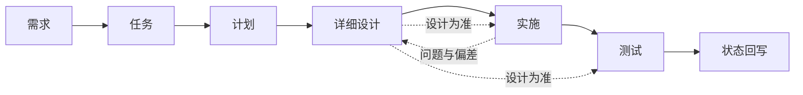

# AI 开发规范

> AI 协作开发总纲：阅读顺序 · 产出流程 · 详细设计核心 · 资料与资源

[文档首页](../文档首页.md) › 规范 › AI 开发规范　|　[同级：文档生成规范 →](文档生成规范.md)　[后端开发规范 →](后端开发规范.md)　|　[关联：项目管理规范 →](项目管理规范.md)

## 1. 目的与适用范围 

定义人类与 AI 协作开发本项目的**阅读顺序、产出顺序、留痕要求与红线**，使 AI 能独立、可复现地推进开发而不偏离既定文档体系。

- 适用于本工作区（bizs / cws）内全部开发活动；
- 与《[文档生成规范](文档生成规范.md)》及各类专项规范同时适用：**本规范管流程与顺序**，具体格式与字段以对应专项规范为准；
- 冲突时：专项规范 > 本规范（格式/字段层面）；本规范 > 习惯做法（流程/顺序层面）。

## 架构铁律（强制 · 先读） 

> **主体开发（平台内建主线）用继承保统一，项目二次开发 / 定制用组合保灵活**——两轨不互斥，汇入同一登记与契约体系。细则见《[前端开发规范](前端开发规范.md)》《[后端开发规范](后端开发规范.md)》「架构铁律」节与工作区 `AGENTS.md`。

1. **主体内建必须继承**：平台自有实现一律沿基类体系继承链派生（后端与前端**固定前三段：总基类 → 能力域基类 → 插件基类**，同名同序；其下每条链长短由功能与抽象需要决定，组件侧为 **组件根 → 能力基类 → 组件基类 → 具体件**）；**横切功能即继承链上的基类**；公共字段与方法只在链上对应基类维护；不得绕过链层另起炉灶，**不得在链外自由挂接功能**。**前端继承链全系统只有《[前端基类清单](../前端基类清单.md)》一份**，其他文档一律引用。
2. **二次开发 / 定制用组合**：不继承平台基类，经统一注册通道登记接入，不回改平台基类。
3. **两轨汇入同一体系**：同一注册表 / 登记清单 + 同一套契约测试（后端契约版本校验、前端契约用例工厂），**均须过契约测试**。
4. **依赖方向**：只准上层依赖下层，禁止反向依赖；层 / 能力之间的依赖须在登记表显式声明，禁止隐式自由挂接。
5. **口径返工教训**：继承 / 组合两轨口径历经多次返工（成因与处置见《知识档案 · 经验教训 · 体系口径返工》）。**AI 动手前必须核本铁律；发现文档口径与铁律冲突时，先报冲突、按铁律执行并回写冲突文档，不得沿旧口径继续实施。**

## 2. 阅读顺序（动手前必读） 

| 顺序 | 层级         | 入口                                                                            | 读取目的                                                                                                                                                                                                   |
| ---- | ------------ | ------------------------------------------------------------------------------- | ---------------------------------------------------------------------------------------------------------------------------------------------------------------------------------------------------------- |
| 1    | 本地资源     | 本地凭据文件与部署环境变量文件（均不入库）                                      | 知道可以调用哪些服务器 / 服务 / 账号与凭据入口；涉及具体操作的服务，再读`资料/开发服务器/` 下对应部署说明（入口《[开发服务器部署使用说明总览](../资料/开发服务器/linux/开发服务器部署使用说明总览.md)》） |
| 2    | 规划         | `bms文档/规划/`（项目规划说明、总体项目规划、开发部署规划、平台可扩展性规划） | 对总体有概念：范围、阶段、里程碑、约束                                                                                                                                                                     |
| 3    | 规范         | `bms文档/规范/`                                                               | 知道规矩与规则，避免返工                                                                                                                                                                                   |
| 4    | 设计         | `bms文档/设计/`（架构 / 概要 / 布局 / **数据库设计** / 组件 / 原型）           | 知道该朝什么方向做、大概做成什么样子；**涉及数据库或表设计时再读 `设计/数据库设计/`**：总览 → 数据规范（字段级通用约定）→ 方言特性（各库差异）→ 相关表文件 |
| 5    | 项目         | `bms文档/项目/{阶段}/`                                                        | 进入具体开发阶段                                                                                                                                                                                           |
| 6    | 需求         | `项目/{阶段}/需求/`                                                           | 具体需要做什么（需求分析：目标 / 边界 / 验收）                                                                                                                                                             |
| 7    | 任务         | `项目/{阶段}/任务/{NN}_{域名}/`                                               | 任务落实（WBS 拆解，可递归嵌套）                                                                                                                                                                           |
| 8    | 计划         | `项目/{阶段}/计划/`                                                           | 开发进度、先后顺序、依赖与里程碑                                                                                                                                                                           |
| 9    | 详细设计     | 任务目录内`设计/`                                                             | 本任务具体怎么做（开发核心文档）                                                                                                                                                                           |
| —   | 审计（按需） | `bms文档/规范/前端审计规范.md`、`bms文档/规范/后端审计规范.md`              | 审计任务（阶段收口合规审计 / 安全 / 性能 / 文档）启动时按端增读：流程、检查维度框架、报告规范与护栏沉淀要求                                                                                                |

## 3. 产出与执行流程 

1. **需求**：按《[需求文档规范](需求文档规范.md)》编写（背景与动机必填）；先做需求分析，明确范围、边界与验收标准。
2. **任务**：按《[任务文档规范](任务文档规范.md)》由需求生成子任务（可递归嵌套），关联需求编号，禁止无需求的任务。
3. **计划**：按《[计划文档规范](计划文档规范.md)》排期（依赖、窗口、工时、甘特）；嵌套子任务并入其直属父任务行。
4. **详细设计**：**先设计后编码**——设计须含交付物清单、接口 / 字段 / 边界与失败分支、测试设计与验收映射。
5. **实施**：严格按详细设计实施；实现过程、关键命令、遇到的问题与处置全部记录到实施文档。
6. **测试**：依据「详细设计 + 实施记录」设计测试用例（先登记 Kiwi TCMS 再编码），记录覆盖率、问题与偏差。
7. **回写**：进度（状态 / 工时 / 完成日期 / 排期窗口）只在**计划表**回写（唯一落点，需求与任务文档不承载进度）；**设计发生变更时先回写设计文档，再继续实施或测试**。

### 3.1 补充需求的处理方式 

开发中基于**架构设计**（`bms文档/设计/架构设计/`）深挖，识别尚未覆盖、且具「基座 / 公共封装 / 扩展点」性质的能力，按下列口径补充（「建得好，后面调整少」）：

1. **判别（不硬凑）**：候选须满足「会被多模块复用 + 现在能定接口 / 占位」；**明确属后续阶段内部实现的（如回收站恢复、中间件链等）不立项**，归对应阶段，必要时在计划「后续阶段待办」登记。
2. **需求**：在对应需求域文档按编号**顺延新增**（如后端基座 `02-17` 起），写背景与动机 / 内容 / 完成标准 / 参考文档，状态 `未开始`；同步需求总览计数与需求总清单。
3. **任务**：优先挂到**现有父任务**下作**嵌套子任务**（任务树可递归、可随时附加，不依赖序号连续）；无合适父任务才新建父任务；每个任务关联需求编号；工时与排期按「接口占位」口径登记于**阶段计划表**（进度唯一落点）。
4. **计划重排**：父任务因追加嵌套子任务而重开——状态改 `部分完成`、**从已完成表移回剩余排期**、工时按「自有 + 直属子任务合计」回写；表内「**偏差与遗留**」列跟踪处理情况及归口（防遗漏）。
5. **一致性回写**：进度只在**计划表**回写（唯一落点）；实施完成后按第 3 节流程回写。
6. **确认纪律**：补充范围、编号、挂载父任务、工时、排期窗口等逐项确认后再执行（见第 7 节「不擅动」）。

### 3.2 数据库与表设计的处理方式 

凡任务内容涉及**建表 / 改字段 / 加索引 / 方言差异 / 迁移**，除本规范第 3 节流程外，按下列顺序处理（口径见《[数据库开发规范](数据库开发规范.md)》「与数据库设计的关联与事实源」节）：

1. **先读设计**：`bms文档/设计/数据库设计/` 下按「总览 → 数据规范 → 方言特性（MySQL / PostgreSQL / 达梦）→ 相关表文件」读取；表结构只认表文件，**不复制字段清单**到需求 / 任务 / 详细设计等文档（一律相对链接引用）。
2. **表结构变更顺序（强制）**：**先改表文件**（含「变更记录」追加）→ 再改 ORM 模型 → 再建表落地（启动期自动建表 / `ops.init_schema`，见《[数据库开发规范](数据库开发规范.md)》「迁移与建表口径」节）→ 最后回写总览登记状态与表文件状态（两处一致）。历史迁移脚本已清空，迁移机制保留（按新基线重建脚本时才走迁移路径）。
3. **新建表**：先创建表文件并在《数据库设计总览》「已设计数据表登记」登记，再写模型并建表落地；未登记视为未定稿。
4. **通用约定**（公共字段、类型映射、时间、多语言附表、索引与唯一约束、分片与归档、库划分与建表归属）只在《数据规范》维护，表文件不重复；通用约定变更先改《数据规范》再传导。
5. **方言差异**（类型落点 / DDL / 空值语义 / 标识符与模式 / 索引与约束 / 事务与连接）：先在真库实测，再回写对应方言特性文档并标「**实测**」或「**待验**」；**未实测结论不得写入表文件或规范**。
6. **登记与校验**：表文件 ↔ 总览登记 ↔ 目录一致性、模型与链表集一致由基座校验脚本断言（见《[数据库开发规范](数据库开发规范.md)》「与数据库设计的关联与事实源」节）；实施记录须登记核对结论与偏差归口。
7. **连接与落点**：数据库连接串以**配置为唯一来源**（见第 7 节「配置唯一来源」红线）——新增 / 调整连接串只改 `config.toml` / `config.{env}.toml` / 部署环境变量，不在代码、脚本或 CI 写死；本地 SQLite 库文件统一落工作区根 `database/<仓库>/`（测试库 `database/bms/test`），切库只改 `[database].sqlite_dir` 基址，新增库目录不入库。

## 4. 详细设计的核心地位 

- 详细设计是**开发的核心文档**：实施、测试、验收一律以其为准；代码与设计不一致时，以设计为准（或先修订设计再改代码）。
- 任务开工前必须完成详细设计并逐项确认；设计须写清：边界与失败分支、接口契约、数据结构、测试设计与验收映射、与相邻任务的职责边界。
- 变更纪律：实施中发现设计偏差 → 在实施记录登记问题 → 回写设计（含对齐记录）→ 再推进；不得默默绕过。

## 5. 单任务交付「一条龙」 

单个开发任务（基座 / 接口占位类为其典型形态）从设计到收尾按固定链条一次走完，各步留痕、状态一致。链条内每一处待拍板事项均按第 3 节与第 7 节纪律**逐项确认**，不以推荐值或默认值擅自执行；**详细设计一经定稿即自动提交并自动续行后续各步，直至任务完成**——仅在两处停下：遇不清楚或需用户拍板之处（见「随时可停」），以及推送远程（见「提交与推送」）。

| 步                | 动作                                                                                                                                                                                                                                                                                                                                        | 留痕 / 产物         |
| ----------------- | ------------------------------------------------------------------------------------------------------------------------------------------------------------------------------------------------------------------------------------------------------------------------------------------------------------------------------------------- | ------------------- |
| 1 上下文          | 按第 2 节顺序读本地资源 → 规划 → 规范 → 设计 → 项目 → 需求 → 任务 → 计划；再读该任务相关架构节点；**界面类任务并列读对应可交互原型**（《[文档生成规范](文档生成规范.md)》8.5；原型即验收基准）                                                                                                                                                                                                                                     | —                  |
| 2 决策确认        | 该任务待拍板事项（代码落点 / 契约签名 / 数据契约 / 占位语义 / 常量 / 路由 / 测试编号等）用 question 工具逐项确认，推荐项在前                                                                                                                                                                                                                | —                  |
| 3 详细设计        | 任务目录`设计/` 落详细设计（交付物清单 / 接口与字段边界及失败分支 / 测试设计与验收映射 / 登记落点 / 边界与开放项 / 对齐记录）；**先设计后编码**；**定稿即提交（`docs(scope)`）并自动续行**                                                                                                                                  | 详细设计文档 + 提交 |
| 4 实施            | 按设计落代码（横切能力域一域一目录，依赖注入提供者 + 应用装配）；**不实现真实能力**                                                                                                                                                                                                                                                   | 代码                |
| 5 测试            | **先登记 Kiwi TCMS 用例取得编号**（分类 / 优先级 / 状态 / 标签 / `text` 字段与批量脚本模板见《[KiwiTCMS部署使用说明](../资料/开发服务器/linux/KiwiTCMS部署使用说明.md)》「用例约定」节与「用例登记（脚本化批量）」节），再写用例并在代码中标注用例编号；占位契约用护栏用例（依赖注入可解析、应用可启动、固定返回可断言）；**界面类任务另须对照原型核对**（截图识图逐页比对，见第 7 节「界面先原型」；结论登记测试记录） | 用例代码 + 平台编号 + 原型对照结论 |
| 6 验证            | 后端测试、lint、格式化检查、类型检查、基座校验**全绿**（命令与门禁口径见《[测试规范](测试规范.md)》与工程说明）；覆盖率达标（口径见第 7 节「覆盖率要求」），**本地跑满再交付，不靠 CI 兜底**                                                                                                                                               | 门禁结果            |
| 7 登记回写        | 架构（基类清单 / 横切基座 / 跨阶段基座契约表）、《后端基类清单》、《后端开发规范》「后端基座体系」节、计划（进度：状态 / 工时 / 完成日期 / 排期窗口，唯一落点 + 后续阶段待办 + 偏差跟踪）；**涉及数据库时另加**：《数据库设计》表文件（含变更记录）、总览「已设计数据表登记」状态、方言特性文档（实测结论）                                                                                                                                                         | 登记落点表          |
| 8 记录            | 任务目录`实施/`、`测试/` 各一份记录（信息 / 过程 / 问题与处置 / 验证 / 覆盖率 / 偏差与遗留）                                                                                                                                                                                                                                            | 实施记录 + 测试记录 |
| 9 提交            | **各仓库独立提交**；代码与文档分开（`feat(scope)` / `docs(scope)`）；只暂存本次任务相关文件；**链内自动执行**                                                                                                                                                                                                               | 提交                |
| 10 处理偏差与遗留 | 消费方任务文档补「前置契约（已交付）」/「协同契约」；计划 §3.1 与需求注块归口；记录遗留条闭环；**独立提交**                                                                                                                                                                                                                          | 闭环提交            |
| 11 收尾           | 推送按两级指令独立确认                                                                                                                                                                                                                                                                                                                      | 收尾                |

补充纪律：

- **随时可停**：链条推进中凡遇不清楚、或需用户拍板之处，**随时停下**，用 question 工具列出候选选项（推荐项在前、附差异说明）请用户选择后再继续——不必等整步走完，也不得以推荐值或默认值擅自越过。
- **编号对齐**：Kiwi 用例号以平台自增主键为准——**先在平台登记取得编号**，再回填代码内的用例编号标注与任务记录；平台既有编号不得复用或改派。
- **提交与推送**：一条龙链内各次提交（详细设计 / 代码 / 文档 / 偏差遗留闭环）**自动执行并自动续行**，无需逐步询问；仅**推送远程**需两级独立确认（说「提交」只做 commit、说「推送」只做 push）。链外任务仍按第 7 节与《[项目管理规范](项目管理规范.md)》询问是否提交。
- **闭环才算完成**：偏差与遗留未登记去向、下游消费方未标注，不得视为任务完成。

## 6. 资料与资源 

- **资料**（`bms文档/资料/`）：部署使用说明、技术资料与辅助文档统一存放。开发中需要而缺失的资料，**先去网上查找**；找到后在资料文件夹按《[文档生成规范](文档生成规范.md)》生成对应文档，以备以后直接使用与对照（版本、命令、步骤按实测记录）。
- **资源**（`bms文档/资源/`）：存放各类被各文件夹共享的资源文件（图片 / 音频 / 视频 / 公共样式等）；html 资产的资源放同级「资源」目录（见《文档生成规范》第 4/7 节）。
- **本地资源与凭据**：仅存 gitignore 文档（`用户文档/本地资源.md`、`deploy/.env`），不入库、不写入其他文档（公开文档红线）。
- **外部服务操作先读部署说明**：涉及具体服务与平台的操作（Kiwi 用例登记、服务部署与重建、备份恢复、数据库、远程唤醒 / 睡眠 / 关机等），**先读 `资料/开发服务器/` 下对应的部署使用说明再动手**——命令模板、字段口径与排障结论均在文档中，不得凭记忆下手；入口见《[开发服务器部署使用说明总览](../资料/开发服务器/linux/开发服务器部署使用说明总览.md)》。
- **动手前定向检索**：进入实施 / 编码 / 外部操作前，先按本次任务关键词（服务名、动作名、能力域、技术主题）在 `资料/开发服务器/`、`资料/知识档案/`、`设计/架构设计/` 定向检索，命中即先读。资料类文档为**辅助参考**（会过时、不具强制力），读后须结合当前现状自行判断；强制口径只认 `规范/` 下的规范文档。项目的坑与来龙去脉多已沉淀在资料中，检索仍是成本最低的避坑手段。

## 7. 红线与纪律（强制） 

- **不跳步**：不得越过「规划 → 规范 → 设计 → 项目 → 需求 → 任务 → 计划 → 详细设计」直接编码；无需求不建任务，无设计不开工。
- **界面先原型**：**界面类开发**（页面 / 布局 / 框架组件 / 交互形态，含其样式呈现）**开工前须有对应的可交互原型**（`bms文档/设计/原型设计/`，形态与规则见《[文档生成规范](文档生成规范.md)》8.5）——**无可交互原型不得进入详细设计与实施**；原型与《布局设计》冲突以布局设计为准（《[原型审查规范](原型审查规范.md)》）。**原型即验收基准**：界面验收以对应原型为准，原型未覆盖的界面须先补原型再实现；原型暴露的功能 / 流程问题先修订概要设计、再同步原型，不得反向先改代码。**机器门禁（强制）**：`scripts/tools/base_check/check_prototype_review.py` —— 变更集含界面源码（`frontend/apps/desktop/src/{views,components,layouts}`、`frontend/packages/ui_ep/src`、`*.vue`）时，必须有「原型对照结论」（原型依据引用且文件存在 + 逐页表 + 结论 + 截图；纯逻辑改动可写「不适用」+ 理由），已并入 `preflight --fast` 与 CI `base-integrity`；缺口即阻断推送。
- **不臆造**：版本、命令、接口、结论必须实测或查证；不确定时先查资料并落文档。
- **不擅动**：破坏性操作、范围外改动、提交与推送，先逐项确认（《[项目管理规范](项目管理规范.md)》与工作区约定）。
- **测试产物复用不开口子**：一切针对构建产物的测试**必须消费已构建的固定版本产物、只跑受变更影响的部分**（《[测试规范](测试规范.md)》「被测物与执行范围」节）；**不得以「这次情况不一样」为由自行绕过或另起源码 / 临时构建物**——确需例外的，先向用户逐项说明并确认，未确认不得实施。
- **重命令不重跑**：分钟级 / 数十秒级的重命令（预检、全量或多目录 pytest、全仓 ruff / pyright）**一律经 `scripts/tools/preflight/run_once.py` 包装**调用——缓存键 =「命令 + 工作目录 + 工作区指纹」，窗口内（缺省 30 分钟）命中即回放上次完整输出与退出码；改完代码想立刻重验加 `--force`，只看缓存状态用 `--show`。**禁止为「从输出里挑几行报错」整轮重跑**——第一次已给出结论后，改看具体报错一律用**定向**命令（单文件 `ruff check` / `pyright`、单文件或窄目录 `pytest`，秒级出结果）。**机器门禁（强制）**：`scripts/tools/preflight/heavy_command_guard.py` —— 本地非 CI 环境未经包装跑上述重命令**立即报错、命令零执行**，并打印该用的包装命令；逃生开关 `ENGKIT_ALLOW_UNWRAPPED=1`（仅用于排查 run_once 自身问题）。`.pth` 启动钩子由 `scripts/tools/preflight/install_guard_hook.py` 安装（依赖重装后需重跑）；`ruff` 为原生二进制，Python 层钩子无法覆盖，靠本节约束与预检兜底。
- **不泄露**：公开文档不出现本地资源信息；凭据不入库。- **配置唯一来源**：数据库连接串（含 SQLite 相对路径、库文件示例）只经 `Settings`（`[database]`，含 `sqlite_dir` 基址）读取；**代码 / 脚本 / CI 一律不得写死连接串或库路径**，改配置即可切库。本地库文件统一放工作区根 `database/<仓库>/`（bms 为 `database/bms`，测试库 `database/bms/test`），**不与代码混放**，`database/` 不入库。
- **可追溯**：需求 ↔ 任务 ↔ 计划 ↔ 设计 ↔ 实施 ↔ 测试 链路留痕完整；进度以**计划表**为唯一落点（需求 / 任务文档不承载进度）。

### 覆盖率要求（唯一权威口径） 

- **门槛 = 100%，维度 = 行 + 分支**（后端 pytest-cov、前端 Vitest coverage 同口径）。
- **本要求只在此定义一处**：其他规范、规划、设计、README 与 CI 注释一律引用本节（写「覆盖率口径见《AI开发规范》『覆盖率要求』节」），**不得再复述数字**。
- **开发环 / 推送环分两段执行**：开发期间改完即测用**开发环**（`scripts/tools/preflight/测试改动内容.sh`，等价 `engkit run-changed`）——只跑 git 改动相关的直接依赖测试与前端受影响包，**不采集覆盖率**、只对改动文件跑 ruff，并按仓侧 `[[devloop.steps]]` 声明的**附加步骤**跑**增量护栏**（裸集合 / 产品字面量 / 服务边界带 `--files-from`、工作区卫生）与**改动文件 pyright**；**推送前**跑**推送入口**（`scripts/tools/preflight/推送.py`，等价 `engkit push`）——它先跑预检（定向档：覆盖率门禁 + **全量**静态），通过后**自动推送**，不通过即中止。分工口径：**增量只用于开发环**，且仅对**文件局部判据**成立——服务边界按判据分层：逐文件判据（跨服务 import / 分层反向依赖 / 跨包私有引用 / 表声明与跨域引用）按改动清单裁剪，全局判据（表名与前缀跨服务唯一、归属登记对账、例外与归属双字段、ops 镜像闭包、域文件覆盖与布局形态、基线陈旧）**恒全量**，触碰布局 / 基线 / 例外 / 归属登记 / 目录登记或清单内有已删除文件时**整体升为全量**；基线对账、未归属判定等全局断言只在推送入口与 CI 做；表声明索引缓存（`table_index_cache`）只服务于开发环提速，**预检的该步骤固定带 `--no-cache`**，权威门禁不信缓存。开发环跳过覆盖率**不算**破坏本节门禁，门禁以推送入口为准（漏测由预检的传递闭包选测与 CI 全量兜底）。
- **预检 = 推送的内部步骤，本地没有独立入口（机器强制，2026-10-29 二次拍板）**：**预检不再是命令**——本地手动调用 `engkit preflight` 一律拒绝（退出码 2，零步骤执行），只有两种路径能触发：① 推送入口 `engkit push`（先预检、通过才推送）；② CI 环境（流水线必须能跑）。**档位由待推提交自动选**：全为文档（`[push].doc_globs`，如 `*.md` / 图片）→ **快速档**（静态 + 护栏，秒级）；含代码 / 配置 → **定向档**（静态 + 定向用例 + 覆盖率门禁）；`--full` 显式全量。`push --check` 是「只跑预检、不推送」的唯一出口。**闸门**：工作树有未提交改动（含未跟踪文件）即拒绝——推送前的工作树本就应当干净，**不再有 `--allow-dirty` 之类的逃生口**。**审计**：真跑 / 被拒两类事件逐条落 `<仓根>/.cache/preflight/audit.jsonl`（写盘失败 fail-open）。闸门与档位判定都在 `engkit` 包内实现，各仓 `engkit.toml` 只放开关与推送配置（`[preflight.gate]` / `[push]`）。

  > 2026-10-29 首版只判「工作树是否干净」，实测被「开发中间过程也先提交、再调预检」整条绕过（当日 14 次真跑、41 分钟、5 次以失败告终，全部是「改→跑→失败→改→再跑」）。判据因此从「是否已提交」换成「是否真要推送」：只有推送入口能触发预检。
- **纯声明模块用「可导入 / 可解析」护栏用例覆盖，禁止 `pragma: no cover` 或 `omit` 绕过**：域公共出口（`domains/*/public.py` 的空占位）、模型模块清单（`models/__init__.py` 的 `MODEL_MODULES`）不承载运行期逻辑，业务用例天然不触达，单服务跑覆盖率时必然整模块缺失（2026-10-28 九个服务 `service-test` 实测）。做法是加护栏用例——基座侧 `bms_core/tests/crosscut/test_domain_public_exports.py` 与服务侧 `<服务>/tests/test_package_shape.py` **各一份**（服务子流水线只收集本服务 `tests`，基座侧用例覆盖不到），公共解析收在 `tests_support/package_shape.py`。`omit` 会把该文件将来放入的真实逻辑一并漏统计；`pragma: no cover` 容易在放入内容后忘记移除。模型清单用例走迁移链同一入口（`service_model_modules`），清单写错 / 模块缺失即刻失败，而不是等迁移期才发现。

> 落地命令、门禁 job、校验脚本与推进节奏属工程实现，不在本规范展开。

## 8. 检查清单 

- □ 动手前已按第 2 节顺序完成阅读（资源 → 规划 → 规范 → 设计 → 项目 → 需求 → 任务 → 计划 → 详细设计）
- □ 需求含背景与动机；任务关联需求；计划排期与依赖完整
- □ 开发任务先有已确认的详细设计，实施 / 测试均以其为准
- □ 界面类任务开工前已有对应**可交互原型**（详细设计登记原型依据），验收以原型为基准
- □ 实施过程与问题已记录；测试用例基于设计与实施且先登记 Kiwi
- □ 构建产物测试（镜像 / 产物）已消费**固定版本产物**且**只跑受变更影响的部分**，未以「情况不同」绕过（例外已上报确认）
- □ 覆盖率达标（口径见第 7 节「覆盖率要求」）——**本地跑满再推送**，未靠 CI 兜底
- □ 已按任务主题在 `资料/`（部署说明 / 知识档案）与 `设计/架构设计/` 定向检索，并读过命中文档
- □ 涉及外部服务 / 平台的操作（如 Kiwi 用例登记）已先读 `资料/开发服务器/` 下对应部署说明
- □ 新资料已落 `资料/`；共享资源已放 `资源/`；无红线违规
- □ 补充需求已按第 3.1 节判别（不硬凑）、顺延编号、挂现有父任务、同步计划与状态两处
- □ 单任务交付已按第 5 节「一条龙」链条闭环（设计 → 实施 → 测试 → 验证 → 登记 → 记录 → 提交 → 偏差遗留 → 收尾）
- □ 涉及数据库 / 表设计：已按第 3.2 节读取数据库设计体系，表结构变更先改表文件（含变更记录）→ 模型 → 建表落地（启动期自动建表 / `ops.init_schema`）→ 状态两处回写
- □ 方言差异结论已真库实测并回写对应方言特性文档（标「实测」或「待验」）；未实测结论未写入表文件或规范
- □ 新增 / 变更表已在《数据库设计总览》登记，且表文件 ↔ 登记 ↔ 目录一致性校验通过
- □ 数据库连接串经**配置**读取（无代码 / 脚本 / CI 写死）；本地库文件统一 `database/<仓库>/` 且 `database/` 已忽略
- □ 写 / 改设计文档与规范时遵守《[文档生成规范](文档生成规范.md)》「架构节点的语义与实现分层」节：架构节点只写语义；实现细节落实现侧清单与详细设计；规范只写全局原则与强制口径，不含技术细节（举例除外）；**组件设计节点只写通用组件的语义与契约边界**——实现侧命名与落点见《[前端基类清单](../前端基类清单.md)》、实现契约细节见项目详细设计

> 依《文档生成规范》编写 · 与《项目管理规范》《文档生成规范》及各类专项规范配套
