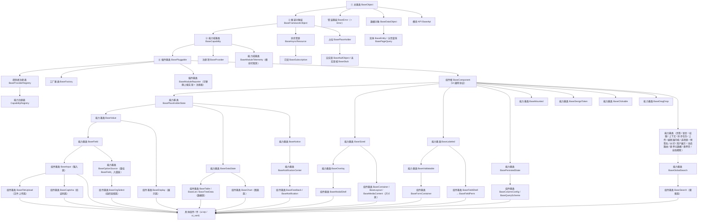
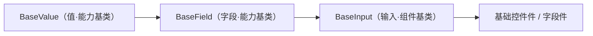

# 前端基类体系说明

> 前端基类体系的定位与口径、继承链总览、固定四段、组件根与资源占位错误基座、演进扩展与维护约定。**全量基类登记表见《[前端基类清单](../../前端基类清单.md)》**；**继承链与目录依赖见《[前端基类实现契约](前端基类实现契约.md)》**；**迁移映射见《[前端基类治理台账](前端基类治理台账.md)》**。

[文档首页](../../文档首页.md) › [前端基类清单](../../前端基类清单.md) › 前端基类体系说明

---

## 1. 体系口径与维护流程

### 1.1 体系口径（参照后端基类体系） <a id="positioning"></a>

**前端基类体系与后端基类体系同构**：**总基类 → 框架对象层 → 功能基类（能力域基类）→ 插件基类**为**固定的四段**（对后端 `BaseObject` → `BaseFrameworkObject` → `BaseCapability` → `BasePluggable` 09_02 起）；其下**每条继承链按功能与抽象需要自行延伸、有长有短，不设固定层数**。

- **主体内建必须继承**：平台自有实现一律沿《前端基类清单》的继承链派生；**公共字段与方法只在链上对应基类维护**，任何组件与模块不得重复实现；**不得绕过链层另起炉灶、不得在链外自由挂接功能**。
- **零例外**：一切基类从**总基类 `BaseObject`** 派生（错误基座亦入链，见 §6.3）。
- **固定四段（强制）**：① **总基类 `BaseObject`**（一切基类之根：命名空间 / 日志 / 错误上报 / 配置读取 / 生命周期）；② **框架对象层 `BaseFrameworkObject`**（框架对象统一标识 `objectKind`；对齐后端同名基类 09_02 起）；③ **能力域基类 `BaseCapability`**（能力键与依赖登记）；④ **插件基类 `BasePluggable`**（实现名 / 契约版本 / 注册与解析 / 生命周期）——四段之后，各链自由延伸。
- **能力基类 → 组件基类（强制顺序）**：**能力基类**承载正交横切功能（值 / 字段 / 尺寸 / 数据状态 / 浮层 / 通知 / 标签 / 校验 / 持久化 / 令牌 / 挂载 / 可点击 / 拖拽 / 页签 / 语言 / 权限 / 上下文 / 上传 / 编辑器内核 / 选项源 …）；**组件基类**在能力基类之后，形成一类组件的身份骨架（输入 / 展示 / 表格 / 列表 / 树 / 模态 / 表单容器 / 容器 / 布局 / 媒体 / 反馈 / 字段壳 …），**继承相应的能力基类**；具体组件 / 件继承组件基类。全链另立组件根 `BaseComponent`（所有 UI 组件的公共协议）作为组件侧入口。
- **相似基类抽公共段**：两个基类有公共部分 → 提取**能力基类**承前启后；两个能力基类仍有公共部分 → **继续提取**（如 `BaseSized` 承载容器 / 布局 / 媒体的尺寸档位）。
- **插件化（纵向可替换）**：与平台《[扩展点与插件化](../架构设计/10_架构设计_子系统_扩展点与插件化.md)》§3 / §7.1 同构——能力域基类（能力键）→ 插件基类（实现名 / 契约版本 / 注册与解析 / 生命周期）→ 注册表（`BaseProviderRegistry` / 注册项 `BaseProvider`）→ 默认实现 / 内建实现 / 定制实现。
- **双轨（继承 + 组合）**：平台内建走继承轨（定义即登记 + 契约测试）；项目二次开发 / 定制走组合轨（注册通道登记接入、不继承平台基类、不回改平台基类）；两轨汇入同一登记与同一套契约测试。
- **命名对齐后端**：通用基类与后端**同名同职责**（`BaseObject` / `BaseCapability` / `BasePluggable` / `BaseProviderRegistry` / `BaseProvider` / `BaseAsyncResource` / `BasePlaceholder` / `BaseNullObject` / `BaseStub`）；前端特有族按功能命名，不强行造无对应的基类。

### 1.2 状态取值 <a id="status"></a>

`已交付` / `部分` / `占位` / `待交付`——与平台架构节点登记一致。

### 1.3 维护流程 <a id="maintain-flow"></a>

新增 / 调整基类走：**候选 → 设计节点（组件设计）→ 评审确认 → 《前端基类清单》登记 → 代码登记 + 契约用例 → 《架构设计 · 前端组件体系》同步**；状态列随实施回写。历史旧体系内容（`src/base`、`src/components/base` 能力片段层、`useXxx` 组合式能力）已随移动端（S4c）与 PC 宿主（S6）删除，历史经 git 追溯（专项 `02_07`）。

## 2. 继承链总览

```text
前端基类继承链（全系统唯一权威源 · 见《前端基类清单》）
│
├─ 固定四段（强制）                                                        # §3
│  └─ BaseObject 总基类 → BaseFrameworkObject 框架对象层 → BaseCapability 能力域基类 → BasePluggable 插件基类
│
├─ 插件基类之下（平行支线）                                                # §4
│  ├─ BaseProviderRegistry 提供者注册表 → CapabilityRegistry / 各扩展点注册表
│  ├─ BaseProvider 注册项（挂能力域基类）
│  └─ BaseFactory 工厂基类 → 各域工厂基类 → 具体工厂类
│
├─ 组件侧（组件根 → 能力基类 → 组件基类 → 具体件）                          # §5
│  ├─ BaseComponent 组件根（UI 通用协议：透传 / 尺寸密度 / 令牌属性 / 生命周期）
│  ├─ 能力基类：BasePlaceholderState · BaseValue · BaseField · BaseSized · BaseDataState · BaseOverlay
│  │            BaseNotice · BaseLabeled · BaseValidatable · BasePersistedState
│  │            BaseMounted · BaseDesignToken · BaseClickable · BaseDragDrop
│  │            BaseTabs · BaseLocale · BaseAccess · BaseModuleContext · BaseModuleApi · BaseAsyncTask
│  │            BaseUploadEngine · BaseEditorKernel · BaseOptionSource · BasePresignedUrl
│  │            BaseWatermark · BaseUserDisplay · BaseDynamicRoutes · BaseFormMeta · BaseFormPage
│  │            BaseWizard · BaseSelection · BaseBulkAction · BaseTheme · BaseTenant · BasePrintTemplate · BasePrint
│  │            BasePermissionConfig · BaseFileDownload · BaseImportFlow · BaseExportFlow · BaseFormDesigner
│  │            BaseFormRenderer · BaseMessageCatalog
│  │            BaseApprovalFlow · BaseProcessModeler · BaseReportDesigner
│  │            BaseScreenDesigner · BaseScreenPlayer · BaseAiAssistant · BaseGlobalSearch
│  └─ 组件基类（继承相应能力基类）：BaseInput · BaseDisplay · BaseTable · BaseList · BaseTreeData
│                 BaseModalShell · BaseFormContainer · BaseContainer · BaseLayout · BaseMediaContent
│                 BaseFeedback · BaseNotification · BaseColumnConfig · BaseQueryScheme
│                 BaseFieldShell · BaseFieldPerm · BaseChart · BaseSearch · BaseOrgSelect
│
├─ 资源 / 占位 / 错误（挂总基类，对齐后端）                                 # §6
│  ├─ BaseAsyncResource 异步资源 → BaseSubscription 订阅
│  ├─ BasePlaceholder 占位 → BaseNullObject 空实现 / BaseStub 未实现桩
│  └─ BaseError 错误基座（extends BaseObject + Error）
│
└─ 契约基类                                                               # §7
   ├─ BaseApi 模块 API（→ 总基类）
   └─ BaseDataObject 数据对象 → BaseEntity 实体 / BasePageQuery 分页查询
```

## 3. 继承链全景



> 图只画主要分叉；完整父子关系以 §2.1 全量表「父基类」列为准。

## 4. 固定四段

> **固定（强制）**：`BaseObject`（总基类）→ `BaseFrameworkObject`（框架对象层）→ `BaseCapability`（能力域基类）→ `BasePluggable`（插件基类）——与后端基类体系逐段对应；四段之后各链自由延伸，**不设固定层数**。

### 4.1 总基类 `BaseObject` <a id="root"></a>

- **形态**：类（非抽象）；**一切可继承的前端基类默认从其派生（零例外）**。
- **提供**：命名空间 / 版本、日志（`log`）、错误上报（`reportError`）、配置读取（`getConfig`）、生命周期（`dispose`）——**公共方法唯一落点**。
- **约束**：只放「所有基类共有」的横切职责；任一方的特有逻辑（UI 协议、数据访问流程、框架绑定）不得上提。
- **现状**：已交付（`frontend/packages/core/src/base/BaseObject.ts`）。

### 4.2 框架对象层 `BaseFrameworkObject` <a id="framework-object"></a>

- **形态**：类，继承总基类；**体系固定第 2 层**（对齐后端 `BaseFrameworkObject` 09_02）。
- **提供**：**框架对象统一标识** `objectKind`（子层覆写，如 `capability` / `component` / `registry` / `resource`）；非渲染 / 非数据对象语义；生命周期沿用总基类 `dispose()` / `onDispose()`（不在本层重复定义）。
- **约束**：只承载「框架对象共有」的横切标识，**不含 UI、数据与业务语义**；数据 / 契约类（`BaseApi` / `BaseDataObject` / `BaseEntity` / `BasePageQuery`）**不属框架对象**，仍直承总基类（前后端差异以各端清单为准）。
- **现状**：已交付（`frontend/packages/core/src/base/framework-object.ts`）。

### 4.3 能力域基类 `BaseCapability` <a id="capability"></a>

- **形态**：类，继承框架对象层；**体系固定第 3 层**（对齐后端 `BaseCapability`）。
- **提供**：**能力键声明与依赖登记机制**——`key`（snake_case 口径）、`depends` 依赖登记、单向校验（依赖已登记 / 无环 / 键名合法）、开发态告警（违规默认告警，`strict` 抛 `BaseError`）、`describe()` 元信息。
- **约束**：只做「能力如何声明、如何登记、如何被校验」，**不含任何 UI 或业务语义**；登记源为能力依赖登记表（`capabilities/manifest.ts`）。
- **现状**：已交付（`mechanisms/capability.ts`）。

### 4.4 插件基类 `BasePluggable` <a id="pluggable"></a>

- **形态**：类，继承能力域基类；**体系固定第 4 层**（对齐后端 `BasePluggable`）。
- **提供**：可替换实现的装配语义——**能力键 / 实现名 / 契约版本 / 注册与解析 / 生命周期 / 元信息**；与平台《[扩展点与插件化](../架构设计/10_架构设计_子系统_扩展点与插件化.md)》§3「基类承载与双轨」同构。
- **约束**：注册与解析统一走提供者注册表基座（§4），**不注册不可用**；插件基类只承载装配语义，不含具体实现。
- **现状**：已交付（`mechanisms/pluggable.ts`）。

## 5. 组件根与组件侧顺序

- **形态**：类，继承插件基类；**所有 UI 组件的公共协议**（组件侧入口）。
- **提供**：标识（`identifier`）与命名空间类名（`nsClass`）、尺寸 / 密度、`loading` / `disabled` / 显隐、**令牌属性协议**（`data-size` / `data-density` / `aria-*` + 状态类，`rootAttrs`）、attrs 透传（`passthroughAttrs`，保留键过滤）、运行期字段（`setProps`）、生命周期通知（`notifyLifecycle`）、机制装配点（`mechanisms`）。
- **约束**：纯数据输出（不触 DOM、不依赖渲染框架）；档位只写根元素属性、状态只加状态类；组件只消费令牌语义变量，**不得硬编码色值与尺寸**（豁免项见《[前端开发规范](../../规范/前端开发规范.md)》§3.1）。

## 6. 资源、占位与错误基座

> 三者**挂总基类**（对齐后端 `BaseAsyncResource` / `BasePlaceholder` / `BizError`），不经能力域基类与插件基类。

### 6.1 异步资源与订阅 <a id="resource"></a>

- `BaseAsyncResource`（继承 `BaseObject`）：登记 / **逆序释放** / 幂等 / 释放后拒绝登记；订阅、定时器、请求取消、编辑器实例共用。
- `BaseSubscription`（继承 `BaseAsyncResource`）：`topic` 点分小写（与后端事件表同源）、来源解耦（占位总线 / 本地 / 实时），取消函数登记为异步资源（卸载自动取消）。

### 6.2 占位三件 <a id="placeholder"></a>

- `BasePlaceholder`（继承 `BaseObject`）：三类原因（`pending` / `null` / `stub`）× 三类降级（`empty` / `disabled` / `hidden`）；**占位不请求、不写缓存、无副作用**。
- `BaseNullObject`（继承 `BasePlaceholder`）：空实现（Null Object，无副作用、恒定返回）。
- `BaseStub`（继承 `BasePlaceholder`）：未实现桩，`_not_implemented()` 统一抛错。

### 6.3 错误基座 `BaseError` <a id="error"></a>

- **形态**：类，**多重继承** `BaseError extends BaseObject, Error`——**本体系唯一的多重继承项**，与后端 `BaseSchema → (pydantic.BaseModel, BaseObject)` 同类先例；既入继承链由总基类派生，又保留原生 `instanceof Error` 与堆栈。
- **提供**：`code` / `userMessage`、提示映射（i18n `error.{code}`）、上报委托总基类。
- **约束（不放开滥用）**：仅错误基座可使用多重继承；新增多重继承须经评审并在《前端基类清单》逐项登记。**「错误基座不入继承链」的旧例外条款已废**——本体系为零例外（《[前端开发规范](../../规范/前端开发规范.md)》§3.1 已同步）。

## 7. 演进与扩展

### 7.1 口径修正（第三次） <a id="evolve-capability"></a>

原体系把横切功能做成「**能力片段 + 组合式调用**」（31 个平级类 + `useXxx` 组合式），导致功能平铺、无层次、无统一管理；第二次修正改为「能力入继承链 + 固定分层」仍未对齐后端。**《前端基类清单》最终口径：完全参照后端基类体系**——固定前三段（总基类 → 能力域基类 → 插件基类），其后**能力基类 → 组件基类 → 具体件**逐级细化，各链长短不一；**「能力类」这一实体不再存在**（`BaseCapability` 仅作为能力域基类 / 能力声明机制）。**不允许再退回能力片段口径或固定分层口径**。

### 7.2 扩展规则 <a id="extend-rule"></a>

- **新增横切功能 → 新增能力基类**：定其父基类（组件根或已有能力基类）；**两个基类出现公共段 → 提取能力基类承前启后**；不改总基类与固定三段。
- **新增组件族 → 新增组件基类**：继承相应能力基类（无合适能力基类时先补能力基类），登记《前端基类清单》。
- **新增可替换实现（纵向）→ 继承插件基类 `BasePluggable`** 并经提供者注册表登记；扩展点注册表统一基于 `BaseProviderRegistry`，注册项继承 `BaseProvider`。
- **新增即登记**：候选 → 组件设计节点 → 评审确认 → 《前端基类清单》登记 → 代码登记（能力依赖登记表 `capabilities/manifest.ts`）+ 契约用例 → 《架构设计 · 前端组件体系》同步；**未登记的基类不得散落在具体组件内重复实现**。
- **兼容性**：新增基类 / 中间层为兼容变更；调整既有基类契约（行为 / 参数 / 事件）须评估使用方并升**主版本**标注（组件设计节点与《前端基类清单》同步）。

### 7.3 加层演练（真实案例） <a id="evolve-example"></a>

最初「输入 / 展示」在形态与域两处出现、职责打架。处理方式是**按功能拆成链上的独立基类**：`BaseValue`（值归一 / 格式化 / 三态 / `change`）与 `BaseField`（字段标识 / 校验触发 / 字段上下文）作为**能力基类**，输入形态再作为**组件基类** `BaseInput` 挂在 `BaseField` 之下；后续出现新横切职责时按同一办法新增能力基类（如 `BaseSized` / `BaseNotice` / `BaseDataState`），**不动既有链**。



## 8. 维护约定与护栏

- **继承链唯一（强制）**：前端继承链**只在《前端基类清单》维护一份**；规范 / 架构 / 组件设计 / 任务与产品文档**一律引用**《前端基类清单》，不得重复描述继承关系（重复即口径漂移源）。发现重复描述时**改为引用**并在《前端基类清单》登记变更。
- **同步范围**：新增 / 调整基类须同步《前端基类清单》（§2.1 全量表 + 对应章节）+ 《组件设计》对应节点（契约与原型）+ 平台《架构设计 · 前端组件体系》与《扩展点与插件化》§7 登记 + 相关任务文档；《前端基类清单》状态列随实施回写。
- **护栏**：
 - 核心框架无关由 `guard-core-framework-agnostic`（`frontend/packages/core/tests/`）随 CI `core-check` 校验；
 - **注释齐备**由 `guard-jsdoc`（`frontend/packages/core/tests/`，模块头 / 导出定义 / 类与接口成员均有 JSDoc）随 CI `core-check` 校验；
 - 「同契约多实现」由契约用例工厂 `@bms/core/testing` 保证（各插件 spec 跑同一套断言）；
 - **清单 ↔ 代码对账护栏（新体系版）**：`guard-base-registry`（`frontend/packages/core/tests/`）双向校验「《前端基类清单》 §2.1 + §4 ↔ 核心源码定义 ↔ 核心入口具名导出 ↔ 插件与宿主导入」——漏登记 / 僵尸条目 / 僵尸位置 / 父基类口径漂移 / 未导出 / 未登记引用六面零差集（含 fixture 拦截），随 CI `core-check` 执行。
- **机制未挂接评估**：保持**开发态告警**、不升级构建期硬失败（基类允许脱离组件根独立实例化；再评估条件随新护栏批次）。
- **状态回写**：实施完成后回写《前端基类清单》「状态」列与平台架构节点；待交付项（插件基类族 / 能力基类 / 组件基类 / 契约上提）随前端阶段更新。
