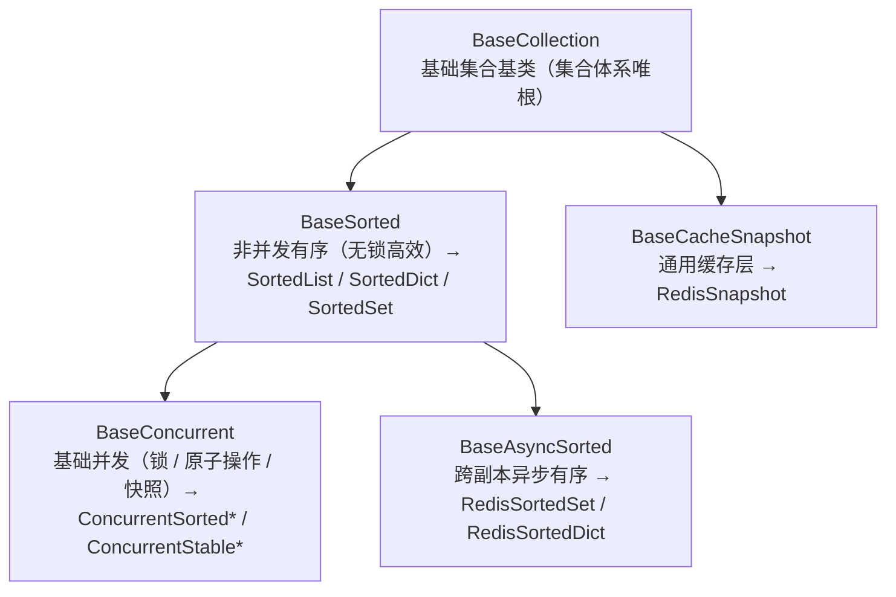
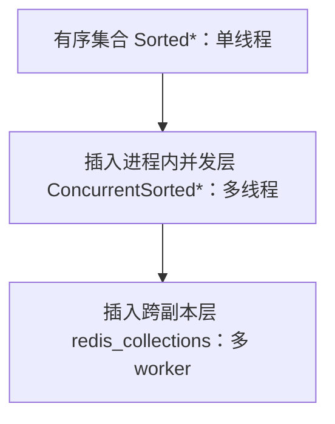

# 后端基类体系说明

> 后端基类体系的定位、分层口径、集合体系结构、跨端命名对照、扩展演进与维护约定。**基类登记表见《[后端基类清单](../../后端基类清单.md)》**；**逐类契约与继承链见《[后端基类实现契约](后端基类实现契约.md)》**；**护栏、基线、非基类实现登记见《[后端基类治理台账](后端基类治理台账.md)》**。

[文档首页](../../文档首页.md) › [后端基类清单](../../后端基类清单.md) › 后端基类体系说明

---

## 1. 定位与体系口径

- **定位**：后端基类**权威清单**——回答「有哪些基类、在哪一层、什么职责、代码在哪、是否已交付」。**强制用法口径与扩展规则**见《[后端开发规范](../../规范/后端开发规范.md)》「后端基座体系（强制）」节；体系机制见平台《架构设计 · 后端基础类体系》；详细契约见对应详细设计。
- **口径**：所有可继承的后端类收敛为一套分层体系（根系 根基类 + 集合体系 / 模块基类 / core 横切 / 跨阶段基座 + 中间层基类）；**公共字段/方法只在对应层基类维护，任何模块不得重复实现**；调整某一层基类即全链生效。
- **状态取值**：`已交付` / `占位`（接口或结构就位、真实实现待回补）/ `待交付`（已设计未落地）；与平台架构节点登记一致。
- **维护**：新增/调整基类须同步《后端基类清单》 + 平台《架构设计 · 后端基础类体系》登记 + 对应阶段任务基座登记 + 相关详细设计；状态列随实施回写。
- **代码路径口径（工作区化）**：《后端基类清单》「代码位置」为**包根相对路径**——共享基座库路径根为 `backend/libs/bms_core/src/`（`bms_core/...`），各服务路径根为 `backend/services/<服务>/src/`（平台服务包 `bms_<服务>/...`，产品服务包 `{包前缀}_{服务}/...`——包前缀经 `[app].package_prefix` 配置，12_04）；02_03 拆分后共 8 个**平台**服务：platform / identity / tenant / file / notification / search / ai / report（`org` 已退役，组织主数据归 mdm 产品服务）；工程结构与依赖方向见《[后端开发规范](../../规范/后端开发规范.md)》「目录与分层职责」节。

## 2. 根系 根基类

- **形态**：普通类 `BaseObject`（非 ABC，可被 SQLAlchemy 声明式基类等混合继承）；**所有可继承的后端类默认从其派生**（模块基类、集合类、中间层基类）。
- **提供**：公共方法唯一落点——序列化、稳定序序列化、统一字符串输出、主键相等与哈希；序列化取字段**声明字段优先**（dataclass → `dataclasses.fields`；Pydantic → `model_dump()`；其余 → `__dict__` 兜底）；不含任何业务或框架语义。
- **约束**：只放「所有后端类共有」的横切能力；任一方的特有逻辑（数据访问流程、序列化配置、并发保护）不得上提 根系。
- `ValueHolder`：`get_locked` 类上下文内可替换的值容器（进程内与 Redis 复用）。

## 3. 集合体系（非并发有序 / 基础并发 / 跨副本 / 通用缓存）

集合是后端公共数据形态，**唯一继承链**——**所有集合类一律（间接）继承基础集合基类 `BaseCollection`、无任何例外**；层数与形态随需扩展（见「扩展与演进」节）：

**模块拆分与「无依赖面」（08_02）**：升序形态基于第三方 `sortedcontainers`，**单列** `core/sorted_collections.py`（`Sorted*` 与 `ConcurrentSorted*`）；体系根与有序公共段（`core/collections.py`）与基础并发层 / 插入序形态（`core/concurrent.py`）**只依赖标准库**。CI `base-integrity` 的精简镜像（`python:3.14-slim`，不装依赖）会导入基座模块做边界校验（`check-service-boundaries.py` → `boundary/` → `services/` 注册表），故 `core/collections.py` 与 `core/concurrent.py` 构成集合体系**「无依赖面」**——**不得**引入第三方依赖（依赖止步于 `core/sorted_collections.py`，业务侧导入链保持 stdlib-only）。

| 形态 | 基类 / 封装 | 代码位置 | 职责 |
| --- | --- | --- | --- |
| 基础集合基类（**集合体系唯根**） | `BaseCollection` | `core/collections.py` | 集合通用**语义约定**：有序语义 + 对外输出稳定序（禁止裸无序集合）+ `collection_kind` 标记；**所有集合类一律继承本根、无任何例外** |
| 非并发有序（无锁高效） | `BaseSorted` → `SortedList` / `SortedDict` / `SortedSet` | `core/collections.py`（`BaseSorted`）+ `core/sorted_collections.py`（`Sorted*`） | 进程内**无锁**有序：稳定序列化 / 排序视图 / 分批 / 集合运算（同步读）；`Sorted*` 为无锁高效形态，也是并发形态的数据底座——**业务与契约不得直接声明 / 继承**（业务排序走排序契约） |
| 基础并发 | `BaseConcurrent` | `core/concurrent.py` | 锁策略守卫 + 原子复合操作 + 快照遍历模板（`BaseSorted` 之**并发子层**，承载 `LockStrategy` 显式传入与 SNAPSHOT 写时复制） |
| 进程内并发（插入序，**业务与契约唯一落点**） | `BaseConcurrent` → `ConcurrentStable*` | `core/concurrent.py` | **插入序稳定输出、不比较元素**（`collection_kind="stable"`）；**分段写 + 插入序号归并**（`SHARDED`，写并发 ≈ 段数；序号分配用独立轻量锁，读按整数序号归并还原插入序）；只读面补齐为 `Sequence` / `Mapping` / `Set`；承载 Pydantic 模型 / `dict` / ORM 模型等不可比较元素与须保序的清单（08_02） |
| 进程内并发（升序，**体系内部**） | `BaseConcurrent` → `ConcurrentSorted*` | `core/sorted_collections.py` | 多线程共享：原子复合方法 + 快照遍历；**只读面补齐为 `Sequence` / `Mapping` / `Set`**（索引 / 切片 / `keys` / `items` / `values` / 集合运算 / 与内置容器内容相等），**写入仍走显式原子方法**；锁策略 `LockStrategy` 显式传入（`RW` 默认 / `RLCK` / `SHARDED` / `SNAPSHOT`）；**业务与契约不得直接声明 / 继承**（升序需比较 + 维护有序结构，写并发天生受限；业务排序走排序契约）（只读 API 与内部化口径随 08_02） |
| 跨副本异步有序 | `BaseAsyncSorted` → `RedisSortedSet` / `RedisSortedDict` | `core/redis_collections.py` | 跨副本 / 多 worker：外部存储为事实源 + 版本号（`{key}:version` 惰性比对）；**并发由 Lua 原子脚本 + `WATCH` / `MULTI` 乐观重试承载，无同步锁层**；公共段＝`async size()` / `async version()` / `version_key()`，读写方法留各自类，**无同步读入口、禁 sync 到 async 桥接** |
| 通用缓存层 | `BaseCacheSnapshot` → `RedisSnapshot` | `core/redis_collections.py` | 跨副本只读快照的公共段（`async get()` 取快照 / `async invalidate()` 本地失效）；**通用缓存分支**（非有序集合，不经有序公共段） |

**唯一链与同步读边界（08_02）**：集合体系收敛为**一条继承链**——根 `BaseCollection` 只留语义约定；有序分支 `BaseSorted` 承载同步读公共段（`to_list` / `__iter__` / `_json_data` 与 `to_json` / `chunk` / `merge` / `__str__` 等），非并发有序（`Sorted*`）与进程内并发（`BaseConcurrent` → `Concurrent*`）共用；跨副本分支 `BaseAsyncSorted` 挂在有序分支下，但**跨副本形态没有可同步实现的读公共段**（方法全为 `async`，Python 不能 `async` 重载）——故其同步读公共段**显式置为不支持**（`to_list` / `__iter__` / `_json_data` 恒抛 `NotImplementedError`），调用方一律 `await`，且不做任何 sync → async 桥接。`RedisSnapshot` 经通用缓存层 `BaseCacheSnapshot` 入链（非有序集合，不经有序公共段）。

- 锁原语：`LockStrategy` / `ReadWriteLock` / `LockGuard`（`core/locking.py`，`ReadWriteLock` / `LockGuard` 继承 `BaseObject`）。
- 复合操作语义：`replace_if_equal` / `get_and_remove` 用 Lua；`update_atomic` / `get_locked` 用 WATCH + MULTI 乐观重试。

**集合落地形态（定档；同日二次拍板收敛到插入序）**：`SortedList` / `SortedDict` / `SortedSet` 与 `ConcurrentSorted*` 定位为**体系内部基础实现**（仅由体系内部组合使用）——**业务代码与对外数据契约不得直接声明、不得继承**；**业务与契约的集合一律落插入序形态**（`ConcurrentStable*`；**无合适形态时先新增继承 `BaseCollection` 的形态并回写《后端基类清单》与规范，不得链外自造**）；**列表排序一律走排序契约**（请求侧统一排序参数 + 仓储可排序字段白名单），**不用集合结构排序**；**只读 / 可变抽象（`Sequence` / `Mapping` / `AbstractSet` / `Collection` / `Mutable*`）不再作落点**；既有以 `Sorted*` 为基的子类一律改继承对应 `ConcurrentSorted*`（全仓当前无此类子类，本条为面向新增的强制规则）；跨副本异步链 `RedisSortedSet` / `RedisSortedDict` 挂 `BaseAsyncSorted`——其并发语义由 Lua 原子脚本 + `WATCH` / `MULTI` 乐观重试 + 版本号承载（即异步形态的「并发有序集合」实现），且异步接口无法继承同步并发类。

## 4. 中间层基类候选

> 未落地前不视为基类；落地后按《[后端基类清单](../../后端基类清单.md)》维护约定回写登记。

| 候选 | 代码位置（计划） | 职责 | 优先级 / 状态 |
| --- | --- | --- | --- |
| `BaseProvider` | `core/provider.py` | 统一注册项契约（抽象 `key` + 抽象 `describe`），收敛字段类型 / 查询提供者 / 卡片提供者 / 健康检查 | **已交付**（03-2；组合轨边界护栏 Kiwi 651 / 652） |
| `BaseProviderRegistry` | `core/provider.py`（03-2 归位） | 注册表公共实现（`register` 唯一性 / `get` 未命中 / `keys` / `values`），收敛 4 个域注册表与 Null 注册表 | **已交付**（02-2；4 域全部收敛随 03-3） |
| 契约测试基座 | `tests/`（测试侧） | 统一「注册表 + 全部注册实现」契约套件 | P1 候选 |
| Null 实现拆分与目录对齐 | 各能力域 `null.py` | 38 个 `NullXxx` 由 `base.py` 迁出（见平台《架构设计 · 扩展点与插件化》「代码结构」节） | P0 配套（阶段三前置） |
| 配置源中间层 / 日志落点中间层 | 待定 | 多源配置 / 多落点日志的适配层 | P2 暂缓（YAGNI，触发再评估） |

> 逐项验收要点与落点见《[阶段三需求提出清单](../../项目/03_后端插件化/README.md)》；分层口径见《[架构设计 · 后端基础类体系](../架构设计/04_架构设计_后端基础类体系.md)》「基类候选」节。

## 5. 前后端镜像（跨端命名对照）

| 后端基类 | 前端对应 | 说明 |
| --- | --- | --- |
| `BaseObject`（根系 根基类） | `BaseObject`（总基类） | 同名同职责：一切可继承类之根、公共方法唯一落点（前端现名 `BaseFrontend`，按前端清单改名对齐） |
| `BaseCapability`（能力域基类） | `BaseCapability` | 同名同职责：能力键声明机制（`key` / 依赖登记 / 单向校验 / 开发态告警） |
| `BasePluggable`（插件中间层） | `BasePluggable`（插件基类） | 同名同职责：可替换实现的装配语义（能力键 / 实现名 / 契约版本 / 注册与解析 / 生命周期），见平台《[扩展点与插件化](../架构设计/10_架构设计_子系统_扩展点与插件化.md)》 |
| `BaseProviderRegistry` / `BaseProvider` | `BaseProviderRegistry` / `BaseProvider` | 同名同职责：注册表（唯一性拒重 / 未命中不兜底 / 保序 / 只读快照）与注册项契约（抽象键 + 自描述）；前端现名 `BaseRegistry` / `RegistryItemLike`，按前端清单改名对齐 |
| `BaseFactory`（工厂基类） | `BaseFactory` | 同名同职责：一切工厂类之根（创建入口标识 / 参数校验 / 产出物释放登记）；层级 `BaseFactory → 各域工厂基类 → 具体工厂类`，**公共创建逻辑只在工厂基类维护、工厂只创建与装配**（后端已交付 02-54） |
| `BaseAsyncResource` / `BasePlaceholder` / `BaseNullObject` / `BaseStub` | 同名四件 | 同名同职责：异步资源生命周期、占位标记、空实现、未实现桩（均挂总基类，同后端；订阅 `BaseSubscription → BaseAsyncResource`） |
| `BaseError` / `BizError`（错误码段位） | `BaseError` | 提示映射走 i18n `error.{code}`；**段位数值已对齐**：镜像平台 `10001` PARAM / `10003` CONFLICT / `10005` RATE_LIMIT / `30001` PERMISSION；前端内建保留子段 `19xxx`（`19001` 未实现）。前端为**唯一的有理由多重继承**（`BaseError extends BaseObject, Error`，保留 `instanceof Error` 与堆栈），与后端 `BaseSchema` 多重继承同类先例 |
| —（后端无对应） | **组件侧**：组件根 `BaseComponent` → **能力基类**（`BaseValue` / `BaseField` / `BaseSized` / `BaseDataState` / `BaseOverlay` / `BaseNotice` / `BaseLabeled` / `BaseValidatable` / `BasePersistedState` / `BaseDesignToken` / `BaseClickable` / `BaseOptionSource` / `BaseEditorKernel` … 横切功能）→ **组件基类**（`BaseInput` / `BaseDisplay` / `BaseTable` / `BaseTreeData` / `BaseContainer` / `BaseLayout` / `BaseModalShell` / `BaseFieldShell` … 组件族） | 前端特有的 UI 基类体系（开放集合，新增即登记）；**能力基类在前、组件基类在后**（组件基类继承相应能力基类）；后端对应职责由模块基类（`BaseRepository` / `BaseService`）与横切能力域基类承担，**只对齐职责不同名** |

> 双端**只对齐职责与命名口径，不共享代码**；任一侧新增通用基类时同步本表与《[前端基类清单](../../前端基类清单.md)》。**前端继承链以《前端基类清单》为唯一权威**，本表仅作跨端命名对照，不登记前端继承关系。

## 6. 扩展与演进

- **加类型**：出现新的类类型（新集合形态、新数据源形态、新契约形态）→ 新增对应基类；**加扩展**：出现新的横切能力（多租户强制过滤、限流、灰度路由、审计捕获等）→ 新增一层基类。
- 公共逻辑只在所属层基类维护，模块类只负责自身差异；修改公共行为改基类即可全链生效。
- **分层演进原则**：遇到职责冲突或共享范围扩大就插入中间层承前启后，同一冲突可插入**多层**，每层只解决一类横切职责（加层优先于在既有层堆逻辑）。

**示例一（共享范围扩大 → 逐层加层，本体系已发生的真实演进）**：

**示例二（实现口径切换 → 停在基类改，不动模块类）**：`BaseRepository` / `BaseService` 原为同步实现，02-5-1 数据访问底座**在基类统一切换异步**（调用面改动集中一次），模块类不改（只实现同步 `_build` / `_apply`）。

**示例三（横切能力 → 抽中间层，02-5-1 补强）**：占位（`BasePlaceholder` / `BaseNullObject` / `BaseStub`）、能力域（`BaseCapability` / `BaseEventWorker`）、异步资源（`BaseAsyncResource`）三类中间层，由既有重复模式收敛而来。

**示例四（插件化 → 抽中间层，本体系新增，已交付）**：在 `BaseCapability` 与能力域基类之间插 `BasePluggable`，承载「实现可替换」的装配语义（插件键 / 实现名 / 注册与解析 / 契约版本 / 生命周期），能力域基类改继承之、业务方法不变；见平台《架构设计 · 扩展点与插件化》。**02-1已完成 40 个能力域基类改继承**。

- **可继续加层**：若后续出现新横切职责（如「多租户强制过滤」「限流」「灰度路由」「审计捕获」），按同一办法再插一层（如 `BaseTenantScoped`、`BaseRateLimited`），插在合适的两层之间，**不动其它层**。
- 原则：**改一层即全链生效**；禁止把多类横切职责塞进同一层。
- **阶段三基座候选**：`BasePluggable` + `core/plugin.py`（P0 必补，**已交付**；40 个能力域基类改继承随 **02-1 已完成**）、`BaseProvider`（P1，**已交付 03-2**；4 类提供者改继承、组合轨护栏）、`BaseProviderRegistry`（P1，**已提前交付 02-2**；03-2 归位 `core/provider.py`，**4 域收敛完成随 03-3**）、契约测试基座（P1，**已交付 03-1**）、配置源与日志落点中间层（P2 暂缓）——逐项见《[阶段三需求提出清单](../../项目/03_后端插件化/README.md)》，落地后回写《后端基类清单》与平台《架构设计 · 后端基础类体系》。

## 7. 维护约定

- **同步范围**：新增 / 调整基类须同步《后端基类清单》（分层总览表与章节）+ 平台《架构设计 · 后端基础类体系》登记 + 对应阶段任务基座登记 + 相关详细设计。
- **状态回写**：实施完成后回写《后端基类清单》「状态」列与平台架构节点；占位 / 待交付项随回补阶段更新。
- **口径唯一**：强制用法与扩展流程以《[后端开发规范](../../规范/后端开发规范.md)》「后端基座体系（强制）」节为准；基类是否存在、在哪一层、代码位置以《后端基类清单》为准。

> 后端基类权威清单 · 与《后端开发规范》配套 · 与《前端基类清单》对称
