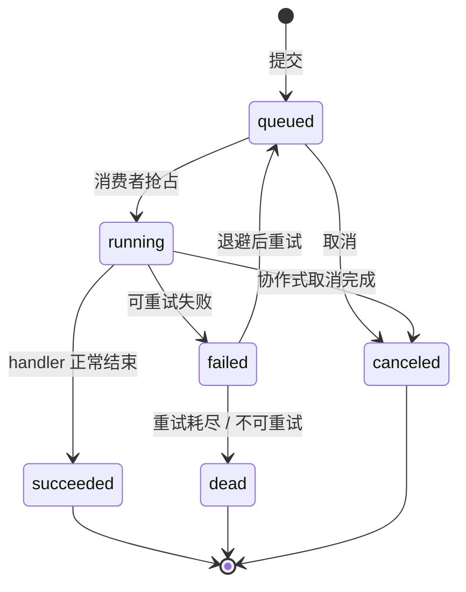

# 架构设计 · 子系统 · 异步作业中心

> BMS · 一次性异步作业的提交、消费、租约、进度、重试与监控

[架构设计](01_架构设计_总览.md) › 40-异步作业中心　|　[← 39-产品与服务划分](39_架构设计_子系统_产品与服务划分.md) · [41-产品租户与安全接入 →](41_架构设计_子系统_产品租户与安全接入.md)

> **上游依据**：《[项目规划说明](../../规划/项目规划说明.md)》「异步与任务」「导入导出」「归档与备份」章节。**相邻节点**：[16-事件总线](16_架构设计_子系统_事件总线.md)（写后副作用）、[17-任务调度](17_架构设计_子系统_任务调度.md)（cron 定义与到期）、[37-服务间通信与分布式一致性](37_架构设计_子系统_服务间通信与一致性.md)（服务边界与一致性）、[38-跨产品协同](38_架构设计_子系统_跨产品协同.md)（产品自持声明与平台装载）、[33-部署与运维](33_架构设计_部署与运维.md)（worker 进程形态）。
>
> 实现侧契约、代码落点与字段级结构见《[后端基类清单](../../后端基类清单.md)》与具体任务详细设计；本节点只写架构语义（《[文档生成规范](../../规范/文档生成规范.md)》8.6「架构节点的语义与实现分层」节）。

## 1. 概述 

异步作业中心承载**一次性、可恢复、有进度**的异步执行：批量导入、列表导出与 PDF、归档、备份、批量打印，以及后续由产品注册的同类长任务。

它与另外两个异步通道分工明确：

| 通道 | 回答的问题 | 事实源 |
| --- | --- | --- |
| 事件总线 | 业务写完之后**还要通知谁 / 同步什么**（审计落库、通知、Webhook、索引） | 事件信封与消费记录 |
| 任务调度 | **什么时候做**（cron 到期、手动触发） | 任务定义与调度记录 |
| 异步作业中心 | **怎么做一次、做到哪一步、失败怎么办** | 作业记录 |

统一后只有一套执行语义：任务调度到期只**生产作业**，业务侧（导入、导出、归档等）只**提交作业**，所有执行由**作业消费者**按同一套状态机、租约、重试、取消、进度与监控规则完成。

**目标**：提交即持久、执行可恢复、进度可查、失败可重试、终态可通知、执行者可发现。

## 2. 问题与边界 

**要解决的问题（已发生的事实）**：孤儿分片清理等场景曾以「内置任务 → 服务内部端点」的触发型补丁实现；每新增一个长任务就要重复实现轮询、进度、重试与失败处理；平台既不知道各服务有哪些作业执行者，也看不到执行情况。第三个、第四个异步场景出现时会继续复制这套补丁。

**范围内**（架构语义）：

1. 作业模型与生命周期（§3）；
2. 提交与事务一致性（§4）；
3. 消费者、租约、并发与重试（§5）；
4. 执行者注册与可发现（§6）；
5. 监控、审计与完成通知（§7）；
6. 失败语义与红线（§8、§9）。

**范围外**：事件总线与消费组、cron 表达式与任务定义管理、各业务 handler 的业务规则、通知渠道实现、前端作业中心页面（阶段十五）、作业依赖编排 / DAG（§11 开放项）。

## 3. 作业模型与生命周期 

**作业**是一次可独立追踪的异步执行单元，不是业务事实源。作业记录回答「这次执行是什么、做到哪里、结果如何」；业务结果仍以各所有者业务表为准。

作业的契约级要素：

| 要素 | 语义 |
| --- | --- |
| 作业标识 | 全局唯一、不可复用；跨服务排障与审计的串联键。采用雪花分布式 ID（接口按字符串输出）；**全系统唯一的前提是每个进程的 `BMS_APP__WORKER_ID` 全局唯一**，由部署保证 |
| 作业类型 | 全局唯一、与实现解耦；声明方自持，命名遵循《[命名规范](../../规范/命名规范.md)》 |
| 提供方 | 作业类型的归属服务 / 业务域；handler 只能在该服务内执行 |
| 负载 / 结果 | 业务无关的版本化载荷；作业中心不解析业务语义 |
| 归属 | 租户与提交人；跨租户不可见 |
| 优先级 | 租户内调度优先级，不跨租户抢占 |
| 进度 | 已完成量 / 总量或百分比；供查询与投影 |
| 尝试次数 | 已执行次数与上限；重试与死信判据 |
| 状态 | `queued` / `running` / `succeeded` / `failed` / `canceled` / `dead` |
| 租约 | 当前执行者与租约到期时刻；多副本抢占与失联回收依据 |

- **至少一次执行**：租约过期、worker 崩溃、消息重放都可能让同一作业再次执行；handler 必须幂等，或以业务唯一约束兜底。
- **记录是运行态数据**：作业记录按保留期清理，不作为审计或业务历史长期保存；业务变更的留痕归各业务域审计口径。
- **同步与异步同一模型**：阈值内可在请求内执行并直接落终态（仍生成作业记录，保证幂等与可查）；超阈值转 `queued` 由消费者执行。是否同步由消费方按业务阈值决定，作业中心只保证两种路径的记录与状态语义一致。

## 4. 提交与一致性 

- **事务性提交**：需要与业务写入同生共死的作业，在**同一业务事务**内写作业记录；业务回滚则作业不产生，避免「业务没落库、作业却执行了」。
- **提交即持久**：作业记录是队列的事实源；提交成功后即使进程重启、Redis 不可用，作业仍可被消费者重新发现。禁止用进程内 `BackgroundTasks`、临时内存队列或 fire-and-forget 任务作为生产异步通道。
- **幂等提交**：提交方可携带幂等键；同键重复提交返回既有作业，不产生第二次执行。幂等键的唯一性由作业记录所在库约束兜底。
- **可见性**：提交方拿到作业标识与初始状态；后续进度、结果、取消均按作业标识查询。

## 5. 消费者、租约与重试 

**消费者归属**：消费者运行在**作业提供方**一侧——每服务独立 worker 进程，只加载本服务注册的 handler；作业中心不跨服务 import 业务实现，也不代替业务写表。

**抢占与租约**：

- 消费者以数据库条件更新抢占待执行作业，写入执行者标识与租约到期时刻；`rowcount = 1` 才算抢到，多副本天然互斥。
- 执行期间按心跳续租；租约到期未续租视为执行者失联，作业被回收（重新排队或按尝试次数转失败 / 死信）。
- 租约与数据库条件更新是正确性保障；Redis 等外部信号只用于**唤醒加速**，不承担正确性。

**并发与公平**：

- 全局并发上限约束单进程资源占用；
- 单租户并发上限防止一个租户的大批量作业饿死其他租户；
- 优先级只在同一租户内生效，不跨租户抢占。

**重试与死信**：

- handler 区分可重试与不可重试失败；可重试失败按指数退避重新排队，达到上限转 `dead` 并保留错误摘要。
- 重试次数、退避与上限由作业类型声明与运行参数共同约束；重试不放大为「多处各重试一遍」。
- 死信作业可查询、可人工重试；重试动作落审计。

**取消与超时**：

- 取消是**协作式**的：handler 在批次边界检查取消信号并自行收尾（回滚当前批次、清理临时产物）；作业中心不强制杀协程，避免留下半写事务或半成品文件。
- 执行超过超时阈值由租约回收路径置失败 / 死信；取消与超时的最终状态可区分。

**优雅停机**：停止抢占新作业，等待在途作业到批次边界；未完成作业保留租约到期回收路径，宁可重复不可丢。

## 6. 执行者注册与可发现 

产品与服务**自持作业类型声明**，平台**统一装载**为只读视图；这与[38-跨产品协同](38_架构设计_子系统_跨产品协同.md)「产品自持声明、平台装载校验」是同一套机制，只新增记录种类、不新增注册机制。

| 面 | 归属 | 语义 |
| --- | --- | --- |
| 作业类型声明 | 提供方（产品 / 服务） | 作业类型、提供方业务域、执行者位置、超时 / 重试 / 并发默认值、负载版本、状态 |
| 装载与视图 | 平台 | 校验唯一性、提供方登记、业务域归属、执行者格式与版本兼容；形成只读作业类型视图 |
| handler 注册 | 提供方（代码侧） | 只在该服务 worker 内登记与解析；与声明做装载期对账，缺失 / 不一致按失败语义处置 |
| 作业记录 | 提供方（本地库） | 每服务每链一份基础设施表；平台不跨库读写 |
| 平台监控视图 | 平台 | 作业生命周期事件的投影；供统一列表 / 看板，可重建 |

- **声明与代码对账**：声明是跨进程可见的权威元数据，代码侧 handler 是实现；两者不一致不得静默放过（启动期 fail-fast 或按登记的错误语义拒启）。
- **命名与弃用**：作业类型全局唯一、语义化、与实现标识解耦；下线须标记弃用、给出替代类型与过渡期。
- **平台不持业务负载**：类型视图只保存元数据，不保存作业负载、结果或业务字段。

### 6.1 基类继承与产品扩展 

作业中心是**横跨所有产品的横切能力**，以统一基类体系承载：作业模型、负载 / 结果契约、处理器契约、消费者与租约、进度与取消、重试与死信、注册表等公共语义只在共享基座维护；平台内建与产品扩展沿同一继承链派生，公共能力改一次即全链生效。

| 层 | 职责 | 约束 |
| --- | --- | --- |
| 作业基类（共享基座） | 作业 / 负载 / 结果 / 处理器 / 消费者 / 仓储 / 注册表等公共契约与实现 | 公共字段与方法只在此维护；不承载具体业务 |
| 平台内建实现 | 沿继承链派生，复用统一消费者、租约、重试、进度与监控 | 只写业务差异，不得另起炉灶 |
| 产品扩展 | 默认继承 `BaseJobHandler`，只实现本产品的 handler、负载与作业类型声明；确有必要可继承更深的消费者 / worker 基类并覆写少量钩子 | 必须保持统一状态机、租约、进度与事件契约；偏差由该产品自担，不得影响其他产品；禁止另起炉灶自研平行队列 / 消费者 / 租约 / 重试 / 监控；不得绕过基类直接写作业表 |
| 组合轨（不继承基类的第三方） | 经统一注册通道登记，结构化契约适配 | 仍须通过同一套契约测试；不得形成第二套机制 |

- 产品侧接入的**默认最小面**是「声明作业类型 + 继承 `BaseJobHandler` 实现 handler」；平台以自身的具体作业实现作为样例。确需更深继承（消费者 / worker 基类）由该产品自担偏差，但必须保持统一状态机、租约、进度与事件契约，且不影响其他产品。
- 基类清单、继承链与代码落点归《[后端基类清单](../../后端基类清单.md)》；本节点只定“统一继承、只扩展差异”的语义。

## 7. 监控、审计与通知 

- **生命周期事件**：提交、开始、进度、终态（成功 / 失败 / 取消 / 死信）发事件；平台消费后投影为统一监控视图。事件是投影来源，作业记录是事实源；投影可重建，投影不可用不影响作业执行。
- **指标**：队列深度、等待时长、执行时长、成功率、重试率、死信数、租户维度并发与积压。
- **审计**：提交、取消、重试、终态写结构化日志；业务数据变更按各业务域既有审计口径，不在作业中心重复实现字段级审计。
- **完成通知**：作业终态事件登记为可订阅事件，通知中心交付后消费；作业中心不直连邮件 / 短信 / 站内信渠道。
- **排障**：作业标识、类型、提供方、租户、提交人、尝试次数、租约与错误摘要构成排障最小集；负载与结果按敏感级别控制展示。

## 8. 失败语义 

| 时点 | 情形 | 处置 |
| --- | --- | --- |
| 装载 / 启动期 | 作业类型重复、提供方未登记、业务域未登记、执行者不可解析、声明与代码不一致 | **拒绝启动**（fail-fast），不把断链留到运行期 |
| 提交期 | 幂等键重复 | 返回既有作业，不重复执行 |
| 提交期 | 作业记录持久化失败 | 整体失败；业务事务按消费方口径回滚或重试 |
| 提交期 | 跨服务写作业记录 | **禁止**；作业记录只能由所在服务写 |
| 执行期 | handler 抛可重试异常 | 退避重试；达到上限转 `dead` |
| 执行期 | handler 抛不可重试异常 | 直接 `failed` / `dead`，保留错误摘要 |
| 执行期 | 租约丢失 / worker 崩溃 | 租约到期回收；按至少一次语义重新执行 |
| 执行期 | 取消请求 | 批次边界协作式停止；无法停止则等待超时回收 |
| 执行期 | 作业类型无 handler（历史脏数据） | 终态失败并告警，不阻塞其他作业 |
| 投影 / 通知不可用 | 事件或通知消费失败 | 作业执行不受影响；投影可重建，通知按事件总线重试 / 死信口径处理 |
| 消费者不可用 | 无 worker 在线 | 作业停留在 `queued`；监控告警，恢复后继续 |

## 9. 边界与红线 

- **不写业务表**：作业中心与消费者框架不承载业务写入；handler 在所有者服务内写自己的表。
- **不替代事件总线**：事件总线仍负责写后副作用与跨服务通知；作业中心不订阅业务事件来驱动执行（避免两套驱动语义）。
- **不替代任务定义**：cron 表达式、任务启停与手动触发仍归任务调度；任务调度到期只生产作业。
- **不新增第二套注册机制**：作业类型声明并入产品自持声明与平台装载体系（[38-跨产品协同](38_架构设计_子系统_跨产品协同.md)）。
- **不跨服务直读作业表**：平台管理面只读投影；取消 / 重试按作业所在服务转发，不直接改他服务库。
- **不用进程内异步冒充作业**：生产路径禁止 `BackgroundTasks` / 临时内存队列 / 线程内 fire-and-forget。
- **不自研平行作业基座**：产品与服务默认继承 `BaseJobHandler`；确有必要可继承更深的消费者 / worker 基类，但不得另建队列、租约、重试、进度或监控实现，不得绕开统一状态机与事件契约。
- **不绕过基类写作业表**：作业记录只能经基座仓储写入；业务代码不得直接拼 SQL 或另建作业表。
- **记录保留期与业务产物保留期分离**：作业记录是运行态数据；导入错误明细、导出 PDF 等产物按各自业务策略保留。
- **负载版本化**：作业类型声明负载版本；破坏性变更升版本并保留过渡期，不得静默改变既有作业的负载语义。

## 10. 与相邻节点的关系 

| 节点 | 分工 |
| --- | --- |
| [16-事件总线](16_架构设计_子系统_事件总线.md) | 写后副作用、事件契约、投递与消费；作业生命周期事件复用其通道 |
| [17-任务调度](17_架构设计_子系统_任务调度.md) | 任务定义、cron 计算、到期与手动触发；到期生产作业，执行归本节点 |
| [37-服务间通信与分布式一致性](37_架构设计_子系统_服务间通信与一致性.md) | 服务边界、公开契约、强一致事务；作业管理面的取消 / 重试转发沿用服务间调用口径 |
| [38-跨产品协同](38_架构设计_子系统_跨产品协同.md) | 产品自持声明与平台装载；作业类型声明是该体系的新增记录种类 |
| [33-部署与运维](33_架构设计_部署与运维.md) | 每服务 worker 进程形态、扩缩容与优雅停机 |
| [11-模块注册](11_架构设计_子系统_模块注册.md) | 服务目录与契约登记；作业提供方按服务目录校验 |
| [32-测试与质量](32_架构设计_测试与质量.md) | 多副本竞争、租约回收、重试与死信的验证口径 |

## 11. 演进与开放项 

- **作业依赖 / DAG**：当前作业是独立执行单元；需要「A 完成后再做 B」时，由业务编排或后续引入依赖字段，本节点不预设。
- **优先级抢占**：首版优先级只在同租户内排序，不做运行中抢占；高优先级长作业的抢占策略待真实负载出现后评估。
- **定时窗口与限流**：按租户 / 作业类型的执行窗口与速率限制，可随容量阶段补充。
- **跨租户全局视图**：平台投影已支持统一查看；跨租户聚合统计与告警阈值随可观测性阶段完善。
- **死信重放**：首版支持人工重试单条；批量重放与按类型重放待运维需求明确后补充。
- **作业模板**：同一作业类型复用负载模板、减少重复提交，待导入 / 导出 / 归档的公共负载形态稳定后评估。

> 架构设计节点 · 与《项目规划说明》《文档生成规范》《命名规范》配套
