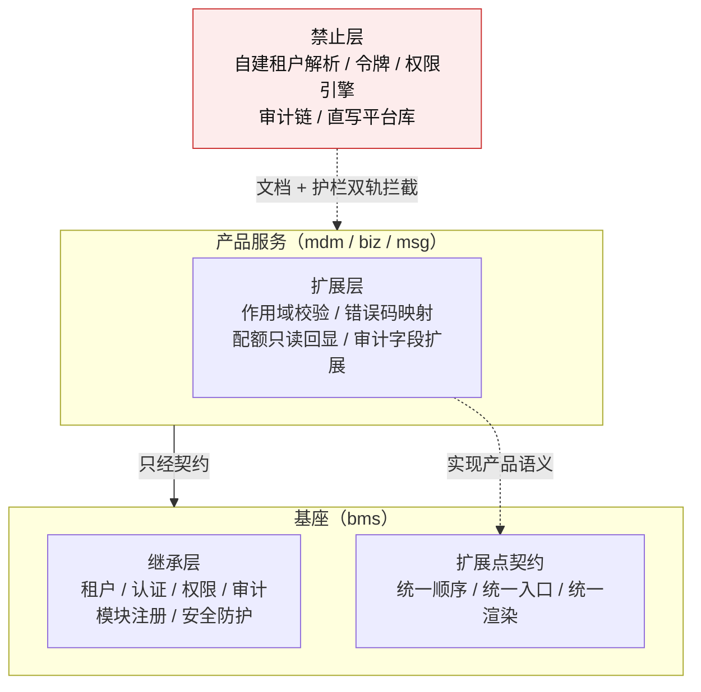

# 架构设计 · 子系统 · 产品租户与安全接入

> BMS · 继承层 / 扩展层 / 禁止层 · 通用三级作用域 · 四类标准扩展点

[架构设计](01_架构设计_总览.md) › 41-产品租户与安全接入　|　[← 40-异步作业中心](40_架构设计_子系统_异步作业中心.md)

> **上游依据**：《[平台可扩展性规划](../../规划/平台可扩展性规划.md)》「总体模型」「代码复用能力边界」节；《[项目规划说明](../../规划/项目规划说明.md)》「平台扩展接入流程」节。**相邻节点**：[10-扩展点与插件化](10_架构设计_子系统_扩展点与插件化.md)（装配机制）、[11-模块注册](11_架构设计_子系统_模块注册.md)（模块键与注册要素）、[12-多租户路由](12_架构设计_子系统_多租户路由.md)（租户解析与生命周期）、[14-认证与会话](14_架构设计_子系统_认证与会话.md)（用户与服务身份）、[15-权限计算引擎](15_架构设计_子系统_权限计算引擎.md)（RBAC）、[19-审计哈希链](19_架构设计_子系统_审计哈希链.md)（审计链）、[31-性能与安全](31_架构设计_性能与安全.md)（限流与脱敏）、[38-跨产品协同](38_架构设计_子系统_跨产品协同.md)（能力契约）、[39-产品与服务划分](39_架构设计_子系统_产品与服务划分.md)（业务域与拓扑）。

> 实现侧命名与落点见《[后端基类清单](../../后端基类清单.md)》与各专项详细设计；本节点只写架构语义（《[文档生成规范](../../规范/文档生成规范.md)》「架构节点的语义与实现分层」节）。

## 1. 概述 <a id="overview"></a>

产品（mdm、biz、msg 等）都是独立仓库、独立服务、独立库，经产品自持声明接入平台。租户与安全是**每个产品都必须具备、但不应由每个产品各自实现**的能力：租户身份、解析链、停用状态、用户与服务身份、权限判定、审计留痕一旦出现第二套实现，就会产生「管理面看到 A 租户、数据面看到 B 租户」「平台已停用、产品仍放行」「审计链断裂」这类不可接受的不一致。

本节点定义产品接入平台租户与安全能力的**统一语义**：哪些必须继承、哪些允许扩展、哪些禁止复制，以及产品特有资源如何嵌进统一的作用域与扩展点。

**本节点回答**：

1. 继承层、扩展层、禁止层分别包含什么（§3）；
2. 通用三级作用域 `tenant_id / module_key / resource_key` 如何表达与校验（§4）；
3. 四类标准扩展点——作用域校验、错误码映射、配额只读回显、审计字段扩展——的契约边界（§5）；
4. 产品接入的继承清单、流程与验收判据（§6、§7）；
5. 依赖方向与红线（§8）。

**本节点不回答**：租户解析与引擎路由的实现（[12](12_架构设计_子系统_多租户路由.md)）、认证与会话的实现（[14](14_架构设计_子系统_认证与会话.md)）、权限计算与缓存的实现（[15](15_架构设计_子系统_权限计算引擎.md)）、审计哈希链的实现（[19](19_架构设计_子系统_审计哈希链.md)）、跨产品能力契约与分配（[38](38_架构设计_子系统_跨产品协同.md)）、业务域与部署拓扑（[39](39_架构设计_子系统_产品与服务划分.md)）；也不写类名、代码落点、配置项、字段级结构与任务编号。

## 2. 问题与边界 <a id="problem"></a>

**要解决的问题（已发生的事实）**：消息平台的多租户与安全需求曾按「本域定义一套租户边界与安全防线」组织，而实际实现已经复用基座解析链、租户源、可用性守卫、服务身份、RBAC 与审计链；文档口径与代码事实不一致，评审时容易被读成「产品要自建一套」。同类风险在其他产品同样存在：产品为了「自主可控」复制一份租户解析或权限判定，短期能跑，长期会在基座停用、权限变更、审计归档时出现不可见的断链。

**范围内**（架构语义）：

1. 继承层、扩展层、禁止层的划分与判定规则（§3）；
2. 通用三级作用域的语义、注册、解析与校验规则（§4）；
3. 四类标准扩展点的契约边界与失败语义（§5）；
4. 产品接入的继承清单、流程与验收判据（§6、§7）；
5. 依赖方向与红线（§8）。

**范围外**：具体清单结构与字段、代码落点与文件清单、脚本与命令、字段级表结构、任务编号——按《[文档生成规范](../../规范/文档生成规范.md)》「架构节点的语义与实现分层」节落《[后端基类清单](../../后端基类清单.md)》与详细设计。

## 3. 三层模型 <a id="layers"></a>

产品与基座在租户与安全上的关系分三层。三层不是按「重要程度」分，而是按**权威归属**分：继承层只有基座一个权威实现；扩展层由基座定契约、产品实现语义；禁止层是产品不得出现的实现。



| 层 | 含义 | 产品动作 | 典型能力 |
| --- | --- | --- | --- |
| **继承层** | 基座已提供、所有产品必须使用、不得自建 | 依赖基座契约或平台服务，不自建、不复制、不缓存第二份状态 | 租户身份与解析链、租户状态与生命周期、用户身份与服务身份、RBAC、通用配额（仅通用维度）、审计链、模块注册、限流与脱敏 |
| **扩展层** | 基座提供契约与挂载点，产品实现自身语义 | 只实现产品特有规则，不重写基座的顺序、判定与渲染 | 作用域校验、错误码映射、产品配额维度与只读回显、审计扩展字段、资源级 ACL |
| **禁止层** | 产品侧复制基座实现或绕过基座契约 | 禁止出现 | 自建租户表与解析链、自建用户/服务令牌、自建权限引擎、自建审计链、直写平台租户/用户/权限/审计表、在扩展点之外复制基座逻辑 |

**三条判定规则**：

1. **权威唯一**：同一能力只能有一个权威实现。基座已有实现，产品只能继承；产品先实现的能力，出现第二个产品需要时按《[平台可扩展性规划](../../规划/平台可扩展性规划.md)》「边界争议的处置」上收为基座能力，原实现保留过渡期，不做一次性切换。
2. **扩展不复制**：扩展层只实现「产品语义」，不实现「基座机制」。判断标准是——把产品实现换到另一个产品，如果语义仍然成立，它就不该由产品实现；如果只对本品类成立，才属于扩展层。
3. **禁止靠双轨**：禁止层不能只靠文档约定，须同时有机器护栏（依赖方向、关键符号、路径与字面量检查）；护栏规则先设计、后续实现，规则本身不阻断本节点的语义成立。

**继承不等于「只有远程调用一种形态」**：基座能力按形态分三类——进程内契约（基座库）、平台服务契约（租户、认证、权限、审计等服务）、平台数据源（只读投影）。同一能力只有一种权威实现，产品按能力形态接入，不得因为「调用不方便」就在本地复制一份。

## 4. 通用三级作用域 <a id="scope"></a>

### 4.1 模型 <a id="scope-model"></a>

产品的资源归属统一用三级表达：

```text
tenant_id / module_key / resource_key
```

| 层级 | 取值来源 | 可变性 | 说明 |
| --- | --- | --- | --- |
| **tenant_id** | 基座租户注册与解析链 | **不可变** | 雪花内部身份；目录、表列、缓存键、审计条目一律使用它，不用租户编码 |
| **module_key** | 基座模块注册中已登记且启用的模块键 | 登记后稳定 | 一个产品可以登记多个模块键；未登记或未启用的值一律拒绝，产品不得自造 |
| **resource_key** | 产品自持声明中登记的资源标识 | 由产品定义 | 语义由产品解释（如消息平台的主题、文件平台的存储桶），基座只做作用域校验与寻址，不解释业务含义 |

**为什么用 `module_key` 而不是再引入 `namespace`**：`module_key` 已经是基座模块注册、权限码、菜单、服务目录的共同锚点；再造一个 `namespace` 会出现两套命名与两次校验。消息平台的 `namespace` 取值映射为 `module_key`，其 `topic` 映射为 `resource_key`，产品文档保留自己的业务叫法即可。

### 4.2 规则 <a id="scope-rules"></a>

1. **作用域是资源归属，不是数据权限**：三级作用域回答「这条资源属于谁」；[15-权限计算引擎](15_架构设计_子系统_权限计算引擎.md) 的数据范围回答「当前用户能看哪些行」。两者正交，不得互相替代。
2. **作用域必须可派生、可校验、可审计**：请求进入时先确定 `tenant_id`，再确定 `module_key`，最后由产品在作用域内解析 `resource_key`；三步的输入来源与顺序由基座统一，产品不得在入口自行拼装。
3. **注册在先、使用在后**：`module_key` 在模块注册中登记；`resource_key` 在产品的自持声明中登记类型、命名规则与所属 `module_key`。未登记即拒绝（fail-closed），不出现「先跑起来再补登记」。
4. **不跨作用域**：跨租户、跨 `module_key` 的访问一律拒绝；同一 `module_key` 下跨 `resource_key` 的访问，由产品在自己的授权模型内决定（如消息平台的主题 ACL），但不得绕过租户与模块边界。
5. **逻辑边界与物理落点一一对应**：物理落点由产品决定（消息平台用租户目录，其他产品可用表、库或对象存储前缀），但同一作用域只能有一个物理落点，不得混放；物理落点的命名不得使用可变的租户编码。
6. **平台租户按普通租户处理**：平台租户不引入「全局作用域」或「跨租户广播」；跨租户共享走能力分配与显式授权，不放开作用域。
7. **数据面与异步路径同口径**：不经过 HTTP 中间件的数据面、消息消费、定时任务与批处理，必须复用同一套作用域解析与校验契约，不得另写一套。

### 4.3 与业务域、部署单元的关系 <a id="scope-domain"></a>

`module_key` 是**模块/服务粒度**的注册键，[39-产品与服务划分](39_架构设计_子系统_产品与服务划分.md) 的**业务域**是代码、表归属与能力提供方的架构边界，**部署单元**是运营拓扑。三者不混用：

- 一个业务域可以由一个或多个 `module_key` 对外提供能力；
- `resource_key` 归属 `module_key`，不归属部署单元；
- 拓扑变化（拆库、合库、换部署单元）不改变 `tenant_id / module_key / resource_key`，消费方无感。

## 5. 标准扩展点 <a id="extensions"></a>

扩展点由基座定义**契约、顺序与统一入口**，产品只实现语义。四类扩展点覆盖产品接入时最常见的差异；不在此四类中的需求，先按 §3 判定是继承、扩展还是新能力，不直接在产品侧开新口子。

| 扩展点 | 基座负责 | 产品负责 | 禁止 |
| --- | --- | --- | --- |
| **作用域校验** | 统一解析顺序、租户可用性判定、模块登记校验、错误渲染入口、审计上下文注入 | 声明本产品的 `resource_key` 类型与规则；实现资源级归属判定 | 在入口自行解析租户、信任客户端自报头、自建状态缓存 |
| **错误码映射** | 统一错误渲染单点、产品码段登记、码表装载与撞码检测 | 声明「基座码 → 产品码」映射与文案键 | 在业务层自行拼装 HTTP 响应、绕过统一渲染、使用未登记码段 |
| **配额只读回显** | 统一投影契约（维度、限额、用量、单位、周期、软硬限、更新时间）、权限与脱敏、只读装载 | 维护配额值与执行点（单一事实源在产品侧）；提供只读取数 | 平台侧双写、产品直写平台通用配额表、平台侧代替产品执行配额 |
| **审计字段扩展** | 审计链写入、哈希与归档、标准字段与扩展字段的序列化 | 声明必须留痕的操作类别；提供 `resource_key`、记录级定位等语义字段 | 自建审计表或哈希链、绕过审计写入、对普通读写逐条留痕造成洪泛 |

### 5.1 作用域校验 <a id="ext-scope"></a>

**判定顺序固定为**：租户可用性 → `module_key` 已登记且启用 → `resource_key` 已注册且归属正确 → 产品自定义规则。前三步由基座统一，产品只在最后一步追加语义；产品不得调整顺序，也不得跳过前三步。

**失败语义**：租户不存在 / 已停用、`module_key` 未登记 / 未启用、`resource_key` 未注册 / 越界，分别映射到产品登记的错误码；对外不泄露租户或资源是否存在。租户源不可达按 fail-closed 处理，不静默放行。

**数据面与异步路径**：不经过 HTTP 中间件的数据面在帧入口复用同一套解析与校验契约；消息消费、定时任务与批处理在每轮或每批入口调用同一契约。三条路径必须得出同一结论。

### 5.2 错误码映射 <a id="ext-error"></a>

基座统一错误渲染单点是管理面与数据面共同的出口；产品通过映射声明把基座码改写为产品码，保证同一语义在两个入口返回同一个码。产品码段在服务行登记，码级定义随产品自持声明装载；平台负责撞码检测与契约反向对账。

**边界**：映射只做「基座码 → 产品码」的语义改写，不改 HTTP 状态语义、不吞掉错误、不把系统性失败（如租户源不可达）改写成业务成功或业务参数错误。

### 5.3 配额只读回显 <a id="ext-quota"></a>

产品自有维度（如消息平台的主题数、消息存储、吞吐、连接数）的配额**由产品自维护**：值是单一事实源，执行点在产品入口；平台通用配额只管用户数、存储、开放接口调用量等通用维度，**不写产品维度**。

平台侧经产品登记的数据源记录**只读装载**产品配额投影，用于运营视图展示；产品提供只读取数，平台负责权限、脱敏与读取审计。**不做双写**：平台侧不维护第二份配额值，也不代替产品执行配额。

### 5.4 审计字段扩展 <a id="ext-audit"></a>

审计条目在基座标准字段之外，允许产品补充语义字段；标准字段至少覆盖：谁、何时、对什么（`tenant_id` / `module_key` / `resource_key` / 资源标识）、做了什么、结果、来源与链路标识。涉及具体记录的操作（重放、删除、位点重置、异常处置等）允许带记录级定位字段，从审计条目一次定位到记录。

**边界**：普通读写不逐条留痕，只做指标统计；扩展字段只补充语义，不改变哈希链的构造与归档口径；产品不得自建审计表、不得绕过基座审计写入、不得删除审计记录。

## 6. 继承清单与产品接入流程 <a id="inherit"></a>

### 6.1 继承清单（按能力指向权威节点） <a id="inherit-list"></a>

| 能力 | 权威节点 | 产品接入形态 |
| --- | --- | --- |
| 租户身份、解析链、状态、生命周期、通用配额（通用维度）、引擎路由 | [12-多租户路由](12_架构设计_子系统_多租户路由.md) | 基座库契约 + 平台租户服务 |
| 租户拓扑、业务域与部署单元 | [39-产品与服务划分](39_架构设计_子系统_产品与服务划分.md) | 平台拓扑记录 + 运行时解析 |
| 用户认证、SSO、会话、服务身份、密钥轮换 | [14-认证与会话](14_架构设计_子系统_认证与会话.md) | 网关 + 平台认证服务 + 基座库契约 |
| RBAC、字段权限、数据范围、三权分立 | [15-权限计算引擎](15_架构设计_子系统_权限计算引擎.md) | 基座库契约 + 权限元数据/数据来源接缝 |
| 操作日志、登录日志、字段级审计、哈希链、归档 | [19-审计哈希链](19_架构设计_子系统_审计哈希链.md) | 基座审计能力域 + 平台审计服务 |
| 模块键、服务行、表前缀、错误码段、事件域 | [11-模块注册](11_架构设计_子系统_模块注册.md) | 产品自持声明 + 平台装载校验 |
| 跨产品能力目录、分配与授权 | [38-跨产品协同](38_架构设计_子系统_跨产品协同.md) | 产品自持声明 + 平台装载 + 服务身份 |
| 限流、脱敏、降级、安全防护 | [31-性能与安全](31_架构设计_性能与安全.md) | 基座库契约 + 网关 |
| 扩展点装配与插件生命周期 | [10-扩展点与插件化](10_架构设计_子系统_扩展点与插件化.md) | 基座库契约 + 配置驱动装配 |

> 本表只列「继承什么、权威在哪」，不复制各节点的细节；字段、类名、配置与脚本一律以对应节点、基类清单与详细设计为准。

### 6.2 接入流程（语义级） <a id="inherit-flow"></a>

1. **登记**：产品在自持声明中登记产品档案、服务行、`module_key`、表前缀、错误码段、事件域、数据源、种子与 `resource_key` 类型；平台装载并校验唯一性与归属。
2. **装配**：产品应用装配基座中间件、租户源、租户可用性守卫、认证、权限、审计与四类扩展点（按需）；装配缺失或声明非法即拒启。
3. **声明**：产品在自己的需求与设计文档中区分「继承项」与「扩展项」——继承项只引用基座权威节点与验收判据，扩展项才写产品语义；不把继承项重新定义一遍。
4. **验收**：按 §7 的判据逐项验证；验收责任在产品，权威判定在基座契约。
5. **护栏**：产品仓库不得出现继承层实现；扩展层只能经基座契约；护栏规则由平台统一设计，产品不得自行放宽。

## 7. 失败语义与验收判据 <a id="accept"></a>

### 7.1 失败语义 <a id="fail"></a>

| 时点 | 情形 | 处置 |
| --- | --- | --- |
| 启动 / 装配 | 继承项未装配、必需扩展点未注册、作用域声明非法、产品码段未登记 | **拒绝启动**（fail-fast），不进入「先跑起来再补」 |
| 请求入口 | 租户不存在 / 已停用 | 拒绝，不泄露租户是否存在 |
| 请求入口 | `module_key` 未登记 / 未启用 | 拒绝，按产品码段返回 |
| 请求入口 | `resource_key` 未注册 / 越界 | 拒绝，按产品码段返回 |
| 运行期 | 租户源不可达 | **fail-closed**（503），不静默放行、不按旧缓存放行 |
| 审计 | 审计写入失败 | 按操作类别与合规要求处置：需强审计的操作失败即失败；其余记录指标与告警，不静默丢弃 |

### 7.2 验收判据 <a id="accept-criteria"></a>

1. **同一性**：同一请求在管理面、数据面、异步路径解析出同一组 `tenant_id / module_key / resource_key`。
2. **越权拒绝**：跨租户、跨 `module_key` 的访问被拒绝；同一 `module_key` 下的资源级越权按产品授权模型拒绝。
3. **停用即时**：租户停用后，生产与消费（含数据面与异步任务）按基座版本戳即时被拒绝，不依赖产品自建缓存。
4. **未登记拒绝**：未登记或未启用的 `module_key`、未注册的 `resource_key` 被拒绝，产品不得自造。
5. **审计可追溯**：管理操作可在基座审计链查到；涉及具体记录的操作可按记录级定位字段一次定位。
6. **配额可核对**：产品配额在平台侧只读可见，且与产品侧一致；平台侧无双写。
7. **错误码一致**：同一语义在管理面与数据面返回同一产品码；产品码在登记段内，无撞码。
8. **无复制实现**：产品仓库不出现继承层实现（租户解析、令牌、权限引擎、审计链等）；扩展层只经基座契约。

## 8. 依赖方向与红线 <a id="rules"></a>

- **依赖方向**：产品 → 基座契约 / 平台服务；基座不感知具体产品，产品标识只出现在产品自持声明与按能力名的取用中。
- **红线一（租户权威）**：产品不得自建租户表、解析链、状态缓存与生命周期；租户身份、状态与开通停用一律以基座为准。
- **红线二（身份权威）**：产品不得自建用户令牌、服务令牌、会话与密钥轮换；不得把外部 access token 透传给内部服务。
- **红线三（权限权威）**：产品不得自建 RBAC 引擎与权限码体系；权限码经模块注册登记，判定复用基座引擎。
- **红线四（审计权威）**：产品不得自建审计表或哈希链；审计写入、归档与校验归基座。
- **红线五（数据边界）**：产品不得直写平台租户、用户、权限、审计等平台表；跨服务读走契约或只读投影。
- **红线六（扩展有界）**：产品不得在四类扩展点之外复制基座逻辑；扩展点只实现语义，不重写基座的顺序、判定与渲染。
- **红线七（注册在先）**：`module_key`、`resource_key`、错误码段、数据源、种子一律先登记后使用；未登记即拒绝。
- **红线八（同码同语义）**：同一语义在管理面与数据面返回同一产品码；不得用产品码掩盖系统性失败。

## 9. 与相邻节点的关系 <a id="related"></a>

| 节点 | 分工 |
| --- | --- |
| [10-扩展点与插件化](10_架构设计_子系统_扩展点与插件化.md) | 提供装配、契约校验与插件生命周期；本节点定义产品接入的继承/扩展/禁止语义，不定义装配实现 |
| [11-模块注册](11_架构设计_子系统_模块注册.md) | 提供 `module_key`、服务行、表前缀、错误码段、事件域登记；本节点把 `module_key` 作为作用域第二级 |
| [12-多租户路由](12_架构设计_子系统_多租户路由.md) | 提供租户解析、状态、生命周期、通用配额与引擎路由；本节点不复制其实现 |
| [14-认证与会话](14_架构设计_子系统_认证与会话.md) | 提供用户身份与服务身份；本节点只规定产品必须继承、不得自建 |
| [15-权限计算引擎](15_架构设计_子系统_权限计算引擎.md) | 提供 RBAC 与数据范围；本节点把资源级 ACL 留给产品扩展层，不并入 RBAC |
| [19-审计哈希链](19_架构设计_子系统_审计哈希链.md) | 提供审计链与归档；本节点定义审计字段扩展的边界 |
| [31-性能与安全](31_架构设计_性能与安全.md) | 提供限流、脱敏、降级；本节点不重复安全防护机制 |
| [38-跨产品协同](38_架构设计_子系统_跨产品协同.md) | 提供能力目录、分配与授权；本节点规定产品接入时的身份、作用域与审计口径 |
| [39-产品与服务划分](39_架构设计_子系统_产品与服务划分.md) | 提供业务域、部署单元与租户拓扑；本节点区分 `module_key` 与业务域，不把两者混用 |

## 10. 演进与开放项 <a id="evolution"></a>

- **第四级作用域**：当前不引入业务域或部署单元作为作用域层级；若未来出现「同一 `module_key` 下需要按业务域再隔离」的普遍需求，再按「被第二个产品需要」的规则论证。
- **资源级 ACL 通用化**：当前不上移，由产品自建（如消息平台的主题 ACL）；若第二个产品提出同类需求，再上收为基座通用授权能力。
- **配额统一执行**：当前只做只读回显，不代产品执行配额；若未来需要平台统一执行，须先解决「值存产品侧、执行在平台侧」的跨服务一致性，不默认支持。
- **跨产品作用域共享**：当前禁止；若未来需要共享资源，走 [38-跨产品协同](38_架构设计_子系统_跨产品协同.md) 的能力分配与显式授权，不放开作用域边界。
- **护栏规则**：禁止层的机器护栏先设计规则、后续实现；规则须区分「继承层复制」「扩展点外复制」「字面量硬编码」三类，并保留误报豁免通道。
- **产品接入口径**：继承、扩展与禁止的语义只在本节点定义，不另立继承清单或接入基线；产品直接用基座能力，缺失或接口不足的回补 bms（提需求或缺陷），不在产品仓复制实现；与产品文档不一致时以本节点为准并回写产品文档。

## 11. 待定项 <a id="tbd"></a>

| # | 待定项 | 回填位置 |
| --- | --- | --- |
| 1 | ~~作用域注册的字段级结构~~ **已回填** | 07D `01-1`：字段结构见该任务详细设计「注册记录与表结构」节与数据表文件 `sys_scope_resource_type`（2026-11-07） |
| 2 | 四类扩展点的契约细节与错误码 | 产品接入专项需求域「标准扩展点」的详细设计 |
| 3 | 禁止层护栏的规则与误报处理 | 产品接入专项需求域「护栏与阶段验收」 |
| 4 | 消息平台的 `namespace → module_key`、`topic → resource_key` 映射 | 消息平台多租户与安全扩展需求及其设计 |
| 5 | mdm / biz 的扩展项清单 | 各产品多租户与安全需求篇 |

---

> 架构设计节点 · 与《[项目规划说明](../../规划/项目规划说明.md)》《[文档生成规范](../../规范/文档生成规范.md)》《[命名规范](../../规范/命名规范.md)》配套
