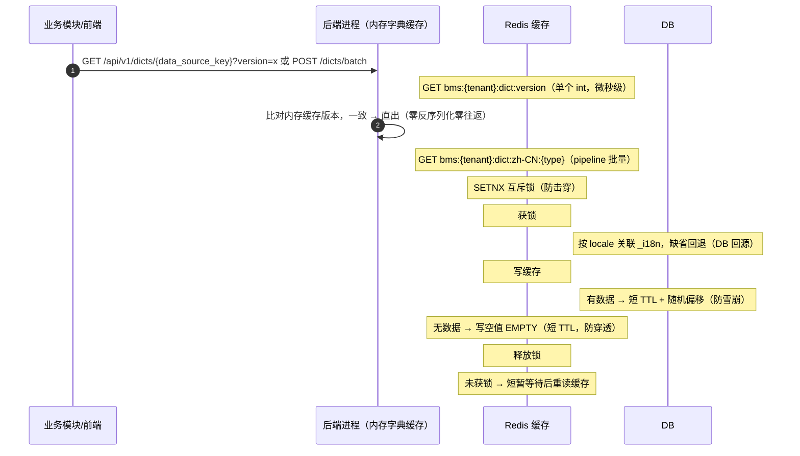
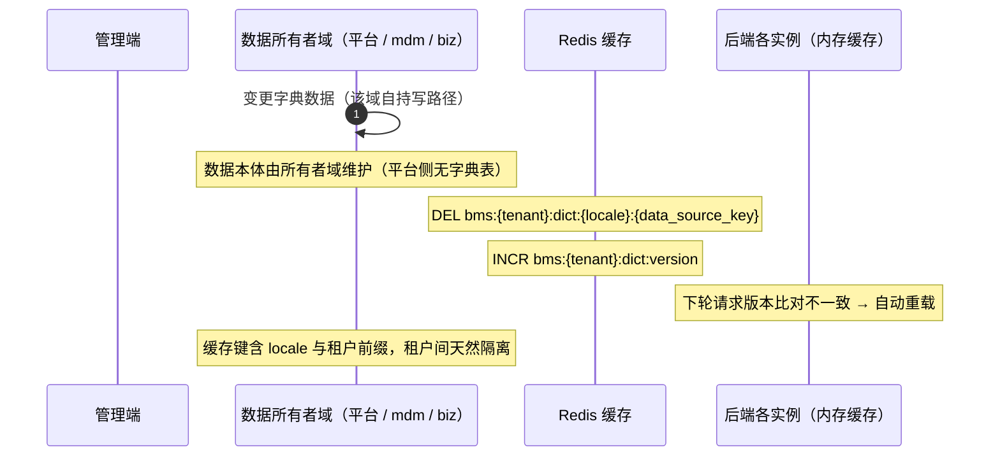

# 概要设计 · 字典管理

> BMS · 通用数据字典维护

[概要设计](01_概要设计_总览.md) › 09-字典管理　|　[← 07-菜单管理](07_概要设计_菜单管理.md) · [10-系统参数 →](10_概要设计_系统参数.md)

## 1. 模块概述与职责 

> **口径返工（2026-10-11 · 任务 02_09）**：「字典」＝**基础数据 / 参考数据**（含主数据，但不止主数据：bms 用户 / 角色 / 租户、biz 仓库储位等都是字典）。AI 自行编造的「字典类型 / 字典条目 / 字典属性」（`sys_dict_type` / `sys_dict_item` / `sys_dict_attr` + 3 `_i18n` 六表，实质「选项类型 / 条目」）**剔除**，取数改由**字典数据源登记 + 统一出口**承载；**字典域本体保留**（取数 / 缓存 / 翻译 / 高级查询 / 数据权限左列 / 字典页，路径仍 `/api/v1/dicts/*`）。

> **服务化归口（2026-09-22）**：本项目以微服务为目标架构（平台模块与产品全服务化，见《[微服务演进规划](../../规划/微服务演进规划.md)》）；本节点在服务化形态下对应**一个服务或服务内能力单元**——拥有独立库（每服务每租户一库）、独立部署与发布，与其他服务经**公开契约或事件**协同（服务边界与一致性见[架构设计 37](../架构设计/37_架构设计_子系统_服务间通信与一致性.md)）。

本节对应[《项目规划说明》](../../规划/项目规划说明.md)「功能模块」之**字典管理**模块，与「核心数据表清单」「数据规范（多语言）」「性能与高并发设计（缓存策略）」「权限模型」「初始化数据」等章节；架构设计依据[《架构设计》](../架构设计/01_架构设计_总览.md)**07-数据架构**节点（4.1 字典与[系统参数](10_概要设计_系统参数.md)管理、5 缓存架构）与 **13-数据访问与分片**节点。

字典管理为全系统提供**通用数据字典**的统一查询出口：**运行期可维护**的业务枚举值（如公告类型、业务类型）不再散落硬编码于各模块，统一以**字典（基础数据 / 参考数据）**登记并由各所有者域承载；**运行期不可变**的固定值域走选项集（装载时注册），两者分工见「业务规则」节。业务模块仅通过**运行时查询接口**（经字典统一出口）取字典，界面展示的多语言 label 由各所有者域按当前 locale 随出口下发。

| 维度 | 说明 |
| --- | --- |
| 模块定位 | **统一数据源登记 + 统一出口**（02_10 泛化：「字典」为数据源的一类 `kind=dict`）：登记各数据源（`data_source_key` / 名称 / 类型 / 数据出口 / 字段白名单 / 级联 / 可用策略 / 状态），按 `data_source_key` 路由取数并叠加缓存 / 翻译；数据本体由各所有者域承载（平台实体表 / mdm / biz） |
| 职责边界 | 只负责字典的**登记、路由取数与下发**；不承载具体业务枚举逻辑，业务模块按 `data_source_key` 引用字典；字典数据写入归各所有者域 |
| 架构依据 | 07-数据架构（字典与系统参数管理、缓存架构三防）、13-数据访问与分片（租户库路由）、09-接口与集成（API 规范） |
| 相邻协作 | 用户/菜单/公告等模块的枚举下拉经运行时查询接口取数；国际化模块提供 locale 体系，label 多语言随各所有者域下发 |

## 2. 功能分解与业务流程 

### 2.1 功能点分解 

| 功能点 | 说明 | 权限码 |
| --- | --- | --- |
| 统一数据源登记 | 登记各数据源（`data_source_key` + 名称 + 类型 `kind`（`dict` / `form`，预留其它）+ 来源 + 数据出口 + 字段白名单 + 级联 + 可用策略 + 状态）；`GET /api/v1/data-sources` 下发（02_10 由字典专用 `GET /dicts` 迁出），供数据权限左列 / 通用页面；数据本体由各所有者域承载 | dict:manage（登记维护） |
| 运行时字典查询 | 按**字典标识** `data_source_key` + locale 经**统一出口路由数据源**返回启用条目，供业务模块下拉/展示 | 登录即可（业务通用依赖） |
| 字典高级查询 | 按字典**可查字段**（固定字段 + 登记项字段白名单）/查询提供者（注册实现类）构造组合条件，取项回填或作业务筛选；查询方案个人/共享；规则见[《组件设计·字典字段》](../组件设计/06_字段类/01_组件设计_字典字段/01_组件设计_字典字段.md)第 8 节 | 登录即可（查询）；dict:query-scheme（方案管理） |
| 缓存失效管理 | 字典变更后由**数据所有者域**删除 Redis 缓存 key 并递增全局版本号（INCR `bms:{tenant}:dict:version`），前端与后端进程内内存缓存按版本比对自动重载 | 系统内部 |

### 2.2 业务规则 

- **唯一性**：登记项 `data_source_key` 全局唯一、格式 `^[a-z][a-z0-9_]*$`（启动 / CI 校验）；条目唯一性由各所有者域按其实体口径约束
- **登记来源**：构建期清单（平台内建 + 各项目装载注入），运行期只读；不再有平台库默认字典种子与租户库覆盖
- **与选项集的分工（2026-10-21 口径确认）**：**运行期可维护**的值域（业务人员不重启、不发版即可增删改，立即生效）一律走字典；**运行期不可变**、随代码/配置在装载时注册的值域走**选项集**（标识同 `data_source_key` 一样纳入标识符登记，但由选项集注册基座承载、不落字典表）。同一语义只允许一种来源；**字典字段（`dict` / `dict_multi`）与选项集字段（`option` / `option_multi`）是两种字段类型**，不得给同一字段配两种来源。**平台状态类字段（用户 / 角色状态、锁定类型、菜单状态、业务码 / 动作码状态、租户状态）已裁决为选项集**（`option`，随代码装载注册、加项须发版），与后端 `02-14` 种子 `sys_field.type = option` 一致；字典侧保留的 `user_status` / `biz_type` 种子仅作**取数与缓存演示**，不用于平台字段绑定
- **条目标识与业务值（2026-10-21 口径确认）**：条目 `id`（雪花）是**内部关联唯一键**——业务表与字典字段一律存 `id`（`BIGINT`，多值 JSON 数组）；`value` 是业务值、`code` 是人读编码，二者仅用于展示与外部交换，**可修改且不影响存量数据**。数据源必须提供稳定 `id`；无 `id` 的数据源不得登记为字典数据源
- **状态**：登记项启用/停用；停用的字典在运行时查询结果中不可见，已引用旧值的业务数据不受影响
- **多语言**：label 按当前 locale 由各所有者域随出口下发，缺省回退默认文案
- **数据来源**：字典数据本体由各所有者域承载，平台的统一出口按 `data_source_key` 路由取数（不再有平台侧字典数据表与写路径）
- **可查字段**：高级查询可查字段 = 固定字段 + 登记项字段白名单（无独立属性表；组件设计·字典字段 8.3/8.4）
- **查询方案泛化**：`sys_query_scheme` 由「字典高级查询方案」泛化为通用**查询方案**——`target=items` 供字典高级查询取项/筛选，`target=business` 供列表页筛选方案（`field_key=form_key`，见《组件设计 · 查询筛选区》「查询方案」节）；通用接口 `/api/v1/query-schemes`，列表筛选方案的租户/共享方案维护需动作码 `query:scheme`（个人方案免权限码）

### 2.3 流程步骤与异常分支 

1. **运行时查询**：读缓存 → 未命中走互斥锁回源重建（三防）→ 经统一出口按 `data_source_key` 路由数据源取条目 → 返回；查询未登记的字典 → 空结果（版本 0）
2. **变更生效**：数据所有者域变更字典数据后删除缓存 key + 版本递增 → 下一轮请求版本不一致自动重载
3. **停用**：登记项停用或数据源侧停用即时从运行时结果消失

> **写路径已移除**：原「类型 / 条目 / 属性」增删改查随字典六表（`sys_dict_type` / `sys_dict_item` / `sys_dict_attr` + 3 `_i18n`）拆除（2026-10-11 02_09）。

## 3. 关键时序与协作 

读路径（Redis 缓存三防：防穿透空值、防击穿互斥锁、防雪崩随机偏移；后端进程内内存字典缓存按全局版本号比对，免反序列化与网络往返）：

写路径（先写库后删缓存 + 递增版本号，保证一致性）：

> Redis 故障时缓存失效直连数据源并日志告警（降级协议见[架构 05](../架构设计/07_架构设计_数据架构.md) 与规划「降级」节）；Redis key 命名遵循 `bms:{租户|global}:{域}:{业务键}` 规范。

## 4. 数据模型与表设计 

### 4.1 核心表 

| 表 | 关键字段 | 说明 |
| --- | --- | --- |
| —（统一数据源登记） | `data_source_key` / 名称 / 类型 `kind` / 来源 / 数据出口 / 字段白名单 / 级联 / 可用策略 / 状态 | **不落表**：登记为**代码内构建期清单**（`bms_core/datasource/registry.py`，02_10 泛化自字典数据源登记；各项目装载注入、运行期只读）；数据本体由各所有者域承载（平台实体表 / mdm / biz），消费方不直连权威库 |
| sys_query_scheme | id（雪花）、scope、owner_id、target、data_source_key、field_key、provider_key、conditions、params、layout、is_default、shared、status、审计字段、version | 查询方案（scope=platform/tenant/user 三级；conditions/params/layout 为 JSON）。**已泛化**：`target=items` 为字典高级查询方案（`data_source_key` 填字典标识）；`target=business` 为**列表筛选方案**（`field_key=form_key`、`data_source_key`/`provider_key` 为空），契约见[《组件设计 · 查询筛选区》](../组件设计/07_展示类/02_组件设计_查询筛选区/02_组件设计_查询筛选区.md)「查询方案」节 |

> **已拆除（2026-10-11 02_09）**：`sys_dict_type` / `sys_dict_item` / `sys_dict_attr` + 3 张 `_i18n` 附表（编造的「字典类型 / 条目 / 属性」，实质「选项类型 / 条目」）——迁移 `0013_drop_dict_tables` 拆除，表文件与登记同步移除。

### 4.2 索引与存储策略 

- 索引：字典六表已拆除，无平台侧字典索引；`sys_query_scheme` 唯一约束 `(scope, owner_id, target, data_source_key, field_key, name, deleted_at)`、普通索引 `(target, field_key, status, scope)`
- 分片：字典为小型热配置数据，不做按月分片
- 归档：字典为在用配置数据，不进入归档流转；审计留痕走操作日志与字段级审计（sys_data_audit_log，按月分片）
- 缓存：`bms:{tenant}:dict:{locale}:{data_source_key}`，短 TTL + 随机偏移；缓存键含 locale 与租户前缀；全局版本键 `bms:{tenant}:dict:version`（字典变更 INCR）；进程内内存字典缓存（dogpile.cache 双 Region：小字典整类型 + 超大字典已查条目局部子集，按版本惰性比对）供查询接口与业务翻译共用，零网络往返；超大字典批量翻译走「局部缓存 + 一次性 IN 查询」防 N+1。（可查字段为固定字段 + 登记项白名单，无独立属性列）

### 4.3 数据流转 

字典数据本体由各所有者域承载（平台实体表 / mdm / biz）→ 平台侧**字典数据源登记**声明可用字典清单 → 运行时经**统一出口**按 `data_source_key` 路由取数并缓存（按租户 + locale 分键）→ 各业务模块消费。字典变更只影响后续查询，已落库的业务数据保持原值。

## 5. 接口设计 

### 5.1 接口清单 

接口前缀、统一响应与鉴权约定见[《API 接口规范》](../../规范/API接口规范.md)（第 2~3、6 节），本模块接口如下：

| 方法 | 路径 | 说明 | 权限码 |
| --- | --- | --- | --- |
| GET | /data-sources | 统一数据源登记清单（`data_source_key` / 名称 / 类型 `kind` / 来源 / 字段白名单 / 级联 / 可用策略 / 状态；可按 `kind` 过滤）；供数据权限左列 / 通用页面（02_10：原字典专用 `GET /dicts` 迁出） | 登录即可 |
| GET | /dicts/{data_source_key} | 运行时字典查询（按 locale 返回启用条目；登录即可，业务通用依赖）。可选参数：`version`（客户端本地版本，一致时 items 返回 null）、`keyword`（远程搜索，模糊匹配 label/value/code）、`parent_id`（级联过滤）、`ids`（逗号分隔**条目 id** 集合，仅返回这些条目的子集——批量回显与超大字典列翻译用）、`limit`（条数上限，探针传 2001 判别超大字典）；响应 data 为 `{version, items, has_more, total}`；**条目字段含 `id`（雪花，JSON 字符串）与 `color`（语义色，可空）**，业务表一律存 `id`、`value`/`code` 仅展示与外部交换（`POST /dicts/batch` 同结构） | 登录即可 |
| POST | /dicts/batch | 批量运行时字典查询（表单页多字典字段合并为一次请求）：请求体 `{types: [...], version?, locale?}`；响应 data 为 `{version, items: {type: {items, has_more, total} \| null}}`，items 为 null 表示该类型版本一致（前端复用本地缓存）；每类型统一 limit 截断（2001）判别超大字典 | 登录即可 |
| POST | /dicts/{data_source_key}/advanced-query | 高级查询统一入口：body `{target:'items'\|'business', conditions?, provider?, params?, page, size}`；条件组走通用引擎，指定 provider 走注册实现类；返回条目/业务记录分页（不返回 attr_json 之外的普通缓存字段） | 登录即可 |
| GET | /dicts/{data_source_key}/attrs | 获取字典可查字段 schema（供高级查询条件构建器渲染） | 登录即可 |
| GET | /dicts/query-providers | 获取可用查询提供者清单（按 type 过滤，含 param_schema，不含实现类信息） | 登录即可 |
| GET/POST/PUT/DELETE | /dicts/query-schemes | 字典高级查询方案 CRUD（scope=platform/tenant/user；个人方案登录即可，平台/共享方案需 `dict:query-scheme`） | 登录即可 / dict:query-scheme |
| GET/POST/PUT/DELETE | /api/v1/query-schemes | **通用查询方案接口**（泛化后）：按 `target=items\|business` 区分字典方案与列表筛选方案（`business` 时 `field_key=form_key`）；个人方案登录即可，租户/共享方案需 `query:scheme` | 登录即可 / query:scheme |

> **响应契约类型化（2026-10-12 · 02_12）**：`/data-sources`、`/dicts/{data_source_key}/attrs`、`/dicts/query-providers` 的响应 `data` 收敛为 `{items: [...]}` 包装（`DataSourceListResponse` / `DictAttrListResponse` / `DictQueryProviderListResponse`）；`/dicts/{data_source_key}`、`/dicts/batch`、`/dicts/{key}/advanced-query` 分别为 `DictTypeResult` / `DictBatchResult` / `DictAdvQueryResult`。类型化后进入公开契约快照并驱动 `@bms/api-types`（`/query-schemes` 族不在本次范围）。

### 5.2 分页/幂等/限流 

- 分页：查询参数 `page`（从 1 起）、`size`；响应 `{list, total, page, size}`；limit/offset 分页限深 100 页
- 幂等：写接口支持幂等键（请求头 Idempotency-Key），Redis SETNX 前置拦截 + 唯一约束兜底
- 限流：接口级限流（slowapi，Redis 后端，IP/用户维度）；运行时查询接口为高频路径，单独配置较宽限流；批量接口（/dicts/batch）、远程搜索（keyword 参数）与高级查询（/dicts/{data_source_key}/advanced-query，可触发 provider 复杂查询）分别限流，防止超大字典场景被刷
- 命名：RESTful 资源式，列表筛选用查询参数

### 5.3 事件 

本模块不发布独立事件；字典变更通过缓存删除 + 全局版本号递增即时生效（各实例内存缓存与前端缓存按版本比对自动重载），无需异步通知消费方（事件总线事件清单中无 dict 域事件）。

## 6. 权限与配置 

### 6.1 权限码分配 

| 权限码 | 业务 | 动作 | 默认归属 |
| --- | --- | --- | --- |
| dict:manage | dict（字典管理） | manage（管理，含查询与维护） | 系统管理员 |
| dict:query-scheme | dict（字典管理） | query-scheme（高级查询方案管理：平台/共享方案维护） | 系统管理员 |

dict 业务码平台统一维护（sys_business），租户侧可见、可分配、不可增删；动作 manage、query-scheme 归属 dict 业务（sys_action）。运行时高级查询与个人查询方案无需权限码（登录即可），查询界面定制复用 `formdesign:manage`（见 36-表单定制）。

### 6.2 菜单挂接 

菜单「字典管理」→ 表单挂接 dict 业务码（菜单→表单→业务）；表单按钮挂权限码 manage（查询/新建/编辑/删除/启用停用），按钮默认无权限，按角色授予权限码后显隐；字段按字段权限控制（默认全部可见可编辑）。

### 6.3 sys_config 参数 

缓存 TTL 与三防策略全局统一（见规划「性能与高并发设计·缓存策略」），安全类可配项（密码策略、上传上限等）由系统参数模块统一维护，见 [10-系统参数](10_概要设计_系统参数.md) 节点。本模块新增高级查询相关参数：

| 参数 | 默认 | 说明 |
| --- | --- | --- |
| —（无） | — | 可查字段改为固定字段 + 登记项字段白名单（2026-10-11 02_09），原 `dict_attr_*` 配置随六表拆除 |

### 6.4 种子数据 

- 平台库种子：**已随字典六表拆除（2026-10-11 02_09）**——字典数据不再落库种子，改由各所有者域经统一出口提供
- 租户开通：无字典库种子；登记清单为构建期清单（各项目装载注入）
- 语言包种子：中文/英文语言与前后端固定文案（sys_i18n_message）

## 7. 错误码与异常处理 

| 段 | 区间 | 覆盖模块 | 本模块建议分配 |
| --- | --- | --- | --- |
| 4xxxx | 40001-49999 | 系统配置（菜单/字典/系统参数/国际化语言包） | 401xx 段（示例：40101 数据源不可用、40102 字典未登记、40103 语言不支持；2026-10-11 02_09 口径） |

- 错误码一经发布稳定不变；文案由前端按 i18n 映射，后端不承担文案拼装
- 参数校验错误走 1xxxx 通用段；HTTP 状态码与业务错误码分离
- 并发冲突（乐观锁）返回明确错误提示，前端刷新重试
- Redis 故障：缓存失效直连 DB + 日志告警，不影响查询正确性

## 8. 页面清单与验收要点 

### 8.1 页面清单 

| 端 | 页面 | 说明 |
| --- | --- | --- |
| PC 管理端 | 字典管理 | **字典登记项列表 + 条目预览**；登记项查看 / 编辑；条目预览只读（经字典出口取数）。**记录页（登记项详情与编辑）布局见《[布局设计 · 字典页](../../设计/布局设计/17_布局设计_字典页.html)》**——**所有字典记录共用一套记录页**（通用记录页骨架模板：工具栏 + 最少两 Tab + 详细信息首行三字段 + 系统信息区；**其余业务 Tab 与字段不受限**）：详细信息与系统信息 Tab，详细信息首行三字段的**标识固定为 `Code` / `Name` / `State`**（`data_source_key` / `name` / `status`；**列标题按需求显示**）；系统信息区与《[布局设计 · 表单页](../../设计/布局设计/08_布局设计_表单页.html)》**完全一致**（7 项，第 7 项为表单标识 `form_key`）。实现侧按数据形态判定（构建期清单 `kind` / 清单接口 `is_dict`）后套用同一骨架件；列表侧见《[布局设计 · 列表页](../../设计/布局设计/07_布局设计_列表页.html)》 |
| PC 管理端 | 字典高级查询（嵌入字典字段） | 列表筛选区/表单字段弹出高级查询抽屉：条件组（AND/OR + 操作符）、查询提供者选择、结果预览、查询方案保存/应用；查询界面定制入口在表单定制设计器 |
| 移动端 H5 | 高级查询（简化） | 业务表单/查询枚举的简化高级查询（单列条件、常用操作符、取项回填）；不提供提供者选择与界面定制 |
| 移动端 H5 | — | 不提供字典维护页面；业务表单枚举下拉经运行时查询接口取数 |

### 8.2 验收标准 

- 类型与条目 CRUD、启用/停用、排序全流程可用
- 多语言切换 label 正确；未配置翻译时缺省回退主表默认文案
- 缓存失效即时生效：修改后立即查询返回新值（先写库后删缓存验证）
- 租户隔离：A 租户修改/停用不影响 B 租户（独立库 + 缓存租户前缀）
- 停用条目在运行时查询中不可见；软删除条目可在回收站恢复且审计留痕
- 种子字典（状态、类型等通用字典）下发正确，含 i18n 英文文案
- 高级查询：条件组（AND/OR 分组 + 常用操作符）与查询提供者（通用引擎 / 注册实现类）均可执行；结果可取项回填或作业务筛选；查询方案个人/共享可保存复用；扩展属性 attr_json 不进入普通运行时缓存（内存隔离验证）
- 越权验证：无 dict:manage 权限用户访问维护接口被拒

> 概要设计节点 · 与《项目规划说明》《架构设计》《文档生成规范》《命名规范》配套