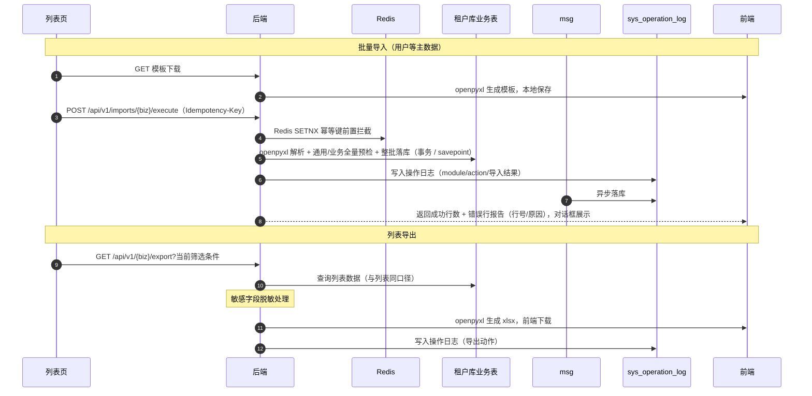

# 概要设计 · 导入导出

> BMS · Excel 批量导入与列表导出

[概要设计](01_概要设计_总览.md) › 19-导入导出　|　[← 18-公告管理](18_概要设计_公告管理.md) · [20-开放接口管理 →](20_概要设计_开放接口管理.md)

## 1. 模块概述与职责 

> **服务化归口（2026-09-22）**：本项目以微服务为目标架构（平台模块与产品全服务化，见《[微服务演进规划](../../规划/微服务演进规划.md)》）；本节点在服务化形态下对应**一个服务或服务内能力单元**——拥有独立库（每服务每租户一库）、独立部署与发布，与其他服务经**公开契约或事件**协同（服务边界与一致性见[架构设计 37](../架构设计/37_架构设计_子系统_服务间通信与一致性.md)）。

本节对应[《项目规划说明》](../../规划/项目规划说明.md)「功能模块」之**导入导出**模块，以及「API 设计规范」「认证与安全」（数据脱敏）、「核心数据表清单」（[操作日志](11_概要设计_操作日志.md)）章节；
架构设计依据[《架构设计》](../架构设计/01_架构设计_总览.md)09-接口与集成 节点（API 公共约定与幂等规范）。

- **模块定位**：为各业务模块提供统一的 Excel 批量导入与列表导出能力，MVP 覆盖用户等主数据批量导入与各列表页当前筛选条件下的数据导出。
- **职责边界**：本模块提供导入导出**通用通道**，不持有业务表，复用各业务表与操作日志；文件处理基于 openpyxl（读取与生成 xlsx）。
- **协作关系**：导入导出动作全部落操作日志（谁在何时导入了什么、导出了什么）；导出数据经数据脱敏机制处理（敏感字段默认掩码，持 data:plain 权限码方可导出明文）；导入写接口与文件上传共用限流与上传安全基线（类型白名单、大小上限）。

## 2. 功能分解与业务流程 

### 2.1 功能点分解 

| 功能点 | 说明 | 权限码 |
| --- | --- | --- |
| 导入模板下载 | 按业务表字段生成 Excel 模板（openpyxl），含列头与填写说明，随各列表页导入对话框提供下载 | import:execute |
| Excel 批量导入 | 用户等主数据批量导入：上传文件 → 解析校验 → 逐行落库 → 返回错误行报告（错误行号 + 原因） | import:execute |
| 导入幂等拦截 | 导入请求携带 Idempotency-Key，Redis SETNX 前置拦截 + 唯一约束兜底，重复提交不产生重复数据 | import:execute |
| 导入审计衔接 | 导入动作落操作日志（模块、动作、导入结果摘要），导入产生的数据变更按各业务表既有审计规则记录 | 系统自动 |
| 列表导出 | 按当前筛选条件导出列表数据为 Excel（导出与查询同一数据口径） | export:download |
| 导出脱敏 | 敏感字段（手机号/邮箱/身份证等）导出默认脱敏，持 data:plain 权限码方可导出明文 | export:download |
| 导出 PDF（单据 / 列表） | 单据打印与列表导出 PDF：按模板渲染、单据 / 列表两种导出类型、逐份 / 合并、超阈值转后台任务并完成后限时下载 | 按权限码（打印 / 导出） |

### 2.2 业务规则 

- 导入模板列与业务表字段对齐，列头固定，模板内不允许增删列；解析校验按模板列序读取。
- 导入校验先行：逐行做必填、格式、枚举、唯一性（结合库内已有数据）校验，**全部通过的行才落库，任一字段失败的行整体跳过**并记录错误行号与原因，成功与失败行数汇总返回。
- **枚举类字段的导入导出口径（2026-10-21 登记，前端组件库 `06_10`）**：选项集字段（`option` / `option_multi`）与字典字段（`dict` / `dict_multi`）**一律按 label 文本导入导出，不导出库值**（选项集库值为枚举常量、字典库值为条目 `id`，均不适合人读）；导入时**优先按 label 反查**，选项集字段同时接受直接填 `value`、字典字段同时接受填条目 `id`，两者都不匹配即**行级错误**（记 `column` 便于定位）。多选导出按选项集 / 字典顺序拼接 label、分隔符统一「、」；导入接受 `、` / `,` / `|` / `;` 混合分隔，拆分去重后逐个反查，存在未识别项即行级错误；**写回库时统一半角逗号 `,`**（`option_multi` 为按选项集顺序去重的 `,` 拼接，`dict_multi` 为 `id` 数组的 JSON 文本）。口径细节见[《组件设计 · 选项集字段》](../组件设计/06_字段类/14_组件设计_选项集字段/14_组件设计_选项集字段.md)第 9 节与[《组件设计 · 字典字段》](../组件设计/06_字段类/01_组件设计_字典字段/01_组件设计_字典字段.md)。
- 导入幂等：写接口要求 Idempotency-Key 请求头；Redis SETNX 前置拦截（重复键直接返回首次处理结果）+ 幂等键字段唯一约束兜底（并发穿透时拒绝重复提交），保证重复请求不产生重复数据。
- 导入按单事务分批落库：逐行落库在同一事务内提交，事务失败整体回滚；单批次行数超限时按配置分批处理，避免长事务占用连接。
- 导出数据口径与当前列表筛选条件一致（复用查询参数，**含多列排序** `order_by`/`order`），导出文件不含后端未授权的字段；导出**列顺序遵循导出模板**而非页面列偏好（列显隐/顺序为展示层偏好，见用户喜好 `list.{form_key}`）；敏感字段按脱敏规则处理。
- 导入/导出动作均落操作日志，操作日志的 action 记录权限码（业务:动作），与权限体系对齐。
- **导入错误行报告与错误明细（2026-09-19 登记，前端组件库 `08_05`）**：执行导入响应的 `errors` 项由 `{row, message}` 扩展为 `{row, column?, message}`（`column` 可选，为出错列 / 字段，便于前端按列定位）；新增**错误明细下载**接口，按**首次结果**生成完整错误明细 xlsx（限时有效），供前端「下载错误明细」取址；错误明细文件的生成与保留期归[《概要设计 · 文件管理》](13_概要设计_文件管理.md)。
- **大数据量异步导出（2026-09-19 登记，前端组件库 `08_05`）**：导出超过阈值（行数或耗时，`sys_config` 可配）时转**后台任务导出**——接口返回**任务标识**而非文件流，完成后经通知中心 / 站内消息提供限时下载；阈值内走同步文件流（导出按当前筛选与排序取数、列顺序遵循导出模板、敏感字段默认脱敏）。
- **导出 PDF（2026-09-20 登记，后端基座 `02-4-25`）**：导出类型除 Excel 外**含 PDF**——**单据打印**（单条，按模板渲染）与**列表导出 PDF**（当前筛选结果）；导出输入为**模板键 + 单据数据**，模板选择由业务按单据类型确定，模板定义来源（模板键 / 变量清单）归[表单定制](36_概要设计_表单定制.md)；**逐份 / 合并**由批量模式决定（多单据批量打印），超阈值同样**转后台任务**（任务标识 + 完成后限时下载）、失败支持重试；产物为高保真 PDF（签章 / 水印 / 长明细跨页表头重复由服务端渲染承担），**存[文件管理](13_概要设计_文件管理.md)并以限时取址提供下载 / 分享**，打印与导出动作落操作日志。导出执行与模板来源经统一出口承载（契约与状态见《[后端基类清单](../../后端基类清单.md)》「跨阶段基座」节）。

### 2.3 流程步骤 

1. 模板下载：用户在各列表页点击导入 → 下载模板 → 按模板填写数据。
2. 文件上传：选择填好的 Excel 上传（类型白名单校验 xlsx，大小上限校验），携带 Idempotency-Key 提交导入。
3. 解析校验：openpyxl 读取 → 表头核对 → 逐行字段校验（必填/格式/枚举/唯一性）。
4. 全量预检与整批落库：全部行先做通用 + 业务校验；通过后整批写入业务表（同一事务 / savepoint）。**任一行非法或写入失败整批回滚，不产生部分成功**（2026-11-02 拍板，取代原文「按行事务」）。
5. 错误行报告：返回 `{total, success_count, fail_count, blocked_count, committed, errors:[{row, column?, message}]}`；`committed=false` 时合法行计入 `blocked_count`，前端对话框展示并支持下载错误明细，用户修正后以新幂等键重新导入。
6. 异常分支——文件格式错误：非 xlsx 或模板列不匹配时整体拒绝，返回 5xxxx 文件段错误码，不进入解析；
7. 异常分支——并发重复提交：相同幂等键并发穿透时，唯一约束拦截拒绝重复，返回首次处理结果。

## 3. 关键时序与协作 

与缓存/限流协作要点：导入幂等键为 Redis 持久状态类 key（TTL 与业务有效期对齐）；导入导出接口级限流（slowapi，Redis 后端）防批量滥用；
操作日志经 msg 异步写入降低主库写压力（日志落库组）。

## 4. 数据模型与表设计 

本模块**无独立业务表**：导入数据落入各业务表（如用户导入落 sys_user），导出数据读各业务表；
导入导出动作本身以操作日志（sys_operation_log）留痕。

| 数据载体 | 说明 |
| --- | --- |
| 各业务表（如 sys_user） | 导入的最终落库目标，遵循既有表结构、唯一约束与审计字段（created_by 记导入执行人） |
| sys_operation_log | 导入/导出动作审计：module（业务模块）、action（import:execute / export:download）、params（导入行数/结果摘要）、ip、status、cost_time；按月分表 + 哈希链防篡改，保留 90 天归档 |
| 导入模板 | 按业务表字段实时生成（openpyxl），不落库 |
| sys_job / sys_job_error | 导入作业记录、进度、结果摘要与行级错误明细（随作业保留期清理） |
| 对象存储 | 异步导入源文件（`{tenant|global}/imports/source/{token}.xlsx`），作业结束删除；不建 `sys_file` 元数据、不占文件配额 |
| 对象存储（导出产物） | 异步 Excel 产物 `{tenant|global}/exports/{biz}/{token}.xlsx`（2026-11-02，04_02）；列表 PDF 走打印出口落 `{tenant|global}/prints/list/{token}.pdf`；均不建 `sys_file`、不占配额，按 `export.artifact_ttl` 由 `platform.export.cleanup` 作业回销。单据打印产物（`{tenant|global}/prints/{template_key}/{biz_key}.pdf`）按 `print.artifact_ttl` 由 `print.artifact.cleanup` 回销——key 按「模板 + 单据」固定、重打覆盖，故删除前反查更晚作业引用、有则跳过（2026-11-03，04_03）；两条清理各由一条内置任务按 cron 提交 |
| sys_job（导出作业） | 异步导出记录（`platform.export.execute`）：负载含筛选 / 选中集合 / 明文标志（提交时固化）/ 渲染参数；`result` 记产物 key / 文件名 / 字节数 / 条数，供状态端点取址与清理作业回销 |

- **唯一性约束**：业务唯一约束统一建为（唯一字段, deleted_at）复合唯一索引——导入逐行落库时撞唯一键的行报错进入错误行报告；幂等键字段唯一约束兜底重复提交。
- **数据流转**：模板（下载）→ Excel 文件（上传）→ 解析校验（内存）→ 业务表（落库）→ 操作日志（审计）→ 导出文件（出站）。

## 5. 接口设计 

接口前缀、统一响应与鉴权约定见[《API 接口规范》](../../规范/API接口规范.md)（第 2~3、6 节）。

### 5.1 接口清单 

| 方法 | 路径 | 说明 | 权限码 |
| --- | --- | --- | --- |
| GET | /api/v1/imports/{biz}/template | 下载导入模板（biz 为业务标识，如 users） | import:execute |
| POST | /api/v1/imports/{biz}/execute | 执行批量导入（multipart 上传 Excel；必须携带 Idempotency-Key） | import:execute + 定义业务写权限（users `user:create` / roles `role:create`） |
| GET | /api/v1/imports/{biz}/jobs/{job_id} | 查询异步导入状态 / 进度 / 汇总 / 前 N 条错误 | import:execute |
| GET | /api/v1/{biz}/export | 按当前筛选条件导出列表数据为 Excel（查询参数与列表接口一致） | export:download |
| GET | /api/v1/imports/{biz}/error-report/{token} | 下载导入错误明细 xlsx（按首次结果生成，限时有效；`token` 由幂等键与结果生成） | import:execute |
| GET | /api/v1/exports/{biz} | 按当前筛选导出 Excel（查询参数与列表接口一致；同步回文件流，超阈值回异步受理；`ids` 为选中行导出） | export:download |
| GET | /api/v1/exports/{biz}/pdf | 按当前筛选导出列表 PDF（`paper` / `orientation` / `watermark` / `title`；同步回限时取址，超阈值转作业） | export:download |
| GET | /api/v1/exports/jobs/{job_id} | 异步导出状态 / 进度 / 产物限时取址（每次请求重新预签名） | export:download |

> **异步导出分支（2026-09-19 登记，前端组件库 `08_05`）**：`GET /api/v1/{biz}/export` 在数据量超阈值（`sys_config` 可配）时**不返回文件流**，改返回**后台任务标识**；`GET /api/v1/tasks/{task_id}` 复查任务状态与进度（轮询），完成后经通知中心 / 站内消息提供限时下载。前端按阈值判定：阈值内同步取文件流并触发下载，超阈值转后台并给「已转后台，完成后在通知中心查看下载」反馈。

### 5.2 公共要求 

- 幂等：导入执行接口**必须**携带 Idempotency-Key（缺失 `50305`）；Redis SETNX 前置拦截（重复键直接返回首次结果）+ `sys_job(job_type, idempotency_key)` 唯一约束兜底（并发穿透拒绝重复提交）；处理中冲突返回 `10003`。
- 上传安全：文件类型白名单（仅 xlsx）+ 大小上限（默认 20MB，`import.upload.max_size` 可配）+ ZIP/OOXML 容器校验、条目数与解压后大小上限；拒绝宏文件与异常结构。
- 全量原子：任一行非法或写入失败整批不落库（`committed=false`）；响应字段 `{total, success_count, fail_count, blocked_count, committed, errors:[{row, column?, message}], async, job_id, report_token, duplicate}`；同步响应错误最多前 200 条，完整明细经 `report_token` 下载。
- 异步：行数超 `import.sync_max_rows`（默认 200）转 `platform.import.execute` 作业，`max_attempts=1` 不自动重试；状态经 `/jobs/{job_id}` 轮询；单次上限 `import.upload.max_rows`（默认 50000）。
- 限流：导入接口按用户维度限流（默认 10 次/分钟，`import.rate_limit.*` 可配），防止批量请求拖垮数据库。
- 导出：响应为 Excel 文件流（application/vnd.openxmlformats-officedocument.spreadsheetml.sheet），文件名含导出时间；敏感字段默认脱敏；**超阈值时改返回后台任务标识**（响应体含任务标识与提示，不返回文件流，2026-09-19 登记）。
- **导出通道落地口径（2026-11-02，04_02）**：`GET /api/v1/exports/{biz}` 与 `/exports/{biz}/pdf` 共用「导出定义」（列集 + 脱敏字段 + 同源取数）——取数的 `count` / `fetch` 只调各业务仓储同一组过滤与排序函数，**不另写 SQL**；Excel 同步阈值 `export.sync_max_rows`（默认 5000 行）、PDF 同步上限 `export.pdf.sync_max_docs`（默认 50 份）、单次上限 `export.max_rows`（默认 50000 行，超限 `50404`）；异步作业 `platform.export.execute`（`max_attempts=1`，不自动重试）；明权限 `data:plain` 在**提交时判定一次**并固化进作业负载，作业进程不再读用户请求上下文；产物只落对象存储、不建 `sys_file`、不占文件配额；过期清理由 `platform.export.cleanup` 按作业结果里的对象 key 回销（对象存储契约无 `list`）。0 行返回 `{empty:true, message}`，不生成空文件。
- **打印 / 列表 PDF 出口（2026-11-02，04_02）**：`BasePrintExporter` 契约 `0.2.0`——`batch_print` 增可选 `documents`（与 `keys` 同序等长；缺省渲染单据键简版页）、新增 `export_list`（列表按列定义渲染表格）；模板来源内置 `builtin`（通用单据 / 通用列表），表单定制（10_01）落地后换 provider；渲染引擎 reportlab（纯 Python）；模型服务 report 新增 `print.batch.execute` 作业与 `report-jobs` worker，批量超 `export.pdf.sync_max_docs` 转后台。

### 5.3 发布事件 

本模块不发布独立业务事件：导入产生的数据变更随各业务既有事件（如 sys.user.created）由业务模块发布；导入/导出动作仅落操作日志，不进入事件总线。

## 6. 权限与配置 

- **权限码**：业务 `import`（Excel 批量导入，默认归属普通角色）与业务 `export`（列表导出，默认归属普通角色）；动作 execute、download；典型权限码 import:execute、export:download。
- **菜单挂接**：导入/导出作为各业务列表页工具栏按钮挂接权限码（按钮→权限码，默认无任何按钮权限）；持有 import:execute 显示「导入」入口，持有 export:download 显示「导出」入口。
- **sys_config**：可配置项包括导入文件大小上限、单批导入行数上限、导出脱敏开关等（平台库存默认，租户库可覆盖）。
- **脱敏衔接**：敏感字段（手机号/邮箱/身份证等）注册标记，导出序列化层默认掩码；持 data:plain 权限码方可导出明文，与页面展示脱敏机制一致。
- **种子数据**：import / export 业务与 execute / download 动作码为平台种子；各列表页导入/导出按钮挂接随对应模块菜单种子下发。

## 7. 错误码与异常处理 

错误码 5 位数字，万位为模块段、后 4 位为段内序号，一经发布稳定不变；文案由前端按 i18n 映射（error.{code}），后端不承担文案拼装。本模块错误码段：

| 段 | 区间 | 覆盖模块 |
| --- | --- | --- |
| 5xxxx | 50001-59999 | 文件（上传/下载/分片/导入导出）（本模块规划于 51xxx 段内序号） |

- 导入子段（2026-11-02 落地）：`50301` 模板不匹配、`50302` 文件非法、`50303` 文件超限、`50304` 行数超限、`50305` 缺幂等键、`50306` 错误明细不存在、`50307` 业务未注册 / 作业不属于该业务、`50308` 错误明细未就绪、`50309` 源文件丢失、`50310` 整批写入失败。
- 导出子段（2026-11-02 落地，04_02）：`50401` 导出业务未注册、`50402` 导出作业不存在 / 不属于当前租户、`50403` 产物对象不存在（已过期清理或写入失败）、`50404` 导出行数超限、`50405` 导出执行失败（取数 / 渲染 / 落存储异常）。
- 错误码覆盖：模板不匹配/列头错误、文件格式不支持、文件超限、批量超限、幂等键缺失、错误明细 token 失效、业务未注册、源文件丢失、整批写入失败。
- 异常处理要求：**行级错误在预检阶段汇总，任一非法行即整批拒绝且不落库**（不再「跳过该行」）；写入阶段失败整批回滚并返回明确错误；解析器异常捕获后返回可读原因，不暴露内部堆栈。

## 8. 页面清单与验收要点 

| 端 | 页面 | 说明 |
| --- | --- | --- |
| PC 管理端 | 各列表页导入/导出入口（导入导出对话框） | 列表工具栏「导入/导出」按钮：导入对话框（模板下载、文件选择、上传进度、错误行报告展示）；导出按钮直接触发当前筛选条件下载 |
| 移动端 H5 | 无独立页面 | 导入导出为管理端能力，移动端不做批量维护入口 |

**验收要点**（对齐《项目规划说明》MVP 验收标准与测试策略）：

- Excel 导入导出可用：模板下载、批量导入、错误行报告（行号 + 原因）展示、按当前筛选条件导出均可正常工作；
- 幂等验证：相同 Idempotency-Key 重复提交只产生一次数据，并发穿透被唯一约束拒绝；
- 审计衔接验证：导入/导出动作均落操作日志（操作人、模块、结果摘要可查）；
- 脱敏验证：敏感字段导出默认脱敏，持 data:plain 权限码方可导出明文。

> 概要设计节点 · 与《项目规划说明》《架构设计》《文档生成规范》《命名规范》配套