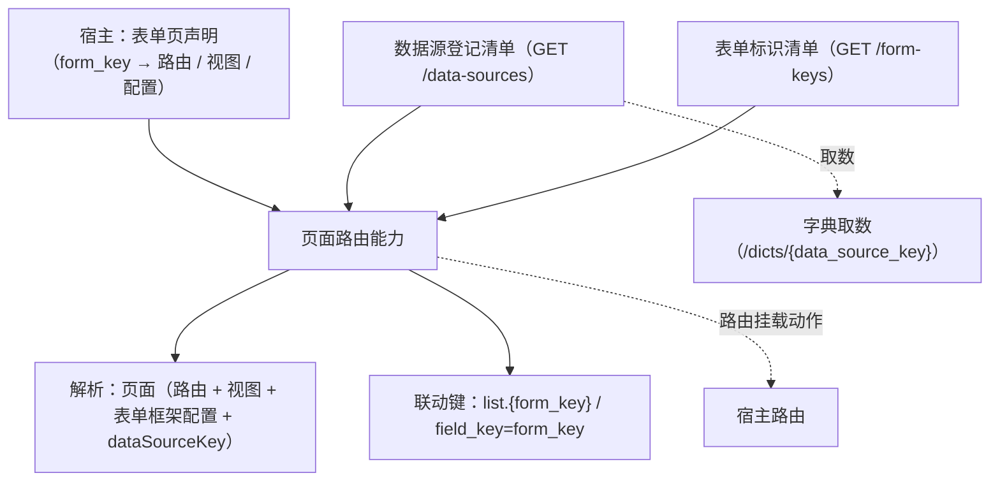

# 组件设计 · 页面路由能力

> 通用页面路由：按 `form_key` 解析页面 / 表单（表单标识 → 页面：路由 + 视图 + 表单框架配置 + 数据源），统一挂载与寻址；消费数据源 / 表单标识清单，联动查询方案与列表偏好
> 实现侧命名与落点见《[前端基类清单](../../../../../前端基类清单.md)》（§2.1 全量基类登记表；继承链全系统唯一一份），实现契约细节见项目详细设计。

[文档首页](../../../../../文档首页.md) › [项目规划说明](../../../../../规划/项目规划说明.md) › [组件设计](../../../01_组件设计_总览.md) › 页面路由能力　|　[← 模块上下文能力](../31_组件设计_模块上下文能力/31_组件设计_模块上下文能力.md)

## 1. 目的与适用范围 

定义 BMS 前端**通用页面路由能力**的组件设计：承载**「表单标识（`form_key`）→ 页面」的登记、解析与统一挂载**——菜单树 → 路由的构建 / 注册 / 卸载归[动态路由能力](../20_组件设计_动态路由能力/20_组件设计_动态路由能力.md)；本能力解决「**同一个表单 / 字典标识如何统一寻址到页面**」，并打通「界面标识（`form_key`）↔ 数据标识（`data_source_key`）」，联通[查询方案能力](../29_组件设计_查询方案能力/29_组件设计_查询方案能力.md)与[偏好持久化能力](../16_组件设计_偏好持久化能力/16_组件设计_偏好持久化能力.md)。

### 1.1 定位与职责边界 

| 职责 | 归属 |
| --- | --- |
| 表单标识 → 页面的声明登记、解析（路由 / 视图 / 配置 / 数据源）、统一挂载 | **本节点（页面路由能力）** |
| 菜单树 → 路由构建 / 注册 / 卸载、组件映射 | [动态路由能力](../20_组件设计_动态路由能力/20_组件设计_动态路由能力.md) |
| 清单下发（数据源 / 表单标识） | 后端 `GET /api/v1/data-sources` / `GET /api/v1/form-keys`（数据源注册与通用接口契约） |
| 查询方案（`business` 目标，`field_key=form_key`） | [查询方案能力](../29_组件设计_查询方案能力/29_组件设计_查询方案能力.md) |
| 列表偏好（`list.{form_key}`） | [偏好持久化能力](../16_组件设计_偏好持久化能力/16_组件设计_偏好持久化能力.md) |

上游依据：[《数据库开发规范》](../../../../../规范/数据库开发规范.md)「系统字段」节（`form_key` 用途）、[《前端开发规范》](../../../../../规范/前端开发规范.md) §7 / §8.2（动态菜单与视图名映射）、[《架构设计 · 前端架构》](../../../../架构设计/08_架构设计_前端架构.md)（动态路由与插件化）。

> 本篇为 **基础组件类 · 能力「页面路由能力」**。本基类位于继承链上（父子关系与落点见《[前端基类清单](../../../../../前端基类清单.md)》§2.1），经能力机制声明与登记，只被上位基类依赖、不在链外自由挂接。**范围边界**：菜单树 → 路由归动态路由能力；字典取数归 `BaseDictStore` / `/dicts/*`；页面渲染归渲染插件；本能力只管「表单标识 → 页面怎么解析与寻址」。

## 2. 职责与组成 

| 组成部分 | 职责 |
| --- | --- |
| 声明登记 | 宿主登记「表单标识 → 页面」（路由路径 / 名 / 标题 / meta / 列表与详情视图 / 可选显式数据源）；同键拒重、非法声明丢弃 |
| 清单装载 | 经注入适配器加载数据源登记清单与表单标识清单（幂等 / 并发去重 / 失败降级，不阻断启动） |
| 页面解析 | 按 `form_key` 解析：路由（路径 / 名）+ 视图（列表 / 详情）+ 表单框架配置（标题）+ 数据源（`dataSourceKey`）+ 联动键 |
| 统一挂载 | 宿主按声明装载 / 卸载表单页路由（幂等；跳过已存在路径；装载先于菜单占位路由） |
| 联动键派生 | 列表偏好键 `list.{form_key}`、查询方案表单标识 `field_key=form_key` |

## 3. 交互与契约语义 

| 语义项 | 说明 |
| --- | --- |
| 清单适配器 | 数据源 / 表单标识清单加载（宿主注入；缺省占位、不发请求） |
| 声明 | `declare` / `declareAll` / `declarationOf`；标识格式与路径校验，同键拒重 |
| 解析 | `resolve(formKey)`：`dataSourceKey` 取「声明显式 → 表单标识清单命中」；**须落在数据源清单内**（未登记即不可用） |
| 联动键 | `listPreferenceKeyOf` / `schemeFieldKeyOf`（页面不再各自拼键） |
| 装载 / 重置 | 幂等装载（成功即返回）；登出 / 会话失效重置清单（声明保留） |
| 占位 | 未注入适配器 / 未就绪即占位零请求（`requestCount` 恒 0），`resolve()` 返回 `undefined` |

## 4. 行为语义 

| 项 | 设计 |
| --- | --- |
| 数据源与表单标识关系 | `form_key → data_source_key` **多对一**（默认 1:1 同名，可显式共享）；界面标识面向页面、数据标识面向取数 |
| 清单来源与时机 | 会话就绪后（与动态菜单并行）装载；失败降级不阻断启动（未命中即仅声明显式数据源可用） |
| 视图名 → 组件 | 声明内直挂视图组件（列表 / 详情）；未声明回退占位视图 + 开发态告警（防白屏） |
| 挂载顺序 | 表单页路由须**先于**菜单占位路由装载（占位路由不顶替真实路由） |
| 卸载 | 登出 / 切租户：卸载表单页路由 + 重置清单（防越权） |
| 依赖方向 | 位于继承链上的能力基类；只依赖 组件根 / 占位状态基类 / 领域纯函数；供宿主与页面消费，不依赖上层 |

## 5. 场景集成 

| 场景 | 说明 |
| --- | --- |
| 登录 / 刷新恢复 | 装载清单 → 声明装载表单页路由 → 页面按 `form_key` 寻址 |
| 菜单直达 | 菜单路径命中表单页声明时以真实视图渲染（占位路由不顶替） |
| 列表页 | 以 `list.{form_key}` 读写列表偏好；`field_key=form_key` 存取筛选方案 |
| 字典字段 | 页面解析出的 `data_source_key` 经 `/dicts/{data_source_key}` 取数（与 `BaseDictStore` 协作） |
| 多界面共用数据源 | 多个 `form_key` 显式声明同一 `data_source_key`（多对一） |

## 6. 依赖接口与上游变更 

### 6.1 上游接口与口径 

| 项 | 说明 | 目标文档 |
| --- | --- | --- |
| `form_key` 用途 | 表单标识：供通用页面路由 / 查询方案 / 用户偏好引用 | [《数据库开发规范》](../../../../../规范/数据库开发规范.md)「系统字段」节 |
| 清单端点 | 统一数据源登记清单 / 表单标识清单 | [《架构设计 · 接口与集成》](../../../../架构设计/09_架构设计_接口与集成.md) §2.1 |
| 前端架构 | 动态路由 / 视图名映射 | [《架构设计 · 前端架构》](../../../../架构设计/08_架构设计_前端架构.md) |

### 6.2 需登记的上游变更 

| 变更点 | 目标文档 | 内容 |
| --- | --- | --- |
| ① 页面路由能力契约 | [《前端开发规范》](../../../../../规范/前端开发规范.md) §7 / §8.2 | 明确「表单标识 → 页面」解析与统一挂载；视图名映射 |
| ② 清单端点登记 | [《架构设计 · 接口与集成》](../../../../架构设计/09_架构设计_接口与集成.md) | `GET /api/v1/data-sources` 与 `GET /api/v1/form-keys` 登记条目 |
| ③ 前端架构 | [《架构设计 · 前端架构》](../../../../架构设计/08_架构设计_前端架构.md) | 「扩展点 + 注册表」节补「页面路由（表单标识 → 页面）」 |

> 按[《文档生成规范》](../../../../../规范/文档生成规范.md)「引用与追溯」节，上述变更需用户确认后由上游文档同步。

## 7. 权限 / i18n / 移动端 

- **权限**：路由守卫沿用；表单标识清单为登录即可，无额外权限码；页面可达性由菜单 / 路由守卫控制。
- **i18n**：页面标题取声明值（可经 i18n key）；清单名称为后端下发。
- **移动端**：同一契约的另一实现（同一套契约断言保障），机制一致（清单 / 解析 / 挂载相同，交互不同）。

## 8. 性能与边界 

| 场景 | 设计 |
| --- | --- |
| 装载 | 数据源与表单标识清单一并请求（并行）；幂等，成功即不重复拉取 |
| 解析 | 内存解析（声明 + 清单索引）；懒加载视图组件（路由级分包） |
| 边界 | 未注入适配器（占位零请求）、清单加载失败（降级不阻断）、声明非法（丢弃并告警）、数据源未登记（不可用）、重复装载（幂等）、切换租户残留（重置清空） |
| 不支持 | 菜单树 → 路由（动态路由能力）、字典取数（`BaseDictStore` / `/dicts/*`）、页面渲染（渲染插件） |

## 9. 检查清单 

- □ 契约语义：清单适配器 + 声明（登记 / 拒重 / 校验）+ 解析（路由 / 视图 / 配置 / 数据源）+ 联动键 + 装载 / 重置 / 占位
- □ 行为：多对一映射、清单装载时机与降级、视图名映射与占位、挂载顺序、卸载清空
- □ 位于继承链上（能力基类），依赖方向单向，不硬编码路由表
- □ 权限 / i18n / 移动端符合第 7 节；性能边界符合第 8 节
- □ 三项上游登记已确认

> 组件设计节点（页面路由能力）· 与[《前端开发规范》](../../../../../规范/前端开发规范.md)[《架构设计 · 前端架构》](../../../../架构设计/08_架构设计_前端架构.md)[《架构设计 · 接口与集成》](../../../../架构设计/09_架构设计_接口与集成.md)[动态路由能力](../20_组件设计_动态路由能力/20_组件设计_动态路由能力.md)[查询方案能力](../29_组件设计_查询方案能力/29_组件设计_查询方案能力.md)[《命名规范》](../../../../../规范/命名规范.md)配套
