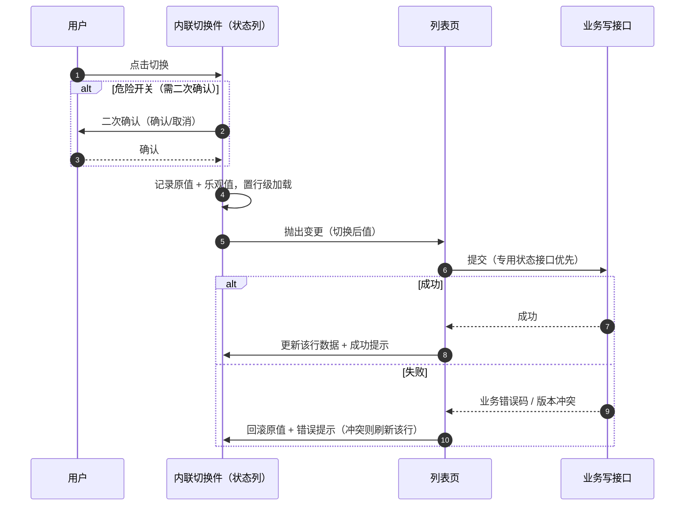

# 组件设计 · 开关字段

> 布尔开关：三态与默认值 / 启用停用文案 / 危险切换确认 / 列表与详情内联切换 / 只读回显 / 导入导出映射
> 实现侧命名与落点见《[前端基类清单](../../../../前端基类清单.md)》，实现契约细节见项目详细设计。

[文档首页](../../../../文档首页.md) › [项目规划说明](../../../../规划/项目规划说明.md) › [组件设计](../../01_组件设计_总览.md) › 开关字段　|　[← 富文本字段](../07_组件设计_富文本字段/07_组件设计_富文本字段.md)　[穿梭框 →](../09_组件设计_穿梭框/09_组件设计_穿梭框.md)

> 可交互原型：[08_原型设计_开关字段.html](08_原型设计_开关字段.html)（演示开关编辑与三态、启用/停用文案、危险确认、列表内联切换与失败回滚）

## 1. 目的与适用范围 

定义 BMS 前端**开关字段**的组件设计：布尔开关（含列表/详情内联切换）的值域与存储映射、三态与默认值、校验、只读回显与导入导出映射。适用于用户/角色/菜单/租户/系统参数等管理页的「启用停用」开关与布尔状态标记。

本节对应[《项目规划说明》](../../../../规划/项目规划说明.md)前端章节；上游设计依据[《概要设计 · 表单定制》](../../../概要设计/36_概要设计_表单定制.md)（字段类型 `switch`、字段属性与服务端动态校验）、[《概要设计 · 菜单管理》](../../../概要设计/07_概要设计_菜单管理.md)（平台字段维护与字段权限）、[《概要设计 · 导入导出》](../../../概要设计/19_概要设计_导入导出.md)（行级布尔校验与错误行报告）；页面形态依据[《布局设计 · 表单页》](../../../布局设计/08_布局设计_表单页.html)（只读/编辑分态）与[《布局设计 · 列表页》](../../../布局设计/07_布局设计_列表页.html)（无操作列、行内状态变更）；协作节点为[选项集字段](../14_组件设计_选项集字段/14_组件设计_选项集字段.md)（枚举与选项下拉）、[字典字段](../01_组件设计_字典字段/01_组件设计_字典字段.md)（字典取数与翻译）、[状态标签与描述列表](../../07_展示类/03_组件设计_状态标签与描述列表/03_组件设计_状态标签与描述列表.md)（状态标签本体）、[请求封装](../../09_基础类/01_组件设计_请求封装/01_组件设计_请求封装.md)（错误码提示）、[权限指令](../../09_基础类/02_组件设计_权限指令/02_组件设计_权限指令.md)（字段权限）。

> 本篇为「开关字段」节点。**范围边界**：枚举与选项集字段（字段类型 `option` / `option_multi`，含单选/复选/按钮/分段/标签/下拉形态）归[《组件设计 · 选项集字段》](../14_组件设计_选项集字段/14_组件设计_选项集字段.md)；字典字段（`dict` / `dict_multi`）归[《组件设计 · 字典字段》](../01_组件设计_字典字段/01_组件设计_字典字段.md)；本篇只负责布尔开关。只读态颜色标签仅保留**开关的颜色标记属性**，标签本体归 [状态标签与描述列表](../../07_展示类/03_组件设计_状态标签与描述列表/03_组件设计_状态标签与描述列表.md)。分层权威见[《前端开发规范》](../../../../规范/前端开发规范.md)「前端基类体系」节。

## 2. 职责与组成 

| 组成部分 | 职责 |
| --- | --- |
| 布尔开关件 | 布尔开关：三态（未设置）、启用/停用文案变体、危险切换确认、加载态、只读回显 |
| 内联切换件 | 列表/详情内联切换：乐观值、二次确认、行级加载、失败回滚 |
| 回显与归一 | 后端值形态归一为布尔（`0`/`1`/`'0'`/`'1'`/`'true'`/`'是'`/`'否'`）；布尔 → 只读文本（是/否或文案变体） |
| 继承链 | 布尔开关 → [基础控件类·开关](../../05_基础控件类/08_组件设计_开关/08_组件设计_开关.md) → 能力域基类 → 组件根 → 总基类；行为在链上层维护，不在组件内重复实现 |

- 字段类组件统一**受控**：受控双向绑定，变更额外抛出业务变更通知（见[《组件设计 · 总览》](../../01_组件设计_总览.md)通用设计约定）。
- 移动端与 PC 端同接口多实现（契约套件同一套断言），不引用 PC 组件（见第 10 节）。

## 3. 值域与存储口径 

| 字段类型 | 前端值 | 库值 / 列类型 | 空值 | 说明 |
| --- | --- | --- | --- | --- |
| `switch`（布尔开关） | 布尔 | `SMALLINT`（1=是/启用，0=否/停用） | 未设置 | 前端**只暴露布尔**，1/0 在组件边界归一 |

- **归一容错**：后端历史值与接口直出可能出现 `0`/`1`/`'0'`/`'1'`/`'true'`/`'是'`/`'否'`，统一归一为布尔；无法识别的值按未设置处理并记录一次性告警（开发环境）。
- **写回统一**：写回 `1`/`0`（未设置写空值）。
- 自建字段物理列类型为 `SMALLINT`，见[《概要设计 · 表单定制》](../../../概要设计/36_概要设计_表单定制.md)数据模型节。

## 4. 开关交互与契约语义 

| 语义项 | 说明 |
| --- | --- |
| 受控值与三态 | 布尔值受控；未设置（三态）可开放清空入口并展示不确定态 |
| 文案变体 | 启用/停用等文案可配，空则只显示开关本体；走 i18n |
| 危险切换确认 | 可配置切换前二次确认与自定义确认文案（如「停用后该用户将立即退出登录」）；确认前不改变受控值，确认通过后才抛出变更 |
| 加载态 | 外部提交中置加载态（内联切换由内联切换件驱动） |
| 尺寸 | 默认 / 紧凑两档（表格内用紧凑） |
| 权限 | 不可编辑时置禁用（字段权限语义由表单页下发） |
| 切换前置判定 | 可选切换前判定（不允许则撤销切换），表单页用于联动校验 |
| 值变化通知 | 受控更新 + 变更通知（**确认通过后**才抛出，未确认不产生变更）；确认取消可供页面统计/提示 |
| 确认与受控的配合 | 确认生效时先弹确认、确认前不修改值；确认后由父层提交（异步提交期间置加载态，失败由父层回滚） |

## 5. 列表/详情内联切换 

[《布局设计 · 列表页》](../../../布局设计/07_布局设计_列表页.html)「交互与状态约定」节已定案「行内状态变更（启用/停用、审批）成功后局部刷新并提示」，且列表页**无操作列**——内联切换即放置在状态列内，不新增操作按钮。

| 项 | 设计 |
| --- | --- |
| 触发 | 状态列内内联切换件（紧凑尺寸），点击即切换；不可编辑时降级为只读文本 |
| 接口 | **复用业务既有写接口**：优先业务专用状态接口（如 `PUT /users/{id}/status`），无专用接口时用该记录 update 接口；**不新增 toggle 接口** |
| 权限 | 记录级可编辑 + 业务动作权限（如 `user:update`、`tenant:manage`）；不满足则只读（见 [权限指令](../../09_基础类/02_组件设计_权限指令/02_组件设计_权限指令.md)） |
| 确认 | 危险开关弹二次确认（危险按钮样式）；普通开关免确认（对齐列表页既有口径） |
| 成功 | 行级成功提示 + **局部刷新该行**（不整表重载），行内其他字段不闪动 |
| 失败 | 回滚为原值（乐观值丢弃）+ 错误码文案提示（[请求封装](../../09_基础类/01_组件设计_请求封装/01_组件设计_请求封装.md)错误码 → i18n 映射） |
| 并发 | 同一行切换中禁用再次点击（行级加载）；不同行互不影响 |
| 乐观锁 | 后端版本冲突时提示「数据已被他人修改」并刷新该行 |

## 6. 校验与默认值 

| 项 | 规则 |
| --- | --- |
| 布尔必填 | **仅当三态且值为未设置**判未填；假值视为已填（勾选类语义：显式关闭是有效选择） |
| 布尔非必填 | 未设置与假值均可提交；只读回显分别呈现「—」与「否/停用」 |
| 默认值 | 由字段属性 `default` 提供：布尔默认假值（三态时可为未设置）；新增表单按默认值预填，属性变更不回写存量数据 |
| 服务端一致 | 新增/编辑接口按当前生效布局配置做动态校验，前端校验仅为体验前置，**以服务端为准**（[《概要设计 · 表单定制》](../../../概要设计/36_概要设计_表单定制.md)「服务端动态校验」节） |
| 时机 | 变更即时校验 + 失焦校验 + 提交前统一校验；错误文案走 i18n |

## 7. 只读回显 

| 场景 | 设计 |
| --- | --- |
| 表单只读态 / 详情页 | 置禁用展示开关本体 + 文案变体；无文案配置时按「是/否」回显 |
| 列表列（不可编辑） | 只读文本「是/否」（或字段配置的启用/停用文案），**不渲染开关控件** |
| 未设置 | 统一 `—` |
| 颜色标记（可选） | 字段属性开启时由 [状态标签与描述列表](../../07_展示类/03_组件设计_状态标签与描述列表/03_组件设计_状态标签与描述列表.md) 渲染，本节点不再自绘 |

## 8. 导入导出协作 

| 项 | 导出 | 导入（宽容归一） |
| --- | --- | --- |
| 开关 | 「是 / 否」 | 接受 `是`/`否`、`1`/`0`、`true`/`false`（大小写与全半角归一、首尾空白去除）；未知值 → 行级错误 |

- 模板列注释注明「是/否」，降低填写错误。
- 校验在导入解析阶段完成，逐行失败**跳过该行并记错误行号与原因**（[《概要设计 · 导入导出》](../../../概要设计/19_概要设计_导入导出.md)业务规则节）；提交带 `Idempotency-Key`。
- 本节点**不新增接口**，只约定布尔值 ↔ 文本的映射口径；枚举/多选的导入导出归[选项集字段](../14_组件设计_选项集字段/14_组件设计_选项集字段.md)与[字典字段](../01_组件设计_字典字段/01_组件设计_字典字段.md)。

## 9. 依赖接口与上游变更 

### 9.1 上游接口与口径 

| 项 | 说明 | 目标文档 |
| --- | --- | --- |
| 字段类型与列类型 | `switch` 在字段类型白名单内，物理列 `SMALLINT` | [《概要设计 · 表单定制》](../../../概要设计/36_概要设计_表单定制.md)、[《概要设计 · 菜单管理》](../../../概要设计/07_概要设计_菜单管理.md) |
| 字段属性承载位 | 组件形态、启用/停用文案、危险确认标记与确认文案需在表单元数据中下发 | [《概要设计 · 表单定制》](../../../概要设计/36_概要设计_表单定制.md) |
| 内联切换写接口 | 复用业务既有写接口（专用状态接口优先），不新增 toggle 接口（登记项①） | 各业务概要节点、[《布局设计 · 列表页》](../../../布局设计/07_布局设计_列表页.html) |
| 危险开关确认 | 危险切换复用统一二次确认机制与其语义（登记项②） | [《布局设计 · 列表页》](../../../布局设计/07_布局设计_列表页.html)、[《概要设计 · 表单定制》](../../../概要设计/36_概要设计_表单定制.md) |
| 导入导出映射 | 开关「是/否」宽容归一、未知值行级错误 | [《概要设计 · 导入导出》](../../../概要设计/19_概要设计_导入导出.md) |
| 字段权限 | 可见/可编辑由字段权限下发；记录级可编辑决定内联切换是否可用 | [《概要设计 · 菜单管理》](../../../概要设计/07_概要设计_菜单管理.md)、[权限指令](../../09_基础类/02_组件设计_权限指令/02_组件设计_权限指令.md) |
| 新增依赖 | **无**：复用既有开关基础控件与样式令牌 | — |

### 9.2 需登记的上游变更 

| 变更点 | 目标文档 | 内容 |
| --- | --- | --- |
| ① 列表内联切换的接口与权限 | 各业务概要节点「接口清单」节；[《布局设计 · 列表页》](../../../布局设计/07_布局设计_列表页.html) | 明确状态类字段的专用切换接口（如 `PUT /users/{id}/status`）与记录级可编辑校验；无专用接口的业务沿用 update 接口；不新增 toggle 接口 |
| ② 危险开关的二次确认与语义 | [《概要设计 · 表单定制》](../../../概要设计/36_概要设计_表单定制.md)字段属性节；[《布局设计 · 列表页》](../../../布局设计/07_布局设计_列表页.html) | 字段属性登记「危险开关（危险切换需二次确认）」标记与确认文案来源（i18n），复用既有确认口径，不引入新机制 |

> 上述变更**已由用户确认（2026-10-21）**，随本节点同步至上游文档。

## 10. 字段权限 / i18n / 移动端 

- **字段权限**：不可见由表单页不渲染；不可编辑置禁用；列表内联切换额外要求记录级可编辑（第 5 节）。开关为布尔码值，无脱敏需求（见[权限指令](../../09_基础类/02_组件设计_权限指令/02_组件设计_权限指令.md)）。
- **i18n**：文案变体、确认文案、校验提示、导入错误行文案走全局语言能力；**不翻译用户输入与库值**。
- **移动端**：简化形态实现，**只读一律纯文本**（是/否）；值域、归一与校验口径与 PC 同源（第 3、6 节），不套用 PC 组件。

## 11. 性能与边界 

| 场景 | 设计 |
| --- | --- |
| 千行列表 | 状态列内联切换为轻量控件（紧凑尺寸）；切换仅更新该行数据对象，避免整表重渲染；行级加载不阻塞其他行 |
| 连点与并发 | 切换中禁用再次点击；同一行串行；失败回滚原值，冲突（版本）则刷新该行 |
| 边界 | 三态未设置、存量脏值（`'0'`/`'1'`/`'是'`/`'否'`）、切换失败回滚、版本冲突，均纳入单测 |
| 不支持 | 开关的动画/过渡自定义、基于开关的联动显隐表达式（由表单定制的联动能力承载） |

## 12. 检查清单 

- □ 受控组件（受控双向绑定 + 变更通知）；布尔只暴露真/假，1/0 与其他形态由值归一承接
- □ 三态：未设置可展示不确定态；必填仅未设置判未填（假值视为已填）
- □ 内联切换：复用业务既有写接口（专用状态接口优先）、需记录级可编辑、危险开关二次确认、失败回滚、局部刷新与行级加载
- □ 只读回显纯文本（是/否 或启用/停用；空值 `—`）
- □ 导入导出：开关「是/否」宽容归一、未知值行级错误
- □ 字段权限（可见/可编辑）、i18n、移动端（简化形态、只读纯文本）符合第 10 节
- □ 两项上游登记已确认：内联切换接口与权限、危险开关二次确认

> 组件设计节点 · 与[《概要设计 · 表单定制》](../../../概要设计/36_概要设计_表单定制.md)[《概要设计 · 菜单管理》](../../../概要设计/07_概要设计_菜单管理.md)[《概要设计 · 导入导出》](../../../概要设计/19_概要设计_导入导出.md)[《布局设计 · 列表页》](../../../布局设计/07_布局设计_列表页.html)[《布局设计 · 表单页》](../../../布局设计/08_布局设计_表单页.html)《选项集字段》《字典字段》《命名规范》配套
