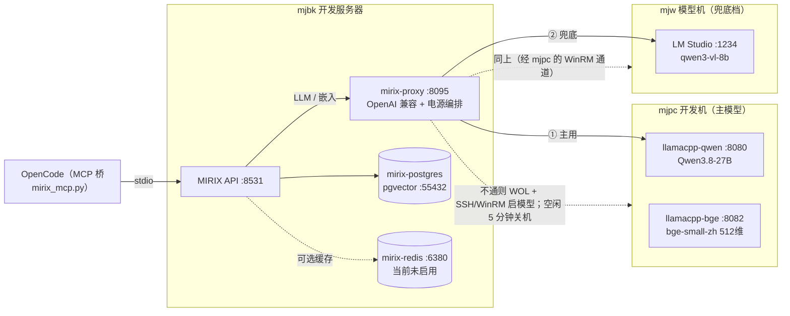

# MIRIX 部署与使用说明

> OpenCode 多层长期记忆（记忆抽取 / 分层存储 / 归并成文档）· 2026-10-13 部署

[文档首页](../../文档首页.md) › 资料 › MIRIX 部署与使用说明　|　[同级：《llamacpp部署使用说明》](llamacpp部署使用说明.md)

## 1. 目的与范围 <a id="purpose"></a>

为 OpenCode 提供**跨会话长期记忆**：从对话中抽取事实 / 偏好 / 决策 → 分**用户级 / 项目级**存储 → 定期归并整理成更精炼的记忆。

- **服务端与数据库**在开发服务器 **mjbk**；**模型**在 **mjpc**（Qwen3.8-27B 推理 + bge 中文嵌入）与 **mjw**（qwen3-vl-8b，速度兜底档）。
- 选型：MIRIX 0.1.6 起为「纯记忆系统」（REST 服务 + 客户端，桌面助理已废弃）；官方无 MCP Server，故**自建 MCP 桥**接入 OpenCode。
- IP / 账号 / 口令见《[本地资源](../../用户文档/本地资源.md)》。

## 2. 架构与组件 <a id="arch"></a>



要点：MIRIX 只连**代理**（`mirix-proxy`），模型配置保持静态；路由与模型机电源编排全在代理内完成。**只有「本次由代理 WOL 唤醒」的机器**才会空闲自动关机。

## 3. 端口与目录 <a id="layout"></a>

| 组件 | 位置 | 端口 | 说明 |
| --- | --- | --- | --- |
| MIRIX API | mjbk | 8531 | FastAPI，仅放行 mjpc |
| 模型代理 | mjbk | 8095 | OpenAI 兼容，仅本机 |
| PostgreSQL | mjbk | 55432 | 容器 `mirix-postgres`（pgvector/pgvector:pg17） |
| Redis | mjbk | 6380 | 容器 `mirix-redis`（redis-stack）；**MIRIX 侧当前关闭**，见 6.2 |
| Qwen3.8-27B | mjpc | 8080 | 系统服务 `llamacpp-qwen` |
| bge-small-zh | mjpc | 8082 | 系统服务 `llamacpp-bge`（512 维，CPU） |
| LM Studio | mjw | 1234 | `qwen3-vl-8b-instruct-abliterated-v2`（须 `--bind 0.0.0.0`） |
| Web 面板 | mjbk | 5173 | 容器 `mirix-dashboard`（官方面板，浏览/搜索/管理记忆） |

```text
mjbk:~/mirix/
├── compose.yml / init.sql / .env        # pgvector + redis-stack 编排与凭据
├── src/  venv/  install.sh              # MIRIX 源码与环境
├── init_client.py  make_key.py  cn_prompts.py   # 一次性初始化脚本
├── meta_agent.json  api_key.txt         # 初始化产物（key 权限 600）
├── auto_dream.sh                        # 定时归并脚本
└── proxy/  (proxy.py, config.json)      # 模型代理（config 含口令，权限 600）
```

## 4. mjbk 侧部署 <a id="deploy-mjbk"></a>

### 4.1 依赖容器 <a id="deploy-containers"></a>

```bash
cd ~/mirix && docker compose --env-file .env up -d mirix-postgres mirix-dashboard   # PG 55432 + 面板 5173
# Redis 6380 当前不启动（见 6.2）
```

初始化库时已建扩展 `vector`（pgvector）/ `uuid-ossp` / `pg_trgm`。

### 4.2 模型代理 <a id="deploy-proxy"></a>

系统服务 `mirix-proxy.service`，配置 `~/mirix/proxy/config.json`：

- `chat_targets`：**mjpc-qwen27b → mjw-qwen3vl8b**（27B 优先、8B 兜底）。
- `emb_targets`：**mjpc-bge-zh**（嵌入**不做**跨模型兜底——换模型会变维度、索引不兼容）。
- `power_groups`：`mjpc`、`mjw` 均开启 WOL 唤醒 + 远程启模型 + 空闲 5 分钟关机。

链路：请求命中健康缓存 → 不通则 WOL → SSH 到目标机启模型（mjw 走 mjpc 的 WinRM 通道）→ 等健康 → 转发。
**保护**：仅「本次由代理 WOL 唤醒」的机器会空闲关机；本就开着的机器不自动关。

```bash
sudo systemctl restart mirix-proxy
curl -s localhost:8095/health    # 各上游 ok/down
curl -s localhost:8095/status    # 电源组：woke / inflight / idle_s
```

### 4.3 服务端 <a id="deploy-server"></a>

系统服务 `mirix.service`（`~/mirix/src` 源码 + `~/mirix/venv`），启动即 `alembic` 建表；配置在 `~/mirix/.env`（PG / Redis / JWT）。

首次初始化（已执行，产物见 `~/mirix/meta_agent.json`、`api_key.txt`）：
`init_client.py` 建 client + meta agent；`make_key.py` 本地签 JWT 建 API Key 与分层用户；`cn_prompts.py` 覆盖各 agent 提示词为**中文输出**。

### 4.4 源码补丁（MIRIX 自身缺陷，升级后需重打） <a id="patches"></a>

对 `~/mirix/src/` 打了 4 组补丁（各自留有 `.bak*` 备份）：

| # | 文件 | 问题 | 修复 |
| --- | --- | --- | --- |
| 1 | `server/rest_api.py` | 消息 `content` 为 OpenAI 数组格式时，`extract_topics_and_temporal_info` 与 `/memory/add` 报 `str + dict` | 兼容字符串与数组两种格式（3 处） |
| 2 | `services/admin_user_manager.py` | 面板登录 `authenticate()` 触发同步惰性加载 → `MissingGreenlet`；`last_login` 写库时区不匹配 | 改为原生 `UPDATE` + 直接构造 Pydantic 对象、写 naive UTC |
| 3 | `server/rest_api.py` | `/users` 列表引用不存在的 `server.admin_user_manager` | 改为 `server.client_manager` |

> 升级 MIRIX（`git pull`）后需重打，否则抽取、面板登录、用户列表会分别报错。

### 4.5 定时归并 <a id="timer"></a>

`mirix-auto-dream.timer`（每日 **08:40**，mjbk 08:00 自醒后）→ `auto_dream.sh`：对 `users` 表每个用户跑一次 `auto_dream`（experience 模式）。日志 `~/mirix/auto_dream.log`。

## 5. 模型机部署 <a id="deploy-models"></a>

### 5.1 mjpc（主模型） <a id="deploy-mjpc"></a>

系统服务（`scripts/tools/llamacpp/install-systemd.sh` 一次性安装，需 sudo）：
`llamacpp-qwen`（8080）+ `llamacpp-bge`（8082）；**默认不自启**，由代理 SSH `systemctl start` 按需拉起，`Restart=always`。
ufw 仅放行 mjbk（22 / 8080 / 8082）；mjbk → mjpc 走公钥免密 SSH。

### 5.2 mjw（速度兜底） <a id="deploy-mjw"></a>

- 自动启停已接入：代理 WOL 唤醒 → **经 mjpc 的 WinRM 通道**执行
  `scripts/tools/winrm/pwsh_mjw.py --file scripts/tools/winrm/mjw_lmstudio_start.ps1`
  （`lms server start --bind 0.0.0.0 --port 1234` + `lms load qwen3-vl-8b...`）→ 空闲后 `shutdown_mjw.py --yes` 关机。
- 已加 Windows 防火墙入站规则放行 mjbk → 1234（`LM Studio API 1234 (mjbk)`）。
- 注意：**必须 `--bind 0.0.0.0`**，否则 LM Studio 只监听 127.0.0.1，外部不可达。

## 6. OpenCode 接入 <a id="opencode"></a>

### 6.1 MCP 桥 <a id="mcp"></a>

`bms/scripts/tools/mirix/mirix_mcp.py`（纯标准库 stdio，NDJSON 协议），在全局 `~/.config/opencode/opencode.jsonc` 的 `mcp.servers.mirix` 注册。工具：

| 工具 | 作用 |
| --- | --- |
| `remember` | 写入记忆（异步抽取）；`scope=project`（默认，`minjian@<项目名>`）/ `user` / `both` |
| `recall` | 语义检索分层记忆 |
| `list_memories` | 分层尽览各类型条目与数量 |
| `consolidate` | 归并整理（`auto_dream`，支持 dry_run） |
| `memory_status` | 服务健康与记忆概览 |

分层：**用户级** `user_id=minjian`；**项目级** `user_id=minjian@<工作区名>`（按 `*.code-workspace` / git 根自动取，如 `minjian@bizs`）。
凭据从 `deploy/.env` 的 `MIRIX_API_BASE` / `MIRIX_API_KEY` / `MIRIX_META_AGENT_ID` 读取。

### 6.2 Redis 说明（当前关闭） <a id="redis"></a>

MIRIX 的 Redis 向量索引固定按 4096 维建，而 bge-small-zh 只有 512 维 → 搜索报维度不匹配、**召回为空**。已在 `~/mirix/.env` 设 `MIRIX_REDIS_ENABLED=false` 改走 pgvector，检索恢复。容器 `mirix-redis` 仍保留（可选缓存/后续版本修复再用）。

### 6.3 命令 <a id="commands"></a>

全局命令（`~/.config/opencode/commands/`）：`/记住 <内容>`、`/整理记忆`（先预览后归并）、`/记忆状态`。

### 6.4 Web 面板（浏览 / 搜索 / 管理记忆） <a id="dashboard"></a>

官方 React 面板，容器 `mirix-dashboard`（`:5173`），nginx 把 `/api/` 反代到宿主机 MIRIX 服务
（compose 用 `extra_hosts: mirix_api:host-gateway`）。访问 **http://<mjbk-IP>:5173**，用面板账号登录后
在「Memories」页右上角选择作用域用户（`minjian` 用户级 / `minjian@bizs` 项目级）即可浏览各记忆类型
（Episodic / Semantic / Procedural / Resource / Knowledge / Core），支持搜索与管理。

> 面板按 **client** 隔离：登录凭据挂在存记忆的 client（`mirix-cli`）上，否则看不到记忆。
> 需 ufw 放行 5173，以及 **docker 网段 → 宿主机 8531**（`ufw allow from 172.16.0.0/12 to any port 8531`）。

### 6.5 重置记忆（清库重抽） <a id="reset"></a>

清空记忆（保留 client / 用户）并重灌历史对话：

```bash
cd ~/mirix && venv/bin/python recover_memories.py     # 清空 + 重建 agents（中文提示词）+ 重灌
```

> **注意**：不能只 `TRUNCATE messages` —— agent 依赖系统提示消息，只清消息会导致
> `assert in_context_messages[0].role == system` 失败、抽取全断。必须连同 `agents` 一起重建。
> 另：`block` 表被清空后需补 `human` / `persona` 段，且 block id 须匹配 `^block-[a-fA-F0-9]{8}`。

## 7. 验证 <a id="verify"></a>

```bash
# 代理链（mjbk）
curl -s localhost:8095/health
# MIRIX 健康
curl -s localhost:8531/health
# 写入并检索（经 MCP 桥）
#   /记住 以后前端依赖一律用 pnpm
#   /记忆状态
```

## 8. 排障 <a id="troubleshooting"></a>

| 现象 | 排查 |
| --- | --- |
| 代理 503 no_upstream | 本地机不可达且无外网兜底；`localhost:8095/status`、`journalctl -u mirix-proxy` |
| 代理 502 upstream_error | 上游模型异常；mjpc 上看 `journalctl -u llamacpp-qwen` |
| mjpc 唤不醒 | BIOS/网卡 WOL、ufw、交换机是否拦广播 |
| mjw 1234 不可达 | 确认 `lms server start --bind 0.0.0.0`；防火墙规则是否放行 mjbk |
| 检索无结果 | 是否误开 Redis（见 6.2）；client 的 `read_scopes` 需含 `"*"` |
| 记忆内容是英文 | `cn_prompts.py` 是否已跑；重跑后新写入即为中文 |
| 升级 MIRIX 后报 content 错误 | 重打 4.4 的补丁 |

## 9. 关联文档 <a id="related"></a>

- 《[llamacpp部署使用说明](llamacpp部署使用说明.md)》：mjpc 本地模型（3.3.1 节为供 MIRIX 的系统级服务）
- 《[LM Studio模型服务使用说明](LM Studio模型服务使用说明.md)》：mjw LM Studio 服务与凭据
- 《[本地资源](../../用户文档/本地资源.md)》：IP / 账号 / 口令
- 《[文档生成规范](../../规范/文档生成规范.md)》：本文档格式依据

---

> 依《文档生成规范》编写 · 记录 2026-10-13 部署过程
