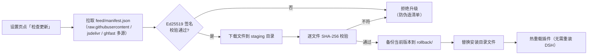
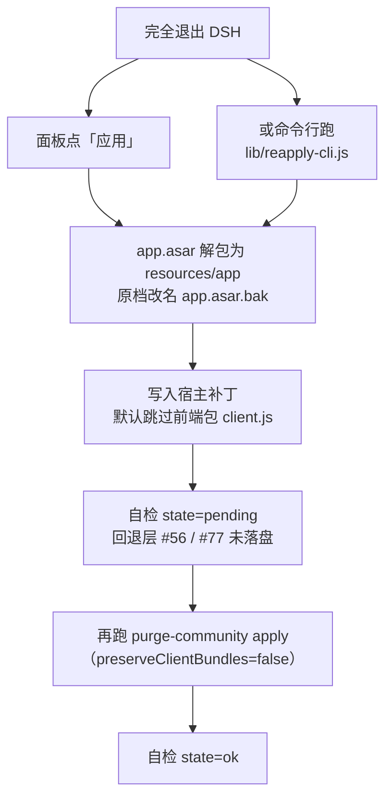

# deepseek_harness Windows 桌面版部署使用说明

> mjpc（Windows 11 侧）· DeepSeek Harness 桌面版 `0.2.2-rc.3`（Electron 44.7.0）· 插件市场、Our Free Model 与 dsh-purge 的安装与更新

[文档首页](../../../文档首页.md) › 资料 › [AI](../) › [windows](./) › deepseek_harness Windows 桌面版部署使用说明

## 1. 目的与适用范围 <a id="purpose"></a>

本文档记录 DSH **桌面版（Electron 客户端）**在 **mjpc 的 Windows 侧**的部署形态、插件机制与更新方法。

mjpc 是同机双系统：Ubuntu 侧跑的是**源码版** dsh（`node apps/cli/lib/bin.js web`），Windows 侧跑的是**桌面版**
（安装包形态，独立进程与独立 profile）。两者**插件目录、插件管理机制、更新方式全不相同**，不可混用命令。

| 项 | 桌面版（本文档） | 源码版 |
| --- | --- | --- |
| 典型机器 | mjpc Windows 侧 | mjpc Ubuntu 侧、mjw |
| 部署文档 | 本文档 | 《[deepseek_harness部署使用说明](../linux/deepseek_harness部署使用说明.md)》（Linux/mjpc）、[deepseek_harnessWindows部署使用说明](../../开发服务器/windows/deepseek_harnessWindows部署使用说明.md)（mjw） |
| 安装方式 | 安装包（`DeepSeek Harness.exe`） | `git clone` + `pnpm install` + `pnpm run build` |
| profile 目录 | `~/.dsh/profiles/desktop/` | `~/.dsh/profiles/web/` |
| 插件管理 | 应用内 in-process 插件管理器（设置 → 插件） | `dsh plugin --profile web add <pkg>`（转发 pnpm） |
| 命令行 | **有，但未进 PATH**：`resources\runtime\cli\bin\dsh.cmd`，须带 `--profile desktop` | `node apps/cli/lib/bin.js` |
| 访问地址 | 应用自动起 Web 服务（随机端口，仅 `127.0.0.1`） | `http://127.0.0.1:3080` |

> 本文档的取值（安装路径、端口、进程号）均取自 mjpc Windows 侧实测；机器通用信息见《[本地资源](../../../用户文档/本地资源.md)》。

## 2. 安装与版本 <a id="install"></a>

### 2.1 安装形态 <a id="install-layout"></a>

桌面版为 Electron 应用，按用户级安装（无需管理员）：

```text
C:\Users\<用户>\AppData\Local\Programs\DeepSeek Harness\
├── DeepSeek Harness.exe          # 主可执行文件（Electron）
├── version                       # Electron 版本（本机 44.7.0）
├── Uninstall DeepSeek Harness.exe
└── resources\
    ├── app.asar                  # 应用主体（约 199 MB；dsh-purge 应用宿主补丁后解包为 app\，原档改名 app.asar.bak）
    ├── app.asar.unpacked\        # 原生模块（node-pty / sherpa-onnx / libreoffice-kit 等）
    ├── runtime\                  # 内置运行时
    │   ├── versions.json         # node 24.21.0 / pnpm 11.28.5
    │   ├── bin\                  # 内置 node
    │   ├── cli\bin\dsh.cmd       # dsh 命令包装（未加入 PATH，见 2.2）
    │   └── primary-runtime\      # node / pnpm / python 三套依赖
    └── app-update.yml            # 自动更新源（nightly 通道）
```

应用整体约 **1.0 GB**（含内置 node、pnpm、Python 及其库；打 dsh-purge 宿主补丁后约 2.4 GB，见 4.5.4）。版本信息有两层，不要混：

| 项 | 取值 | 来源 |
| --- | --- | --- |
| Electron 版本 | 44.7.0 | 安装目录 `version` 文件 |
| 应用版本 | 0.2.2-rc.3 | `app.asar` 内根 `package.json` 的 `name: @deepseek-ai/dsh-desktop` |
| 内置运行时 | node 24.21.0 / pnpm 11.28.5 / Python 3.12.14 | `resources\runtime\versions.json` |

### 2.2 与源码版的关键差异 <a id="install-diff"></a>

- **`dsh` 命令有，但未加入 PATH**：命令包装在 `resources\runtime\cli\bin\dsh.cmd`（调用 Electron 的 `--expose-internals` 跑
  `dsh-desktop-host` 的 CLI），`~\.dsh\bin\` 不存在。因此在 PowerShell 里要用**全路径**调用，并显式带 `--profile desktop`：
  `& "<安装目录>\resources\runtime\cli\bin\dsh.cmd" plugin --profile desktop list`（实测可用）。源码版文档里的 `dsh xxx`
  把 `dsh` 换成该全路径即可，不需要另建 shim。
- **profile 固定为 `desktop`**：环境变量 `DSH_PROFILE=desktop`，profile 目录 `C:\Users\<用户>\.dsh\profiles\desktop\`。
  桌面端**独占**该 profile——运行中的桌面进程持有它，装/改插件前必须完全退出 DSH（5.2）；CLI 本身不会拒绝 `--profile desktop`。
- **Web 服务由应用托管**：主进程派生一个 `dsh-desktop-host` 子进程跑 Web 服务，端口**随机**（本机实测 `127.0.0.1:60910`），
  仅监听 `127.0.0.1`。浏览器访问由应用内的 WebView 承载，一般不单独开浏览器。

## 3. 数据目录 <a id="dirs"></a>

桌面版有两套数据目录，**不要混淆**：

```text
C:\Users\<用户>\AppData\Roaming\@deepseek-ai\dsh-desktop\   # Electron 层（56 MB）
├── logs\                          # 启动崩溃日志（crash-*-web-boot.log 等）
├── Local Storage\ / IndexedDB\    # 渲染进程存储
├── Preferences                    # 窗口与外观偏好
└── .updaterId                     # 自动更新标识

C:\Users\<用户>\.dsh\                # DSH_HOME（DSH 自身数据）
├── profiles\desktop\              # 桌面版 profile（插件装在这里）
│   ├── package.json               # 依赖清单 + dsh.profile.bundles 图层顺序
│   ├── pnpm-lock.yaml             # 锁文件（必须与 package.json 同步）
│   ├── pnpm-workspace.yaml        # 发布新鲜度白名单 allowBuilds 等
│   ├── cordis.patch.yml           # 用户补丁层（模型、端口、插件配置）
│   ├── node_modules\              # 插件实际安装位置
│   ├── vendor\dsh-our-free-model\ # Our Free Model 以本地链接方式装入
│   └── .plugin-manager\logs\      # 每次安装/更新的 pnpm 日志
├── .credentials.yaml              # API Key（write-only）
├── sessions\ / storages\          # 会话与存储
├── logs\                          # 启动诊断（startup-*.log）
├── prompt-inject.md               # dsh-purge 注入文件（每步重贴，见 4.5）
├── dsh-purge\                     # dsh-purge 状态（applied.json / installed-rev 等）
├── dsh-purge-community\backups\   # dsh-purge 写宿主前的快照
├── dsh-market\                    # 插件市场的构建标识
└── our-free-model\                # Our Free Model 数据（设置、目录缓存、备份）
```

> 桌面版**没有** `~/.dsh/settings.yaml`（源码版有）；模型与 provider 配置改由 `profiles\desktop\cordis.patch.yml` 承载。

## 4. 插件机制 <a id="plugins"></a>

### 4.1 插件如何生效 <a id="plugins-load"></a>

插件分**两半**：Node 侧（`main` 入口）与浏览器侧（`dsh.client` 声明的 `client.js`）。装载顺序由
`profiles\desktop\package.json` 的 `dsh.profile.bundles` 数组决定，数组即图层栈，后项覆盖前项。

```text
profiles\desktop\package.json
├── dependencies            # 装了什么包（版本在此钉死）
└── dsh.profile.bundles     # 按序装载哪些包（顺序即优先级）
```

因此**手工改插件必须同时动三处**，缺一处就会不一致：

| 文件 | 作用 | 漏改的后果 |
| --- | --- | --- |
| `package.json` 的 `dependencies` | 声明版本 | pnpm 装不到目标版本 |
| `package.json` 的 `dsh.profile.bundles` | 声明装载 | 装了但不生效（无报错） |
| `pnpm-lock.yaml` | 锁死实际版本与哈希 | 下次安装被回退 |

### 4.2 插件市场 dshmarket <a id="plugins-market"></a>

`dshmarket` 在应用内提供可视化插件市场（设置 → 插件市场，侧边栏亦可入口），可浏览、搜索、一键安装社区插件。

| 项 | 值 |
| --- | --- |
| 包名 | `dshmarket`（本文不记版本号——市场按日发版，现查：`npm view dshmarket version`） |
| 仓库 | <https://github.com/dsh-market/dsh-market>（MIT） |
| 落位 | `profiles\desktop\node_modules\dshmarket`，`bundles` 中登记为 `dshmarket`，patch 插入 `id: dsh-market` |
| 区域设置 | `.dsh-market\state.json`：`region: china`（国内走腾讯云镜像 `mirrors.cloud.tencent.com/npm`） |
| 运行日志 | `.dsh-market\log.ndjson`（每次安装/更新一行，含 exit code 与失败原因） |
| 数据目录 | `.dsh-market\`（区域、分组、禁用列表、兼容性探测缓存） |

**市场能更新别的插件；更新自己则要分版本看**——1.73.19 之前是踩过的坑，机制见 4.2.1。

#### 4.2.1 市场自更新失败的根因 <a id="plugins-market-selfupdate"></a>

对 `dshmarket` 自己点「更新」，**在 1.73.19 之前必然失败**，日志形如：

```text
dshmarket -> dshmarket@<目标版本> exit=1 err=… 市场不能在自己的请求里更新自己：桌面端的移除会先把市场从正在运行的组合里摘掉 …
```

> 提示文案随版本变过（早期是「市场不能在自己的请求里先卸载自己」，现为上面这条并附手工升级命令），
> 拒绝行为在 1.73.19 之前没变。

原因（上游 issue `#900`）：桌面端的更新是「先卸载旧版 → 再安装新版」两步。卸载会把市场自己从运行中的插件组合里摘掉，
而负责执行「安装新版」的代码**正是市场自己**——它已经被卸载，补装那一步永远不会执行。所以这不是网络、版本或权限问题，
是设计上的自引用死结。

**处置：旧版本更新市场不要从市场界面点，改用 4.3 的手工流程。** 2026-10-22 复核时 `lib/official-desktop.js` 的
`market-self-update` 拒绝逻辑仍在，命中后只返回一句「改用 pnpm 手工升级」的提示。**2026-11-14 实测 1.73.19 已可由桌面端
插件管理器完成自更新**：`.dsh-market\log.ndjson` 记 `dshmarket -> dshmarket@1.73.19 exit=0`、`drain update dshmarket: succeeded`，
文件已替换为 1.73.19。若你的版本仍被拒绝（自引用或「有 agent 正在运行」），按 4.3 手工流程处理。

> 若市场界面提示「有 agent 正在运行，拒绝更新」：那是另一层保护——替换插件文件前禁止有会话在跑。等会话结束再操作，
> 或按 4.3 手工更新（手工流程不受此限制，但要自己承担文件被替换的风险）。

### 4.3 手工更新插件的流程 <a id="plugins-manual"></a>

适用于**市场自己更新失败**、或需要在会话进行中更新、或桌面端设置页也失败的情况。

#### 4.3.1 前置：备份 <a id="plugins-manual-backup"></a>

```powershell
$prof = "$env:USERPROFILE\.dsh\profiles\desktop"
$bak  = "$prof\.update-backup-$(Get-Date -Format 'yyyyMMdd-HHmmss')"
New-Item -ItemType Directory -Path $bak -Force | Out-Null
Copy-Item "$prof\package.json","$prof\pnpm-lock.yaml","$prof\pnpm-workspace.yaml" $bak
```

#### 4.3.2 改版本并安装 <a id="plugins-manual-install"></a>

以升级市场为例（2026-10-22 实测，全程约 4 秒）。目标版本现查：`npm view dshmarket version`（国内走镜像 `--registry=https://mirrors.cloud.tencent.com/npm/`）。

```powershell
$prof = "$env:USERPROFILE\.dsh\profiles\desktop"
$node = "C:\Users\$env:USERNAME\AppData\Local\Programs\DeepSeek Harness\resources\runtime\primary-runtime\dependencies\node\bin\node.exe"
$pnpm = "C:\Users\$env:USERNAME\AppData\Local\Programs\DeepSeek Harness\resources\runtime\primary-runtime\dependencies\pnpm\dist\pnpm.mjs"

# 1) 改 package.json 的 dependencies 版本号（用编辑器或脚本，这里用脚本示例）
$pj = Get-Content "$prof\package.json" -Raw | ConvertFrom-Json
$pj.dependencies.dshmarket = "<目标版本>"
$pj | ConvertTo-Json -Depth 10 | Set-Content "$prof\package.json" -Encoding UTF8

# 2) 用桌面版自带的 pnpm 安装（必须用它，不要用全局 pnpm）
Push-Location $prof
& $node $pnpm install --no-frozen-lockfile
Write-Host "EXIT=$LASTEXITCODE"
Pop-Location

# 3) 核对落盘版本
(Get-Content "$prof\node_modules\dshmarket\package.json" -Raw | ConvertFrom-Json).version
```

关键点：

- **必须用桌面版内置的 pnpm**（`resources\runtime\primary-runtime\dependencies\`），它带着 profile 期望的 pnpm 版本（11.28.5）
  与依赖存储目录。用全局 pnpm 容易把 `node_modules` 布局改坏。
- `--no-frozen-lockfile` 让 pnpm 按新的 `package.json` 重算并更新锁文件；装完可再用
  `install --frozen-lockfile --lockfile-only --dry-run` 验证锁文件已同步（输出 `is up to date` 即一致）。
- `dsh.profile.bundles` **不用改**——包的登记名没变，只改版本。
- 安装耗时通常几秒到十几秒；若报 `ECONNRESET` 多为镜像抖动，重试即可。

#### 4.3.3 发布新鲜度门槛 <a id="plugins-manual-freshness"></a>

**pnpm 11 自带 `minimumReleaseAge` 门槛（1440 分钟 = 24 小时）**：发布不满 24 小时的新版本不会被自动选中，
表现为静默回退到旧版本。profile 的 `pnpm-workspace.yaml` 里**没有** `minimumReleaseAge` 这一行（不要去找），
只有 `minimumReleaseAgeExclude` 白名单——要装一个刚发布的版本，需把该版本追加进对应包名的那一行：

```yaml
# ~/.dsh/profiles/desktop/pnpm-workspace.yaml
minimumReleaseAgeExclude:
  - dshmarket@<已豁免版本1> || <已豁免版本2> || <本次目标版本>
```

> 同一个包名只能写一条规则，多个版本用 `||` 串联——写多条会被 pnpm 静默忽略。
>
> **实测要点（2026-10-22）**：新装一个年轻版本时 pnpm 会**自动**把该版本写进白名单并打印
> `Added 1 entry to minimumReleaseAgeExclude`；但**锁文件校验是硬的**——已进 `pnpm-lock.yaml` 的版本若不在白名单，
> 后续任何 `pnpm install` 都会被 `ERR_PNPM_MINIMUM_RELEASE_AGE_VIOLATION` 整轮拦下（不是静默回退）。
> 所以「先装、后补白名单」这条路走不通，顺序必须是**先补白名单、再装**。

#### 4.3.4 回滚 <a id="plugins-manual-rollback"></a>

```powershell
$prof = "$env:USERPROFILE\.dsh\profiles\desktop"
$bak  = "$prof\.update-backup-<时间戳>"      # 换成实际备份目录

Copy-Item "$bak\package.json","$bak\pnpm-lock.yaml","$bak\pnpm-workspace.yaml" $prof -Force
# 然后完全退出 DSH，重跑：
$node = "C:\Users\$env:USERNAME\AppData\Local\Programs\DeepSeek Harness\resources\runtime\primary-runtime\dependencies\node\bin\node.exe"
$pnpm = "C:\Users\$env:USERNAME\AppData\Local\Programs\DeepSeek Harness\resources\runtime\primary-runtime\dependencies\pnpm\dist\pnpm.mjs"
Push-Location $prof; & $node $pnpm install --frozen-lockfile; Pop-Location
```

### 4.4 Our Free Model（dsh-our-free-model） <a id="plugins-ofm"></a>

在 DSH 内直连免密免费模型（DeepSeek V4.1 Flash、Kimi K3 等），无需登录、注册或填 API Key；2.0 起另接入
CodeArts、CodeBuddy、WorkBuddy、Qoder、TRAE、Cline 等账号渠道，并提供 Token 用量看板与 OpenAI 兼容的本地转发端口。

| 项 | 值 |
| --- | --- |
| 包名 / 版本 | `dsh-our-free-model`，当前 2.8.3（2026-11-14 由 2.8.0 升级） |
| 仓库 | <https://github.com/Ebony-Vinyl/dsh-our-free-model>（MIT） |
| 安装形态 | **本地链接**：`profiles\desktop\vendor\dsh-our-free-model`，`dependencies` 记 `link:vendor/dsh-our-free-model` |
| 界面入口 | 设置页分区「Our Free Model」（`settings.section` id `our-free-model`），含「插件升级」小节 |
| 数据目录 | `~\.dsh\our-free-model\`：`settings.json`（开关与偏好）、`updates.json`（升级历史）、`rollback\`（备份） |
| 升级入口 | 设置页 → Our Free Model →「插件升级」→「检查更新」/「恢复备份」 |

#### 4.4.1 与插件市场的更新方式完全不同 <a id="plugins-ofm-update"></a>

Our Free Model **不走 pnpm、不走插件市场**，而是自己从 GitHub 拉取签名清单后逐文件替换：



要点：

- **不需要动 `package.json` 与锁文件**，也不要用 pnpm 去装它——它是以 `link:` 方式挂进 profile 的本地目录，
  pnpm 管不到它的内部文件。
- 升级**失败可回滚**：设置页「恢复备份」按钮，对应 `~\.dsh\our-free-model\rollback\` 里的上一版文件。
- 升级历史记在 `updates.json`，每次含 `from`/`to`/`ok`/`error`；排障先看这个文件。
- 常见失败：`staging failed: … The operation was aborted due to timeout` 是下载超时（本机实测过一次，重试即成功）；
  `size X != manifest Y` 是清单与文件不匹配（上游发布瞬间抓到了半成品，等几分钟重试）。

#### 4.4.2 版本口径 <a id="plugins-ofm-version"></a>

`settings.json` 里有三个版本字段，排查时按此判断：

| 字段 | 含义 |
| --- | --- |
| `installedVersion` | 磁盘上已安装的版本 |
| `updateNotifiedFor` | 已提示过的新版本（不代表已安装） |
| `catalogSyncedAt` | 模型清单上次同步时间（与插件版本无关） |

### 4.5 dsh-purge Community（宿主补丁） <a id="plugins-purge"></a>

社区插件，在官方宿主上关闭沙箱与审批拦截、剥离官方身份提示词，并把 `~\.dsh\prompt-inject.md` 作为每一步 system prompt 的
section 重新贴上。**它不是纯插件**：真正起作用的部分写在解包后的宿主 `resources\app` 里（`@deepseek-ai` 各包的提示词、沙箱与
审批代码），装完必须再做一次「应用」，而「应用」会把 `app.asar` 解包成目录并改写 `dsh.cmd` 包装。

| 项 | 值 |
| --- | --- |
| 包名 / 版本 | `dsh-purge-community`，1.7.18 |
| 仓库 | <https://github.com/kingcharleslzy-ai/dsh-purge>（MIT；发行页附 `SHA256SUMS.txt`） |
| 安装入口 | 官方 CLI：`dsh plugin --profile desktop add <发行 TGZ>` |
| 依赖记法 | `dependencies` 记发行 TGZ 的 https URL；`dsh.profile.bundles` 末尾追加 `dsh-purge-community` |
| 插件落位 | `profiles\desktop\node_modules\dsh-purge-community\`：`bin/community.js` 命令入口、`lib/reapply-cli.js` 解包换包入口 |
| 宿主落位 | `resources\app\`（解包后的宿主）；原 `app.asar` 改名 `app.asar.bak`，另留 `app.dshpurge-prev*\` 快照目录 |
| 注入文件 | `~\.dsh\prompt-inject.md`（实测 25128 字节；面板或 `dsh-purge --edit` 可改） |
| 状态 | `~\.dsh\dsh-purge\`：`applied.json`、`installed-rev`、`unpacked-asar.json`、`override-state.json` |
| 快照 | `~\.dsh\dsh-purge-community\backups\<时间戳>-<哈希>\`，每次写宿主前一份（实测 1.8 MB / 343 个文件） |

#### 4.5.1 安装（先完全退出 DSH）

```powershell
$dsh = "C:\Users\$env:USERNAME\AppData\Local\Programs\DeepSeek Harness\resources\runtime\cli\bin\dsh.cmd"
$tgz = "https://github.com/kingcharleslzy-ai/dsh-purge/releases/download/v1.7.18/dsh-purge-community-1.7.18.tgz"

& $dsh plugin --profile desktop add $tgz
& $dsh plugin --profile desktop list     # 核对：dsh-purge-community@1.7.18
```

- **必须用发行 TGZ 的固定版本 URL**，不要写成 `add dsh-purge-community`（npm 上没有该包），也不要用 `npx` 另拉一套宿主。
- 装前先完全退出 DSH（5.1），装完**不要**立刻重开，先做 4.5.2 的应用。
- 发行页的 `SHA256SUMS.txt` 可核对下载包（本机实测 `7a1f102e…f43b084`，与官方一致）。
- 装完面板会多出「Purge」分区（状态 / 应用 / 维护 / 本机备份），左侧栏也有整页入口。

#### 4.5.2 应用宿主补丁（两阶段，容易漏第二步）



第一阶段解包并写入绝大多数补丁，但 `reapply` 默认 `preserveClientBundles=true`，会**跳过**前端包
`dsh-client-ui-conversation\lib\client.js`（避免运行时改 mtime）；因此首轮自检会在「回退不残留」层留下 #56
`REWIND_HIDE_CUT_ONLY`、#77 `REWIND_DROP_SENT_ON_APPEND` 两条 pending。补齐用官方 CLI 的 `apply`：

```powershell
$exe = "C:\Users\$env:USERNAME\AppData\Local\Programs\DeepSeek Harness\DeepSeek Harness.exe"
$cli = "C:\Users\$env:USERNAME\.dsh\profiles\desktop\node_modules\dsh-purge-community\bin\community.js"

$env:ELECTRON_RUN_AS_NODE = '1'
& $exe $cli apply            # 第二遍：把 #56 / #77 / #96 等前端补丁写进 client.js
& $exe $cli selfcheck --json
```

- `apply` 在宿主**仍是密封 `app.asar`** 时会被直接拒绝（提示「官方宿主在 app.asar 里，点「应用」会解开…」），所以顺序
  必须是**先解包、再 apply**。
- 命令行走桌面版自带的 Electron 运行时（`ELECTRON_RUN_AS_NODE=1`），不需要另装 node。
- 单独跑 `lib/reapply-cli.js` 时，实例定位会落到少一层 `dsh` 的 `resources\app\node_modules\@deepseek-ai`（空目录），
  需显式设 `$env:DSH_BASE = "<安装目录>\resources\app\dsh\node_modules\@deepseek-ai"`；面板入口没有这个问题。
- 应用完**再完全退出并重开 DSH**，宿主与前端包才以新代码装载（5.2）。

#### 4.5.3 自检口径（实测值）

`purge-community selfcheck --json` 把补丁折成 22 个宿主层 + 运行时注入 / profile 权限 / 磁盘布局 3 项。本机合格状态：

| 字段 | 实测值 | 说明 |
| --- | --- | --- |
| `state` / `needsApply` | `ok` / `false` | 各层全部通过，没有待应用项 |
| `level` / `qualified` | `qualified` / `true` | 宿主 `0.2.2-rc.3` 逐条锚点回归验证 |
| `patch.applied` | `76 / 77` | 计入统计的补丁（`all` 为 88） |
| `patch.na` | 7 | 目标预设 / hooks 插件未安装（#28、#30、#31、#64、#65、#71、#76） |
| `patch.skipped` | 3 | #35 自标记型、#80 预设未装、#54 本版锚点漂移（optional，非阻断） |
| `patch.disabled` | 2 | 可选开关补丁 #18 / #19 默认关闭（重复调用提醒、工具结果修剪） |
| `patch.not_applicable` | 11 | 上述不适用项合计 |
| 运行时注入 | 25128 字节 | `~\.dsh\prompt-inject.md` 作为 dsh-purge section 每步重贴 |

> 若 `state` 变成 `pending` 且只差 #56 / #77，就是 4.5.2 的第二阶段没跑；若变成 `broken`，先跑
> `purge-community diagnose` 看锚点漂移，再用 `reanchor` 钉本地覆盖，不要直接改宿主文件。

#### 4.5.4 磁盘占用

解包后 `resources\` 会同时留下多份内容，占用显著变大（实测安装目录从约 1.0 GB 涨到 **2.4 GB**）：

```text
resources\
├── app\                      # 451 MB / 21785 个文件 —— 正在使用的解包宿主
├── app.asar.bak              # 199 MB —— 原始归档（整档回滚用，勿删）
├── app.dshpurge-prev\        # 448 MB —— 上一份解包快照
├── app.dshpurge-prev-<uuid>\ # 448 MB —— 更早一份解包快照
└── app.asar.unpacked\        # 原生模块，未变
```

`app.dshpurge-prev*\` 快照可手动清理（保留最近一份即可），但删掉 `app.asar.bak` 就失去「还原成官方密封宿主」的能力。

#### 4.5.5 回滚

按影响面从小到大：

| 目标 | 命令 / 入口 | 结果 |
| --- | --- | --- |
| 只撤宿主补丁，保留插件 | `purge-community revert` | 宿主文件与 `dsh.cmd` 回到打补丁前，插件仍在 |
| 撤掉插件本身 | `purge-community uninstall` | 先还原宿主，再从 `bundles` 摘除并删插件目录 |
| 回到某次写宿主前的插件快照 | `purge-community rollback <备份ID>`，或面板「Purge → 状态 → 本机备份」 | 用 `~\.dsh\dsh-purge-community\backups\` 里对应目录覆盖插件文件 |
| 整档回到官方形态 | 下方手工步骤 | 恢复密封 `app.asar`，DSH 按官方方式启动 |

手工整档回退（**破坏性，先完全退出 DSH**）：

```powershell
$res = "C:\Users\$env:USERNAME\AppData\Local\Programs\DeepSeek Harness\resources"
Remove-Item -Recurse -Force "$res\app"                       # 删解包宿主
Move-Item "$res\app.asar.bak" "$res\app.asar"                # 原始归档复位
Copy-Item "$res\runtime\cli\bin\dsh.cmd.dsh-purge.bak" "$res\runtime\cli\bin\dsh.cmd" -Force
```

> `dsh.cmd` 被 dsh-purge 改过（加了「`app.asar` 不存在时回落到 `app\`」的分支），旁边留有 `.dsh-purge.bak` 原件。
> 只回退宿主不还原 `dsh.cmd` 也能启动，但包装脚本会指向已不存在的 `app`。

#### 4.5.6 日常注意

- **DSH 每次官方升级都会换掉宿主**，补丁随之失效——升级后要重跑一次「应用」。`app-update.yml` 走 nightly 通道，
  升级频繁，别指望补丁长期有效。
- 面板「应用」会**自动重启 DSH**；命令行 `apply` 不会，需自己重开。
- 装了 dsh-purge 后宿主代码与官方发行版**不再逐字节一致**（`client.js`、提示词、沙箱与审批相关包均带 `[dsh-purge]` 标记）。
  排查登录、审批、沙箱类异常时先 `revert` 再复现，不要在打过补丁的宿主上判断官方 bug。

## 5. 启动、停止与排障 <a id="run"></a>

### 5.1 进程模型 <a id="run-process"></a>

桌面版为多进程（Electron 常规结构），实测约 6 个进程：

| 进程类型 | 作用 |
| --- | --- |
| `main`（主进程） | 窗口、托盘、自动更新 |
| `main`（`--expose-internals` + `dsh-desktop-host`） | **承载 DSH Web 服务**，参数含 profile 路径与内置 pnpm 路径 |
| `renderer` | 界面渲染 |
| `gpu-process` / `utility`（NetworkService） | 图形与网络 |

停止 DSH 要**完全退出**（含托盘图标），不能只关窗口——主进程仍在时插件文件被占用，更新会失败。

### 5.2 插件更新后为什么需要重启 <a id="run-restart"></a>

插件在 profile **启动时**合成装载。手工替换 `node_modules` 里的文件后，正在运行的进程仍持有旧代码：

- 界面上的版本号可能仍显示旧值；
- 新装的插件半身（client.js）不会自动挂载。

**完全退出并重新打开**后才会以新代码装载。市场的「热更新」（`hot=true`）只对市场自己经手的安装生效，手工更新不触发。

### 5.3 排障 <a id="faq"></a>

| 现象 | 根因 / 处理 |
| --- | --- |
| 市场里点更新 `dshmarket` 一直失败，报「不能在自己的请求里先卸载自己」 | 自引用死结（4.2.1），改用手工流程（4.3）。 |
| 市场提示「有 agent 正在运行，拒绝更新」 | 替换插件文件前禁止有会话在跑；等会话结束，或按 4.3 手工更新。 |
| `dsh` 命令在 Windows 侧找不到 | 命令包装在 `resources\runtime\cli\bin\dsh.cmd`，未加入 PATH（2.2）；用全路径调用，或改用内置 pnpm 直连 profile 目录。 |
| Purge 提示「官方宿主在 app.asar 里，点「应用」会解开…」 | 宿主仍是密封归档时的正常拒绝；先「应用」解包，再 `apply` 补齐（4.5.2）。 |
| Purge 自检 `state=pending`，只差 #56 / #77 | `reapply` 默认跳过前端包 `client.js`；补跑一次 `apply`（4.5.2）。 |
| 手工更新后版本号没变 / 插件没生效 | 未完全退出 DSH（5.2）；或只改了 `package.json` 没重装；或漏改 `dsh.profile.bundles`。 |
| 装的是刚发布的新版本，pnpm 却回退了旧版 | 24 小时发布新鲜度门槛（4.3.3），加进 `minimumReleaseAgeExclude` 白名单。 |
| 桌面版启动报 `web boot: N entries did not activate` | 有插件的 client 半身加载失败（本机 2026-10-18 实测：`@linxin666/dsh-remote-web-ui`、`dsh-context`、`dsh-better-sidebar` 三个）。看 `AppData\Roaming\@deepseek-ai\dsh-desktop\logs\crash-*-web-boot.log` 定位具体插件，多为插件版本与当前宿主不兼容，按 4.3 回滚或改版本。 |
| Our Free Model 升级报 `staging failed: … aborted due to timeout` | 下载超时（4.4.1），重试；持续失败看 `~\.dsh\our-free-model\updates.json` 的 `error` 字段。 |
| 想确认某次安装到底跑了什么 | 看 `profiles\desktop\.plugin-manager\logs\operation-*\pnpm.log`（每次一个目录，含完整 pnpm 输出与退出码）。 |

## 6. 关联文档 <a id="related"></a>

- 《[deepseek_harness部署使用说明](../linux/deepseek_harness部署使用说明.md)》：Linux/mjpc 源码版（安装主体、CLI 命令、模型接入等通用内容）
- 《[deepseek_harnessWindows部署使用说明](../../开发服务器/windows/deepseek_harnessWindows部署使用说明.md)》：mjw 源码版（`pnpm dsh web`、访问边界、计划任务执行法）
- 《[LM Studio模型服务使用说明](LM Studio模型服务使用说明.md)》：mjw 本地模型服务
- 《[llamacpp部署使用说明](../linux/llamacpp部署使用说明.md)》：mjpc 本地 llama.cpp 推理服务
- 《[本地资源](../../../用户文档/本地资源.md)》：机器硬件与账号（已 gitignore，不入库）
- 《[文档生成规范](../../../规范/文档生成规范.md)》：本文档遵循的规范

> 依《文档生成规范》编写 · 桌面版实测基于 DSH 0.2.2-rc.3（Electron 44.7.0）；插件实测含插件市场、Our Free Model 与 dsh-purge 1.7.18
