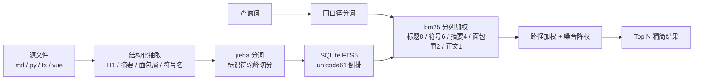

# 内容检索工具部署使用说明

> 代码 + 文档统一检索：按相关性排序收敛结果，替代「命中几百文件逐个打开判断」的旧方式

[文档首页](../../文档首页.md) › [资料](../) › [工具](../) › 内容检索工具部署使用说明　|　[配套：代码检索与知识库方案评估](../../资料/知识档案/工程化与质量/代码检索与知识库方案评估.md)　[复盘：检索索引方式失效](../../资料/知识档案/工程化与质量/代码检索索引方式失效复盘.md)

---

## 1. 定位与结论 <a id="intro"></a>

本工具解决的是**结果收敛**问题，不是扫描速度问题。这个区分决定了整套方案的形态，先看实测：

| 项 | 实测值（2026-10-19，bms 仓） |
| --- | --- |
| 可检索文件数 | 5,002 个（全工作区，含 md / py / ts / vue 等） |
| 全库 `ripgrep` 扫描耗时 | **60~70ms** |
| 「权限计算」纯文本命中 | 162 个文件 / 347 行 |
| 检索服务返回 | ≤10 条，按相关度排序，首条即权威文档 |
| 检索服务单次查询 | **1~2ms**（索引预热后） |
| 索引体积 / 全量重建耗时 | 62MB / 40 秒 |

结论：**扫描速度早已不是瓶颈**（全库 60ms 已接近人类感知下限），真正的成本是
「命中 162 个文件后逐个打开判断」。因此本工具不做更快的扫描，只做更准的排序。

## 2. 与已废止方案的边界 <a id="boundary"></a>

《[代码检索索引方式失效复盘](../../资料/知识档案/工程化与质量/代码检索索引方式失效复盘.md)》
判定「生成式导航索引」无效并已删除。本工具与之**不是同一形态**，必须区分清楚，
否则容易误判为「又走回头路」：

| 维度 | 已废止的导航索引 | 本工具（检索索引） |
| --- | --- | --- |
| 解决的问题 | 「这个主题该去哪个目录找」——**导航映射** | 「哪些文件最相关」——**相关性排序** |
| 生成方式 | 扫描 + 本地 LLM 逐单元语义补全 | 纯静态抽取（H1 / 摘要 / 符号名），零 LLM |
| 重跑成本 | 分钟级（LLM 在线依赖） | 全量 40 秒 / 增量 1~2 秒 |
| 能否机器验证 | **不能**——无法判定「检索前是否先读了索引」 | **能**——`--check` 比对索引与实际文件集，不一致退出码 1 |
| 失败模式 | 靠自觉使用 → 必然漂移 | 索引滞后 → 被 `--check` 当场判失败 |

复盘给出的四条重试前提（能被机器验证 / 零人工与 LLM 成本 / 命中真实规模盲区 /
收益可度量），本工具逐条满足：第 4 条见第 1 节与第 6 节的对照数据。

## 3. 安装 <a id="install"></a>

依赖只有两个（`jieba` 分词 + `mcp` SDK），**不需要常驻服务**，**装到系统 Python**：

```bash
# 国内镜像（清华）
python3 -m pip install -i https://pypi.tuna.tsinghua.edu.cn/simple -r scripts/tools/search/requirements.txt
```

Windows PowerShell 把 `python3` 换成 `python`，其余相同。

> **为什么装系统 Python 而不是项目虚拟环境**（2026-10-19 拍板）：本工具要跨**多个工作区**
> （`bizs` / `cws` …）与**多个 agent**（DSH / opencode / CodeBuddy）复用。虚拟环境不入 git，
> 每个克隆都得重装一次，且各 agent 得分别指向对应 venv 的绝对路径；装系统 Python 后
> **一次安装、所有工作区与 agent 直接可用**，配置里只写 `python` 即可。
>
> 代价是污染全局环境——考虑到只引入两个纯 Python 包（无编译依赖、无版本冲突），
> 这个代价可接受。后端 `backend/.venv` 由 uv 管理，**不要**往里装这两个包（会破坏依赖树）。

**验证安装**：

```bash
python3 -c "import jieba, mcp; print(jieba.__version__)"
```

下文命令统一写 `python3`（Windows 为 `python`）。

## 4. 命令行用法 <a id="cli"></a>

在 bms 仓根运行（`scripts/tools/search/search_mcp.py`）：

```bash
# 基本检索（默认 10 条）
python3 scripts/tools/search/search_mcp.py -q 权限计算

# 只看代码 / 只看文档
python3 scripts/tools/search/search_mcp.py -q BaseService --kind code -n 5
python3 scripts/tools/search/search_mcp.py -q 租户隔离 --kind doc

# 限定路径子串（已知大方向时收敛更快）
python3 scripts/tools/search/search_mcp.py -q 认证 --path 设计

# 附带命中行片段（省去再打开文件）
python3 scripts/tools/search/search_mcp.py -q 刷新令牌 --snippet

# 机器可读输出
python3 scripts/tools/search/search_mcp.py -q 权限计算 --json
```

Windows PowerShell 下把 `python3` 换成虚拟环境解释器
`scripts\tools\search\.venv\Scripts\python.exe`，其余参数相同。

### 4.1 索引维护 <a id="index"></a>

```bash
python3 scripts/tools/search/search_mcp.py --rebuild   # 全量重建（约 40 秒）
python3 scripts/tools/search/search_mcp.py --update    # 增量更新（约 1~2 秒）
python3 scripts/tools/search/search_mcp.py --check     # 一致性自检（不一致退出码 1）
```

索引落在 `<工作区根>/.cache/search/index.db`（约 62MB，已在 `bms/.gitignore` 中忽略）。

**刷新口径**：采用**手动刷新**（2026-10-19 用户拍板）——改完一批文档或代码后跑
`--update`；不确定索引是否滞后就跑 `--check`。不做自动触发（避免引入隐式行为），
也不做「查询前自动比对」（每次查询要多一次全盘 stat，约 1~2 秒，会失去毫秒级优势）。

## 5. MCP 服务接入 <a id="mcp"></a>

不带 `-q` 参数时，脚本以 **stdio MCP 服务**运行，供 agent 直接调用工具。

### 5.1 暴露的工具 <a id="tools"></a>

| 工具 | 用途 | 关键参数 |
| --- | --- | --- |
| `search_content` | 按相关性检索，返回路径 / 类型 / 标题 / 摘要 / 分数 | `query`、`kind`、`path`、`limit` |
| `search_with_snippet` | 检索并附命中行片段（不必整文件读，省 token） | `query`、`kind`、`limit` |
| `index_update` | 增量刷新索引 | 无 |

### 5.2 DSH 接入配置 <a id="dsh"></a>

在 `~/.dsh/profiles/<profile>/cordis.patch.yml` 追加一条（`args` 路径按本机实际替换）：

```yaml
- id: mcp-bizs-search
  name: '@deepseek-ai/dsh-mcp-client'
  config:
    serverName: bizssearch
    transport: stdio
    command: 'python'
    args: ['<工作区根>/bms/scripts/tools/search/search_mcp.py']
```

> **一条配置覆盖所有工作区**：脚本启动时按「当前会话工作目录」向上找 `bms/` 自动定位检索根，
> 索引随工作区落在 `<工作区根>/.cache/search/index.db`。因此 `bizs` 会话查 `bizs`、
> `cws` 会话查 `cws`，**不需要为每个工作区各写一条配置**（见 5.4）。
>
> `command: 'python'` 依赖第 3 节的系统 Python 安装；若 `python` 不在 PATH 上，改写成绝对路径。
>
> 配置在 **DSH 下一个进程生效**——改完需重启 DSH。工具名带服务器前缀，
> 形如 `mcp__bizssearch__search_content`。

### 5.3 环境变量 <a id="env"></a>

| 变量 | 缺省 | 说明 |
| --- | --- | --- |
| `SEARCH_ROOT` | 按会话工作目录自动推导 | 显式指定检索根（一般不用设） |
| `SEARCH_DB` | `<检索根>/.cache/search/index.db` | 显式指定索引文件（一般不用设） |

两个变量都**可以不设**——缺省行为已适配「多工作区 + 多 agent」的共享场景。
仅在需要「固定查某个工作区」时才显式设置 `SEARCH_ROOT`。

### 5.4 多工作区与多 agent 复用 <a id="share"></a>

| 场景 | 是否可用 | 说明 |
| --- | --- | --- |
| `bizs` 工作区的 DSH 会话 | 可用 | 自动定位到该工作区根 |
| `cws` 工作区的 DSH 会话 | 可用 | 自动定位到 `cws`，索引独立、互不干扰 |
| 新增工作区 | 可用 | 无需改配置，首次检索自动建索引 |
| opencode / CodeBuddy | 需各自配 | 它们有独立的 MCP 配置，与 DSH 的 `cordis.patch.yml` 互不影响；配置内容同上，`args` 指向同一脚本 |

**关键前提**：

- 脚本本身随 git 走（`bms/scripts/tools/search/`），各工作区需先 `git pull` 拿到脚本；
- 依赖装系统 Python 后**无需各工作区重装**（这正是选系统 Python 而非虚拟环境的原因）；
- 首次使用某个工作区时还没有索引，第一次检索会自动全量建库（约 40~70 秒），
  也可先手动跑一次 `--update` 预热。

> 实测（2026-10-19）：`cws` 工作区建索引 4,509 个文件 / 71 秒，检索「创作」命中
> `cw/cw文档/规划/创作系统规划/` 下的规划文档，与 `bizs` 索引互不干扰。

## 6. 检索原理与效果 <a id="how"></a>

### 6.1 处理链路 <a id="pipeline"></a>



四个关键设计：

1. **结构化字段高权重**：本仓文档有统一头部（H1 标题 + `>` 摘要 + 面包屑），代码有
   明确符号名。这些字段命中远比正文顺带提及更相关，是收敛的主要来源。
2. **jieba 预分词规避中文失效**：FTS5 的 `unicode61` 分词器会把连续汉字当**单个 token**，
   原生不可用于中文；本方案**先分词再写入**，因此两字中文词（权限 / 租户 / 令牌）也能命中。
   这是与「直接用 FTS5 建中文索引」的关键差别。
3. **标识符切分**：`RBACService` → `rbac service`、`resolve_plugin` → `resolve plugin`，
   使代码符号与自然语言查询互查。
4. **路径加权与噪音抑制**：路径含查询词加分（路径往往就是主题落点）；测试夹具
   （`conftest.py`）、锁文件等降权而非排除——保留可达性，同时不让它们挤占前排。

### 6.2 效果对照 <a id="bench"></a>

```bash
python3 scripts/tools/search/bench.py
```

指标为 **MRR@10**（首个相关文档名次的倒数，1.00 = 首条即命中）与召回，人工标注
本仓权威文档为相关集。2026-10-19 实测：

| 查询 | rg 候选文件 | 检索服务返回 | rg MRR | 本方案 MRR |
| --- | --- | --- | --- | --- |
| 权限计算 | 162 | 10 | 0.00 | **1.00** |
| 基类继承链 | 8 | 10 | 0.00 | **1.00** |
| 认证刷新令牌 | 3 | 10 | 0.00 | **1.00** |
| resolve_plugin | 168 | 10 | 0.00 | 0.20 |
| 租户隔离 | 105 | 10 | 0.00 | 0.50 |
| **平均** | — | 10 | 0.00 | **0.74** |

> `rg` 的 MRR 为 0 并非说它「找不到」，而是它**不做相关性排序**——候选按文件系统
> 遍历序返回，前 10 条通常不含权威文档。这正是「逐个打开判断」成本的来源。

## 7. 自检 <a id="selftest"></a>

```bash
# MCP 协议端到端冒烟：能起来、工具可列出、可调用、可更新索引
python3 scripts/tools/search/selftest.py

# 索引与实际文件集一致性（不一致退出码 1，可挂 CI）
python3 scripts/tools/search/search_mcp.py --check
```

`selftest.py` 走真实 stdio JSON-RPC，退出码 0/1，可作为「服务能起来」的常驻检查。

## 8. 边界与不做的事 <a id="limits"></a>

| 项 | 说明 |
| --- | --- |
| 无语义检索 | 同义改写搜不到（如「登录」搜不到只写「认证」的文档）；需精确词或领域术语 |
| 不含图片与二进制 | 索引只覆盖文本类扩展名；单文件上限 2MB |
| 结果是候选 | 排序只决定「先看哪个」，最终仍需读文件确认内容 |
| 不自动刷新 | 采用手动 `--update`，见 4.1 |
| 不做导航映射 | 不回答「这个主题归哪个目录」，那是已废止方案的职责（见第 2 节） |

## 9. 关联文档 <a id="related"></a>

- 《[代码检索与知识库方案评估](../../资料/知识档案/工程化与质量/代码检索与知识库方案评估.md)》：外置检索引擎（Zoekt / Sourcegraph 等）的选型评估，与本工具是两条不同路线
- 《[代码检索索引方式失效复盘](../../资料/知识档案/工程化与质量/代码检索索引方式失效复盘.md)》：被废止的导航索引形态与四条重试前提
- 工具目录 `bms/scripts/tools/search/README.md`：脚本侧速查（命令行与参数）
- 《[文档生成规范](../../规范/文档生成规范.md)》：本文档遵循的规范

---

> 依《[文档生成规范](../../规范/文档生成规范.md)》编写 · 2026-10-19 落地并实测
