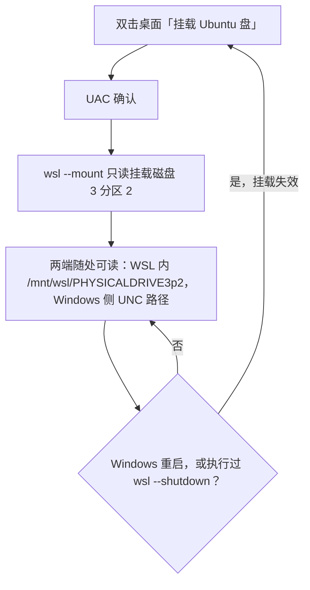

# WSL 部署使用说明

> 开发机 mjpc · Windows 侧 WSL2（Ubuntu 26.04.1）与「只读挂载双系统 Ubuntu 盘」+ WSL 内 bizs 开发环境

[文档首页](../../文档首页.md) › 资料 › 开发机 › WSL 部署使用说明　|　[双系统引导部署使用说明 ←](双系统引导部署使用说明.md)　[开发机部署使用说明总览（Windows 侧）→](windows/开发机部署使用说明总览.md)

## 1. 目的与适用范围 <a id="purpose"></a>

开发机 mjpc 是 Windows 11 与 Ubuntu 双系统机器。本文档记录 **Windows 侧 WSL2 的部署方式**，以及用它**只读挂载双系统 Ubuntu 盘**——即「**不进 Linux 系统，也能在 Windows 下读 Ubuntu 分区里的文件**」这套能力（WSL2 支持把物理盘直接挂进发行版）。

| 想做的事 | 用什么 |
| --- | --- |
| 读 / 比对 Ubuntu 侧的文件（日志、配置、仓库副本、备份） | **本文档**：WSL 只读挂载，不重启、不切系统 |
| **在 WSL 里跑 bizs 的测试与静态检查** | **本文档第 6 节**：WSL 内复刻的开发环境（与双系统逐项对齐） |
| 在 Linux 里改文件、跑开发环境、装软件 | 切到 Ubuntu（见《[双系统引导部署使用说明](双系统引导部署使用说明.md)》「一键切换」节） |
| 只看分区与文件系统结构 | Windows「磁盘管理」，或本文档的只读挂载 |

两条刻意的口径：

- **只读**：Windows 侧不需要写 Ubuntu 盘（要写应当进 Linux 侧操作）。只读可避免误写，也避开 Linux 未干净关机时写入带来的不一致风险。
- **按需挂载**：不用时挂载不存在，因此不常驻内存、不占开机资源；需要时双击一次即可（4.2），代价是重启后要重挂。

本文档与《[开发机部署使用说明总览（Windows 侧）](windows/开发机部署使用说明总览.md)》配套——总览汇总 Windows 侧开发设施，本文档只讲 WSL 与「读 Ubuntu 盘」；双系统的引导与切系统见《[双系统引导部署使用说明](双系统引导部署使用说明.md)》。

**取值说明**：`<mjpc-IP>` 等占位符与账号凭据的真实值见《[本地资源](../../用户文档/本地资源.md)》，不在仓库文档中记录。

## 2. 环境与选型依据 <a id="env"></a>

### 2.1 现状 <a id="env-now"></a>

| 项 | 取值 |
| --- | --- |
| WSL | 3.0.3.0（内核 6.18.54.1-1，WSLg 1.0.79），默认版本 2 |
| 发行版 | `Ubuntu-26.04`（Ubuntu **26.04.1 LTS**，与双系统里那套同版本；`/etc/wsl.conf` 为 `[boot] systemd=true`，systemd 已启用） |
| 落盘位置 | `C:\Users\minjian\AppData\Local\wsl\{2d1cf05e-6a37-432c-b93f-f02ea0b5c50a}\ext4.vhdx`（默认位置，初始约 1.45 GB，随使用增长） |
| 默认用户 | `minjian`（uid 1000，在 `sudo` 组；与双系统 Ubuntu 侧**同名同 uid**，读盘权限天然对齐） |
| 挂载对象 | **磁盘 3 分区 2**（Ubuntu 的 ext4 根分区，3.8 TB），只读 |
| 挂载脚本 | `bms/scripts/tools/wsl/挂载Ubuntu盘.py`（+ 同名 `.bat` 双击包装）；桌面快捷方式「挂载 Ubuntu 盘」 |
| 官方镜像留存 | `D:\tools\操作系统\linux\ubuntu\ubuntu-26.04.1-wsl-amd64.wsl`（399 MB，重装可复用） |

### 2.2 为什么不用本地那张桌面 ISO <a id="why-not-iso"></a>

本机 `D:\tools\操作系统\linux\ubuntu\ubuntu-26.04-desktop-amd64.iso` 是**可启动光盘镜像**，而 WSL 发行版是**rootfs 打包**，两者结构不同：桌面 ISO **不能**直接给 `wsl --install` / `wsl --import` 使用，必须先解包 `casper/filesystem.squashfs`（非官方流程、体积大、无更新通道）。

WSL 用的官方镜像**是另一份文件**：`ubuntu-26.04.1-wsl-amd64.wsl`（同为 26.04.1 LTS）。因此本机路线是「下载 WSL 官方镜像 + 官方安装流程」，而不是从桌面 ISO 里掏 rootfs。

### 2.3 为什么经镜像源下载 <a id="why-mirror"></a>

官方源（`releases.ubuntu.com`，也就是 `wsl --install -d Ubuntu-26.04` 默认使用的那份）在国内实测很慢，镜像源则快一个量级：

| 来源 | 实测速度 | 399 MB 折合 |
| --- | --- | --- |
| 官方 `releases.ubuntu.com` | 约 200 KB/s | 约 35 分钟 |
| 阿里云镜像 | 约 210 KB/s | 同量级 |
| **清华 TUNA 镜像** | **约 35 MB/s** | 约 12 秒（本机实测 6.4 秒） |

两条路线的**文件是同一份**：WSL 官方发行版清单（`microsoft/WSL` 仓库的 `distributions/DistributionInfo.json`）给出 `Ubuntu-26.04` 的 Amd64 下载地址与 **SHA256**；清华镜像同步的正是该文件，下载后按该 SHA256 校验即可确认逐字节一致（见 3.1）。因此这不是「换了个来路不明的包」，而是**同一官方镜像换个更快的通道取回**。

### 2.4 挂载口径：只读 <a id="why-ro"></a>

```powershell
wsl --mount \\.\PHYSICALDRIVE3 --partition 2 --options ro
```

- 挂载点是**物理盘**（不是某个 Windows 卷），所以需要**管理员权限**。
- `--options ro` 让内核以只读挂载 ext4：写入会直接报 `Read-only file system`（预期行为，见 5.2）。
- **副作用（重要）**：整盘挂给 WSL 期间，**Windows 访问不到该盘的任何分区**（即磁盘 3 的分区 1 ESP 与分区 2 都读不到，磁盘管理里也动不了）。要动这些分区，先卸载（4.3）。

## 3. 部署 <a id="deploy"></a>

> 顺序即首次部署顺序；重装（比如换了机器/删了发行版）照此重做即可，镜像已留存可跳过 3.1 的下载。

### 3.1 下载官方镜像并校验 <a id="download"></a>

```powershell
$u = 'https://mirrors.tuna.tsinghua.edu.cn/ubuntu-releases/26.04.1/ubuntu-26.04.1-wsl-amd64.wsl'
$o = 'D:\tools\操作系统\linux\ubuntu\ubuntu-26.04.1-wsl-amd64.wsl'
curl.exe -sL -o $o -w 'downloaded %{size_download} B in %{time_total}s' $u
(Get-FileHash -Algorithm SHA256 -LiteralPath $o).Hash
```

期望值（取自 WSL 官方清单中 `Ubuntu-26.04` 的 Amd64 条目）：`48D56724B5C8E60F24893E83E73BBB58C60B3CA22FBA3DA977075420ACD54104`。

### 3.2 从本地文件安装发行版（官方流程，免交互） <a id="install"></a>

```powershell
wsl --install --from-file 'D:\tools\操作系统\linux\ubuntu\ubuntu-26.04.1-wsl-amd64.wsl' --name Ubuntu-26.04 --no-launch
wsl --list --verbose
```

- **`--from-file` 走的是 WSL 官方安装流程**（相当于把在线安装的镜像换成手边这份），安装后发行版名 `Ubuntu-26.04`、版本 2，落盘在默认位置（2.1）。
- **`--no-launch` 必须加**：官方 Ubuntu 发行版首次启动会**交互式**要求建用户名/密码，无人值守流程会卡在那里；跳过首次启动后，直接由 3.3 建用户。
- 官方 Ubuntu 镜像是稳的：若安装后输出「已成功安装分发」，`wsl --list --verbose` 应能看到 `Ubuntu-26.04`。

### 3.3 建用户并设为默认 <a id="user"></a>

```powershell
wsl -d Ubuntu-26.04 -u root -- useradd -m -s /bin/bash -G sudo minjian
wsl -d Ubuntu-26.04 -u root -- bash -c 'echo minjian:minjian | chpasswd'   # 初始密码同用户名，首次登录后自行 passwd 改
wsl --manage Ubuntu-26.04 --set-default-user minjian
wsl -d Ubuntu-26.04 -- bash -lc 'id'    # 期望：uid=1000(minjian) ... 27(sudo)
```

> 用户**与双系统 Ubuntu 侧同名（`minjian`，uid 也是 1000）**是刻意选择：挂载进来的 `/home/minjian` 目录权限位（`drwxr-x---  minjian minjian`）在 WSL 里天然匹配，不需要 `-u root` 或改权限就能读。

### 3.4 挂载 Ubuntu 数据盘（只读） <a id="mount"></a>

两种方式，日常用第一种：

| 方式 | 操作 |
| --- | --- |
| **桌面快捷方式**（推荐） | 双击桌面 **「挂载 Ubuntu 盘」** → UAC 点「是」→ 弹出控制台打印结果（窗口停在 `Press any key to continue`，按任意键关闭即可） |
| 命令行（管理员） | `python3 bms/scripts/tools/wsl/挂载Ubuntu盘.py`（Windows 亦可双击 `挂载Ubuntu盘.bat`） |

脚本口径（`scripts/tools/wsl/` 目录说明见同目录 `README.md`）：

- **幂等**：已挂载时只校验并打印路径，不会重复挂载；
- 附加参数：`--unmount` 卸载、`--disk/--partition/--distro` 换对象；
- 非管理员运行时**友好拒绝**（退出码 2），不会半途失败；
- 检测到挂载但非只读时会尝试改回只读。

等价的**手工命令**（不想用脚本时）：

```powershell
wsl --mount \\.\PHYSICALDRIVE3 --partition 2 --options ro
```

挂载点形态固定为 `/mnt/wsl/PHYSICALDRIVE3p2`（未改 `/etc/wsl.conf` 的 `automount.root` 时）。

### 3.5 访问路径 <a id="paths"></a>

| 端 | 路径 |
| --- | --- |
| WSL 内 | `/mnt/wsl/PHYSICALDRIVE3p2` |
| Windows 资源管理器 / PowerShell | `\\wsl.localhost\Ubuntu-26.04\mnt\wsl\PHYSICALDRIVE3p2` |

> WSL 未在运行时访问 `\\wsl.localhost\...` 会先拉起发行版，首次有启动延迟。

## 4. 使用 <a id="usage"></a>

### 4.1 日常读文件 <a id="daily"></a>

挂载后两端都能读（**都只读**）：

- **Windows 侧**：资源管理器地址栏输入 `\\wsl.localhost\Ubuntu-26.04\mnt\wsl\PHYSICALDRIVE3p2`，或用 VS Code / 编辑器打开该 UNC 路径；PowerShell 里同样按普通路径用（`Get-ChildItem`、`rg`、`robocopy` 等）。
- **WSL 内**：`ls /mnt/wsl/PHYSICALDRIVE3p2/home/minjian`、`diff`、`rg` 等；也可以在 WSL 内跑脚本对两侧文件做比对。

实测样例（双系统 Ubuntu 的主机名）：

```powershell
Get-Content '\\wsl.localhost\Ubuntu-26.04\mnt\wsl\PHYSICALDRIVE3p2\etc\hostname'   # mjpc
```

### 4.2 挂载生命周期（重启后要重挂） <a id="lifecycle"></a>



- 挂载**不跨重启**：Windows 重启、（发行版或整机）`wsl --shutdown` 之后挂载都会消失，重跑一次即可（脚本幂等，重复双击无害）。
- 想常驻（开机自动挂载）也可以，但会让 WSL 虚拟机每次开机都驻留（约占 1~2 GB 内存）；本机按需挂载，故不做常驻。

### 4.3 卸载 <a id="unmount"></a>

```powershell
python3 bms/scripts/tools/wsl/挂载Ubuntu盘.py --unmount
# 等价手工命令：wsl --unmount \\.\PHYSICALDRIVE3
```

- **卸载不需要管理员**（本机实测；只有挂载需要）。
- 需要访问磁盘 3 的其它分区（含它的 ESP）、或在磁盘管理里调整该盘之前，**必须先卸载**（2.4 的副作用）。

## 5. 维护与排障 <a id="maintain"></a>

### 5.1 发行版维护 <a id="distro"></a>

| 事项 | 做法 |
| --- | --- |
| 进入发行版 | `wsl -d Ubuntu-26.04`（默认用户 `minjian`；需要 root 时 `-u root`） |
| 系统更新 | 发行版内照常 `sudo apt update && sudo apt upgrade`（默认源在国内偏慢，可换镜像，见下） |
| 换 apt 镜像（可选） | Ubuntu 26.04 用 deb822 格式的 `/etc/apt/sources.list.d/ubuntu.sources`：把其中的 `archive.ubuntu.com`、`security.ubuntu.com` 换成 `mirrors.tuna.tsinghua.edu.cn`（改前先备份该文件） |
| 迁移发行版位置 | 先 `wsl --shutdown`，再 `wsl --manage Ubuntu-26.04 --move D:\wsl\Ubuntu-26.04` |
| 释放内存 | `wsl --shutdown`：WSL2 虚拟机空闲时也会驻留一部分内存，长期不用可关掉 |
| 重建桌面入口 | 见文末「重建桌面快捷方式」代码块 |

**重建桌面快捷方式**（快捷方式丢失或换机时；创建后须置「以管理员身份运行」位）：

```powershell
$ws = New-Object -ComObject WScript.Shell
$lnk = "$env:USERPROFILE\Desktop\挂载 Ubuntu 盘.lnk"
$s = $ws.CreateShortcut($lnk)
$s.TargetPath = 'D:\Develop\bizs\bms\scripts\tools\wsl\挂载Ubuntu盘.bat'
$s.WorkingDirectory = 'D:\Develop\bizs\bms'
$s.IconLocation = "$env:SystemRoot\System32\imageres.dll,27"
$s.Save()
# .lnk 的 LinkFlags 位于 0x14，其第二字节 0x15 的 bit5 = RunAsUser（以管理员身份运行）
$b = [IO.File]::ReadAllBytes($lnk); $b[0x15] = $b[0x15] -bor 0x20; [IO.File]::WriteAllBytes($lnk, $b)
```

### 5.2 常见问题 <a id="trouble"></a>

| 现象 | 原因与处理 |
| --- | --- |
| 双击快捷方式后提示「需要管理员权限」 | UAC 被点了「否」，或该快捷方式丢了「以管理员身份运行」位：重新双击并在 UAC 点「是」（或按 5.1 重建） |
| 写入报 `Read-only file system` | **预期**：这是只读挂载（2.4）；要改文件请进 Ubuntu 系统操作 |
| 重启后 `/mnt/wsl/PHYSICALDRIVE3p2` 不见了 | 挂载不跨重启（4.2）：重跑一次挂载 |
| `wsl --mount` 失败（盘被占用 / 找不到分区） | 先 `wsl --unmount \\.\PHYSICALDRIVE3` 再试；并在「磁盘管理」核对**磁盘号与分区号**（本机为磁盘 3 分区 2） |
| 磁盘 3 的其它分区在 Windows 里打不开 | 整盘已挂给 WSL（2.4 副作用）：先按 4.3 卸载 |
| `wsl -d Ubuntu-26.04` 报发行版不存在 | 发行版被删或未安装：按 3.1~3.3 重装（镜像已留存） |
| 在 WSL 里 `ls /mnt/wsl/...` 提示无权限 | 挂载点属 root：本机两侧用户同名同 uid，正常读取无需提权；若用了别的用户名，需 `-u root` 或改用同名用户 |

### 5.3 与双系统 Ubuntu 的关系 <a id="relation"></a>

- **两套 Ubuntu 相互独立**：WSL 里的 Ubuntu 是独立 rootfs（`ext4.vhdx`），与磁盘 3 上的双系统 Ubuntu **不共享文件系统**；本文档提供的是把后者**挂进来当数据读**。
- 版本同为 **26.04.1 LTS**，命令与包行为接近，适合在 Windows 侧顺手查资料、对配置。
- **不要在 Linux 侧重启/关机的同时读写**：WSL 挂的是同一块物理盘；只读挂载风险很低，但若要在 Linux 侧重启或关机，先按 4.3 卸载更稳妥。
- 常驻 WSL 的内容（装的软件、写的文件）都在 `ext4.vhdx` 里，**不会**回到双系统 Ubuntu，也不占磁盘 3 的空间。

## 6. WSL 内开发环境（跑测试用） <a id="devenv"></a>

> 目标：**不进 Linux 系统，也能在 WSL 里跑 bizs 的测试与静态检查**。环境与双系统 Ubuntu 侧**逐项对齐**（路径、工具版本、依赖），差异只在「没有桌面 / 没有 GPU / 磁盘独立」。

### 6.1 定位与取舍 <a id="devenv-scope"></a>

| 想做的事 | 用什么 |
| --- | --- |
| 在 Linux 环境下跑 pytest / ruff / pyright / vitest，验证改动 | **本节**：WSL 内复刻的开发环境 |
| 改代码、写文档、跑大模型、用桌面 IDE | 切到双系统 Ubuntu（见《[双系统引导部署使用说明](双系统引导部署使用说明.md)》） |
| 只读比对 Linux 侧文件 | 第 3~4 节：只读挂载 |

三条刻意对齐的口径（**改动本节时不要破坏**）：

- **路径完全复刻**：WSL 内同样是 `~/develop/bizs`（工作区）与 `~/dev-deps`（依赖仓）。原因是 Linux 侧 `.venv` 内 38 个脚本的 shebang、`pyvenv.cfg` 的 `home`、`node_modules` 软链**全是绝对路径 `/home/minjian/...`**；路径一致才能直接复用依赖、**零重装**。
- **代码从挂载分区复制，不是 clone**：要的是「正在跑的那一份」——含 `deploy/.env`、`database/*.db`、跨仓文档软链，而不是最新远端。
- **依赖仓整目录复制后做导入自检**：WSL 与双系统同为 x86_64 + glibc 2.43，二进制可直接复用；自检不过才回退到重装。

### 6.2 一键复刻 <a id="devenv-deploy"></a>

前置：已按 3.4 挂载 Ubuntu 盘（脚本要从挂载点读源）；WSL 内已装 `rsync`、`git`。

```powershell
wsl -d Ubuntu-26.04 -- bash -lc 'bash ~/develop/bizs/bms/scripts/tools/wsl/部署WSL开发环境.sh'
```

首次部署（WSL 内还没有工作区）时，从 Windows 侧直接调用挂载分区里的脚本副本：

```powershell
wsl -d Ubuntu-26.04 -- bash /mnt/wsl/PHYSICALDRIVE3p2/home/minjian/develop/bizs/bms/scripts/tools/wsl/部署WSL开发环境.sh
```

脚本口径（`scripts/tools/wsl/部署WSL开发环境.py`，`.sh` 为薄包装）：

- **幂等**：重复运行只增量同步，不重复下载依赖；
- **只读源端**：全程不对挂载分区做任何写入；
- **复制内容**：工作区四仓 + 依赖仓 `bms`/`mdm` + 用户级配置（`.gitconfig`、`.git-credentials`、`.npmrc`、`.config/uv/uv.toml`、`.config/pip/pip.conf`）；
- **不复制**：`tmp/`、`.playwright-mcp/`、`.playwright-cli/`（本地产物，目标端建空目录）；
- **自动补 `/usr/local/bin/python` 软链**：venv 的 `bin/python` 指向它，WSL 默认没有（Linux 侧有），缺了 venv 里的脚本全部不可用；
- 附加参数：`--sync`（复制后同步到最新并重装依赖，**推荐**）、`--sync-only`（只同步不复制）、`--skip-deps`（只同步工作区）、`--skip-verify`（跳过自检）、`--configs-only`（只刷用户级配置）。
- **复制完必须同步**：源端通常落后远端（首次实测 bms 落后 204 个提交），详见 [6.4](#devenv-sync)。

### 6.3 工具链 <a id="devenv-toolchain"></a>

与双系统 Linux 侧版本对齐（**改动任一版本时两侧同步**）：

| 工具 | 版本 | 安装方式 | 位置 |
| --- | --- | --- | --- |
| node | v24.20.0 | nvm + `NVM_NODEJS_ORG_MIRROR=https://npmmirror.com/mirrors/node` | `~/.nvm/versions/node/v24.20.0/bin/node` |
| pnpm | 11.7.0 | `npm i -g pnpm@11.7.0`（registry=npmmirror） | 同上目录 |
| uv | 0.12.7 | `curl -LsSf https://astral.sh/uv/install.sh \| sh`，再 `uv self update 0.12.7` | `~/.local/bin/uv` |
| python3 | 3.14.4 | 系统源 | `/usr/bin/python3` |
| gcc / make | 15.2.0 | `apt-get install build-essential` | `/usr/bin` |
| Playwright CLI | 0.1.22 | `npm i -g @playwright/cli@0.1.22` | 全局 |
| Firefox 内核 | 1553（Firefox 156.0） | 从 Linux 侧 `~/.cache/ms-playwright` 复制 | `~/.cache/ms-playwright/firefox-1553` |

两条踩过的坑：

- **apt 源要换清华 TUNA**：WSL 默认 `archive.ubuntu.com`，国内装 `build-essential` 极慢。改 `/etc/apt/sources.list.d/ubuntu.sources`（改前备份）。
- **Firefox 内核缺系统库**：直接跑报 `libasound.so.2: cannot open shared object file`，需 `apt-get install libasound2t64 libgtk-3-0t64 libnss3 libgbm1 libasound2t64 fonts-liberation` 等一整套（Playwright 官方依赖清单）。
- **`playwright-cli` 默认走 Chrome 通道**：WSL 没装 Google Chrome，会报 `Chromium distribution 'chrome' is not found`；**显式加 `--browser firefox`** 即可（本机口径）。

### 6.4 同步到最新（复制后必做） <a id="devenv-sync"></a>

**复制来的代码是「源端那一刻」的快照，通常落后远端**：首次部署实测 bms 落后 **204 个提交**（test 15、工作区 17、mdm 2、biz 1）。落后的提交里含 **pytest 启动插件（`-p bms_testing_plugin`）、覆盖率采集、`pytest-xdist`** 等测试基础设施改动——**不同步就跑测试，结论不可信**（同步后 bms_core 用例从 1551 涨到 2139）。

同步不是单纯 `git pull`：**依赖锁文件会随代码一起变**，必须跟着重装。

```bash
# 一条命令搞定：四仓快进到远端 + 按锁文件重装依赖
bash ~/develop/bizs/bms/scripts/tools/wsl/部署WSL开发环境.sh --sync-only
```

首次部署可直接一步到位（复制 + 同步 + 重装 + 自检）：

```bash
bash /mnt/wsl/PHYSICALDRIVE3p2/home/minjian/develop/bizs/bms/scripts/tools/wsl/部署WSL开发环境.sh --sync
```

`--sync` 内部顺序（与 `bms/scripts/tools/deps/` 的约定一致）：

| 步骤 | 命令 | 说明 |
| --- | --- | --- |
| 1 | `git -C <仓> pull --ff-only origin main` | 四仓逐个快进；**只做 ff**，不产生合并提交，有本地改动即报错停下 |
| 2 | `bash scripts/tools/deps/还原依赖.sh` | 外置 -> 原位（安装器见符号链接会误判跳过） |
| 3 | `uv sync --frozen` | 后端按 `uv.lock` 严格安装 |
| 4 | `pnpm install --frozen-lockfile` | 前端按 `pnpm-lock.yaml` 严格安装 |
| 5 | `bash scripts/tools/deps/外置依赖.sh` | 原位 -> 外置，恢复依赖仓口径 |

**为什么必须走「还原 -> 装 -> 再外置」**：pnpm 与 uv 在符号链接状态下会误判「已安装」而跳过，直接装会得到一个空壳。

日常刷新（已部署过，只要最新代码）：

```bash
bash ~/develop/bizs/bms/scripts/tools/wsl/部署WSL开发环境.sh --sync-only
```

### 6.5 验证 <a id="devenv-verify"></a>

```bash
# 后端：基座用例（最能代表可跑性）
cd ~/develop/bizs/bms/backend && .venv/bin/python -m pytest libs/bms_core/tests -q

# 后端静态检查
cd ~/develop/bizs/bms && backend/.venv/bin/ruff check backend/libs/bms_core/src

# 前端：组件库用例
cd ~/develop/bizs/bms/frontend/packages/ui_ep && pnpm exec vitest run

# 浏览器真机（注意 --browser firefox）
playwright-cli -s=t open --browser firefox "about:blank"
```

本机实测基线（2026-10-22，同步到远端最新后）：`bms_core` **2139 passed / 50 skipped**（87 秒）；`ui-ep` **71 文件 / 1102 用例全通过**（15 秒）；`ruff` 通过；`libs/bms_core/tests/boundary` **143 项全通过**。

### 6.6 与双系统 Ubuntu 的差异（已知限制） <a id="devenv-limits"></a>

| 项 | 差异与影响 |
| --- | --- |
| 代码与依赖同步 | 依赖仓是**复制**的，不是共享的；两侧各自独立演进，**刷新一律用 `--sync-only`**（同步代码 + 按锁文件重装依赖） |
| git 提交 | 两侧是**独立克隆**，各自 commit / push；WSL 侧改动不会自动回到 Linux 侧（走 git 远端同步） |
| 桌面 / GPU | WSL 无桌面与 CUDA 直通；需要桌面 IDE、真机 GUI、本地模型推理时仍要进双系统 Ubuntu |
| 浏览器内核 | 只有 Firefox；要 Chromium 需另装 Google Chrome 或 `playwright install chromium` |
| 磁盘 | WSL 内容在 `ext4.vhdx` 里，不占磁盘 3 空间，也不会回到双系统 |

## 7. 关键位置速查 <a id="quickref"></a>

| 用途 | 位置 |
| --- | --- |
| 查看 WSL 状态 | `wsl --status` / `wsl --list --verbose` |
| 发行版 rootfs（WSL 落盘） | `C:\Users\minjian\AppData\Local\wsl\{2d1cf05e-6a37-432c-b93f-f02ea0b5c50a}\ext4.vhdx` |
| 官方镜像留存 | `D:\tools\操作系统\linux\ubuntu\ubuntu-26.04.1-wsl-amd64.wsl` |
| 挂载脚本 | `bms/scripts/tools/wsl/挂载Ubuntu盘.py`（+ `挂载Ubuntu盘.bat`） |
| WSL 开发环境部署脚本 | `bms/scripts/tools/wsl/部署WSL开发环境.py`（+ `.sh` 薄包装） |
| WSL 内工作区 | `~/develop/bizs`（四仓 + 跨仓软链） |
| WSL 内依赖仓 | `~/dev-deps/bms`、`~/dev-deps/mdm`（外置于工作区，与 Linux 侧同口径） |
| WSL 内浏览器内核 | `~/.cache/ms-playwright/firefox-1553` |
| 桌面入口 | 桌面「挂载 Ubuntu 盘」（勾「以管理员身份运行」） |
| 挂载点（WSL 内） | `/mnt/wsl/PHYSICALDRIVE3p2` |
| Windows 侧访问 | `\\wsl.localhost\Ubuntu-26.04\mnt\wsl\PHYSICALDRIVE3p2` |
| 卸载 | `python3 scripts/tools/wsl/挂载Ubuntu盘.py --unmount` |

> 依《[文档生成规范](../../规范/文档生成规范.md)》编写 · 与《[开发机部署使用说明总览（Windows 侧）](windows/开发机部署使用说明总览.md)》配套
