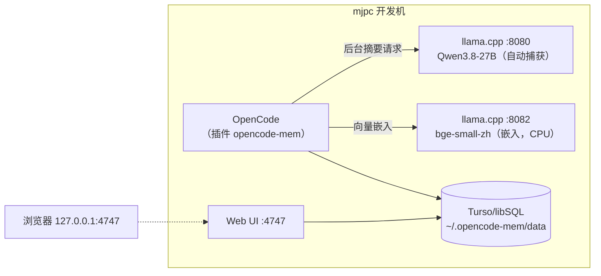

# opencode-mem 部署与使用说明

> mjpc 开发机 · OpenCode 持久记忆插件（自动捕获 → 本地嵌入 → 跨会话检索）· 2026-10-13 部署

[文档首页](../../文档首页.md) › [资料](../../工具/Ubuntu安装部署使用说明.md) › [开发机部署使用说明总览](开发机部署使用说明总览.md) › opencode-mem 部署与使用说明　|　[同级：《opencode部署使用说明》](opencode部署使用说明.md)

## 1. 目的与范围 <a id="purpose"></a>

为 OpenCode 提供**跨会话持久记忆**：自动捕获会话中的技术上下文 → 存入本地向量库 → 后续会话检索/注入相关记忆。

- **插件**：`opencode-mem`（MIT，免费，本地优先）。
- **运行位置**：mjpc 开发机（作为 OpenCode 插件随 OpenCode 运行）。
- **全部本地**：自动捕获用**本机 Qwen3.8-27B**，向量嵌入用**本机 bge-small-zh**（512 维），数据落本机 `~/.opencode-mem/data`。
- 选型：替换已退役的 claude-mem（本体 Apache-2.0 免费，但压缩服务需订阅）与自建 MIRIX（上游 bug 多）。
- IP / 账号等取值见《[本地资源](../../用户文档/本地资源.md)》。

## 2. 架构与组件 <a id="arch"></a>



要点：插件**随 OpenCode 进程运行**（无独立常驻 worker）；自动捕获在会话空闲时后台发起；嵌入与捕获都只连本机，数据不出机。

## 3. 依赖 <a id="deps"></a>

| 组件 | 版本 / 位置 | 说明 |
| --- | --- | --- |
| Node.js | v24.20.0（nvm） | 运行时 |
| Bun | **1.4.3**，`~/.bun/bin/bun` | 插件安装其运行时依赖需要 |
| 本机模型 | `llamacpp-qwen`（:8080）、`llamacpp-bge`（:8082） | 见《[llamacpp部署使用说明](../AI/llamacpp部署使用说明.md)》 |

> opencode-mem 用嵌入式 Turso（`@tursodatabase/database`，`F32_BLOB` 向量 + 精确余弦），**不需要**独立向量库，也不需要 GPU。

## 4. 安装 <a id="install"></a>

```bash
# 前置：Bun 在 PATH（见《claude-mem...》同法，或系统装）
export PATH="$HOME/.bun/bin:$HOME/.local/bin:$PATH"
export npm_config_registry=https://registry.npmmirror.com     # 国内 npm 镜像

# 用 opencode 自带 CLI 安装（会写入全局配置的 plugins 数组）
opencode plugin add opencode-mem@latest
```

安装后 `~/.config/opencode/opencode.jsonc` 出现：

```jsonc
"plugins": ["opencode-mem@latest"]
```

## 5. 配置 <a id="config"></a>

配置文件 `~/.config/opencode/opencode-mem.jsonc`（**改后需重启 OpenCode 生效**）：

```jsonc
{
  // 语言：记忆与用户画像内容一律简体中文
  //   默认 "auto" 会跟随提示词语言，但工具描述会显示 English（getLanguageName("auto")→English），可能诱导英文
  "autoCaptureLanguage": "zh",

  // 自动捕获：用【本机】Qwen3.8-27B（opencode 的 llamacpp 提供商）
  "opencodeProvider": "llamacpp",
  "opencodeModel": "qwen3.8-27b-q4-k-m",

  // 嵌入：本机 bge-small-zh 服务（512 维）——免 Hugging Face 下载
  "embeddingApiUrl": "http://127.0.0.1:8082/v1",
  "embeddingApiKey": "local",
  "embeddingModel": "bge-small-zh-v1.5",
  "embeddingDimensions": 512,

  "storagePath": "~/.opencode-mem/data",
  "autoUpdate": true
}
```

要点：

- **自动捕获的两种本地化方式**（择一）：
  - 走 OpenCode 已注册的本地 provider：`opencodeProvider` + `opencodeModel`（本方案采用，opencode 负责鉴权/路由）。
  - 直连 OpenAI 兼容端点：`memoryProvider: "openai-chat"` + `memoryApiUrl` + `memoryModel` + `memoryApiKey`。
- `"opencodeModel": "inherit"` 表示**跟随当前会话模型**（会话用云端时会走云端，不算本地）。
- **语言**：`autoCaptureLanguage` 控制自动捕获记忆与用户画像的输出语言，默认 `"auto"`（跟随提示词）；本方案显式设为 `"zh"`（中文）。取值为 ISO 639 语言码（`getLanguageName` 映射：`zh`→Chinese、`en`→English）。
- **嵌入换模型会变维度**，届时需用 Web UI 的 re-embed 功能重建；本方案用本机 bge（512 维）固定不变。
- 单独用插件内置嵌入（`Xenova/nomic-embed-text-v1`）时首次需从 Hugging Face 下载；国内可设 `HF_ENDPOINT=https://hf-mirror.com`（已写入 `~/.config/environment.d/hf-mirror.conf`）。

## 6. 使用 <a id="usage"></a>

- **自动**：正常工作即可，会话空闲时后台捕获（**前提：:8080 服务在跑**；不在跑则静默跳过，不影响使用）。
- **手动工具** `memory`（模型侧）：`add` / `search` / `list` / `profile` / `forget` / `list-shards` / `migrate` / `export` / `import`。
- **Web UI**：`http://127.0.0.1:4747`（浏览 / 编辑 / 删除记忆、用户画像、Skills、re-embed）。
- 记忆注入：后续会话按相关性注入相关记忆。

## 7. 模型服务 <a id="models"></a>

| 用途 | 服务 | 端口 | 自启 |
| --- | --- | --- | --- |
| 自动捕获（27B） | `llamacpp-qwen` | 8080 | **手动**（用时 `sudo systemctl start llamacpp-qwen`） |
| 向量嵌入（bge） | `llamacpp-bge` | 8082 | **已开机自启**（纯 CPU、48MB，开销极低） |

> 自动捕获依赖 8080；嵌入依赖 8082。8080 未启动时存不进新记忆（手动搜索/列表仍可用）。

## 8. 验证 <a id="verify"></a>

```bash
# 1) 插件已登记
grep -A2 '"plugins"' ~/.config/opencode/opencode.jsonc
# 2) 嵌入服务在跑
curl -s 127.0.0.1:8082/health
# 3) 重启 OpenCode 后：日志显示自动捕获已配置、嵌入模型就绪
tail -20 ~/.opencode-mem/opencode-mem.log
# 4) Web UI
xdg-open http://127.0.0.1:4747
```

## 9. 排障 <a id="troubleshooting"></a>

| 现象 | 排查 |
| --- | --- |
| 日志 `Auto-capture disabled ... not configured` | `opencode-mem.jsonc` 未生效 → 确认键名并在**重启 OpenCode** 后再看日志 |
| 日志 `Failed to initialize embedding model: socket closed` | `embeddingApiUrl` 指向的 8082 未启动，或配置未重载 |
| 存不进记忆 / 搜索无结果 | `llamacpp-bge`(8082) 未跑；`sudo systemctl start llamacpp-bge` |
| 自动捕获不产出 | `llamacpp-qwen`(8080) 未跑；启动后重试（会话空闲时才触发） |
| 换嵌入模型后写入被阻断 | 维度变化导致 shard 不兼容 → Web UI re-embed 重建 |
| 安装/更新拉包慢 | `export npm_config_registry=https://registry.npmmirror.com` |

## 10. 关联文档 <a id="related"></a>

- 《[llamacpp部署使用说明](../AI/llamacpp部署使用说明.md)》：本方案依赖的本机模型服务（8080 / 8082）
- 《[opencode部署使用说明](opencode部署使用说明.md)》：OpenCode 安装与配置
- 《[本地资源](../../用户文档/本地资源.md)》：IP / 账号
- 《[开发机部署使用说明总览](开发机部署使用说明总览.md)》：本机设施清单

---

> 依《文档生成规范》编写 · 记录 2026-10-13 部署过程
