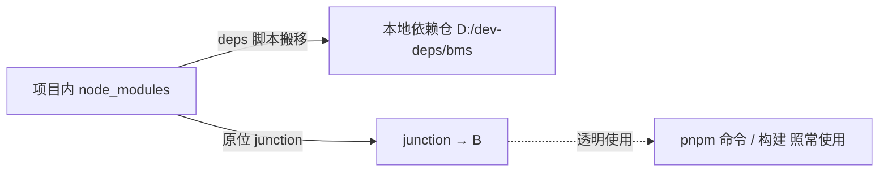

# pnpm 部署使用说明

> mjpc 开发机 Windows 侧 pnpm（前端包管理 + 单一 workspace 收敛 + 依赖外置）部署与使用 · 2026-10-16

[文档首页](../../../文档首页.md) › 资料 › 开发机 › windows › pnpm 部署使用说明　|　[同级：开发机部署使用说明总览 →](开发机部署使用说明总览.md)　[git 部署使用说明 →](git部署使用说明.md)　[uv 部署使用说明 →](uv部署使用说明.md)

## 1. 目的与适用范围 <a id="purpose"></a>

记录开发机 **mjpc** 的 **Windows 11 侧**（与 Ubuntu 26.04.1 LTS 双系统同机）上 pnpm 的部署与使用：Node 经 nvm-windows 管理、**前端依赖管理统一走 pnpm**、**单一 workspace 收敛**、**依赖物理外置到项目外**（Windows 侧为 junction）。Ubuntu 侧对应文档见《[pnpm 部署使用说明](../linux/pnpm部署使用说明.md)》。

三点口径与 Linux 侧一致（仅链接实现不同）：

- **严格依赖树**：pnpm 内容寻址 store + 链接布局，消灭 npm 平铺的幽灵依赖；依赖必须逐项声明；
- **单一锁文件**：`frontend/packages/*`、`frontend/apps/*`、`frontend/modules/*` 全收敛为一个 workspace，根 `pnpm-lock.yaml` 唯一锁定；
- **依赖不进仓库树**：项目内 `node_modules` 外置到本地依赖仓，原位留 junction，检索工具默认不跟随链接，检索零污染；CI 改为 job 内现装（`pnpm install --frozen-lockfile`），本地与 CI 口径一致。

适用范围：开发机本地一切前端开发与构建；CI 侧原则见《[前端开发规范](../../../规范/前端开发规范.md)》。

## 2. 版本与路径（速查） <a id="versions"></a>

| 组件 | 版本 | 路径 |
| --- | --- | --- |
| nvm-windows | 2.0.1-hotfix.4（shim 模式） | `C:\Users\minjian\AppData\Local\Author Software\nvm` |
| Node.js | v24.20.0（默认）、v22.23.2 | `...\nvm\installs\v24.20.0\`、`...\nvm\installs\v22.23.2\` |
| npm | 11.19.0 | 随 Node（全局前缀＝当前 Node 版本目录，`npm config get prefix` 实测） |
| corepack | 0.35.0 | 随 Node 提供 |
| pnpm | **11.7.0** | `...\nvm\installs\v24.20.0\node_modules\pnpm`；命令入口 `...\nvm\.nodejs\pnpm.exe`（nvm 命令代理，随 `nvm use` 切换） |
| pnpm store | — | `D:\.pnpm-store\v11`（内容寻址全局缓存；仓库内 `pnpm store path` 实测） |
| 项目 registry | npmmirror | 用户 `C:\Users\minjian\.npmrc` 与仓内 `bms\.npmrc` 均为 `https://registry.npmmirror.com` |
| workspace 收敛 | — | `D:\Develop\bizs\bms\pnpm-workspace.yaml`（`frontend/packages|apps|modules/*`） |
| 单一锁文件 | — | `D:\Develop\bizs\bms\pnpm-lock.yaml`（**必须提交**） |
| 本地依赖仓 | — | `D:\dev-deps\bms`（各 node_modules / backend-venv 的实体所在，junction 指向处） |

> 表中 `...\nvm` 均为 `C:\Users\minjian\AppData\Local\Author Software\nvm`。

## 3. 安装与配置过程 <a id="install"></a>

### 3.1 Node（nvm-windows） <a id="nvm"></a>

Node 由 **nvm-windows v2** 管理（shim 模式：`.nodejs\` 目录下提供 node / npm / npx / corepack / pnpm / yarn / playwright-cli 等命令代理，指向当前默认版本）：

```bat
nvm version              rem v2.0.1-hotfix.4
nvm list                 rem 已装：24.20.0（* default）与 22.23.2
nvm install 24.20.0      rem 装新版本
nvm use 24.20.0          rem 设为默认版本（v2 代 CLI：use 设置默认版本）
nvm config               rem 查看全部配置项
```

下载源已指向国内镜像（实测）：

```bat
nvm config get node_mirror   rem https://npmmirror.com/mirrors/node/
nvm config get npm_mirror    rem https://registry.npmmirror.com
```

改配置用 `nvm config set <option>=<value>`（`nvm config list` 总览；其他子命令 `nvm config --help`）。

### 3.2 pnpm <a id="install-pnpm"></a>

pnpm 以 npm 全局模块方式装入当前 Node 版本目录（实测 `npm config get prefix` 指向 `...\nvm\installs\v24.20.0`），与 CI 基础镜像固定版本一致：

```bat
npm install -g pnpm@11.7.0
pnpm -v                  rem 11.7.0
where.exe pnpm           rem ...\nvm\.nodejs\pnpm.exe（nvm 命令代理）
```

> corepack 0.35.0 随 Node 提供（`corepack -v` 实测）；本机 pnpm 命令由 nvm 模块代理接入。pnpm 11.7.0 与 `deploy/ci/Dockerfile.frontend` 内 `npm install -g pnpm@11.7.0` 同款，升级须同步改 CI 并核对 `pnpm-lock.yaml` 的 `lockfileVersion`。

### 3.3 项目配置 <a id="config"></a>

`bms\` 根三个配置（均已入库，脚本 / CI 依赖，与 Linux 侧同名同义）：

| 文件 | 作用 |
| --- | --- |
| `.npmrc` | registry=npmmirror；`auto-install-peers=true`、`strict-peer-dependencies=false`（平滑迁移、peer 冲突仅告警） |
| `pnpm-workspace.yaml` | workspace 包范围；`allowBuilds`（@parcel/watcher、vue-demi 放行 postinstall 脚本） |
| `pnpm-lock.yaml` | 单一锁文件（**必须提交**；CI 以 `--frozen-lockfile` 为准） |

> **pnpm 11 只读 `pnpm-workspace.yaml` 的 `allowBuilds`**：`package.json` 里的 `pnpm.onlyBuiltDependencies` 等字段已不读取（会告警），build 类包放行一律写 workspace 配置。

## 4. 依赖外置（本地依赖仓） <a id="externalize"></a>

前端依赖**不落仓库树**：项目内 node_modules 整体外置到本地依赖仓 `D:\dev-deps\bms`，原位替换为 **junction**（Windows 侧链接口径；Linux 侧为符号链接）。



| 形态 | 说明 |
| --- | --- |
| 外置态 | node_modules 为 junction；日常开发、构建、检索均在此态（**推荐常驻**）。后端 `.venv` 同口径（见 [uv 部署使用说明](uv部署使用说明.md)） |
| 还原态 | junction 删除、真实目录搬回项目内；仅 `pnpm install` 前需要（安装器重建时若遇链接会误判跳过） |

依赖仓布局（与仓库相对路径同构）：

```text
D:\dev-deps\bms\                                # 本地依赖仓（DEPS_DIR；与项目同在 D 盘）
├── node_modules\                               # bms 仓根 node_modules 的实体
├── frontend\                                   # 前端各工程 node_modules（拉平存放）
│   ├── apps\desktop\node_modules\
│   ├── modules\{demo,sample,slot-sample}\node_modules\
│   └── packages\{api-types,ui-ep,vue}\node_modules\
└── backend-venv\                               # 后端虚拟环境（backend\.venv 的实体）
```

仓库侧对应位置均为 junction（本机实测 `node_modules`、7 个前端工程 `node_modules`、`backend\.venv` 全部指向该依赖仓）。

### 4.1 三入口脚本 <a id="scripts"></a>

`bms\scripts\tools\deps\`（Python 单一实现；Windows 侧 `.bat` 薄包装，Git Bash 侧 `.sh` 薄包装，见 [git 部署使用说明](git部署使用说明.md)「Git Bash 与脚本执行」节）：

| 入口 | 作用 |
| --- | --- |
| `外置依赖.bat` | 项目内全部 node_modules **与后端 `.venv`** → 搬移到依赖仓 + 原位 junction；`--dry-run` 预览 |
| `还原依赖.bat` | 经 junction 定位并把真实目录整体搬回项目内（还原态；含后端 `.venv`） |
| `重装依赖.bat` | **还原 → 安装 → 再外置**的完整闭环；参数 `--frontend-only` / `--backend-only` / 不带（前后端都装） |

依赖仓路径读取顺序：环境变量 `DEPS_DIR` → `bms\deploy\.env` 的 `DEPS_DIR=` → 缺省 `%USERPROFILE%\dev-deps\bms`。**本机依赖仓在 `D:\dev-deps\bms`，当前未在环境变量 / `deploy\.env` 中持久化该值**——实测不带指定运行 `外置依赖.sh --dry-run` 会解析到缺省 `C:\Users\minjian\dev-deps\bms` 并提示「依赖仓与项目不在同一盘（D: -> C:）：搬移将退化为复制」。因此运行前先在**同一终端**指定：

```bat
rem 在 bms 仓根执行；PowerShell 用 $env:DEPS_DIR='D:\dev-deps\bms'
set DEPS_DIR=D:\dev-deps\bms
scripts\tools\deps\外置依赖.bat --dry-run      rem 先预览；核对输出中的「本地依赖仓」路径
scripts\tools\deps\重装依赖.bat --frontend-only
```

- **依赖仓与项目须同盘**（现都在 `D:`）：同盘搬移是 rename，秒级完成并保留硬链接结构；跨盘退化为复制（脚本会提前提示）。
- junction（`mklink /J`）免管理员即可创建；开发者模式与长路径开关见 [git 部署使用说明](git部署使用说明.md)「环境前提与安装」节。

## 5. 验证 <a id="verify"></a>

在仓根 `D:\Develop\bizs\bms` 执行（node / pnpm 已在用户级 PATH）：

```bat
node -v                  rem v24.20.0
pnpm -v                  rem 11.7.0
pnpm store path          rem D:\.pnpm-store\v11
pnpm config get registry rem https://registry.npmmirror.com
```

链接态核对（PowerShell；应为 Junction，Target 指向 `D:\dev-deps\bms\...`）：

```powershell
Get-Item node_modules, frontend\apps\desktop\node_modules, backend\.venv | Select-Object FullName, LinkType, Target
```

## 6. 使用 <a id="usage"></a>

workspace 唯一，命令一律在 `bms\` 根执行：

| 用途 | 命令 |
| --- | --- |
| 全量安装（按锁文件） | `pnpm install --frozen-lockfile`（先「还原依赖」） |
| 单包命令 | `pnpm --filter @bms/desktop run lint` |
| 全包门禁 | `pnpm run check`（core / api-types / vue / ui-ep） |
| 构建 + 计量 | `pnpm --filter @bms/desktop run build`（再 `run budget`） |
| 模块构建 + 隔离扫描 | `pnpm --filter @bms/module-demo run build && pnpm --filter @bms/module-demo run budget && pnpm --filter @bms/module-demo run guard:isolation` |

常用组合（本地验证顺序，与 CI 各前端 job 对齐；完整清单见《[pnpm 部署使用说明](../linux/pnpm部署使用说明.md)》「使用」节，Windows 侧命令形态一致）：

```bash
pnpm install --frozen-lockfile
pnpm run check                                            # core / api-types / vue / ui-ep 门禁
pnpm --filter @bms/desktop run lint && pnpm --filter @bms/desktop run test:cov && pnpm --filter @bms/desktop run build && pnpm --filter @bms/desktop run budget
pnpm --filter @bms/module-demo run lint && pnpm --filter @bms/module-demo run typecheck && pnpm --filter @bms/module-demo run test
```

## 7. 常见问题 <a id="troubleshoot"></a>

### 7.1 deps 脚本解析到 C 盘缺省依赖仓 <a id="deps-dir"></a>

实测：不指定 `DEPS_DIR` 运行 `外置依赖`，输出「本地依赖仓：`C:\Users\minjian\dev-deps\bms`」并提示跨盘。处理：同一终端先 `set DEPS_DIR=D:\dev-deps\bms`（或把该行写入 `bms\deploy\.env` 长期生效），再执行脚本；正式操作前用 `--dry-run` 核对输出路径。

### 7.2 命令找不到 node / pnpm <a id="path"></a>

node / pnpm 在用户级 PATH（经 nvm 的 `.nodejs\` 代理提供）。旧会话或未刷新 PATH 的进程里可能缺失：换新终端后 `where.exe node` 应指向 `...\nvm\.nodejs\node.exe`；Git Bash 内补齐 PATH 的方式见 [git 部署使用说明](git部署使用说明.md)「Git Bash 与脚本执行」节。

### 7.3 切到 v22.23.2 后 pnpm 不可用 <a id="nvm-switch"></a>

pnpm 11.7.0 装在 v24.20.0 版本目录下（v22.23.2 未装，全局模块随版本目录各自独立）。处理：`nvm use 24.20.0` 切回；如确需在 v22 下使用，切到 v22 后按[第 3.2 节](#install-pnpm)同样安装。

### 7.4 `pnpm install` 被跳过 / frozen 失败 <a id="install-skip"></a>

- **被跳过**：安装器见到 junction 形态的 node_modules 会误判依赖已齐——先「还原依赖」再安装，或直接用 `重装依赖.bat` 一条龙（还原 → 安装 → 再外置）。
- **frozen 失败**：`package.json` 与 `pnpm-lock.yaml` 不一致——改完依赖声明先 `pnpm install`（更新锁），再回到 `--frozen-lockfile` 校验；CI 只认 frozen，本地一致后才能推送。

## 8. 关联文档 <a id="related"></a>

- 《[uv 部署使用说明](uv部署使用说明.md)》：后端 Python 依赖管理（uv.lock + .venv 外置），与本文同走本地依赖仓与 deps 脚本
- 《[开发机部署使用说明总览](开发机部署使用说明总览.md)》：mjpc 开发设施汇总（Windows 侧总纲）
- 《[pnpm 部署使用说明](../linux/pnpm部署使用说明.md)》：Ubuntu 侧对应文档（背景与结论、完整使用清单）
- 《[前端开发规范](../../../规范/前端开发规范.md)》：前端依赖方向、共享面白名单与 CI 口径（pnpm 单一 workspace 为现状依据）
- 《[git 部署使用说明](git部署使用说明.md)》：开发机 git 与仓库接入（提交前预检、锁文件提交要求见 Git 协作规范）
- 《[文档生成规范](../../../规范/文档生成规范.md)》：本文档的组织、格式与图形约定

> 依《[文档生成规范](../../../规范/文档生成规范.md)》编写 · 记录 2026-10-16 mjpc Windows 侧前端依赖部署落地状态（Node v24.20.0 / pnpm 11.7.0 / 依赖 junction 外置）
