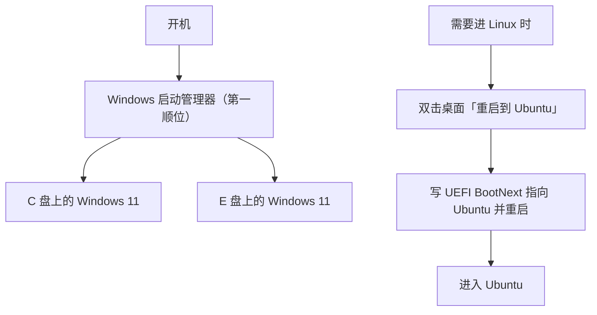

# 双系统引导部署使用说明

> 开发机 mjpc · Windows 11 + Ubuntu 双系统引导（一键重启 + rEFInd）

[文档首页](../../文档首页.md) › 资料 › 开发机 › 双系统引导部署使用说明　|　[开发机部署使用说明总览 ←](开发机部署使用说明总览.md)　[VSCode 部署使用说明 →](VSCode部署使用说明.md)

## 1. 目的与适用范围 <a id="purpose"></a>

开发机 mjpc 是 **Windows 11 与 Ubuntu 双系统**机器，本文档记录两侧的**引导组织方式**：日常怎么切换系统、固件启动项怎么排、一键重启怎么实现，以及引导出问题时的排障与回退。

**一句话结论**：本机 **DisplayPort 下固件阶段无输出**（显卡 VBIOS 的 UEFI 驱动问题，见 3.4），因此**开机菜单（GRUB / rEFInd）在 DP 上都看不见**；日常切换改用**一键重启**（写 UEFI `BootNext`），不依赖菜单。接 HDMI 时 rEFInd 菜单可用。

本文档与《[开发机部署使用说明总览](开发机部署使用说明总览.md)》配套——总览汇总开发机上的开发设施，本文档只讲**引导**；Ubuntu 系统本身的安装见《[Ubuntu安装部署使用说明](../工具/Ubuntu安装部署使用说明.md)》。

**取值说明**：`<mjpc-IP>` 等占位符与账号凭据的真实值见《[本地资源](../../用户文档/本地资源.md)》，不在仓库文档中记录。

## 2. 环境概览 <a id="env"></a>

### 2.1 机器与固件 <a id="env-machine"></a>

| 项 | 取值 |
| --- | --- |
| 主板 / BIOS | Maxsun MS-Terminator Z790M D5 / AMI H7.8G |
| CPU / 内存 / 显卡 | i7-13700K（16 核 24 线程）/ 64 GB / RTX 4090 |
| 固件模式 | UEFI（`Secure Boot` 关闭），全部磁盘 GPT |
| 系统 | Windows 11 专业版（build 26300）+ Ubuntu 26.04.1 LTS |

> Windows 侧 `Win32_OperatingSystem.Caption` 会报「Windows 10 专业版」，那是微软未更新的注册表口径；构建号 26300 属 Windows 11。

### 2.2 磁盘布局 <a id="env-disk"></a>

| 磁盘 | 容量 | 内容 |
| --- | --- | --- |
| 磁盘 0 | 1 TB NVMe | Windows 11（`C:`）+ 恢复分区 |
| 磁盘 1 | 4 TB NVMe | 数据盘（`D:`，开发工作区所在） |
| 磁盘 2 | 512 GB NVMe | Windows 11（`E:`）+ **Windows 的 ESP**（200 MB）+ 恢复分区 |
| 磁盘 3 | 4 TB NVMe | **Ubuntu**（ext4 根分区）+ **Ubuntu 的 ESP**（1 GB） |

三个要点：

- **两套 ESP 各自独立**：Windows 用磁盘 2 的 200 MB ESP，Ubuntu 用磁盘 3 的 1 GB ESP。改动一侧的引导文件不会波及另一侧。
- **`C:` 自身没有 ESP**：`C:` 与 `E:` 上的两个 Windows 共用磁盘 2 的 ESP（引导文件 `\EFI\Microsoft\Boot\bootmgfw.efi` 位于该分区）。
- **`D:` 是两个系统共用的数据盘**（NTFS）：Windows 侧为 `D:`，Ubuntu 侧挂载后同样可读写。

### 2.3 两个 Windows 安装 <a id="env-two-win"></a>

BCD 中登记了两个 Windows 启动加载器：

| 加载器 | 所在分区 | 启动管理器显示名 |
| --- | --- | --- |
| `{current}` | `C:` | Windows 11 |
| 另一个 | `E:` | Windows 11 |

进入「Windows」后，若需要区分这两个安装，Windows 启动管理器会再给一次选择。

## 3. 引导方案与选型依据 <a id="decision"></a>

### 3.1 Windows 启动管理器无法加载 Linux（UEFI 限制） <a id="why-not-bcd"></a>

**结论：UEFI 模式下无法把 Linux 加进 Windows 启动管理器菜单。** 这不是配置没做对，而是 `bootmgfw.efi` 的实现限制。

原状况本是「固件 NVRAM 里已有 Ubuntu 启动项，但开机菜单看不到」。把它加进 BCD 菜单的尝试均告失败：

| 尝试 | 结果 |
| --- | --- |
| 把该固件启动项加入 BCD `displayorder` | 菜单**能显示**，选中报 `0xc000007b` |
| `bcdedit /create /application bootsector` 再指定 `path` | 同样 `0xc000007b` |
| `bcdedit /bootsequence` 指向该固件项 | 同样 `0xc000007b` |
| 同一个项改从固件「使用设备」子菜单选 | **正常进入 GRUB** |

根因：`bootmgfw.efi` 只按 Windows 引导程序的方式加载镜像，Linux 的 `shim`/`grub` 不符合其要求。EasyBCD 也因此在 UEFI 模式禁用 "Add Linux entry"。

> 同一台机器的 `C:` 与 `E:` 两个 Windows 能并列在菜单里，是因为它们都是 Windows 引导程序；Linux 不在此列。

### 3.2 排除 GRUB 做主菜单 <a id="why-not-grub"></a>

Ubuntu 自带的 GRUB 能正常启动 Linux，**但在 DisplayPort 上黑屏**——从开机到 GRUB 阶段屏幕无输出，直到 Linux 内核加载显卡驱动后才亮屏（同一显示器换 HDMI 接口则正常）。

菜单看不见就无法选择，因此 GRUB 不能作为开机菜单。

### 3.3 采用 rEFInd，并以「一键重启」为主路径 <a id="why-refind"></a>

**rEFInd 解决了「直接加载 Linux」的问题，但没有解决 DisplayPort 黑屏**（见 3.4），因此本方案最终的日常路径是**一键重启**，而非依赖开机菜单。

rEFInd 的价值与设计：

- **绕开 GRUB**：rEFInd 自己读 ext4 分区、直接加载 Ubuntu 内核，不经过 GRUB。
- **不动 Windows 引导**：新建独立的固件启动项，Windows Boot Manager 项原样保留。
- **配置可在 Windows 侧修改**：`refind.conf` 位于 ESP（FAT32），Windows 下即可编辑。
- **接 HDMI 时可用**：接 HDMI 显示器时菜单正常，可作为应急入口。

### 3.4 DisplayPort 黑屏（本机限制，配置无法解决） <a id="dp-limit"></a>

**结论：固件阶段在 DisplayPort 上没有输出，这是显卡 VBIOS 的 UEFI 驱动问题，不是 rEFInd 配置问题。**

实测对比（同一份 rEFInd、同一份配置，只换接口）：

| 接口 | 结果 |
| --- | --- |
| **HDMI** | rEFInd 菜单**正常显示**，可正常选择并进入 Ubuntu |
| **DisplayPort（RTX 4090 的 DP 口）** | **黑屏**，5 秒后自动进 Windows |

已排除的原因：

- 不是 rEFInd 没跑起来——`refind.log` 显示它完整执行了扫描、并按时超时启动 Windows（见 7.1）。
- 不是分辨率没设上——`resolution 1024 768` 已生效，日志中无「设置失败 / 可用模式列表」记录。
- 与 GRUB 黑屏**同源**：GRUB 在 DP 上同样黑屏、HDMI 上正常，说明问题在固件阶段的 DP 输出链路。

> Windows 启动管理器能在 DP 上显示，是因为 `bootmgfw.efi` 会主动设置视频模式；而 rEFInd 默认沿用固件遗留模式（源码 `config.c` 中 `RequestedScreenWidth` 默认 `0`）。但即便 rEFInd 主动设了保守分辨率，DP 仍无输出——说明该 DP 链路的初始化在固件阶段就不完整。

**可尝试的方向**（均未验证成功，按成本排序）：显示器 OSD 中把「DisplayPort 版本」从 1.4 改为 1.2（部分显示器在固件阶段无法以 DP 1.4 时序同步）；更新主板 BIOS 或显卡 VBIOS。**日常用 HDMI 或走一键重启即可，不必强求。**

## 4. 部署 <a id="deploy"></a>

本方案于 2026-10-15 部署。

### 4.1 部署产物 <a id="artifacts"></a>

| 产物 | 位置 | 说明 |
| --- | --- | --- |
| rEFInd 程序与配置 | 磁盘 3 ESP 的 `\EFI\refind\` | 主程序 `refind_x64.efi` + `refind.conf` + 图标 + 驱动 |
| ext4 驱动 | `\EFI\refind\drivers_x64\ext4_x64.efi` | **必需**：rEFInd 不内置 ext4，缺它读不到 Ubuntu 内核 |
| 固件启动项 | UEFI NVRAM `Boot0002` | 描述 `rEFInd`，指向 `\EFI\refind\refind_x64.efi` |
| Windows 侧一键重启 | 桌面快捷方式「重启到 Ubuntu」+ 计划任务 `BootSwitch-RebootToUbuntu` | 见 4.4 |
| Ubuntu 侧一键重启 | `/usr/local/bin/reboot-to-windows` | 见 4.5 |

### 4.2 ESP 上的文件布局 <a id="esp-layout"></a>

```text
磁盘3 ESP（1 GB）/
├── EFI/
│   ├── BOOT/          # Ubuntu 的 UEFI 回退引导文件（安装器所建）
│   ├── ubuntu/        # Ubuntu 官方引导链：shimx64.efi / grubx64.efi / grub.cfg
│   └── refind/        # 本方案新增
│       ├── refind_x64.efi         # rEFInd 主程序
│       ├── refind.conf            # 本机配置（见 6.2）
│       ├── refind.conf-sample     # 官方完整选项参考
│       ├── icons/                 # 菜单图标
│       └── drivers_x64/
│           └── ext4_x64.efi       # 读 Ubuntu ext4 根分区所必需
└── System Volume Information/
```

> 只放 `ext4_x64.efi` 一个驱动：rEFInd 官方建议不用的驱动不要装，多余驱动可能相互干扰或拖慢启动。

### 4.3 固件启动项与启动顺序 <a id="bootorder"></a>

| 序号 | 启动项 | 指向 | 作用 |
| --- | --- | --- | --- |
| 1 | `Boot0000` **Windows Boot Manager** | 磁盘 2 ESP 的 `\EFI\Microsoft\Boot\bootmgfw.efi` | **第一顺位**（日常直进 Windows，无等待） |
| 2 | `Boot0001` **Ubuntu** | 磁盘 3 ESP 的 `\EFI\ubuntu\shimx64.efi` | 第二顺位（走 shim→GRUB） |
| 3 | `Boot0002` **rEFInd** | 磁盘 3 ESP 的 `\EFI\refind\refind_x64.efi` | 第三顺位（接 HDMI 时的图形菜单入口） |

`BootOrder` = `Boot0000, Boot0001, Boot0002`。

**顺序设计说明**：由于 DP 上 rEFInd 菜单不可见（见 3.4），若把 rEFInd 放第一顺位，每次开机都会先黑屏等 5 秒才进 Windows。因此**把 Windows 放第一顺位**，日常开机体验与单系统一致；需要 Linux 时走一键重启（4.4），或在开机时按热键选。

> 一键重启使用 UEFI `BootNext`（一次性指定），**不修改 `BootOrder`**，所以不影响上面的日常顺序。

查看当前固件启动项（管理员 PowerShell）：

```powershell
bcdedit /enum firmware
```

### 4.4 Windows 侧一键重启进 Ubuntu <a id="oneshot-win"></a>

**这是本方案推荐的日常路径**（因 DP 下开机菜单不可见）。桌面快捷方式 **「重启到 Ubuntu」**：双击 → 弹确认框 → 确认后重启，**下一次开机直接进 Ubuntu**。

| 环节 | 实现 |
| --- | --- |
| 快捷方式 | `C:\Users\minjian\Desktop\重启到 Ubuntu.lnk`，拉起 `C:\ProgramData\BootSwitch\ToUbuntu.ps1` |
| 确认框 | 脚本用 `System.Windows.Forms` 弹「是/否」，默认按钮为「否」 |
| 提权与执行 | 计划任务 `BootSwitch-RebootToUbuntu`（以 `SYSTEM` 运行，**不弹 UAC**） |
| 生效机制 | 写 UEFI `BootNext` 变量指向 `Boot0001`（Ubuntu）——**只生效一次**，之后自动回到默认顺序 |

> **关键实现细节（三个易踩坑，均于 2026-10-15 实测）**：
>
> 1. **必须显式启用 `SeSystemEnvironmentPrivilege`**：写 EFI 变量即使进程已以 `SYSTEM`/管理员身份运行也**不会自动获得**该权限，不启用时 `SetFirmwareEnvironmentVariableExW` 返回**错误 1314（权限不足）**，表现为「弹了确认框、然后什么也没发生」。需用 `OpenProcessToken` + `AdjustTokenPrivileges` 启用（实测：不提权 err=1314，提权后 err=0）。
> 2. **`.ps1` 必须存为 UTF-8 **带 BOM****：计划任务调用的是 **Windows PowerShell 5.1**（`powershell.exe`），它读取**无 BOM** 的 `.ps1` 时按系统 ANSI（中文环境为 GBK）解码，文件中的中文注释/字符串被解码坏后会**破坏语法**，脚本直接解析失败（实测：无 BOM 时 5.1 报 6 个解析错误、脚本完全不可用）。**校验时也必须用 5.1 而非 PowerShell 7**——pwsh 7 能正确识别无 BOM 的 UTF-8，用它校验会得出「语法正常」的错误结论。
> 3. **必须给计划任务追加普通用户的运行权限**：`Register-ScheduledTask` 以 `SYSTEM` 注册后，任务的默认 ACL **只含管理员组与 SYSTEM**，普通用户（双击快捷方式时的身份）**既不能 `/run` 也不能 `/query`**，`schtasks /run` 返回 `ERROR: Access is denied.`（exit=1），表现同样是「弹了确认框但没反应」。需用 COM 给任务追加 `(A;;GRGX;;;AU)`（Authenticated Users 读+执行）：`(New-Object -ComObject Schedule.Service).GetFolder('\').GetTask('任务名').SetSecurityDescriptor($sd -replace 'D:', 'D:(A;;GRGX;;;AU)', 0)`。实测：追加前非提权 `schtasks /run` 报拒绝访问，追加后返回 SUCCESS 且任务以 SYSTEM 正常执行。

### 4.5 Ubuntu 侧一键重启回 Windows <a id="oneshot-linux"></a>

在 Ubuntu 里执行一次安装脚本即可（之后桌面出现「重启到 Windows」）：

```bash
# 脚本在 bms 仓库内（工作区里 Ubuntu 侧路径通常为 ~/develop/bizs/bms/...）
bash ~/develop/bizs/bms/scripts/tools/boot/安装-重启到Windows快捷方式.sh
```

脚本会自动完成：装 `efibootmgr`（若缺）→ **从 `efibootmgr` 输出中识别 Windows 启动项编号**（不写死）→ 写 `/usr/local/bin/reboot-to-windows` → 配免密 sudo 规则（仅该命令）→ 生成桌面项与应用菜单项 → 标记 `metadata::trusted`。

> 仓库内 `scripts/tools/boot/` 下另有两个 Windows 侧脚本：`生成-Windows侧一键重启.ps1`（重建快捷方式与计划任务，支持 `-SelfTest` 自检）与 `回退-双系统引导.ps1`（回退引导改动），目录说明见同目录 `README.md`。

**手动安装**（不想用脚本时的等效命令）：

```bash
sudo tee /usr/local/bin/reboot-to-windows >/dev/null <<'EOF'
#!/bin/bash
if command -v zenity >/dev/null 2>&1; then
  zenity --question --title="重启到 Windows" --text="确定重启回 Windows 吗？请先保存所有工作。" || exit 0
fi
efibootmgr -n 0000 || exit 1
systemctl reboot
EOF
sudo chmod 755 /usr/local/bin/reboot-to-windows

echo "$USER ALL=(root) NOPASSWD: /usr/local/bin/reboot-to-windows" | sudo tee /etc/sudoers.d/reboot-to-windows
sudo chmod 440 /etc/sudoers.d/reboot-to-windows

cat > ~/.local/share/applications/reboot-to-windows.desktop <<'EOF'
[Desktop Entry]
Type=Application
Name=重启到 Windows
Comment=设置下次启动进入 Windows 并立即重启
Exec=sudo -n /usr/local/bin/reboot-to-windows
Icon=system-reboot
Terminal=false
Categories=System;
EOF
cp ~/.local/share/applications/reboot-to-windows.desktop "$(xdg-user-dir DESKTOP)/"
chmod +x "$(xdg-user-dir DESKTOP)/reboot-to-windows.desktop"
gio set "$(xdg-user-dir DESKTOP)/reboot-to-windows.desktop" metadata::trusted true
```

- 先用 `efibootmgr`（不带参数）确认 Windows 项编号为 `0000`；若不同，替换命令里的 `-n 0000`。
- 桌面图标缺 `metadata::trusted true` 会被 GNOME 拦「不受信任」，详见《[开发机部署使用说明总览](开发机部署使用说明总览.md)》「桌面快捷方式设置」节。

## 5. 使用说明 <a id="usage"></a>

### 5.1 开机流程 <a id="boot-flow"></a>



- **日常开机** → 直进 Windows（第一顺位），与单系统体验一致，无等待。
- **要进 Linux** → 双击桌面「重启到 Ubuntu」，确认后重启即进 Ubuntu。
- **接 HDMI 时** → 开机按热键选 rEFInd，可用图形菜单（DP 下该菜单不可见，见 3.4）。

### 5.2 一键切换 <a id="switch"></a>

| 方向 | 操作 |
| --- | --- |
| Windows → Ubuntu | 双击桌面「重启到 Ubuntu」，确认后重启即进 Ubuntu |
| Ubuntu → Windows | 双击桌面「重启到 Windows」（需先按 4.5 装好），或直接重启（默认顺序即 Windows） |

> **重启回 Windows 是预期行为**：一键重启用的是**一次性**的 `BootNext`，只对紧接的那一次开机生效；之后回到 `BootOrder` 的默认顺序（Windows 第一顺位）。所以「进过 Ubuntu 再重启就回 Windows」是设计如此，不是故障。

### 5.3 双系统时钟（RTC 解释方式） <a id="clock"></a>

**问题**：Windows 与 Linux 对硬件时钟（RTC）的默认解释相反——Windows 把 RTC 当**本地时间**，Linux 把它当 **UTC**。两者共存时，每次切换系统时间会**偏移一个时区**（本机为 +8 小时），可能导致证书校验、令牌、日志时间异常。

**本机处理**（2026-10-15）：改 Windows 一处注册表，让它与 Linux 一致地把 RTC 当 UTC：

```powershell
# 管理员 PowerShell
Set-ItemProperty -Path 'HKLM:\SYSTEM\CurrentControlSet\Control\TimeZoneInformation' `
                 -Name 'RealTimeIsUniversal' -Value 1 -Type DWord

# 启用并立即对时（本机时间服务默认 Stopped/Manual）
Set-Service w32time -StartupType Automatic
Start-Service w32time
w32tm /config /manualpeerlist:"ntp.aliyun.com,ntp1.aliyun.com,time.windows.com" /syncfromflags:manual /update
w32tm /resync /force
```

**切换设置时务必同时校正 RTC**：改动 `RealTimeIsUniversal` 后，RTC 里存的值与新解释方式不匹配，**下一次开机会偏移一个时区**，需等时间服务同步才恢复。做法是把当前 UTC 写进 RTC（`SetSystemTime` 接受的就是 UTC）：

```powershell
Add-Type -TypeDefinition @"
using System; using System.Runtime.InteropServices;
public static class ClockSet {
    [StructLayout(LayoutKind.Sequential)]
    public struct SYSTEMTIME { public ushort wYear,wMonth,wDayOfWeek,wDay,wHour,wMinute,wSecond,wMilliseconds; }
    [DllImport("kernel32.dll", SetLastError=true)] public static extern bool SetSystemTime(ref SYSTEMTIME st);
}
"@
$u = [DateTime]::UtcNow
$st = New-Object ClockSet+SYSTEMTIME
$st.wYear=[ushort]$u.Year; $st.wMonth=[ushort]$u.Month; $st.wDay=[ushort]$u.Day
$st.wDayOfWeek=[ushort][int]$u.DayOfWeek; $st.wHour=[ushort]$u.Hour
$st.wMinute=[ushort]$u.Minute; $st.wSecond=[ushort]$u.Second
[void][ClockSet]::SetSystemTime([ref]$st)
```

**验证**：本机本地时间与 UTC 应相差正好 +8 小时；`w32tm /query /status` 的「源」显示已同步的 NTP 服务器。

> 另一种等效做法是在 Ubuntu 侧执行 `timedatectl set-local-rtc 1`（让 Linux 迁就 Windows），但与 Linux 主流默认相反、systemd 会持续告警，且重装 Linux 后需重做，故本机采用改 Windows 的方式。

## 6. 维护 <a id="maintenance"></a>

### 6.1 内核更新 <a id="kernel-update"></a>

**不需要任何操作**：rEFInd 每次开机重新扫描 Ubuntu 的 `/boot`，自动发现新内核与新 initramfs。这也是相对 GRUB 的另一处省心——不必 `update-grub`，也不会残留旧内核项。

### 6.2 调整 rEFInd 菜单（接 HDMI 时生效） <a id="config"></a>

编辑磁盘 3 ESP 上的 `\EFI\refind\refind.conf`（Windows 下挂载 ESP 即可改，见 7.1）：

```text
timeout 5                              # 菜单等待秒数
default_selection "Microsoft,Windows"  # 默认选中标题含该子串的项（见下）
scanfor internal,external,optical,manual
use_nvram false                        # 变量存盘，不写 NVRAM
resolution 1024 768                    # 强制保守 GOP 模式（见 7.1）
log_level 1                            # 排查期开日志；稳定后改回 0

# 若菜单在 DisplayPort 上仍黑屏，取消注释下一行
#textonly
```

> **`default_selection` 是子串匹配，且匹配的是菜单项标题**：rEFInd 对 Windows 加载器使用的标题是 `Microsoft EFI boot`（源码 `scan.c`），最终显示为 `Boot Microsoft EFI boot from <卷名> `（本机 Windows 所在卷无卷标，故显示 `Basic data partition`）。**不要写 `"Windows Boot Manager"`**——匹配不到时 rEFInd 会回落到「上次启动项」，默认项就不再固定。备选写法是用序号 `default_selection 1`（按菜单顺序取第一项）。
>
> **`resolution` 的宽高必须用空格分隔**：写成 `resolution 1024x768` 会被当作「单个模式号 1024」解析，静默回落默认模式（官方文档与源码 `config.c` 均如此）。

同目录的 `refind.conf-sample` 是官方完整选项参考。

### 6.3 菜单项收敛 <a id="tidy-menu"></a>

rEFInd 会扫描各分区，菜单里可能出现多条 Ubuntu 相关项。若只想保留「直接加载内核」这一条：

```text
dont_scan_files shimx64.efi,grubx64.efi,mmx64.efi
```

> 去掉后就没有 GRUB 兜底入口了；保留它可在直接加载出问题时仍有第二条路。

## 7. 常见问题与排障 <a id="trouble"></a>

### 7.1 rEFInd 菜单在 DisplayPort 上黑屏 <a id="dp-black"></a>

**结论：本机 DP 下无法解决**（详见 3.4），改用 HDMI 或走一键重启。以下记录排查方法与已排除项，供日后换显示器/换卡时复用。

**现象**：开机后 DP 显示器无输出，5 秒后直接进入 Windows；接 HDMI 则菜单正常显示。

**先判断 rEFInd 有没有跑起来**：**不按任何键等 5 秒**。若黑屏过后仍自动进了 Windows，说明 rEFInd 在正常运行、只是画不出来——可用它写在 ESP 上的 `refind.log` 证实：

```powershell
'select disk 3','select partition 1','assign letter=V' | diskpart
Get-Content V:\EFI\refind\refind.log
'select disk 3','select partition 1','remove letter=V' | diskpart
```

日志（UTF-16，需 `log_level` ≥ 1）逐条记录驱动加载、卷识别、启动项发现、模式设置与最终启动目标，是判断「功能正常但显示不出」还是「真的没跑起来」的唯一可靠依据。

**已排除的原因**：

- **不是 rEFInd 没跑起来**：日志显示完整扫描流程 + 按时超时启动 Windows。
- **不是分辨率没设上**：`resolution 1024 768` 已生效（日志中无「设置失败 / 可用模式列表」记录）。注意宽高**必须用空格分隔**，写成 `resolution 1024x768` 会被当作「单个模式号 1024」解析并静默回落默认模式。
- **不是配置问题**：同一份程序与配置换到 HDMI 即正常。

**成因**：`bootmgfw.efi` 会主动设置视频模式（约 1024×768），而 rEFInd 默认不设模式、沿用固件遗留的当前 GOP 模式（源码 `config.c` 中 `RequestedScreenWidth` 默认 `0`）。Windows 菜单因自行设过模式而能显示；rEFInd 即便主动设了保守分辨率，DP 仍无输出——说明该 DP 链路在固件阶段的初始化不完整，属显卡 VBIOS 的 UEFI 驱动问题。

**可尝试**（未验证成功）：显示器 OSD 中把「DisplayPort 版本」由 1.4 改为 1.2；更新主板 BIOS 或显卡 VBIOS；改用 `textonly`（本机固件支持文本模式，但同属固件阶段输出，预计同样无效）。

若根本进不了任何系统：开机按 **F12**，选 **Windows Boot Manager**。

### 7.2 临时绕过 rEFInd <a id="bypass"></a>

开机按 **F12** 呼出固件启动菜单，选 **Windows Boot Manager**（`Boot0000`）或 **Ubuntu**（`Boot0001`）——这两项与本方案新增的 rEFInd 项互相独立。固件启动菜单由主板固件绘制，**不受 3.4 的 DP 问题影响**。

### 7.3 回退到部署前 <a id="rollback"></a>

回退脚本：`C:\ProgramData\BootSwitch\rollback-refind.ps1`（管理员运行）。它会：

1. 把 `BootOrder` 恢复为 `Boot0000, Boot0001`（Windows → Ubuntu）
2. 删除 rEFInd 固件项 `Boot0002`
3. 删除磁盘 3 ESP 上的 `\EFI\refind\` 目录
4. 删除计划任务、桌面快捷方式与 `C:\ProgramData\BootSwitch`

> 脚本按当前 ESP 的卷 GUID 定位；若之后重装过 Ubuntu（ESP 变化），需同步替换脚本里的卷 GUID。
> 更彻底的回退是用部署前导出的 BCD 备份：`bcdedit /import <备份文件>`。
> **仅想停用一键重启、保留 rEFInd**：删除计划任务 `BootSwitch-RebootToUbuntu` 与桌面快捷方式即可，无需跑整个回退。

## 8. 关键位置速查 <a id="quickref"></a>

| 用途 | 位置 |
| --- | --- |
| rEFInd 配置 | 磁盘 3 ESP 的 `\EFI\refind\refind.conf` |
| ext4 驱动 | 磁盘 3 ESP 的 `\EFI\refind\drivers_x64\ext4_x64.efi` |
| 查看固件启动项 | `bcdedit /enum firmware`（管理员） |
| Windows 侧一键重启脚本 | `C:\ProgramData\BootSwitch\ToUbuntu.ps1`（日志同目录 `bootswitch.log`） |
| Windows 侧一键重启任务 | 计划任务 `BootSwitch-RebootToUbuntu` |
| 回退脚本 | `C:\ProgramData\BootSwitch\rollback-refind.ps1` |
| Ubuntu 侧一键重启 | `/usr/local/bin/reboot-to-windows` |

> 依《[文档生成规范](../../规范/文档生成规范.md)》编写 · 与《[开发机部署使用说明总览](开发机部署使用说明总览.md)》配套
