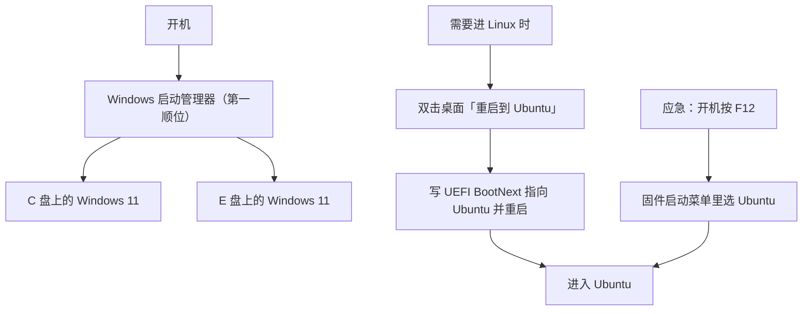

# 双系统引导部署使用说明

> 开发机 mjpc · Windows 11 + Ubuntu 双系统引导（一键重启切系统）

[文档首页](../../文档首页.md) › 资料 › 开发机 › 双系统引导部署使用说明　|　[WSL 部署使用说明 →](WSL部署使用说明.md)　[开发机部署使用说明总览 ←](linux/开发机部署使用说明总览.md)　[VSCode 部署使用说明 →](linux/VSCode部署使用说明.md)

## 1. 目的与适用范围 <a id="purpose"></a>

开发机 mjpc 是 **Windows 11 与 Ubuntu 双系统**机器，本文档记录两侧的**引导组织方式**：日常怎么切换系统、固件启动项怎么排、一键重启怎么实现，以及引导出问题时的排障与停用方式。

**一句话结论**：本机 **DisplayPort 下固件阶段无输出**（显卡 VBIOS 的 UEFI 驱动问题，见 3.2），因此**开机菜单（如 Ubuntu 的 GRUB）在 DP 上根本看不见**；而 Windows 启动管理器又无法加载 Linux（3.1）——**没有一个可见菜单能用来选 Linux**。所以日常切换改用**一键重启**（在系统内写 UEFI `BootNext` 后重启），不依赖任何菜单；应急时开机按 **F12** 用主板固件菜单手选启动项（7.2）。

本文档与《[开发机部署使用说明总览](linux/开发机部署使用说明总览.md)》配套——总览汇总开发机上的开发设施，本文档只讲**引导**；Ubuntu 系统本身的安装见《[Ubuntu安装部署使用说明](../工具/Ubuntu安装部署使用说明.md)》；**不进 Linux 系统、只想在 Windows 下读 Ubuntu 盘里的文件**见《[WSL 部署使用说明](WSL部署使用说明.md)》。

**取值说明**：`<mjpc-IP>` 等占位符与账号凭据的真实值见《[本地资源](../../用户文档/本地资源.md)》，不在仓库文档中记录。

## 2. 环境概览 <a id="env"></a>

### 2.1 机器与固件 <a id="env-machine"></a>

| 项 | 取值 |
| --- | --- |
| 主板 / BIOS | Maxsun MS-Terminator Z790M D5 / AMI H7.8G |
| CPU / 内存 / 显卡 | i7-13700K（16 核 24 线程）/ 64 GB / RTX 4090 |
| 固件模式 | UEFI（`Secure Boot` 关闭），全部磁盘 GPT |
| 系统 | Windows 11 专业版（build 26300）+ Ubuntu 26.04.1 LTS |

> Windows 侧 `Win32_OperatingSystem.Caption` 会报「Windows 10 专业版」，那是微软未更新的注册表口径；构建号 26300 属 Windows 11。

### 2.2 磁盘布局 <a id="env-disk"></a>

| 磁盘 | 容量 | 内容 |
| --- | --- | --- |
| 磁盘 0 | 1 TB NVMe | Windows 11（`C:`）+ 恢复分区 |
| 磁盘 1 | 4 TB NVMe | 数据盘（`D:`，开发工作区所在） |
| 磁盘 2 | 512 GB NVMe | Windows 11（`E:`）+ **Windows 的 ESP**（200 MB）+ 恢复分区 |
| 磁盘 3 | 4 TB NVMe | **Ubuntu**（ext4 根分区，分区 2）+ **Ubuntu 的 ESP**（1 GB，分区 1） |

三个要点：

- **两套 ESP 各自独立**：Windows 用磁盘 2 的 200 MB ESP，Ubuntu 用磁盘 3 的 1 GB ESP。改动一侧的引导文件不会波及另一侧。
- **`C:` 自身没有 ESP**：`C:` 与 `E:` 上的两个 Windows 共用磁盘 2 的 ESP（引导文件 `\EFI\Microsoft\Boot\bootmgfw.efi` 位于该分区）。
- **`D:` 是两个系统共用的数据盘**（NTFS）：Windows 侧为 `D:`，Ubuntu 侧挂载后同样可读写。

> Windows 侧要读磁盘 3 上 Ubuntu 分区里的文件（不重启切系统），见《[WSL 部署使用说明](WSL部署使用说明.md)》「挂载 Ubuntu 数据盘（只读）」节。

### 2.3 两个 Windows 安装 <a id="env-two-win"></a>

BCD 中登记了两个 Windows 启动加载器：

| 加载器 | 所在分区 | 启动管理器显示名 |
| --- | --- | --- |
| `{current}` | `C:` | Windows 11 |
| 另一个 | `E:` | Windows 11 |

进入「Windows」后，若需要区分这两个安装，Windows 启动管理器会再给一次选择。

## 3. 引导方案与选型依据 <a id="decision"></a>

### 3.1 Windows 启动管理器无法加载 Linux（UEFI 限制） <a id="why-not-bcd"></a>

**结论：UEFI 模式下无法把 Linux 加进 Windows 启动管理器菜单。** 这不是配置没做对，而是 `bootmgfw.efi` 的实现限制。

原状况本是「固件 NVRAM 里已有 Ubuntu 启动项，但开机菜单看不到」。把它加进 BCD 菜单的尝试均告失败：

| 尝试 | 结果 |
| --- | --- |
| 把该固件启动项加入 BCD `displayorder` | 菜单**能显示**，选中报 `0xc000007b` |
| `bcdedit /create /application bootsector` 再指定 `path` | 同样 `0xc000007b` |
| `bcdedit /bootsequence` 指向该固件项 | 同样 `0xc000007b` |
| 同一个项改从固件「使用设备」子菜单选 | **正常进入 GRUB** |

根因：`bootmgfw.efi` 只按 Windows 引导程序的方式加载镜像，Linux 的 `shim`/`grub` 不符合其要求。EasyBCD 也因此在 UEFI 模式禁用 "Add Linux entry"。

> 同一台机器的 `C:` 与 `E:` 两个 Windows 能并列在菜单里，是因为它们都是 Windows 引导程序；Linux 不在此列。

### 3.2 DisplayPort 固件阶段无输出（本机限制） <a id="dp-limit"></a>

**结论：从开机到 Linux 内核加载显卡驱动之前，DisplayPort 上没有输出**——这是显卡 VBIOS 的 UEFI 驱动问题，不是引导器配置问题，**任何跑在固件阶段的菜单在 DP 上都画不出来**。

实测对比（同一台机器、同一台显示器，只换接口）：

| 接口 | 结果 |
| --- | --- |
| **HDMI** | 固件阶段的菜单（如 Ubuntu 的 GRUB）**正常显示**，可正常选择并进入 Ubuntu |
| **DisplayPort（RTX 4090 的 DP 口）** | **黑屏**，直到 Linux 内核加载显卡驱动后才亮屏 |

- **Windows 启动管理器能在 DP 上显示**，原因是 `bootmgfw.efi` 会**主动设置视频模式**；而 GRUB 等引导器默认沿用固件遗留的当前模式。
- **不是分辨率设置问题**：设为保守分辨率同样无输出，说明该 DP 链路的初始化在固件阶段就不完整。
- 由此得到两条安排：**① 不能把「开机菜单」当日常路径**（3.3）；**② 主板固件的 F12 启动菜单可用**（由固件绘制，见 7.2）。

**可尝试的方向**（均未验证成功，按成本排序）：显示器 OSD 中把「DisplayPort 版本」从 1.4 改为 1.2（部分显示器在固件阶段无法以 DP 1.4 时序同步）；更新主板 BIOS 或显卡 VBIOS；改用 HDMI 线/口。**日常走一键重启即可，不必强求。**

### 3.3 结论：不做菜单依赖，采用一键重启为主路径 <a id="why-oneshot"></a>

- 开机菜单在 DP 上不可见（3.2），Windows 启动管理器又无法加载 Linux（3.1）——**没有可用的开机菜单**。
- **一键重启**：在系统内写 UEFI `BootNext`（一次性）再重启，**不依赖任何菜单**，是日常路径（Windows 侧见 4.4，Ubuntu 侧见 4.5）。
- **应急手选**：开机按 **F12** 呼出固件启动菜单，选 Ubuntu 或 Windows（7.2）。
- **不新增第三方引导器**：Ubuntu 的固件启动项（`Boot0001`，指向官方 `shimx64.efi`）一键重启与 F12 都指向它；引导链保持「官方、少组件」，ESP 上不需要额外维护程序或 ext4 驱动。

## 4. 部署 <a id="deploy"></a>

### 4.1 部署产物 <a id="artifacts"></a>

| 产物 | 位置 | 说明 |
| --- | --- | --- |
| 固件启动项 | UEFI NVRAM `Boot0000`（Windows）/ `Boot0001`（Ubuntu） | 见 4.3 |
| Windows 侧一键重启 | 桌面快捷方式「重启到 Ubuntu」+ 计划任务 `BootSwitch-RebootToUbuntu` | 见 4.4 |
| Ubuntu 侧一键重启 | `/usr/local/bin/reboot-to-windows` | 见 4.5 |
| ESP 上的引导文件 | 磁盘 3 ESP 的 `\EFI\ubuntu\`（Ubuntu 官方引导链） | 见 4.2 |
| 时钟口径 | Windows 注册表 `RealTimeIsUniversal=1` | 见 5.3 |

### 4.2 ESP 上的文件布局 <a id="esp-layout"></a>

```text
磁盘3 ESP（1 GB）/
├── EFI/
│   ├── BOOT/          # Ubuntu 的 UEFI 回退引导文件（安装器所建）
│   └── ubuntu/        # Ubuntu 官方引导链：shimx64.efi / grubx64.efi / grub.cfg
└── System Volume Information/
```

> Ubuntu 的 ESP 上**只有官方引导链**（Windows 的引导文件在磁盘 2 的 ESP 上，另有一套）。除上述目录外无第三方引导程序，也没有需要随内核更新维护的额外文件。

> 查看该 ESP 内容（管理员）：`'select disk 3','select partition 1','assign letter=V' | diskpart` → 看 `V:\EFI` → 再用 `'select disk 3','select partition 1','remove letter=V' | diskpart` 撤销；或经 WSL 只读挂载看（见《[WSL 部署使用说明](WSL部署使用说明.md)》「挂载 Ubuntu 数据盘（只读）」节，注意整盘挂给 WSL 期间 Windows 读不到该 ESP）。

### 4.3 固件启动项与启动顺序 <a id="bootorder"></a>

| 顺位 | 启动项 | 指向 | 作用 |
| --- | --- | --- | --- |
| 1 | `Boot0000` **Windows Boot Manager** | 磁盘 2 ESP 的 `\EFI\Microsoft\Boot\bootmgfw.efi` | **第一顺位**（日常直进 Windows，无等待） |
| 2 | `Boot0001` **Ubuntu** | 磁盘 3 ESP 的 `\EFI\ubuntu\shimx64.efi` | 一键重启与 F12 手选的入口（走 shim→GRUB） |

`BootOrder` = `Boot0000, Boot0001`。

**顺序设计说明**：Windows 放第一顺位，日常开机与单系统体验一致、无等待；需要 Linux 时走一键重启（4.4）。

> 一键重启使用 UEFI `BootNext`（一次性指定），**不修改 `BootOrder`**，所以不影响上面的日常顺序。

查看当前固件启动项（管理员 PowerShell）：

```powershell
bcdedit /enum firmware
```

### 4.4 Windows 侧一键重启进 Ubuntu <a id="oneshot-win"></a>

**这是推荐的日常路径**（因 DP 下开机菜单不可见）。桌面快捷方式 **「重启到 Ubuntu」**：双击 → 弹确认框 → 确认后重启，**下一次开机直接进 Ubuntu**。

| 环节 | 实现 |
| --- | --- |
| 快捷方式 | `C:\Users\minjian\Desktop\重启到 Ubuntu.lnk`，拉起 `C:\ProgramData\BootSwitch\ToUbuntu.ps1` |
| 确认框 | 脚本用 `System.Windows.Forms` 弹「是/否」，默认按钮为「否」 |
| 提权与执行 | 计划任务 `BootSwitch-RebootToUbuntu`（以 `SYSTEM` 运行，**不弹 UAC**） |
| 生效机制 | 写 UEFI `BootNext` 变量指向 `Boot0001`（Ubuntu）——**只生效一次**，之后自动回到默认顺序 |

> **关键实现细节（三个易踩坑，均于 2026-10-15 实测）**：
>
> 1. **必须显式启用 `SeSystemEnvironmentPrivilege`**：写 EFI 变量即使进程已以 `SYSTEM`/管理员身份运行也**不会自动获得**该权限，不启用时 `SetFirmwareEnvironmentVariableExW` 返回**错误 1314（权限不足）**，表现为「弹了确认框、然后什么也没发生」。需用 `OpenProcessToken` + `AdjustTokenPrivileges` 启用（实测：不提权 err=1314，提权后 err=0）。
> 2. **`.ps1` 必须存为 UTF-8 **带 BOM****：计划任务调用的是 **Windows PowerShell 5.1**（`powershell.exe`），它读取**无 BOM** 的 `.ps1` 时按系统 ANSI（中文环境为 GBK）解码，文件中的中文注释/字符串被解码坏后会**破坏语法**，脚本直接解析失败（实测：无 BOM 时 5.1 报 6 个解析错误、脚本完全不可用）。**校验时也必须用 5.1 而非 PowerShell 7**——pwsh 7 能正确识别无 BOM 的 UTF-8，用它校验会得出「语法正常」的错误结论（仓内 `scripts/tools/boot/校验脚本编码.ps1` 已按此口径实现）。
> 3. **必须给计划任务追加普通用户的运行权限**：`Register-ScheduledTask` 以 `SYSTEM` 注册后，任务的默认 ACL **只含管理员组与 SYSTEM**，普通用户（双击快捷方式时的身份）**既不能 `/run` 也不能 `/query`**，`schtasks /run` 返回 `ERROR: Access is denied.`（exit=1），表现同样是「弹了确认框但没反应」。需用 COM 给任务追加 `(A;;GRGX;;;AU)`（Authenticated Users 读+执行）：`(New-Object -ComObject Schedule.Service).GetFolder('\').GetTask('任务名').SetSecurityDescriptor($sd -replace 'D:', 'D:(A;;GRGX;;;AU)', 0)`。实测：追加前非提权 `schtasks /run` 报拒绝访问，追加后返回 SUCCESS 且任务以 SYSTEM 正常执行。

### 4.5 Ubuntu 侧一键重启回 Windows <a id="oneshot-linux"></a>

在 Ubuntu 里执行一次安装脚本即可（之后桌面出现「重启到 Windows」）：

```bash
# 脚本在 bms 仓库内（工作区里 Ubuntu 侧路径通常为 ~/develop/bizs/bms/...）
bash ~/develop/bizs/bms/scripts/tools/boot/安装-重启到Windows快捷方式.sh
# 该 .sh 为薄包装（唯一实现在同名 .py，两文件须同目录并存）；亦可直接 python3 同目录的 .py
```

脚本会自动完成：装 `efibootmgr`（若缺）→ **从 `efibootmgr` 输出中识别 Windows 启动项编号**（不写死）→ 写 `/usr/local/bin/reboot-to-windows` → 配免密 sudo 规则（仅该命令）→ 生成桌面项与应用菜单项 → 标记 `metadata::trusted`。

> 生成物 `/usr/local/bin/reboot-to-windows` 为 **Python 小程序**（依赖目标机自带 `python3`，Ubuntu 系统内置）——2026-10-16 随仓库脚本口径一并由 shell 转 Python，行为逐项一致（zenity 确认 / 失败报错分支不变）。**机器侧若已装旧 shell 版生成物，重跑一次本安装脚本即可更新。**

> 仓库内 `scripts/tools/boot/` 下另有：`生成-Windows侧一键重启.ps1`（重建 Windows 侧快捷方式与计划任务，支持 `-SelfTest` 自检）与 `校验脚本编码.ps1`（改动 `.ps1` 后校验 BOM 与 5.1 语法），目录说明见同目录 `README.md`。

**手动安装**（不想用脚本时的等效命令）：

```bash
sudo tee /usr/local/bin/reboot-to-windows >/dev/null <<'EOF'
#!/usr/bin/env python3
"""设置 UEFI BootNext 指向 Windows(0000)，然后重启（只生效一次）。"""
import shutil
import subprocess
import sys

if shutil.which("zenity") is not None:
    question = subprocess.run(
        [
            "zenity",
            "--question",
            "--title=重启到 Windows",
            "--text=确定重启回 Windows 吗？\\n\\n请先保存所有未保存的工作。",
            "--ok-label=重启",
            "--cancel-label=取消",
        ]
    )
    if question.returncode != 0:
        sys.exit(0)
flag = subprocess.run(["efibootmgr", "-n", "0000"])
if flag.returncode != 0:
    msg = "设置下次启动项失败（efibootmgr -n 0000）。"
    print(msg, file=sys.stderr)
    if shutil.which("zenity") is not None:
        subprocess.run(["zenity", "--error", "--title=重启到 Windows 失败", "--text=" + msg])
    sys.exit(1)
sys.exit(subprocess.run(["systemctl", "reboot"]).returncode)
EOF
sudo chmod 755 /usr/local/bin/reboot-to-windows

echo "$USER ALL=(root) NOPASSWD: /usr/local/bin/reboot-to-windows" | sudo tee /etc/sudoers.d/reboot-to-windows
sudo chmod 440 /etc/sudoers.d/reboot-to-windows

cat > ~/.local/share/applications/reboot-to-windows.desktop <<'EOF'
[Desktop Entry]
Type=Application
Name=重启到 Windows
Comment=设置下次启动进入 Windows 并立即重启
Exec=sudo -n /usr/local/bin/reboot-to-windows
Icon=system-reboot
Terminal=false
Categories=System;
EOF
cp ~/.local/share/applications/reboot-to-windows.desktop "$(xdg-user-dir DESKTOP)/"
chmod +x "$(xdg-user-dir DESKTOP)/reboot-to-windows.desktop"
gio set "$(xdg-user-dir DESKTOP)/reboot-to-windows.desktop" metadata::trusted true
```

- 先用 `efibootmgr`（不带参数）确认 Windows 项编号为 `0000`；若不同，替换命令里的 `-n 0000`。
- 桌面图标缺 `metadata::trusted true` 会被 GNOME 拦「不受信任」，详见《[开发机部署使用说明总览](linux/开发机部署使用说明总览.md)》「桌面快捷方式设置」节。

## 5. 使用说明 <a id="usage"></a>

### 5.1 开机流程 <a id="boot-flow"></a>



- **日常开机** → 直进 Windows（第一顺位），与单系统体验一致，无等待。
- **要进 Linux** → 双击桌面「重启到 Ubuntu」，确认后重启即进 Ubuntu。
- **应急** → 开机按 **F12**，在固件启动菜单里手选 Ubuntu 或 Windows（固件绘制，不受 3.2 的 DP 问题影响）。

### 5.2 一键切换 <a id="switch"></a>

| 方向 | 操作 |
| --- | --- |
| Windows → Ubuntu | 双击桌面「重启到 Ubuntu」，确认后重启即进 Ubuntu |
| Ubuntu → Windows | 双击桌面「重启到 Windows」（需先按 4.5 装好），或直接重启（默认顺序即 Windows） |

> **重启回 Windows 是预期行为**：一键重启用的是**一次性**的 `BootNext`，只对紧接的那一次开机生效；之后回到 `BootOrder` 的默认顺序（Windows 第一顺位）。所以「进过 Ubuntu 再重启就回 Windows」是设计如此，不是故障。

### 5.3 双系统时钟（RTC 解释方式） <a id="clock"></a>

**问题**：Windows 与 Linux 对硬件时钟（RTC）的默认解释相反——Windows 把 RTC 当**本地时间**，Linux 把它当 **UTC**。两者共存时，每次切换系统时间会**偏移一个时区**（本机为 +8 小时），可能导致证书校验、令牌、日志时间异常。

**本机处理**（2026-10-15）：改 Windows 一处注册表，让它与 Linux 一致地把 RTC 当 UTC：

```powershell
# 管理员 PowerShell
Set-ItemProperty -Path 'HKLM:\SYSTEM\CurrentControlSet\Control\TimeZoneInformation' `
                 -Name 'RealTimeIsUniversal' -Value 1 -Type DWord

# 启用并立即对时（本机时间服务默认 Stopped/Manual）
Set-Service w32time -StartupType Automatic
Start-Service w32time
w32tm /config /manualpeerlist:"ntp.aliyun.com,ntp1.aliyun.com,time.windows.com" /syncfromflags:manual /update
w32tm /resync /force
```

**切换设置时务必同时校正 RTC**：改动 `RealTimeIsUniversal` 后，RTC 里存的值与新解释方式不匹配，**下一次开机会偏移一个时区**，需等时间服务同步才恢复。做法是把当前 UTC 写进 RTC（`SetSystemTime` 接受的就是 UTC）：

```powershell
Add-Type -TypeDefinition @"
using System; using System.Runtime.InteropServices;
public static class ClockSet {
    [StructLayout(LayoutKind.Sequential)]
    public struct SYSTEMTIME { public ushort wYear,wMonth,wDayOfWeek,wDay,wHour,wMinute,wSecond,wMilliseconds; }
    [DllImport("kernel32.dll", SetLastError=true)] public static extern bool SetSystemTime(ref SYSTEMTIME st);
}
"@
$u = [DateTime]::UtcNow
$st = New-Object ClockSet+SYSTEMTIME
$st.wYear=[ushort]$u.Year; $st.wMonth=[ushort]$u.Month; $st.wDay=[ushort]$u.Day
$st.wDayOfWeek=[ushort][int]$u.DayOfWeek; $st.wHour=[ushort]$u.Hour
$st.wMinute=[ushort]$u.Minute; $st.wSecond=[ushort]$u.Second
[void][ClockSet]::SetSystemTime([ref]$st)
```

**验证**：本机本地时间与 UTC 应相差正好 +8 小时；`w32tm /query /status` 的「源」显示已同步的 NTP 服务器。

> 另一种等效做法是在 Ubuntu 侧执行 `timedatectl set-local-rtc 1`（让 Linux 迁就 Windows），但与 Linux 主流默认相反、systemd 会持续告警，且重装 Linux 后需重做，故本机采用改 Windows 的方式。

## 6. 维护 <a id="maintenance"></a>

### 6.1 内核更新 <a id="kernel-update"></a>

**不需要任何操作**：一键重启指向 Ubuntu 的官方引导链（`shimx64.efi` → GRUB），而 Ubuntu 内核包在安装/卸载时由 dpkg 钩子自动执行 `update-grub` 刷新 `/boot/grub/grub.cfg`，新内核自动纳入。

### 6.2 一键重启产物重建 <a id="rebuild"></a>

| 侧 | 做法 |
| --- | --- |
| Windows 侧 | 管理员运行 `bms/scripts/tools/boot/生成-Windows侧一键重启.ps1`（支持 `-SelfTest` 自检）：重建桌面快捷方式与计划任务，并补普通用户运行权限（4.4 的坑 3） |
| Ubuntu 侧 | 重跑 `bash ~/develop/bizs/bms/scripts/tools/boot/安装-重启到Windows快捷方式.sh`：重装生成物、免密 sudo 规则与桌面项 |

> 改过 Windows 侧 `.ps1` 后**必须**跑 `scripts/tools/boot/校验脚本编码.ps1`（校验 BOM 与 5.1 语法），原因见 4.4 的坑 2。

### 6.3 固件启动项与启动顺序 <a id="fw-entries"></a>

- **查看**：`bcdedit /enum firmware`（管理员）。
- **顺序**：一般不动（设计见 4.3）。确需调整时用主板固件 Setup（开机按 `Del`/`F2`）里的启动顺序项更稳妥；`BootOrder` 属固件 NVRAM，不建议手工硬改。
- **一键重启**只写一次性 `BootNext`，改不到 `BootOrder`。

## 7. 常见问题与排障 <a id="trouble"></a>

### 7.1 固件阶段 DisplayPort 无输出 <a id="dp-black"></a>

**结论：本机 DP 下无法解决**（成因见 3.2），改用 HDMI 或走一键重启。

**现象**：开机后 DP 显示器无输出，直到 Linux/Windows 内核或引导程序主动设置视频模式才亮屏；接 HDMI 则固件阶段就有画面（GRUB 菜单可见）。

**怎么判断是这个问题**：

- 换成 HDMI 接口后同一现象消失 → 基本可确认。
- 引导结果本身正常（例如一键重启后确实进了 Ubuntu，只是过程中没画面）→ 说明是**显示链路**问题，不是引导失败。

**成因**：`bootmgfw.efi` 会主动设置视频模式（约 1024×768），而 GRUB 等引导器默认沿用固件遗留的当前 GOP 模式；即便主动设成保守分辨率，DP 仍无输出——说明该 DP 链路的初始化在固件阶段不完整，属显卡 VBIOS 的 UEFI 驱动问题。

**可尝试**（未验证成功）：显示器 OSD 中把「DisplayPort 版本」由 1.4 改为 1.2；更新主板 BIOS 或显卡 VBIOS。

若根本进不了任何系统：开机按 **F12**，选 **Windows Boot Manager**。

### 7.2 开机按 F12 手选启动项 <a id="bypass"></a>

开机按 **F12** 呼出固件启动菜单，选 **Windows Boot Manager**（`Boot0000`）或 **Ubuntu**（`Boot0001`）——这两个项由各自系统的安装器所建，互相独立。固件启动菜单由主板固件绘制，**不受 3.2 的 DP 问题影响**。

### 7.3 停用一键重启（不卸载系统） <a id="rollback"></a>

只想回到「开机进 Windows、要进 Linux 时按 F12 手选」，把两套一键重启产物删掉即可，**不必动引导本身**：

| 侧 | 删除对象 |
| --- | --- |
| Windows 侧 | 计划任务 `BootSwitch-RebootToUbuntu`、桌面快捷方式 `重启到 Ubuntu.lnk`、目录 `C:\ProgramData\BootSwitch`（含 `ToUbuntu.ps1` 与日志） |
| Ubuntu 侧 | 生成物 `/usr/local/bin/reboot-to-windows`、免密规则 `/etc/sudoers.d/reboot-to-windows`、桌面项与 `~/.local/share/applications/reboot-to-windows.desktop` |

> 固件启动项（`Boot0000`/`Boot0001`）与磁盘 3 ESP 上的 `\EFI\ubuntu\` 由系统安装器所建，**不属本方案产物，不要删**；删除它们会导致 Ubuntu 无法启动。

## 8. 关键位置速查 <a id="quickref"></a>

| 用途 | 位置 |
| --- | --- |
| 查看固件启动项 | `bcdedit /enum firmware`（管理员） |
| Ubuntu 的 ESP | 磁盘 3 分区 1（`\EFI\ubuntu\`） |
| Windows 侧一键重启脚本 | `C:\ProgramData\BootSwitch\ToUbuntu.ps1`（日志同目录 `bootswitch.log`） |
| Windows 侧一键重启任务 | 计划任务 `BootSwitch-RebootToUbuntu` |
| Ubuntu 侧一键重启 | `/usr/local/bin/reboot-to-windows` |
| Windows 侧产物重建脚本 | `bms/scripts/tools/boot/生成-Windows侧一键重启.ps1` |
| Ubuntu 侧安装脚本 | `bms/scripts/tools/boot/安装-重启到Windows快捷方式.sh`（+ `.py`） |
| Windows 下读 Ubuntu 盘 | 《[WSL 部署使用说明](WSL部署使用说明.md)》：桌面「挂载 Ubuntu 盘」 |

> 依《[文档生成规范](../../规范/文档生成规范.md)》编写 · 与《[开发机部署使用说明总览](linux/开发机部署使用说明总览.md)》配套
