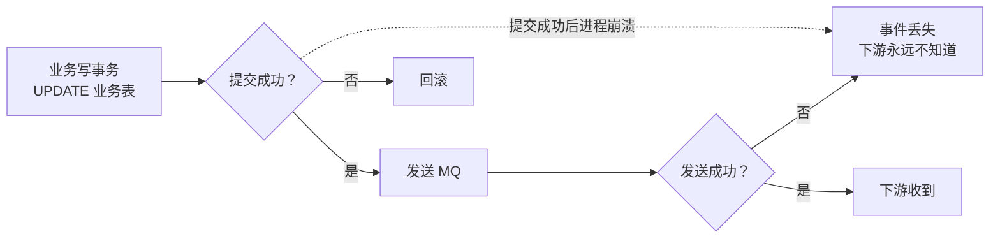
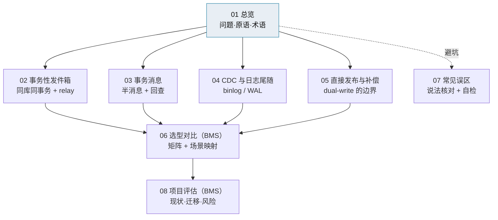

# 事件驱动总览

> 库↔消息双写 · 三种可靠原语 · 选型与迁移 · 子篇地图

[文档首页](../../../文档首页.md) › [知识档案](../技术栈知识档案总览.md) › 事件驱动总览　|　[← 返回总览](../技术栈知识档案总览.md)

---

> **定位**：本目录是**知识档案**（辅助参考），沉淀「业务写库之后，事件如何可靠地送到消息队列」的全部可行方案——事务性发件箱、消息队列事务消息、CDC 日志尾随，以及不可靠但有时可接受的直接发布。
>
> **默认口径以规范与架构为准**（平台《架构设计 · 服务间通信与一致性》、平台《架构设计 · 事件总线》、《[后端开发规范](../../../规范/后端开发规范.md)》）；本目录提供原理、实测证据、代价与可替换方案，**不替代**规范与设计。

## 1. 概述与定位 

事件驱动解决的是「一个服务做完一件事，通知其他服务」的问题。它把同步调用链拆成异步事件，换来解耦、削峰与可重放；但代价是：**业务数据库和消息队列是两个资源，没有一个天然覆盖两者的本地事务**。

本专题要回答四个问题：

1. 业务提交成功、消息发送失败，或者反过来，会发生什么？
2. 业界有哪几种可靠投递原语，各自的原子性从哪里来？
3. 「事务性发件箱」到底要求什么、不要求什么（例如是否要求一库一服务）？
4. BMS 现有实现是什么、要不要换、换了以后操作/登录审计怎么办？

> 本目录只做知识铺垫与决策框架；是否废除 outbox、是否切换事务消息，属平台架构决策，须按《[AI开发规范](../../../规范/AI开发规范.md)》逐项确认后定案。

## 2. 问题本质：库↔消息双写 

业务代码常见写法是「先改库，再发消息」：

反过来「先发消息、再改库」也有对称问题：消息已经发出，业务事务却回滚，下游收到一条**从未发生**的变更。

| 场景 | 能否原子 | 靠什么 |
| --- | --- | --- |
| 单库多表 | **能**（天然） | 数据库本地事务 |
| 业务库 + 消息队列 | **不能**（默认） | 需要额外机制：outbox / 事务消息 / CDC |
| 跨服务两个库 | **不能**（默认） | TM + XA（短流程写）或最终一致（事件/读侧） |

> 关键区分：**跨服务写**要的是「两个库要么都改、要么都不改」；**事件投递**要的是「业务提交了，事件一定发出去；业务回滚了，事件一定不发」。两者目标不同，方案也不同。BMS 的跨服务写走 TM + XA，事件/读侧走 outbox（见《[分布式事务 · 总览](../分布式事务/01_分布式事务_总览.md)》）。

## 3. 三种可靠原语 + 一种不可靠 

| 原语 | 原子性来源 | 额外组件 | 事件账本 / 重放 | 绑定 | 典型代价 |
| --- | --- | --- | --- | --- | --- |
| **本地 outbox** | 业务库本地事务（业务行 + outbox 行同事务） | outbox 表 + relay（轮询或日志尾随） | **有**（可查、可重放、可取证） | 不绑 broker | 表与 relay 的维护、积压监控 |
| **MQ 事务消息** | 半消息 + 本地事务 + 提交/回滚 + broker 回查 | MQ 事务能力 | **无**（依赖 MQ 保留期） | 绑定 RocketMQ | 回查需持久化本地结果；绑 broker |
| **CDC / 日志尾随** | 数据库事务日志 | Debezium / Kafka Connect 或自研 binlog | **有**（Kafka retention） | 绑数据库方言 | 运维重、schema 耦合、方言差异 |
| **直接发布** | **无**（dual-write） | 无 | 无 | 无 | 丢事件 / 假事件；只适合 best-effort |

三者的共同底线：**至少一次投递 + 消费端幂等**。所谓「恰好一次」在工程上通常指「效果等价一次」，不是协议层保证。

## 4. 术语速查 

| 术语 | 含义 |
| --- | --- |
| 事务性发件箱（Outbox） | 业务写入与事件写入**同库同事务**，独立 relay 把 outbox 记录投递到 MQ |
| Relay / 投递器 | 读 outbox、发 MQ、标记结果的独立进程或后台任务（轮询或日志尾随） |
| 半消息（Half Message） | RocketMQ 事务消息的第一阶段：消息对消费者不可见，等待本地事务结果 |
| 回查（Check） | 生产者崩溃后，broker 回调生产者确认本地事务是提交还是回滚 |
| CDC | Change Data Capture：读数据库事务日志（binlog / WAL）捕获变更 |
| 日志尾随（Log Tailing） | 把数据库事务日志当作事件源，按提交顺序投递 |
| 至少一次（At-least-once） | 消息可能重复，但不会丢；消费端必须幂等 |
| 效果一次（Effectively Once） | 至少一次 + 幂等去重，业务效果等价于只执行一次 |
| 聚合键（Aggregate Key） | 同一业务实体的分区键，保证同实体事件有序 |
| 死信（Dead Letter） | 重试超限后转入人工处置的事件 |
| 重放（Replay） | 把已投递 / 死信事件重置为待投递，重新发送 |
| 双写（Dual Write） | 同时写两个资源（库 + MQ）且没有共同事务，必然存在不一致窗口 |

## 5. 子篇地图 

| 篇目 | 回答的问题 |
| --- | --- |
| [01 总览](01_事件驱动_总览.md) | 问题本质、四种原语、术语、怎么读本专题 |
| [02 事务性发件箱](02_事件驱动_事务性发件箱.md) | 原理、表结构、relay、幂等/重放/死信、边界澄清 |
| [03 事务消息](03_事件驱动_事务消息.md) | 半消息与回查、RocketMQ 5.x Python 支持、限制与适用 |
| [04 CDC 与日志尾随](04_事件驱动_CDC与日志尾随.md) | binlog/WAL、Debezium、Python 自研、三库差异与运维 |
| [05 直接发布与补偿](05_事件驱动_直接发布与补偿.md) | dual-write 的失败模式、best-effort 边界、对账 |
| [06 选型对比（BMS）](06_事件驱动_选型对比（BMS）.md) | 对比矩阵、场景映射、推荐与触发条件 |
| [07 常见误区](07_事件驱动_常见误区.md) | 流行说法核对、术语混淆、废除前自检 |
| [08 项目评估（BMS）](08_事件驱动_项目评估（BMS）.md) | 现状、约束、迁移路径、工时、风险、建议 |

## 6. 阅读路径 

| 目的 | 建议顺序 | 预计 |
| --- | --- | --- |
| **快速参与决策** | 01 → 06 → 07 → 08 | 约 30 分钟 |
| 想系统理解 | 01 → 02 → 03 → 04 → 05 → 06 → 07 → 08 | 约 2 小时 |
| 只看实现细节 | 02 → 03 | 约 40 分钟 |
| 只关心「要不要废除 outbox」 | 01 → 07 → 08 | 约 20 分钟 |

## 7. 与相邻专题的边界 

| 专题 | 边界 |
| --- | --- |
| [分布式事务](../分布式事务/01_分布式事务_总览.md) | 该专题讲**跨库/跨服务写**的强一致（2PC / XA / TM）与一致性屏障；本专题只讲**事件投递**的可靠性。两者不能互相替代。 |
| [微服务 · 05 通信与分布式一致性](../微服务/05_微服务_通信与分布式一致性.md) | 该篇讲模式总论（同步/异步、Saga、Outbox、幂等）；本专题把「事件可靠性」单独展开到实现与选型。 |
| [微服务 · 12 选型对比](../微服务/12_微服务_选型对比.md) | 该篇给出一致性候选的总表；本专题补充 RocketMQ 5.x Python 事务消息的实测事实与 outbox 边界澄清。 |
| 平台《架构设计 · 服务间通信与一致性》 | **默认口径的权威源**：本地事务 + Outbox + 幂等为事件基线；RocketMQ 事务消息为备选。 |
| 平台《架构设计 · 事件总线》 | 事件契约、分区有序、消费组与死信的权威设计。 |
| 平台《01_01 事件总线》 | 本平台 outbox / relay / 幂等 / 死信的实现与实施记录。 |

## 8. 本项目现状（一句话版） 

- **实现**：`bms_core` 已交付「本地事务 + 自研薄 Outbox + 轮询投递器 + 消费幂等 + 死信看板」（01_01）。
- **使用方**：06_01 的操作 / 登录审计事件经 `audit-chain` 有序组消费；字段级审计（06_02）计划复用同一链路。
- **事务消息**：`EventPublisher.publish_transactional()` 接口已留，但当前只是委托普通发送（注释写明「备选方案、当前不作基线」）。
- **已知短板**：`sys_outbox` 等基础设施表名写死；多实例投递缺少行锁 / 租约（01_01 已登记为开放项）。
- **决策背景**：审计服务独立化讨论中，暴露出「共用库时同名 outbox 表重叠」与「是否需要废除 outbox」的分歧——本专题即为该决策提供依据。

## 9. 参考资源 

| 资源 | 网址 | 说明 |
| --- | --- | --- |
| microservices.io：Transactional Outbox | https://microservices.io/patterns/data/transactional-outbox.html | Outbox 模式定义、参与者与两种 relay |
| microservices.io：Transaction Log Tailing | https://microservices.io/patterns/data/transaction-log-tailing.html | 日志尾随式 relay |
| microservices.io：Polling Publisher | https://microservices.io/patterns/data/polling-publisher.html | 轮询式 relay |
| Debezium：Outbox Pattern | https://debezium.io/blog/2019/02/19/reliable-microservices-data-exchange-with-the-outbox-pattern/ | CDC 实现 outbox 的完整示例 |
| AWS：Transactional Outbox | https://docs.aws.amazon.com/prescriptive-guidance/latest/cloud-design-patterns/transactional-outbox.html | 云厂商视角的权衡 |
| Apache RocketMQ：Transactional Message | https://rocketmq.apache.org/docs/featureBehavior/04transactionmessage/ | 半消息、回查与事务状态 |
| RocketMQ 5.x Python 事务消息示例 | https://github.com/apache/rocketmq-clients/blob/master/python/example/transaction_producer_example.py | 本项目客户端可直接参考的实现 |
| Martin Fowler：Eventual Consistency | https://martinfowler.com/articles/patterns-of-distributed-systems/ | 最终一致模式集 |

---

> 依《[文档生成规范](../../../规范/文档生成规范.md)》编写
