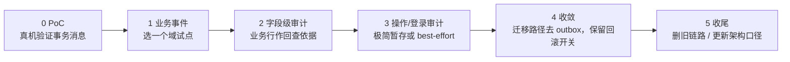

# 项目评估（BMS）

> 现状 · 约束 · 方案评估 · 迁移路径 · 工时与风险 · 建议

[文档首页](../../../文档首页.md) › [知识档案](../技术栈知识档案总览.md) › [事件驱动总览](01_事件驱动_总览.md) › 项目评估（BMS）

---

> **定位**：本篇把前七篇的结论代入 BMS 的实际约束，给出**评估与建议**。是否废除 outbox、是否切事务消息，属架构决策，须按《[AI开发规范](../../../规范/AI开发规范.md)》逐项确认后定案；本篇不替代架构设计。

## 1. 现状 

| 项 | 现状 |
| --- | --- |
| 事件总线 | 01_01 已交付：事务性发件箱 + 轮询投递器 + 消费幂等 + 死信看板 + 指标 |
| 表结构 | `sys_outbox` / `sys_event_consumed` / `sys_event_dead_letter`，表名写死 |
| 使用方 | 06_01 操作 / 登录审计事件经 `audit-chain` 有序组消费；06_02 字段级审计计划复用 |
| 事务消息 | `EventPublisher.publish_transactional()` 已留接口，当前委托普通发送（备选，未启用） |
| 账本能力 | `replay()` 按事件 / 类型 / 聚合 / 时间重放；死信可重投 / 忽略 |
| 已知短板 | 多实例投递无行锁 / 租约（01_01 开放项）；表名写死导致共库撞名 |
| 相关决策 | 06_02 已暂停，等待 01_04 事件基座专项结论 |

## 2. 约束 

| 约束 | 影响 |
| --- | --- |
| 单人兼职 + AI 辅助，无专职运维 | CDC / Kafka Connect / 自研中间件的运维成本过高 |
| 后端单一 Python / FastAPI | 事务消息需用 Python 5.x 客户端；CDC 需 Python 生态支持 |
| 三库：MySQL 8 / PostgreSQL 16 / 达梦 DM8 | 达梦无 Debezium connector；三库日志差异大 |
| 本地开发 SQLite | CDC 不可验证；事务消息需真 broker；outbox 可完整验证 |
| RocketMQ 5.x | 5.x Python 客户端有事务消息示例；稳定性待真机实测 |
| Windows 开发机 | 4.x `rocketmq-client-python` 不支持 Windows；5.x gRPC 可用 |
| 01_01 已上线、06_01 已依赖 | 迁移必须保留回滚路径，不能一次性删除 outbox |
| 审计合规要求 | 操作 / 登录 / 字段审计不能丢事件 |

## 3. 方案评估 

评分口径：★ 越多越适合当前约束（★ = 差，★★★★★ = 好）。

| 方案 | 契合度 | 改动量 | 风险 | 长期成本 | 结论 |
| --- | --- | --- | --- | --- | --- |
| **A 保留 Outbox + 修隔离** | ★★★★★ | 小 | 低 | 低 | 解决「共库撞名 / 表名绑死」的最小方案 |
| **B 事务消息（业务 + 字段审计）+ 审计极简暂存** | ★★★☆ | 中 | 中 | 中 | 若目标是「废除通用 outbox」，这是现实路径 |
| **C 全量事务消息（含操作 / 登录审计）** | ★★ | 大 | 高 | 高 | 本质是 outbox 换名，不建议 |
| **D CDC** | ★★ | 大 | 高 | 高 | 当前基础设施与团队规模不匹配 |
| **E 直接发布** | ★ | 小 | 极高 | 低 | 审计 / 业务事件不可用 |

## 4. 迁移路径（若选 B） 

| 阶段 | 内容 | 退出条件 |
| --- | --- | --- |
| 0 PoC | 半消息 / 提交 / 回滚 / 崩溃回查 / 重复投递 | 四条路径真机通过 |
| 1 业务事件 | 选一个低风险域（如用户 / 角色事件）迁移 | 事件不丢、消费幂等、可回滚 |
| 2 字段级审计 | 业务事务内捕获 + 事务消息 | 审计记录完整、链校验通过 |
| 3 操作 / 登录审计 | 极简暂存表 + 事务消息，或 best-effort | 审计不丢（或明确接受降级） |
| 4 收敛 | 迁移路径去 outbox；保留全局开关 | 旧链路无流量、回滚演练通过 |
| 5 收尾 | 删旧代码 / 表 / 文档；更新架构 37/16 | 文档与实现一致 |

## 5. 工时估算（待定） 

| 工作项 | 估算 |
| --- | --- |
| PoC（真机四路径 + 报告） | 8h |
| 事务消息发布器 + 回查注册 | 16h |
| 业务事件试点迁移 | 12h |
| 字段级审计接入 | 8h |
| 操作 / 登录审计暂存或降级方案 | 8h |
| 测试（含覆盖率）+ 文档 + 回滚演练 | 12h |
| **合计** | **约 64h（区间 48~80h，待设计细化）** |

> 上述为 01_04 专项估算，不含 06_02（64h）。若两者串行，阶段八总工时需同步回写。

## 6. 风险 

| # | 风险 | 影响 | 缓解 |
| --- | --- | --- | --- |
| 1 | 操作 / 登录审计无业务行可回查 | 事务消息无法判定提交/回滚，可能丢审计 | 保留极简暂存表；或接受 best-effort 并登记合规风险 |
| 2 | 绑定 RocketMQ | 未来换 broker 需重做 | 保留 outbox 回滚开关；抽象发布端口 |
| 3 | 失去事件账本 / 重放 | 排障、补消费、取证能力下降 | 另建只读事件归档，或接受 MQ 保留期 |
| 4 | 回查实现错误 | 消息悬挂 / 误提交 / 误回滚 | 真机 PoC + 幂等 check + 监控 |
| 5 | 多实例 / 多租户 | producer 与回查需按库 / 租户隔离 | 设计时明确 key；测试覆盖 |
| 6 | SQLite 本地开发无法验证 | 开发期看不到真实行为 | 真机 / CI 环境验证；本地只跑单测 |
| 7 | 06_02 依赖 | 审计服务迁移与字段审计被阻塞 | 01_04 先出结论；06_02 保持暂停 |
| 8 | 表名 / 库归属变更 | 文档、对账、测试大面积改动 | 单独任务、分阶段提交 |

## 7. 建议（待确认） 

1. **先做 PoC，不做全量迁移**：用真实 RocketMQ 5.x 验证事务消息四路径，拿到数据再定案。
2. **明确目标再选路线**：
   - 若只是「共库撞名 / 表名绑死」→ **路线 A**（参数化隔离），成本最低；
   - 若明确要「废除通用 outbox 表与 relay」→ **路线 B**，并接受 RocketMQ 绑定与审计暂存。
3. **不建议路线 C / D / E**：C 是换名，D 运维过重，E 会丢审计。
4. **保留回滚开关**：迁移期用配置在 outbox / 事务消息之间切换，出问题可回退。
5. **06_02 维持暂停**：等 01_04 PoC 与设计结论后再恢复，避免在即将替换的链路上继续加码。

## 8. 待实测 / 待确认 

| # | 事项 | 影响 |
| --- | --- | --- |
| 1 | RocketMQ 5.x broker 与 Python 客户端事务消息四路径 | 决定 B 是否可行 |
| 2 | 回查延迟 / 最大回查次数 / 事务超时 | 决定业务事务时长上限 |
| 3 | 半消息堆积与监控指标 | 决定运维方案 |
| 4 | 多实例 producer 与回查隔离 | 决定扩容方案 |
| 5 | 操作 / 登录审计暂存表设计 | 决定审计是否不丢 |
| 6 | 事件账本替代（MQ 保留期 / 只读归档） | 决定重放 / 取证能力 |
| 7 | 达梦 / PG / MySQL 事务消息行为差异（MQ 侧应一致，需验证） | 决定三库可用性 |
| 8 | 迁移工时与阶段八排期 | 决定 06_02 / 07_01 顺延 |

## 9. 参考资源 

| 资源 | 网址 | 说明 |
| --- | --- | --- |
| microservices.io：Transactional Outbox | https://microservices.io/patterns/data/transactional-outbox.html | 模式定义 |
| RocketMQ：Transactional Message | https://rocketmq.apache.org/docs/featureBehavior/04transactionmessage/ | 事务消息 |
| RocketMQ 5.x Python 示例 | https://github.com/apache/rocketmq-clients/blob/master/python/example/transaction_producer_example.py | 客户端能力 |
| Debezium：Outbox Pattern | https://debezium.io/blog/2019/02/19/reliable-microservices-data-exchange-with-the-outbox-pattern/ | CDC 方案 |

## 10. 项目内关联文档 

| 文档 | 说明 |
| --- | --- |
| [01 总览](01_事件驱动_总览.md) | 四种原语 |
| [02 事务性发件箱](02_事件驱动_事务性发件箱.md) | 现状实现 |
| [03 事务消息](03_事件驱动_事务消息.md) | 替代方案 |
| [06 选型对比（BMS）](06_事件驱动_选型对比（BMS）.md) | 路线与触发条件 |
| [07 常见误区](07_事件驱动_常见误区.md) | 废除前自检 |
| 平台《01_01 事件总线》 | 现行实现 |
| 平台《06_01 操作日志与登录日志》 | 事件使用方 |
| 平台《架构设计 · 服务间通信与一致性》 | 权威口径 |

---

> 依《[文档生成规范](../../../规范/文档生成规范.md)》编写
