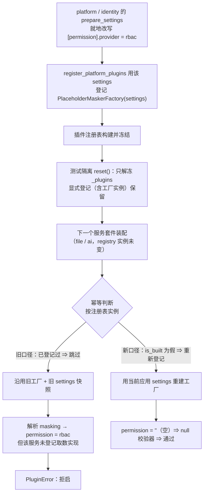

# CI 流水线与测试并发失败复盘

> 一次全量流水线的三类失败（前端并发超时 / 外部网络超时 / 插件注册表配置快照串味）的定位、处置与防复发口径

[文档首页](../../../文档首页.md) › 资料 › [知识档案](../../知识档案/) › [工程化与质量](../) › CI 流水线与测试并发失败复盘

## 1. 结论与适用范围 <a id="conclusion"></a>

本档记录 2026-10-22 手动触发全量流水线后暴露的三类失败，以及**本地不可复现**的
`backend-test` 失败的真因。三类问题的共同特征是「**与业务代码无关、与执行环境相关**」，
因此处置落点分别在：测试并发配置、CI job 容错配置、基座装配幂等键。

| 项 | 内容 |
| --- | --- |
| 触发流水线 | #1209（`main @3d505760`）→ 失败；#1210（`@839f3147`）→ 仅剩 `backend-test` 失败；#1213（`@01f2e568`）→ 修复后验证 |
| 失败 job | `test:desktop-check`（单例超时）、`test:dependency-scan`（漏洞库下载超时）、`test:backend-test`（权限数据来源缺失） |
| 关键结论 | 前两项是**环境/资源**问题；第三项是**基座装配幂等键取注册表实例**导致的跨套件配置快照串味 |
| 适用对象 | 本地预检、CI 全量流水线、`bms_core` 插件注册表与测试夹具维护 |

> 本文只记录**为什么失败、怎么定位、怎么防复发**；具体命令与配置以代码与《测试规范》为准。

## 2. 定位过程与关键证据 <a id="evidence"></a>

三个 job 的失败信息与本地验证口径如下（本地环境与 CI 的差异是本案的关键）：

| job | CI 现象 | 本地复现 | 结论 |
| --- | --- | --- | --- |
| `desktop-check` | `menu-sections.spec.ts` 单例 `Test timed out in 15000ms` | 单文件通过（1455ms）；**全包默认并发稳定超时** | 并发过高拖慢 import，非用例逻辑错 |
| `dependency-scan` | trivy `failed to download vulnerability DB … context deadline exceeded`（约 50~150 KiB/s） | 不适用 | 外部镜像源带宽/抖动 |
| `backend-test` | `services/file`、随后 `services/ai` 的 `PluginError: [permission].provider = rbac 但未登记权限数据来源` | 单跑 / 串行 / `-n 4` / **全量 `-n auto` 均全绿** | 跨套件配置快照串味，取决于 worker 内**首次装配**顺序 |

关键取证手段（值得沉淀）：

1. **按 job 拉完整 trace**（GitLab `GET /projects/:id/jobs/:id/trace`），用关键字过滤而不是通读；
2. 失败用例集合**两次不同**（先是 `services/file` 的 4 例，后是 `services/ai` + `services/file` 的
   `test_dependency_provider_resolves`）——这一现象本身就指向**执行顺序/进程内全局状态**，而不是代码缺陷；
3. 堆栈里的两处细节定罪：

```text
assembly.py: assemble_plugins → _resolve_or_reject → resolve_plugin("masking")
factory.py: PlaceholderMaskerFactory.__call__ → create
assembly.py:678: NullMasker(checker=_resolve_permission_checker(self._settings))
```

`self._settings` 是 `PlaceholderMaskerFactory` **登记时**捕获的配置实例——不是当前应用的配置。

## 3. 根因链（backend-test） <a id="root-cause"></a>



> 为什么本地难复现：串行 / 单套件时「首次装配」恰好是干净配置；全量 `-n auto` 下 worker 内
> 首次装配可能是 identity / platform，缺陷才会现形。CI 上两次失败的用例集合不同，也是 worker
> 分配不同所致。

## 4. 处置落地 <a id="fixes"></a>

### 4.1 前端：限制 Vitest 并发 <a id="desktop"></a>

`frontend/apps/desktop/vitest.config.ts` 增 `test.maxWorkers: '50%'`：桌面包 100 个测试文件默认
按文件各 fork 一个 worker，本地实测 100 worker 同时 transform 使重型文件 import 被拖慢约 10 倍。

| 口径 | 结果 | 整包耗时 |
| --- | --- | --- |
| 默认（100 workers） | 2 例撞 15s 超时 | 51s |
| `--maxWorkers=4` | 868 passed，覆盖率 4 项全 100% | 73s |
| `maxWorkers: '50%'`（落地值） | 868 passed，覆盖率 4 项全 100% | 51~73s（按核数） |

配套把 `menu-sections.spec.ts` 中「字段明细」用例改为**轻量表格替身**（该用例只操作表格外工具栏，
不依赖表格渲染），单例耗时 1455ms → 243ms；空语言回退分支改由用例内显式断言覆盖（保持 100% 覆盖率）。

### 4.2 CI：漏洞库下载容错 <a id="dependency"></a>

`dependency-scan` 增 `retry: {max: 1, when: [script_failure]}`，并给 trivy 加 `--timeout 10m`。
此类失败与代码无关，重试可自愈；不改成「忽略失败」，保留硬门禁语义。

### 4.3 基座：幂等键改为「注册表是否已构建」 <a id="registry"></a>

| 文件 | 改动 |
| --- | --- |
| `core/plugin.py` | 新增只读属性 `is_built`；`register` 对同 `(key, name)` 按**最后者生效**替换 |
| `core/assembly.py` | `register_platform_plugins` 幂等判断由「注册表实例已登记」改为 `registry.is_built`；删除 `_PREPARED_REGISTRIES` |
| `permission/rbac.py` / `scope/rbac.py` | 同步改为 `registry.is_built`，删除各自的 `_REGISTERED_REGISTRIES` |
| `tests/core/test_plugin.py` | 新增「同键同名重登记取最后者 / `reset()` 后回到未构建态」用例 |
| `tests/core/test_assembly_factories.py` | 新增回归用例：先用 `provider=rbac` 装配，`reset()` 后用空 provider 重新装配，masking 解析必须走 null 校验器 |

> 语义解释：插件注册表是**进程级**的，`reset()` 只解除冻结（回到未构建态），显式登记会保留。
> 因此「幂等」应当表达为「**注册表尚未构建时才登记**」，而不是「这个注册表实例登记过一次就永远跳过」。

## 5. 防复发口径 <a id="prevention"></a>

- **测试进程内的全局注册表（插件 / 权限数据来源 / 角色解析器）一律按「状态」判定幂等**，不要按
  「实例是否见过」；实例身份在 `reset()` 后不变，会掩盖状态变化。
- **测试并发不是越高越好**：按文件 fork 的并发会把 `import`/`transform` 放大成主要成本，
  重型文件（路由族 / 真实 `el-table`）优先降并发，而不是逐个加超时。
- **失败用例集合变化 = 顺序依赖信号**：连续两次失败但用例不同，先查进程内全局状态与夹具顺序，
  不要急着改业务代码。
- **本地不可复现不等于不是缺陷**：CI 的 worker 分配与本地不同，属「并发下的必然时序」；
  取证应优先拿到**完整堆栈**（谁持有配置），而不是继续盲跑。
- **外部网络类 job**（漏洞库 / 镜像）保留硬门禁 + 有限重试，不引入 `allow_failure` 软化。

## 6. 遗留与观察项 <a id="open"></a>

- `maxWorkers: '50%'` 对 CI 墙钟时长的影响需在后续流水线观察；若 CI 机器核数偏少导致总时长
  明显上升，再评估固定值（如 4 worker）。
- trivy 漏洞库镜像源（`ghcr.nju.edu.cn`）速度仍不稳定，重试只解决抖动；若长期不达标，
  另立任务评估镜像源替换（需先实测再定，不凭印象切换）。
- 本次未做全量回归之外的深度并发压测；后续如需，另行登记任务与用例。
