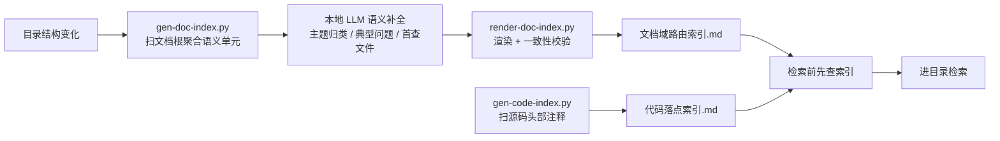

# 代码检索索引方式失效复盘

> 生成式导航索引（文档域路由索引 / 代码落点索引）的试点结论：**判定无效，已全部删除**（2026-10-19 拍板）

[文档首页](../../../文档首页.md) › 资料 › [知识档案](../../知识档案/) › [工程化与质量](../) › 代码检索索引方式失效复盘

## 1. 结论与适用范围 

本档记录一次**失败的工程实践**：为提升文档与代码检索效率而建的**生成式导航索引**，在实际使用中被判定无效，
配套的 3 支生成脚本、2 份索引文件与 1 份工具链说明文档已全部删除。记录目的是**避免重复投入**，而非保留实现细节。

| 项 | 内容 |
| --- | --- |
| 试点周期 | 至 2026-10-19 止 |
| 已删除资产 | `scripts/tools/search/` 三支脚本（`gen-doc-index.py` / `gen-code-index.py` / `render-doc-index.py`）、`bms文档/文档域路由索引.md`、`代码落点索引.md`（本地生成物）、`资料/开发机/代码检索与索引进工具部署使用说明.md` |
| 现行做法 | 不建索引，改用检索工具自身的过滤能力（见第 4 节） |
| 相关规范 | AGENTS.md「代码与文档检索」节 |

> 本文只讲**为什么失败**与**现在怎么做**；被删工具的部署用法不再保留——它们已不存在，保留文档只会误导。

## 2. 原方案设计 

原方案假设：检索慢的根因是**不知道去哪找**，因此先用离线脚本把「主题 → 域 → 首查文件」的映射算好存成索引，
检索前先查索引缩小范围，再进目录检索。

设计上索引**只做导航、不含口径**（权威仍是基类清单与《基座文档清单》），这个边界划分是对的；
问题不在边界，而在**方案前提本身**。

## 3. 失效原因 

### 3.1 无法验证，因此必然漂移 

这是根本原因。索引方案的收益完全依赖「检索前先查索引」这个**行为**，而该行为**没有任何机器检查能判定**：

- 检查脚本能验证索引文件**存在**、格式**正确**、链接**不断**；
- 但无法验证「这次检索是否先读了索引」——同样的检索结果，查过索引和没查过索引看起来完全一样。

对比同仓其他规范可以看出差别：基座清单一致性（`check_base.py` 比对登记数与磁盘数）、断链
（`check_links.py`）、文档范围（`check_docs_scope.py`）都能被脚本判失败，所以它们**真的被执行**；
而索引使用规范违反后无任何反馈，于是逐步被绕过，最终形同虚设。

### 3.2 维护成本高于收益 

索引不是一次性产物，每次目录结构变化都要重跑整条链路，其中「语义补全」依赖本地 LLM 在线：

- 重跑成本：扫描 + LLM 逐单元补全 + 渲染校验，分钟级；
- 失效范围大：新增/迁移一批文档就可能让多个单元的描述失准；
- **仍会与实际不一致**：2026-10-19 实测发现索引把 `资料/AI` 记为「4 份」，而磁盘上只有 3 份——
  索引自身成了需要被校验的对象，等于多维护一份会漂移的清单。

### 3.3 实测：小范围任务上索引更慢 

2026-10-19 一次文档任务（目标目录 `资料/AI` 仅 3 份文档）的实测对比：

| 做法 | 实际耗时 |
| --- | --- |
| 查索引 → 再定位 | 需先确认索引存在、读取对应段、再核对是否过期 |
| 直接列目录 | `Get-ChildItem` 一次即看完 3 份文档 |

目录规模小的时候，**索引的查表成本高于直接列举**。索引的价值只在超大目录上成立，而本仓文档虽多（1874 份 md），
实际任务往往集中在某个具体域（几十份），落在索引的收益盲区。

### 3.4 收益可被工具自身过滤替代 

见第 4 节实测：靠「限定目录」一项就能拿到约 12 倍收敛，而这不需要任何索引资产。

## 4. 现行做法：工具级过滤 

不建任何索引，按以下顺序用检索工具自身的过滤能力收敛（实测于 bms 仓 5014 个可检索文件，关键词「权限计算」）：

| 步骤 | 写法 | 候选文件 | 命中 | 耗时 |
| --- | --- | --- | --- | --- |
| ① 全库（基线） | 仅关键词 | 5,014 | 142 | 0.72s |
| ② 限扩展名 | `include: *.md` | 1,874 | 130 | 0.35s |
| ③ 限目录（域优先） | `path: bms文档/设计` | 484 | 58 | 0.06s |
| ④ 目录 + 扩展名 | `path: 设计` + `*.md` | 253 | 55 | 0.03s |
| ⑤ 更细的域 | `path: 设计/架构设计` | 37 | 21 | 0.01s |

**关键发现**：目录限制带来约 12 倍收敛（142 → 58），扩展名过滤只有约 1.1 倍（142 → 130）。
所以真正有效的动作是「**先想清楚该去哪个域找**」，而不是「堆过滤参数」。

三条按序用：

1. **限定目录**——按域进目录再检索（`bms文档/设计/`、`backend/libs/bms_core/src/`、`frontend/packages/<包>/src/`）；
2. **限定扩展名**——`include` / `-g '*.md'`，排除配置与构建产物；
3. **精确关键词**——用领域术语（「权限计算」「租约续期」）而非泛词（「配置」「管理」）。

配套红线（仍在 AGENTS.md）：禁用 `--no-ignore` / `-uu`（会扫进依赖与构建产物）；
`-g` 白名单只影响 `--files` 列表、不经过忽略层，判定检索范围用不带 `-g` 的 `rg --files`。

## 5. 若将来再考虑索引 

本档不是「索引一律无用」的结论，而是「**这个形态**在本仓当前规模与使用方式下无效」。若要重试，须先满足：

- **能被机器验证**：索引若与实际不符，要有脚本判失败（否则必然重蹈 3.1 的漂移）；
- **零人工/LLM 补全成本**：生成必须是纯静态、秒级可重跑，否则重蹈 3.2；
- **命中真实规模盲区**：须先证明目标场景的目录规模确实大到「直接列举不可行」（本仓单域通常几十份，远未到）；
- **收益可度量**：上线前后对比命中数与耗时，用数据判断而非直觉。

不满足以上任一条，则维持第 4 节的工具级过滤——**它零维护、永不漂移**。

### 5.1 后续实践：2026-10-19 的检索工具如何满足四条前提 

同日稍后落地的《[内容检索工具部署使用说明](../../工具/内容检索工具部署使用说明.md)》（`bms/scripts/tools/search/`）
是**另一种形态**，与本档废止的「生成式导航索引」不同，逐条对照本档第 5 节四条前提：

| 前提 | 本档要求 | 检索工具的满足方式 |
| --- | --- | --- |
| 能被机器验证 | 索引与实际不符要判失败 | `--check` 比对索引与实际文件集（新增/变更/缺失/多余），不一致**退出码 1** |
| 零人工与 LLM 成本 | 纯静态、秒级可重跑 | 纯静态抽取 H1/摘要/符号名，**零 LLM 调用**；全量重建 40 秒、增量 1~2 秒 |
| 命中真实规模盲区 | 证明直接列举不可行 | 实测：单关键词命中 162 个文件 / 347 行，逐个打开判断确实不可行 |
| 收益可度量 | 上线前后对比数据 | `bench.py` 给出 MRR@10 对照：本方案平均 0.74，`rg` 基线 0.00（无相关性排序） |

**关键区别**：本档废止的方案解决的是「**主题该去哪个目录找**」（导航映射，靠自觉使用，
无法验证）；检索工具解决的是「**哪些文件最相关**」（相关性排序，输出即结果，不需要
额外的使用纪律）。前者失败在「依赖行为」，后者把价值直接做进返回值。

第 3.1 节的根因因此被绕开：**没有「检索前必须先做什么」的规则，也就不存在规则漂移。**

## 6. 关联文档 

- 《[内容检索工具部署使用说明](../../工具/内容检索工具部署使用说明.md)》：2026-10-19 落地的另一种形态（相关性排序），5.1 节已逐条对照本档四条前提
- 《[代码检索与知识库方案评估](代码检索与知识库方案评估.md)》：外置检索引擎（Zoekt / Sourcegraph 等）的选型评估，与本档的「自建索引」是两条不同路线
- 《[基座文档清单](../../../基座文档清单.md)》：基座文档权威清单（本次已移除索引文件的登记）
- 《[文档生成规范](../../../规范/文档生成规范.md)》：本文档遵循的规范

> 依《文档生成规范》编写 · 2026-10-19 索引方式失效判定与实测记录
