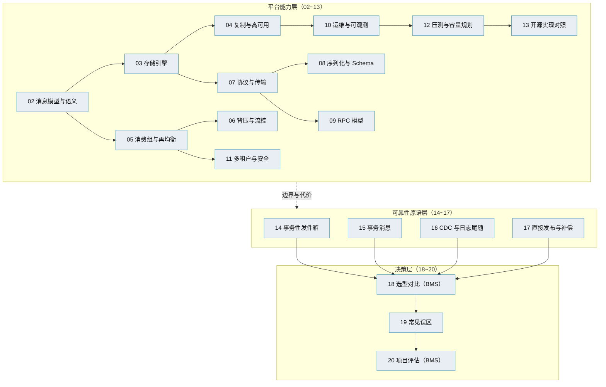

# 消息与事件驱动总览

> **状态说明（2026-11-13）**：RocketMQ 已从本平台下线，事件总线改用自研 `msg`；本文涉及 RocketMQ 的内容仅作技术参考，不代表当前实现。

> 消息平台全栈（传输 / 存储 / 复制 / 消费 / 运维）× 事件可靠性原语（Outbox / 事务消息 / CDC）× 选型与迁移

[文档首页](../../../文档首页.md) › [知识档案](../技术栈知识档案总览.md) › 消息与事件驱动总览　|　[← 返回总览](../技术栈知识档案总览.md)

---

> **定位**：本目录是**知识档案**（辅助参考），沉淀「自研一套消息平台」所需的全部工程知识——不只是「业务写库后事件怎么可靠送到 MQ」，还包括 broker 怎么存、怎么复制、怎么消费、怎么背压、怎么运维、怎么多租户。
>
> **默认口径以规范与架构为准**（平台《架构设计 · 服务间通信与一致性》、平台《架构设计 · 事件总线》、《[后端开发规范](../../../规范/后端开发规范.md)》）；本目录提供原理、业界对照、代价与可替换方案，**不替代**规范与设计。
>
> **本专题的知识边界随 08B 决策扩大**：2026-11 已定「自研消息平台 L3（msg 产品）」，因此本目录从单一「事件投递可靠性」扩展为「消息平台 + 事件驱动」全栈知识。原 8 篇保留为**可靠性原语层**，新增 12 篇为**平台能力层**。

## 1. 为什么需要这一层知识 

bms 原事件与同步通信由三块拼成：本地事务性发件箱 + 轮询投递器 + RocketMQ（事件，已下线，现由 msg 承接），`HttpServiceClient`（httpx + JSON）调 FastAPI 服务（同步调用），TM + XA（跨服务写）。三者各自可用，但拼起来暴露四类问题：

1. **性能**：同步链上 JSON 序列化 + 无多路复用 + 连接开销，延迟与吞吐都不理想。
2. **隔离**：outbox 表名写死，产品共库时同名表重叠。
3. **能力**：事件账本与重放绑在 outbox 表上，broker 侧没有统一消费位点、没有死信重放、没有积压视图。
4. **运维**：事件与 RPC 两套机制、两套契约、两套运维，排障要跨三处。

自研消息平台要一次解决这四类问题，前提是先把「一个消息中间件由哪些部件构成、每个部件的真实难点在哪」讲清楚。**本专题就是这套知识底座**，也是 8B 各阶段详细设计的输入。

## 2. 领域全景：三层知识模型 

| 层 | 回答什么 | 篇目 | 读者场景 |
| --- | --- | --- | --- |
| **平台能力层** | 一个消息中间件由哪些部件构成？每部件怎么做、难在哪、业界怎么取舍？ | 02~13 | 设计 broker / 存储 / 复制 / 消费组 / 协议 |
| **可靠性原语层** | 业务提交与消息投递如何做到不重不漏？四种原语的原子性从哪来？ | 14~17 | 选投递语义、设计 outbox 或事务消息 |
| **决策层** | BMS 该选哪条路？哪些说法是错的？迁移怎么走、代价多大？ | 18~20 | 拍板、立项、迁移排期 |

三层是**递进**关系：不理解平台能力，就看不出原语的边界；不理解原语，就做不出正确的选型；不做选型，知识就停在纸面。

## 3. 平台要回答的十二个问题 

| # | 问题 | 对应篇目 |
| --- | --- | --- |
| 1 | 消息怎么组织？topic / partition / offset / 消费组的语义边界在哪？ | 02 |
| 2 | 消息落在磁盘上是什么形状？为什么是追加日志而不是 B+ 树？ | 03 |
| 3 | 一台机器挂了怎么办？副本、选举、脑裂怎么处理？ | 04 |
| 4 | 多个消费者怎么分工？再均衡为什么会「风暴」？ | 05 |
| 5 | 消费者太慢会不会拖垮 broker？背压加在哪一层？ | 06 |
| 6 | 线上字节长什么样？协议怎么演进而不破坏老客户端？ | 07 |
| 7 | 用 JSON 还是二进制？Schema 变了怎么办？ | 08 |
| 8 | RPC 和消息能共用一条连接吗？超时、取消、流式怎么表达？ | 09 |
| 9 | 出问题怎么定位？积压、延迟、死信看哪些指标？ | 10 |
| 10 | 多个租户共用一个集群，怎么隔离、怎么限额？ | 11 |
| 11 | 吞吐到底能到多少？瓶颈在哪？怎么压、怎么估容量？ | 12 |
| 12 | Kafka / Pulsar / RocketMQ / NATS 分别怎么解上面这些问题？ | 13 |

## 4. 核心概念速查 

### 4.1 消息模型

| 术语 | 含义 |
| --- | --- |
| Topic | 逻辑消息类别；同一 topic 可分多个 partition |
| Partition | 分区；分区内按 offset 严格有序，是并行与顺序的平衡单位 |
| Offset | 分区内消息的单调递增序号，消费位点的基本单位 |
| Consumer Group | 消费组；组内消费者分摊分区，组间互不影响（广播 vs 集群消费） |
| 分区键（Partition Key） | 决定消息落哪个分区；同键同分区 → 同键有序 |
| 位点（Committed Offset） | 消费组已确认消费到的位置，持久化后可恢复 |

### 4.2 投递语义

| 术语 | 含义 |
| --- | --- |
| 至多一次（At-most-once） | 先提交位点再处理；可能丢，不会重 |
| 至少一次（At-least-once） | 先处理再提交位点；可能重，不会丢 |
| 效果一次（Effectively Once） | 至少一次 + 消费端幂等去重，业务效果等价一次 |
| 恰好一次（Exactly-once） | 严格协议保证；仅在特定边界内成立（如同事务内读-处理-写） |
| 幂等键 | 去重依据；常用 `message_id` 或业务唯一键 |

### 4.3 可靠性原语

| 术语 | 含义 |
| --- | --- |
| 事务性发件箱（Outbox） | 业务写入与事件写入同库同事务，独立 relay 投递到 MQ |
| Relay / 投递器 | 读 outbox、发 MQ、标记结果的独立进程（轮询或日志尾随） |
| 半消息（Half Message） | 事务消息第一阶段：对消费者不可见，等待本地事务结果 |
| 回查（Check） | 生产者崩溃后 broker 回调生产者确认本地事务提交或回滚 |
| CDC | Change Data Capture：读数据库事务日志（binlog / WAL）捕获变更 |
| 双写（Dual Write） | 同时写两个资源（库 + MQ）且无共同事务，必然存在不一致窗口 |

### 4.4 平台机制

| 术语 | 含义 |
| --- | --- |
| ISR | In-Sync Replicas：与 leader 保持同步的副本集合；写入需 ISR 确认 |
| HW / LEO | High Watermark（已提交位点）/ Log End Offset（日志末尾） |
| Leader Epoch / Term | 领导者任期号；用于拒绝旧 leader 的过期写入（fencing） |
| Rebalance | 消费组内分区重新分配；eager 全停 vs cooperative 增量 |
| 死信（DLQ） | 重试超限后转入人工处置的消息 |
| 重放（Replay） | 把已消费 / 死信消息按位点重新投递 |
| 背压（Backpressure） | 下游处理不过来时，向上游传导的减速信号 |
| 分段（Segment） | 追加日志按大小 / 时间切分的文件单元，便于删除与定位 |
| Compaction | 按 key 保留最新值、清理旧版本的后台整理 |
| 信用额度（Credit） | 流控的显式许可模型：下游给多少额度，上游才能发多少条 |

## 5. 三层地图 

## 6. 篇目索引 

### 6.1 平台能力层

| 篇 | 回答的问题 |
| --- | --- |
| [02 消息模型与语义](02_事件驱动_消息模型与语义.md) | topic / partition / offset / 消费组；三种投递语义；顺序性三级取舍；延迟与定时消息 |
| [03 存储引擎](03_事件驱动_存储引擎.md) | 追加日志、稀疏索引、分段、页缓存与零拷贝、fsync 级别、崩溃恢复、retention 与 compaction |
| [04 复制与高可用](04_事件驱动_复制与高可用.md) | 主从 / ISR / Raft；选举、任期、fencing、脑裂；故障切换与跨机房 |
| [05 消费组与再均衡](05_事件驱动_消费组与再均衡.md) | join / sync / heartbeat；eager 与 cooperative；分配策略；位点提交；重平衡风暴 |
| [06 背压与流控](06_事件驱动_背压与流控.md) | pull vs push、长轮询、信用额度、水位线、慢消费者隔离、队头阻塞 |
| [07 协议与传输](07_事件驱动_协议与传输.md) | 帧格式与版本演进；HTTP/2 多路复用、HPACK、流控窗口；h2c 与 TLS |
| [08 序列化与 Schema](08_事件驱动_序列化与Schema.md) | JSON / MessagePack / Protobuf / Avro 取舍；Schema Registry；兼容性规则 |
| [09 RPC 模型](09_事件驱动_RPC模型.md) | 请求响应、关联 ID、超时传播、取消、流式、幂等重试、熔断限流 |
| [10 运维与可观测](10_事件驱动_运维与可观测.md) | 吞吐 / 延迟 / 积压 / ISR 指标；链路追踪；管理台；重放与死信处置 |
| [11 多租户与安全](11_事件驱动_多租户与安全.md) | 逻辑与物理隔离、配额模型、mTLS / SASL / ACL、传输与静态加密 |
| [12 压测与容量规划](12_事件驱动_压测与容量规划.md) | 压测方法、瓶颈定位、容量模型、故障演练 |
| [13 开源实现对照](13_事件驱动_开源实现对照.md) | Kafka / Pulsar / RocketMQ / NATS 的存储、复制、消费、协议逐项拆解 |

### 6.2 可靠性原语层

| 篇 | 回答的问题 |
| --- | --- |
| [14 事务性发件箱](14_事件驱动_事务性发件箱.md) | 原理、表结构、relay、幂等 / 重放 / 死信、边界澄清 |
| [15 事务消息](15_事件驱动_事务消息.md) | 半消息与回查、RocketMQ 5.x Python 支持、限制与适用 |
| [16 CDC 与日志尾随](16_事件驱动_CDC与日志尾随.md) | binlog / WAL、Debezium、Python 自研、三库差异与运维 |
| [17 直接发布与补偿](17_事件驱动_直接发布与补偿.md) | dual-write 失败模式、best-effort 边界、对账 |

### 6.3 决策层

| 篇 | 回答的问题 |
| --- | --- |
| [18 选型对比（BMS）](18_事件驱动_选型对比（BMS）.md) | 原语对比 + 自研 / 开源自建 / 云服务对比；场景映射与触发条件 |
| [19 常见误区](19_事件驱动_常见误区.md) | 原语误区 + 平台级误区（自研 broker 很简单、HTTP/2 一定更快等） |
| [20 项目评估（BMS）](20_事件驱动_项目评估（BMS）.md) | 现状、约束、L3 路线、迁移路径、风险与建议 |

## 7. 阅读路径 

| 目的 | 建议顺序 | 预计 |
| --- | --- | --- |
| **快速建立平台全貌** | 01 → 02 → 03 → 05 → 07 → 13 | 约 60 分钟 |
| **设计 broker 与存储** | 02 → 03 → 04 → 05 → 06 → 13 | 约 90 分钟 |
| **设计传输与协议** | 07 → 08 → 09 → 06 | 约 60 分钟 |
| **决定投递语义** | 02 → 14 → 15 → 16 → 18 | 约 60 分钟 |
| **准备立项 / 迁移** | 01 → 18 → 19 → 20 | 约 40 分钟 |
| **系统通读** | 01 → 02 … → 20 | 约 3 小时 |

## 8. 与相邻专题的边界 

| 专题 | 边界 |
| --- | --- |
| [分布式事务](../分布式事务/01_分布式事务_总览.md) | 该专题讲**跨库 / 跨服务写**的强一致（2PC / XA / TM）与一致性屏障；本专题只讲**消息传输与事件投递**。消息不替代事务。 |
| [微服务 · 05 通信与分布式一致性](../微服务/05_微服务_通信与分布式一致性.md) | 该篇讲模式总论（同步 / 异步、Saga、Outbox、幂等）；本专题展开到实现、协议与运维细节。 |
| [微服务 · 12 选型对比](../微服务/12_微服务_选型对比.md) | 该篇给出一致性候选总表；本专题补充 broker 内部的存储 / 复制 / 消费机制。 |
| [后端核心 / RocketMQ 技术介绍](../后端核心/RocketMQ技术介绍.md) | 现有事件总线底座的入门介绍；本专题 13 篇把它放到四家实现中做横向对照。 |
| 平台《架构设计 · 服务间通信与一致性》 | **默认口径的权威源**：本地事务 + Outbox + 幂等为事件基线；RocketMQ 事务消息为备选。 |
| 平台《架构设计 · 事件总线》 | 事件契约、分区有序、消费组与死信的权威设计。 |
| 平台《01_01 事件总线》 | 本平台 outbox / relay / 幂等 / 死信的实现与实施记录。 |

> **跨层引用纪律**：知识档案不写相对链接指向 `设计/` 与 `项目/`（CI 只 clone bms 时可能判断链），需要提及时一律写「平台《文档名》」。

## 9. 本项目现状与决策 

| 项 | 现状 |
| --- | --- |
| 事件投递 | `bms_core` 已交付「本地事务 + 自研薄 Outbox + 轮询投递器 + 消费幂等 + 死信看板」（01_01） |
| 使用方 | 06_01 操作 / 登录审计经 `audit-chain` 有序组消费；06_02 字段级审计计划复用 |
| 同步调用 | `HttpServiceClient`（httpx + JSON）调 FastAPI 服务；瓶颈在 **FastAPI 框架栈**（路由匹配 / 依赖注入 / Pydantic 校验与序列化 / 中间件）与 httpx 连接开销，**不在 OpenAPI**（OpenAPI 只是契约规范，不产生运行时开销） |
| 事务消息 | `EventPublisher.publish_transactional()` 接口已留，当前委托普通发送（备选方案，非基线） |
| 已知短板 | `sys_outbox` 等基础设施表名写死；多实例投递缺行锁 / 租约 |
| **2026-11 决策** | 自研消息平台 **L3**，新建 `msg` 产品仓与独立 **08B** 阶段；传输 HTTP/2 + 二进制；单服务多域；先设计 + PoC，再分阶段实现 |
| 06_02 状态 | 暂停，等 8B 结论；恢复时优先复用 8B 适配层 |

> 决策记录与阶段划分见 msg 仓 08B 文档；本专题只提供知识，不承载进度。

## 10. 维护口径 

- **实测数据不写进知识层**：自研基准、压测结论归 8B_01 / 8B_09 的实施与测试记录；本目录只写原理、业界公开口径与「待实测」项。
- **业界对照必标来源**：引用 Kafka / Pulsar / RocketMQ / NATS 的具体行为时，注明版本区间与出处（官方文档 / 设计文档 / 论文）。
- **篇目与实现同步**：8B 各阶段设计若推翻某篇结论，先回写本目录再改实现。
- **新增篇目**：按三层归属编号，保持 `{NN}_事件驱动_{主题}.md` 命名。

## 11. 参考资源 

| 资源 | 说明 |
| --- | --- |
| Kafka 官方文档：Design / Implementation | 存储、复制、消费组协议的一手口径 |
| Apache Pulsar：Architecture Overview | Segment + BookKeeper 分层架构 |
| Apache RocketMQ：Design | CommitLog / ConsumeQueue / IndexFile 设计 |
| NATS JetStream 文档 | 轻量流式与 retention policy |
| Ongaro & Ousterhout《In Search of an Understandable Consensus Algorithm》 | Raft 原论文 |
| Kleppmann《Designing Data-Intensive Applications》「流处理」章 | 日志抽象与流式处理 |
| microservices.io：Transactional Outbox / Polling Publisher / Transaction Log Tailing | 原语模式定义 |
| RFC 9113（HTTP/2）、RFC 7541（HPACK） | 传输层权威规范 |
| MessagePack / Protocol Buffers / Apache Avro 规范 | 序列化格式定义 |

---

> 依《[文档生成规范](../../../规范/文档生成规范.md)》编写
