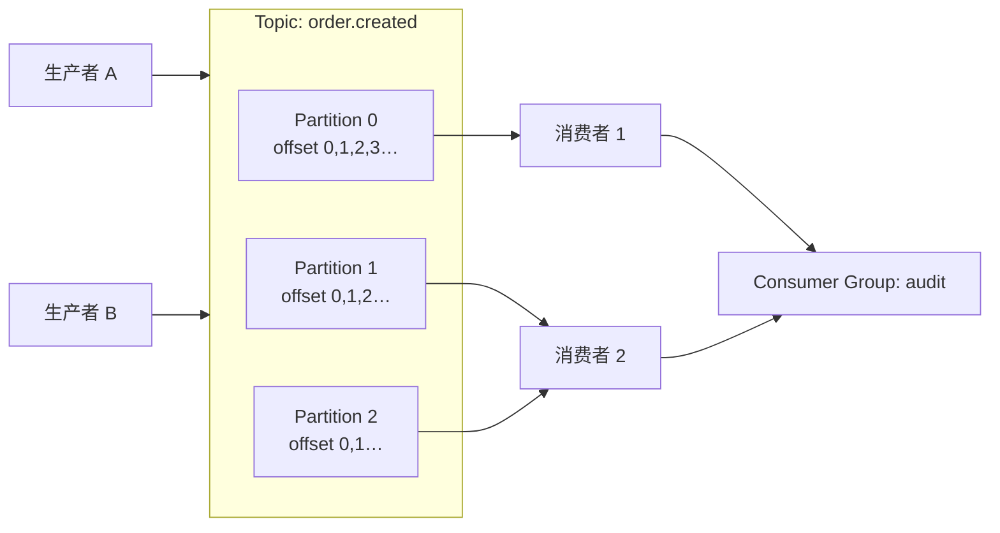
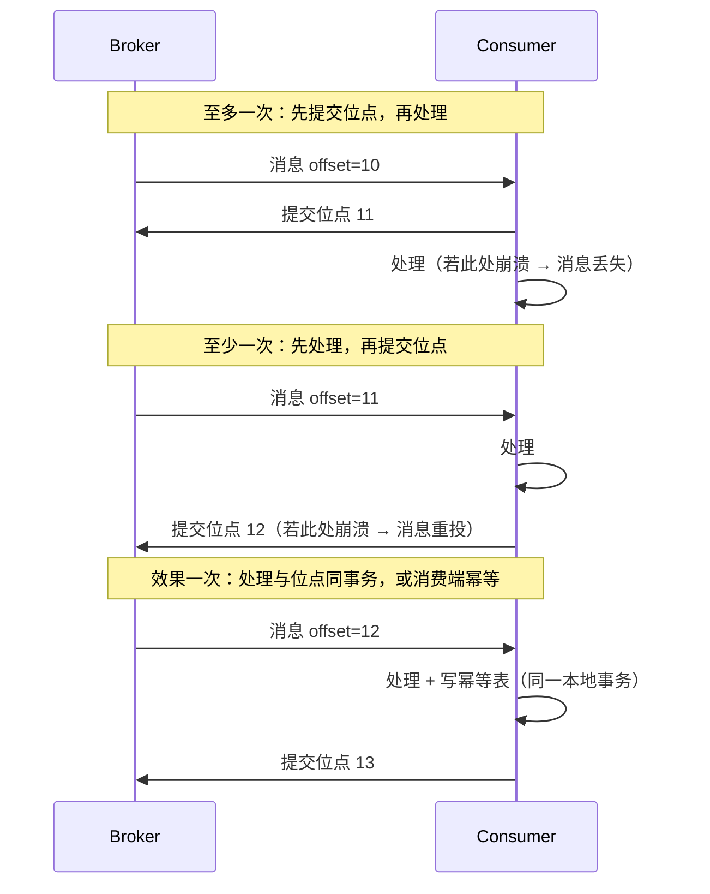
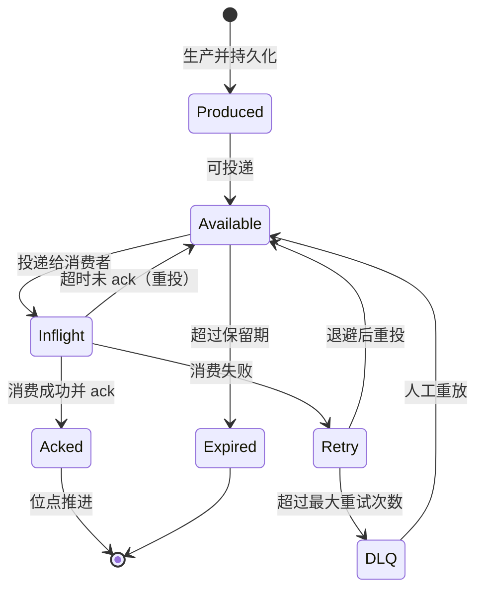

# 消息模型与语义

> topic / partition / offset / 消费组 · 三种投递语义 · 顺序性三级取舍 · 延迟与定时

[文档首页](../../../文档首页.md) › [知识档案](../技术栈知识档案总览.md) › [消息与事件驱动总览](01_事件驱动_总览.md) › 消息模型与语义

---

> **定位**：本篇定义消息平台「对上层承诺什么」——消息怎么组织、消费怎么分工、投递做到什么程度、顺序保到什么级别。**语义定不下来，存储、复制、消费组都无法设计**，因此它是平台能力层的第一篇。

## 1. 为什么要先定模型 

消息中间件表面上是「发一条、收一条」，实际有五个正交决策：

| 决策 | 选项 | 影响 |
| --- | --- | --- |
| 部门 | 队列（queue） / 主题（topic） / 主题 + 分区 | 并行度与顺序性 |
| 消费方式 | 点对点 / 发布订阅 / 消费组 | 一条消息被几个人消费 |
| 投递语义 | 至多一次 / 至少一次 / 效果一次 | 丢失与重复的边界 |
| 顺序性 | 全局 / 分区 / 键 | 并发度与吞吐 |
| 时效 | 即时 / 延迟 / 定时 | 是否要调度器 |

这五个决策互相牵制：要全局顺序就得单分区（吞吐受限）；要效果一次就得有事务或幂等表（成本上升）；要延迟消息就得有定时扫描（存储多一层）。**不存在全都最优的组合**，只能按场景取。

## 2. 部门：topic、partition、offset 

| 概念 | 定义 | 关键约束 |
| --- | --- | --- |
| Topic | 逻辑消息类别，是订阅与权限的最小单位 | 同 topic 内 schema 应一致 |
| Partition | topic 的物理分片，是**并行与顺序的平衡单位** | 分区数决定最大并行消费度，且通常只能增不能减 |
| Offset | 分区内消息的单调递增序号 | 全局不唯一，必须 `(topic, partition, offset)` 三元组定位 |
| Message ID | broker 生成的全局唯一标识 | 用于幂等、排障、追踪，**不等于** offset |

**分区数怎么定**：消费者并行度上限 = 分区数；分区越多，单机文件句柄、复制开销、再均衡耗时越大。经验值是「峰值消费并行度 × 1.5~2」，并预留扩容余量——因为**分区只能增不能减**，减少分区会破坏 key → partition 的映射。

**分区键的作用**：`hash(key) % partition_count` 决定落点。同 key 必落同分区 → 同 key 有序；key 选得偏斜（如按租户 ID，大租户占满一个分区）会造成热点。可选做法是复合键（`tenant + 业务主键`）或对热点键加盐（牺牲顺序换均衡）。

## 3. 消费组：谁消费、消费到哪 

| 模式 | 语义 | 典型实现 |
| --- | --- | --- |
| 点对点（Queue） | 一条消息只被一个消费者处理 | RocketMQ 集群消费、RabbitMQ queue |
| 发布订阅（Pub/Sub） | 每个订阅者都收到全量 | Kafka 不同 group、NATS subject |
| 消费组（Consumer Group） | **组内分摊、组间广播** | Kafka / Pulsar / RocketMQ 通用模型 |

消费组是前两者的统一：同一 group 内是点对点（分区不重复分配），不同 group 之间是广播（各自独立位点）。这一条决定了：

- **扩消费者只能扩到分区数**：组内消费者多于分区时，多出的消费者空闲。
- **位点按组存**：位点是 `(group, topic, partition) → offset`，不是全局一个数。
- **组是隔离边界**：一个组消费慢，不影响另一个组（各自位点独立）。

位点提交时机决定投递语义，见下节。

## 4. 投递语义：三种承诺 

| 语义 | 保证 | 代价 | 适用 |
| --- | --- | --- | --- |
| 至多一次 | 不重，可能丢 | 最低 | 指标采集、日志采样等可丢场景 |
| 至少一次 | 不丢，可能重 | 需消费端幂等 | **默认选择**（绝大多数业务事件） |
| 效果一次 | 业务效果不重不漏 | 需幂等表或事务边界 | 资金、库存、审计等强一致场景 |
| 恰好一次 | 协议级严格一次 | 仅限「读-处理-写同一事务」边界内 | 流处理（Kafka 事务）等特定场景 |

**必须讲清的两个边界**：

1. **「恰好一次」几乎都只在特定边界内成立**。Kafka 的 exactly-once 限定在「消费 → 处理 → 生产」的 Kafka 事务内；一旦处理要写外部数据库，就退化为「至少一次 + 幂等」。
2. **至少一次 + 幂等 = 效果一次**，这是工程上最常用的组合。幂等键优先用业务唯一键（订单号 + 状态迁移），而不是 `message_id`——因为重放时 `message_id` 可能变，业务键不变。

## 5. 顺序性：三级承诺 

| 级别 | 保证 | 实现 | 吞吐 | 适用 |
| --- | --- | --- | --- | --- |
| 全局有序 | 整个 topic 严格按生产顺序 | 单分区 + 单消费者 | 最低 | 极少；一般用不到 |
| 分区有序 | 同分区内有序 | 分区数 > 1，同 key 同分区 | 中 | 同聚合根事件（订单、账户） |
| 键有序 | 同业务键有序 | 分区键 = 聚合键 | 高 | **推荐默认** |
| 无序 | 不保证 | 随机分区 | 最高 | 无依赖的独立事件 |

三个必须知道的陷阱：

1. **重试会破坏顺序**。失败消息进重试队列后重新投递，若重试队列与主队列并行消费，后发消息可能先到。做法是「同 key 阻塞重试」（RocketMQ 顺序消费的锁）或「重试消息回原分区尾部」。
2. **再均衡会短暂乱序**。分区从一个消费者换到另一个时，旧消费者未提交的处理可能被新消费者重做。
3. **多分区无法保证跨分区顺序**。若业务要求「A 事件必须先于 B 事件」，必须让它们落同一分区（同 key），否则只能靠消费端按业务状态机兜底。

## 6. 时效：延迟与定时消息 

| 类型 | 语义 | 实现方式 |
| --- | --- | --- |
| 延迟消息 | 发出后 N 秒才可被消费 | 定时轮 / 时间轮 / 延迟队列 / 分级 topic |
| 定时消息 | 指定绝对时间点投递 | 同上，按时间戳排序 |
| 事务消息 | 等本地事务结果再投递 | 半消息 + 回查（见 15 篇） |

RocketMQ 用固定延迟级别（1s/5s/10s/…/2h）实现延迟消息，落到内部 `SCHEDULE_TOPIC_XXXX`；Kafka 无原生延迟消息，通常靠外部调度或「延迟 topic + 定时搬运」；Pulsar 支持延迟投递（deliverAt）。**自研时优先做「延迟级别 + 定时扫描」**，不要一上来做任意时间精度——精度越高，索引与扫描成本越大。

## 7. 消息生命周期 

这条状态机是后续所有设计的骨架：存储要支持 `Produced → Available` 的持久化，消费组要支持 `Available → Inflight → Acked` 的位点推进，重试与死信是旁路，保留期是回收。

## 8. 业界对照 

| 能力 | Kafka | Pulsar | RocketMQ | NATS JetStream |
| --- | --- | --- | --- | --- |
| 部门 | topic + partition | topic + partition（segment） | topic + queue（MessageQueue） | stream + subject |
| 消费模型 | consumer group | subscription（exclusive / shared / failover / key_shared） | 集群 / 广播消费 | consumer（push / pull） |
| 位点存储 | 内部 topic `__consumer_offsets` | 游标（cursor）持久化 | Broker 端 offset 表 | 消费者 ack 状态 |
| 投递语义 | 至少一次；事务内效果一次 | 至少一次；事务 | 至少一次；顺序消费 | 至少一次；去重窗口 |
| 顺序 | 分区有序 | 分区有序；key_shared 按键 | 队列有序（顺序消费） | 单 subject 有序 |
| 延迟消息 | 无原生 | 支持 deliverAt | 固定延迟级别 | 支持（定时） |

共同规律：**顺序单位都是「分区 / 队列」，投递语义默认至少一次，位点都按消费组存**。这四条是消息模型的「共识区」，自研不必另辟路径。

## 9. 对 msg 的设计约束 

| 决策点 | 建议 | 理由 |
| --- | --- | --- |
| 部门 | topic + partition，分区键 = 聚合键 | 与 bms 事件契约的「聚合有序」口径一致 |
| 消费模型 | consumer group（组内分摊、组间广播） | 审计 / 通知 / 检索等多消费方共存 |
| 默认语义 | 至少一次 + 消费端幂等 | 与现有 outbox 基线一致，迁移成本最低 |
| 顺序 | 分区有序（默认按聚合键） | 满足审计链、订单等场景，吞吐可控 |
| 延迟消息 | 首期只做固定级别 | 避免时间轮精度带来的索引复杂度 |
| 位点 | 按 `(group, topic, partition)` 持久化 | 崩溃恢复与重放的前提 |

## 10. 失败模式与自检 

| 失败模式 | 现象 | 防法 |
| --- | --- | --- |
| 分区键热点 | 单分区打满，其余空闲 | 复合键 / 加盐；监控分区倾斜度 |
| 分区数拍脑袋 | 消费者扩不上去 | 按峰值并行度 × 1.5~2 预估，预留扩容 |
| 误以为全局有序 | 并发消费出现乱序 | 明确「同 key 同分区」才有序 |
| 重试打乱顺序 | 后发先至 | 同 key 阻塞重试或回原分区尾部 |
| 幂等键用 message_id | 重放后重复处理 | 改用业务唯一键 |
| 位点先提交后处理 | 崩溃丢消息 | 先处理再提交，或同事务 |

## 11. 待实测 

| # | 事项 | 归属 |
| --- | --- | --- |
| 1 | 分区数 vs 消费并行度的实际拐点 | 8B_02 / 8B_12 |
| 2 | 幂等表（按业务键）在高并发下的写放大 | 8B_04 |
| 3 | 同 key 阻塞重试对吞吐的影响 | 8B_02 |
| 4 | 延迟消息级别与精度的成本曲线 | 8B_02 |

## 12. 参考 

- Kafka 官方文档：Topics / Consumer Groups / Delivery Semantics
- Pulsar 官方文档：Messaging Concepts / Subscriptions
- RocketMQ 官方文档：消息类型（顺序 / 延迟 / 事务）
- NATS JetStream：Streams / Consumers / Retention
- Kleppmann《Designing Data-Intensive Applications》「流处理」章

---

> 依《[文档生成规范](../../../规范/文档生成规范.md)》编写
