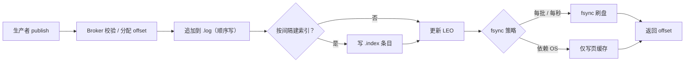

# 存储引擎

> 追加日志 · 稀疏索引 · 分段 · 页缓存与零拷贝 · fsync 级别 · 崩溃恢复 · retention 与 compaction

[文档首页](../../../文档首页.md) › [知识档案](../技术栈知识档案总览.md) › [消息与事件驱动总览](01_事件驱动_总览.md) › 存储引擎

---

> **定位**：消息平台的性能与可靠性，七成取决于存储引擎。本篇讲清「消息落盘是什么形状、为什么这么设计、崩溃后怎么恢复」，是 8B_02 存储设计的直接输入。

## 1. 为什么是追加日志，不是数据库表 <a id="why"></a>

| 维度 | 追加日志（append-only log） | 关系表 / B+ 树 |
| --- | --- | --- |
| 写放大 | 1（顺序写一次） | 多（页分裂、索引维护、WAL、undo） |
| 写吞吐 | 顺序 IO，接近磁盘带宽 | 随机 IO，受页大小与索引深度限制 |
| 读模式 | 按 offset 顺序读，可预读 | 按主键随机读 |
| 删除 | 整段删除（O(1) 文件操作） | 逐行删除 + 索引清理 + 碎片 |
| 事务开销 | 无（消息不可变，只追加） | 每行都要事务、锁、MVCC |
| 保留期 | 按时间 / 大小整段回收 | 需定期 DELETE + 清理作业 |

消息的访问模式非常单一：**写只追加、读只按位点顺序读、删只按整段删**。这三点让追加日志几乎是唯一正确选择。用数据库表存消息能快速验证功能，但在吞吐、保留期清理、崩溃恢复上都会成为瓶颈——这正是 8B_01 PoC 用「内存 + 最小文件日志」而不是数据库表的原因。

## 2. 文件布局 <a id="layout"></a>

```text
data/{topic}/{partition}/
├── 00000000000000000000.log        # 消息追加（record 顺序）
├── 00000000000000000000.index      # 稀疏索引：相对 offset → 物理位置
├── 00000000000000000000.timeindex  # 时间戳 → 相对 offset
├── 00000000000000001000.log        # 下一段（按 baseOffset 命名）
└── ...
```

| 文件 | 内容 | 作用 |
| --- | --- | --- |
| `.log` | `[offset][length][crc][payload]` 或 `[length][crc][payload]` | 消息本体，顺序追加 |
| `.index` | `(relative_offset, position)` 定长条目 | 按 offset 快速定位物理位置 |
| `.timeindex` | `(timestamp, relative_offset)` | 按时间点找位点（重放 / 排障） |
| 段名 | 该段第一条消息的 baseOffset，20 位零填充 | 二分查找定位段 |

**为什么索引是稀疏的**：每条消息都建索引会让索引与数据一样大。稀疏索引按「每写入 N 字节记一条」建立（Kafka 默认 `index.interval.bytes=4096`），读取时「二分找到不大于目标 offset 的索引项 → 从该物理位置顺序扫描到目标 offset」。用少量扫描换极小的索引体积，这是追加日志的标准做法。

## 3. 写入路径 <a id="write"></a>



四个关键点：

1. **offset 在 broker 侧分配**，不由生产者指定——否则无法保证单调与不冲突。
2. **写页缓存即返回**（`fsync=0`）吞吐最高，但断电会丢最近一批；**每条 fsync** 最安全，但吞吐掉一个数量级。中间的折中是「按批 fsync」或「按时间 fsync（如 1s）」。
3. **页缓存是最大的性能杠杆**：Linux 会把空闲内存用作 page cache，broker 通常**故意不自己缓存消息**（避免 JVM 堆与页缓存双重占用）。
4. **LEO（Log End Offset）是内存中的写指针**，定期持久化到恢复点文件；崩溃后从这里开始校验。

## 4. 读取路径与零拷贝 <a id="read"></a>


**零拷贝（sendfile）**：传统 `read()` + `write()` 要经历「磁盘 → 内核页缓存 → 用户缓冲区 → socket 缓冲区」两次拷贝；`sendfile` 让数据在内核态直接从页缓存送到 socket，省掉用户态往返。这是 Kafka 高吞吐的关键之一，也是「消息原样转发、broker 不解包」的价值——一旦要解包（如逐条审计、转换格式），零拷贝就失效。

**批量与预读**：消费端一次拉一批（如 500 条 / 1MB），比逐条拉少几个数量级的系统调用；顺序读会触发内核预读，进一步降低延迟。

## 5. fsync 与持久性级别 <a id="durability"></a>

| 级别 | 行为 | 断电丢失窗口 | 吞吐 | 适用 |
| --- | --- | --- | --- | --- |
| `fsync=0` | 只写页缓存 | 最近若干秒 / 整批 | 最高 | 可丢的指标类消息 |
| 按批 | 每 N 条或每 B 字节 fsync | 一个批次 | 高 | **默认推荐** |
| 按时间 | 每 T 毫秒 fsync | T 毫秒 | 中 | 延迟敏感、可容忍短窗口 |
| 每条 | 每条 fsync | 0（单机） | 最低 | 审计、资金等强持久 |

**必须讲清**：fsync 只保证「落到本机磁盘」，不保证「副本可见」。真正的持久性 = 本地 fsync + 副本确认（见 04 篇）。单机 fsync 再频繁，磁盘坏了照样丢。

## 6. 崩溃恢复 <a id="recovery"></a>

恢复流程（单机）：

1. **读恢复点**：从 `recovery-point` 文件取上次已知的 LEO。
2. **校验尾部**：从 LEO 开始向后逐条读，校验 `length` 与 `crc`。
3. **截断不完整记录**：遇到长度越界或 CRC 不符，说明是崩溃时写了一半，**截断到上一条完整记录**。
4. **重建索引**：扫描过程中按间隔补建 `.index` / `.timeindex` 缺失条目。
5. **对齐位点**：若段尾被截断，已提交位点若超过新 LEO，需回退位点并告警（数据可能已丢，属于严重事件）。

**为什么必须 CRC**：崩溃可能造成「长度字段正确、内容残缺」的伪完整记录，只校验长度会读到垃圾数据。CRC 是唯一的可靠判据。

**为什么只截断尾部**：追加日志的中间记录一旦写成功就不会再改；唯一可能损坏的是最后一条（未完成）。因此恢复成本是 O(尾部)，不是 O(全量)。

## 7. 分段、保留与压缩 <a id="retention"></a>

| 机制 | 触发 | 动作 | 用途 |
| --- | --- | --- | --- |
| 分段（segment） | 段大小超限（如 1GB）或时间超限 | 关闭当前段、开新段 | 让删除与定位都以段为单位 |
| 保留期（retention） | 段最后修改时间超过 N 天，或总大小超限 | 删除整段 | 控制磁盘占用 |
| 压缩（compaction） | 后台任务 | 同 key 只保留最新值，重写段 | 状态型 topic（如 changelog） |
| 分层存储（tiered） | 段超过热数据期 | 迁到对象存储，本地留索引 | 长保留、低成本 |

**retention 与 compaction 不能混用**：retention 是「按时间 / 大小丢旧数据」，compaction 是「按 key 丢旧版本」。前者适合事件流，后者适合状态快照（Kafka 的 `cleanup.policy` 二选一，或 `compact,delete` 组合）。

**删除为什么可以 O(1)**：因为段是不可变的完整文件，删除就是删文件 + 更新段列表，不需要逐条清理。这是「分段」相对「单个大文件」的核心价值。

## 8. 业界对照 <a id="compare"></a>

| 实现 | 日志组织 | 索引 | 刷盘 | 清理 |
| --- | --- | --- | --- | --- |
| **Kafka** | 每 partition 一组 segment（`.log` / `.index` / `.timeindex`），默认 1GB/段 | 稀疏索引，`index.interval.bytes=4096` | 依赖页缓存，`flush.messages` / `flush.ms` 可调 | retention（时间 / 大小）+ compaction |
| **RocketMQ** | **所有 topic 共用 CommitLog**（1GB 定长文件），另有 ConsumeQueue（每 topic-queue 20 字节定长条目）与 IndexFile（按 key 哈希） | ConsumeQueue 相当于稠密索引 | 异步刷盘 / 同步刷盘可配 | 按文件过期删除（默认 72h） |
| **Pulsar** | Segment 存 BookKeeper（bookie 集群），本地只做缓存 | Ledger 元数据 | 由 BookKeeper 保证（多副本 ack） | retention + 分层存储 |
| **NATS JetStream** | 每 stream 一组文件，按 subject 建索引 | 文件内索引 | 可配 sync interval | limits / interest / workqueue 三种 retention |

**最大差异在「日志粒度」**：Kafka / Pulsar 是「每分区一组日志」，RocketMQ 是「全 broker 一个 CommitLog + 每队列一个轻量 ConsumeQueue」。前者的隔离性好（删 topic 只删自己目录），后者写入更集中（顺序写一条大日志）但删除与隔离要靠 ConsumeQueue 兜底。

## 9. 对 msg 的设计约束 <a id="msg"></a>

| 决策点 | 建议 | 理由 |
| --- | --- | --- |
| 日志粒度 | 每 partition 一组文件 | 删除 / 迁移 / 隔离都简单，符合 PoC 与单机先行 |
| 索引 | 稀疏索引（按字节间隔） | 索引体积小，读取扫描可接受 |
| 刷盘 | 按批 fsync，可配 | 平衡吞吐与持久性；审计场景可切每条 |
| CRC | 必须 | 崩溃恢复的唯一可靠判据 |
| 恢复 | 只扫尾部 + 重建索引 | 成本与日志总量无关 |
| 保留 | 先做时间 + 大小 retention，compaction 后置 | 首期不需要状态型 topic |
| 零拷贝 | 保持「不解包转发」 | 一旦要逐条解析，吞吐会显著下降 |

## 10. 失败模式与自检 <a id="failure"></a>

| 失败模式 | 现象 | 防法 |
| --- | --- | --- |
| 无 CRC，只校验长度 | 崩溃后读到垃圾记录 | 每条记录带 CRC |
| 索引稠密化 | 索引体积接近数据量 | 稀疏索引 + 扫描兜底 |
| 单文件无限增长 | 删除要重写整个文件，卡顿 | 按大小 / 时间分段 |
| 页缓存被应用挤占 | 读放大、延迟抖动 | broker 不自己缓存消息 |
| fsync 每条却无副本 | 单盘坏 → 全丢 | fsync + 副本确认才叫持久 |
| 恢复扫全量 | 启动几分钟 | 只从恢复点扫尾部 |

## 11. 待实测 <a id="todo"></a>

| # | 事项 | 归属 |
| --- | --- | --- |
| 1 | 不同 fsync 策略下的吞吐 / P99 曲线 | 8B_01 / 8B_12 |
| 2 | 稀疏索引间隔对读放大与索引体积的影响 | 8B_02 |
| 3 | Python 文件 IO 与 mmap 的实测差异 | 8B_01 |
| 4 | 分段大小对删除停顿的影响 | 8B_02 |
| 5 | 段尾截断恢复的真实耗时 | 8B_02 |

## 12. 参考 <a id="refs"></a>

- Kafka 官方文档：Log Implementation / Log Compaction
- Apache RocketMQ：Design（CommitLog / ConsumeQueue / IndexFile）
- Apache Pulsar：Architecture（Segment / BookKeeper）
- NATS JetStream：Stream Storage / Retention
- Linux `sendfile(2)` man page
- Kleppmann《Designing Data-Intensive Applications》「存储与检索」章、「流处理」章

---

> 依《[文档生成规范](../../../规范/文档生成规范.md)》编写
