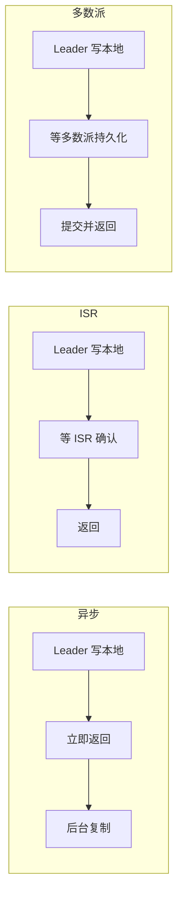
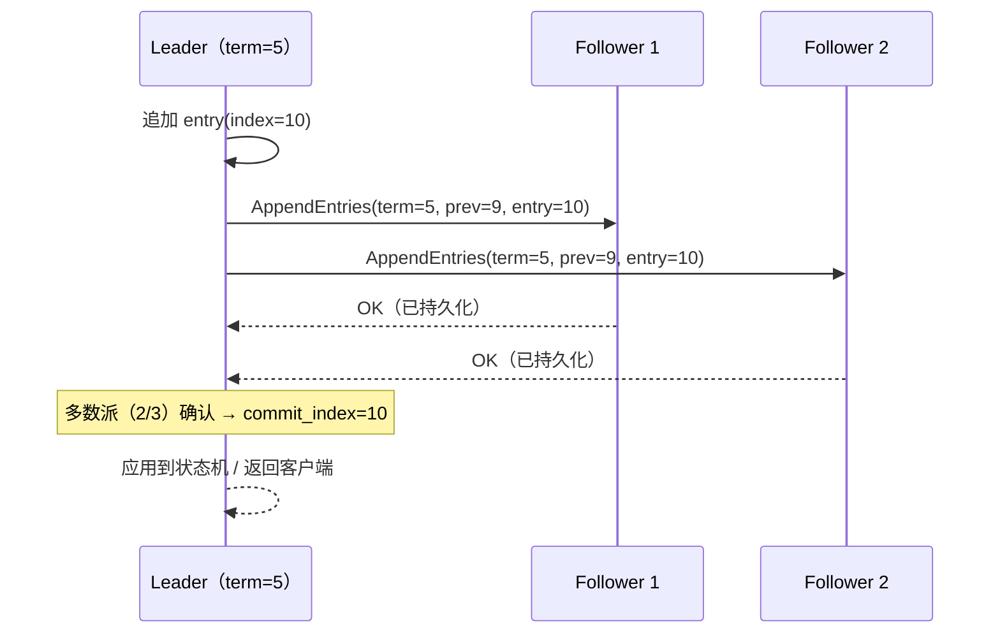

# 复制与高可用

> 主从 / ISR / Raft · 选举与任期 · fencing 与脑裂 · 故障切换 · 跨机房

[文档首页](../../../文档首页.md) › [知识档案](../技术栈知识档案总览.md) › [消息与事件驱动总览](01_事件驱动_总览.md) › 复制与高可用

---

> **定位**：存储解决「一台机器上不丢」，复制解决「一台机器挂了不丢」。本篇是 8B_05 的设计输入，也是判断「什么时候不能单机上线」的依据。

## 1. 复制到底在解决什么 

| 故障 | 单机能防吗 | 复制能防吗 |
| --- | --- | --- |
| 进程崩溃 | ✅（fsync + 恢复） | 不必要 |
| 磁盘损坏 | ❌ | ✅（副本在其他盘） |
| 整机 / 断电 | ❌ | ✅（副本在其他机） |
| 机房故障 | ❌ | ✅（副本在其他机房） |
| 误删数据 | 部分（备份） | ❌（副本同步删除） |

**关键认知**：复制不等于备份。副本会同步删除与损坏，只防「节点故障」，不防「逻辑错误」。备份是另一个维度（快照 + 异地归档）。

## 2. 三种复制模型 

| 模型 | 写入确认 | 一致性 | 可用性 | 代表 |
| --- | --- | --- | --- | --- |
| **异步主从** | leader 写完即返回 | 弱（故障可能丢未复制的数据） | 最高 | MySQL 异步复制、Redis 主从 |
| **半同步 / ISR** | leader 写 + ISR 中 N 个副本确认 | 中（不丢已确认） | 中 | Kafka（`acks=all` + `min.insync.replicas`） |
| **强一致（多数派）** | 多数派写入才算提交 | 强（线性一致） | 低（少数派不可写） | Raft、Zab、PacificA |

**取舍的本质**：确认越多 → 越不丢 → 越慢、越怕网络抖动。没有「又快又强又可用」的复制。

## 3. Kafka 的 ISR 模型 

Kafka 用「leader + ISR 集合」而不是固定多数派：

| 概念 | 含义 |
| --- | --- |
| Leader | 唯一接受读写的副本 |
| Follower | 从 leader 拉取日志 |
| ISR | 与 leader 保持同步的副本集合（含 leader） |
| OSR | 落后太多、被踢出 ISR 的副本 |
| `min.insync.replicas` | `acks=all` 时，ISR 至少要有几个副本才允许写 |
| HW（High Watermark） | ISR 都已复制到的位点；消费者只能读到 HW 之前 |
| LEO（Log End Offset） | leader 本地日志末尾 |

**ISR 的精妙之处**：不要求固定多数派，而是「当前跟得上的副本」。3 副本中 1 个慢，仍然是 2 个确认；慢的恢复后重新加入 ISR。代价是**判断「跟得上」需要超时**（`replica.lag.time.max.ms`），存在误判。

**读写可见性**：写入 `acks=all` 只保证「ISR 已收到」，消费者能读到的上限是 HW。leader 崩溃后，新 leader 可能比旧 leader 少几条未提交数据——那些数据对消费者从未可见，所以不算丢失。

## 4. Raft：强一致的复制 

Raft 把「多数派提交」拆成三个可理解的子问题：

| 子问题 | 做法 |
| --- | --- |
| **领导者选举** | 任期（term）+ 随机选举超时；获得多数派投票即当选 |
| **日志复制** | leader 追加日志 → 并行发给 follower → 多数派持久化即提交 |
| **安全性** | 只有「日志至少和自己一样新」的候选者才能当选，保证已提交日志不丢 |

**Raft 的关键不变量**：

1. 同一任期同一 index 只有一条日志。
2. 已提交的日志一定存在于后续 leader 中（选举限制保证）。
3. leader 不会覆盖或删除自己的日志，只会追加。

**代价**：每次写要等多数派往返；leader 选举期间不可写（通常几百毫秒到数秒）；3 副本只能容忍 1 个节点故障，5 副本容忍 2 个。

## 5. 选举、任期与 fencing 

**脑裂**：网络分区时，两侧都以为自己是 leader，同时接受写入 → 数据分叉。

| 防护手段 | 原理 |
| --- | --- |
| 任期号（term / epoch） | 旧 leader 的写入带旧任期，被新 leader 拒绝 |
| 多数派要求 | 少数派一侧无法获得多数票，无法提交 |
| Fencing token | 存储层校验「写入者持有最新租约」，旧 leader 的写被拒 |
| 租约（lease） | leader 持有带超时的写权限，超时自动失效 |
| STONITH / 隔离 | 直接关掉旧节点，最粗暴也最可靠 |

**必须讲清**：Kafka 早期版本没有 leader epoch 时，曾出现「旧 leader 重新加入后截断新数据」的问题；后来引入 **leader epoch** 解决。自研时如果做「主从 + 手动切换」，**必须**在日志里带 epoch，否则切换后无法判断哪份数据是新的。

## 6. 故障切换 

| 模式 | 触发 | 优点 | 缺点 |
| --- | --- | --- | --- |
| 手动切换 | 人判断后执行 | 可控、不会误切 | 恢复慢（分钟级） |
| 自动切换 | 心跳超时 + 选举 | 快（秒级） | 可能误判（网络抖动） |
| 半自动 | 自动选主，人工确认 | 平衡 | 流程复杂 |

**切换必须回答的四个问题**：

1. **谁是新 leader**：日志最新的副本？还是配置指定？
2. **旧 leader 怎么办**：隔离（fencing）还是等它自己降级？
3. **未提交数据怎么处理**：截断（可能丢）还是保留（可能分叉）？
4. **客户端怎么感知**：重连、元数据刷新、重试？

**最容易被忽略的是第 4 点**：客户端缓存了旧 leader 地址，切换后仍往旧地址发，会持续失败直到元数据过期。所以协议里必须有「元数据版本 / leader epoch」，客户端据此主动刷新。

## 7. 跨机房与机架感知 

| 策略 | 做法 | 效果 |
| --- | --- | --- |
| 机架感知 | 副本分散到不同机架 | 单机架故障不影响多数派 |
| 同城双活 | 两机房各一副本，第三副本仲裁 | 容忍单机房故障 |
| 异地多活 | 跨城复制 | 容忍城市级故障，但延迟高 |

**必须承认的物理约束**：跨城 RTT 通常 10~30ms，同步复制会让每次写增加一个 RTT。所以跨城通常用**异步复制 + 本地强一致**，接受「城市级故障时丢最后几秒数据」。

## 8. 业界对照 

| 实现 | 复制模型 | 选举 | 一致性 |
| --- | --- | --- | --- |
| **Kafka** | leader + ISR（半同步） | Controller 选主 + leader epoch | 已提交（HW 之前）不丢 |
| **RocketMQ** | 主从（同步 / 异步双写可配） | 无自动选主（4.x）；5.x Controller 模式支持 | 取决于同步/异步配置 |
| **Pulsar** | BookKeeper 多副本（默认 3） | Ledger 的 ensemble 选主 | 多数派写入即提交 |
| **NATS JetStream** | Raft 组（stream 级别） | Raft 选举 | 强一致（多数派） |
| **ZooKeeper / etcd** | Raft / Zab | 自动选举 | 强一致 |

**规律**：消息系统偏「半同步 + ISR」（吞吐优先），元数据 / 协调组件偏「Raft」（一致性优先）。自研时若同时要「高吞吐」与「强一致」，通常要拆成两个组件。

## 9. 对 msg 的设计约束 

| 决策点 | 建议 | 理由 |
| --- | --- | --- |
| 首期 | **单机**，不做复制 | 8B_01~04 验证协议、存储、消费模型 |
| 存储格式 | **预留 term / epoch / 副本位点字段** | 避免 8B_05 推倒重来 |
| 复制模型 | ISR 式半同步（`acks=all` + 最小同步副本数） | 吞吐与不丢的平衡，与 Kafka 口径一致 |
| 选举 | 先手动，后自动 | 单人运维下，自动选主误判代价高 |
| fencing | 日志带 epoch，写入校验 | 防脑裂的唯一可靠手段 |
| 客户端感知 | 元数据版本 + leader epoch | 切换后客户端能主动刷新 |
| 跨机房 | 首期不做；预留机架感知字段 | 单机房内先做机架分散 |

**明确的边界**：**没有复制就迁移生产事件，等于把单点故障放大到全平台**。所以 8B_05 必须在 8B_08（bms 迁移）之前完成。

## 10. 失败模式与自检 

| 失败模式 | 现象 | 防法 |
| --- | --- | --- |
| 无 epoch 的主从切换 | 旧 leader 数据覆盖新数据 | 日志带 epoch + fencing |
| ISR 判断过松 | 慢副本被算作同步，故障时丢数据 | `min.insync.replicas` + 合理 lag 阈值 |
| 多数派写入但未持久化 | 断电后多数派一起丢 | 多数派确认前必须 fsync |
| 自动切换抖动 | 网络抖动引发反复选主 | 选举超时 + 退避 + 最小稳定期 |
| 客户端不刷新元数据 | 切换后持续写旧地址 | 元数据版本 + 主动刷新 |
| 跨城同步复制 | 写延迟暴涨 | 跨城异步 + 本地强一致 |
| 副本数 = 1 当高可用 | 节点一挂全停 | 至少 3 副本，且跨故障域 |

## 11. 待实测 

| # | 事项 | 归属 |
| --- | --- | --- |
| 1 | 单机模拟主从切换（进程级）的切换时长 | 8B_05 |
| 2 | ISR lag 阈值对「不丢」与「可用」的影响 | 8B_05 |
| 3 | 多数派 fsync 的写延迟曲线 | 8B_05 / 8B_12 |
| 4 | 客户端元数据刷新的收敛时间 | 8B_05 |
| 5 | 三副本跨机架的网络开销 | 8B_05 |

## 12. 参考 

- Ongaro & Ousterhout《In Search of an Understandable Consensus Algorithm》（Raft 原论文）
- Kafka 官方文档：Replication / Leader Epoch / `min.insync.replicas`
- Apache Pulsar：Architecture（BookKeeper ensemble）
- Apache RocketMQ：主从同步与 5.x Controller 模式
- NATS JetStream：Raft Groups
- 《PacificA: Replication in Log-Based Distributed Storage Systems》（微软）

---

> 依《[文档生成规范](../../../规范/文档生成规范.md)》编写
