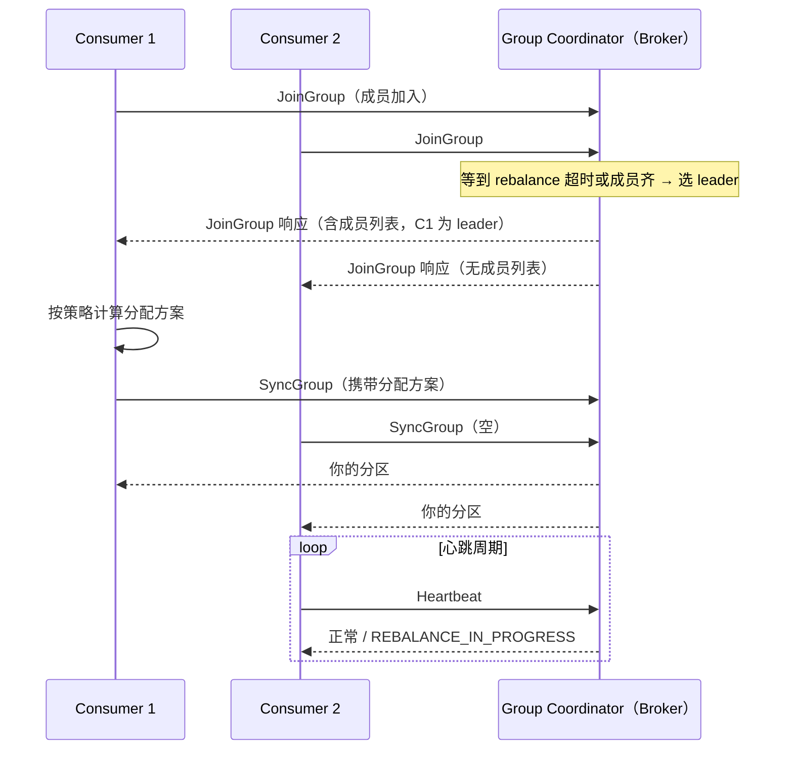
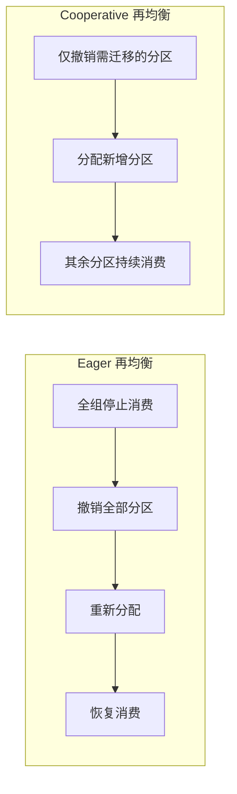
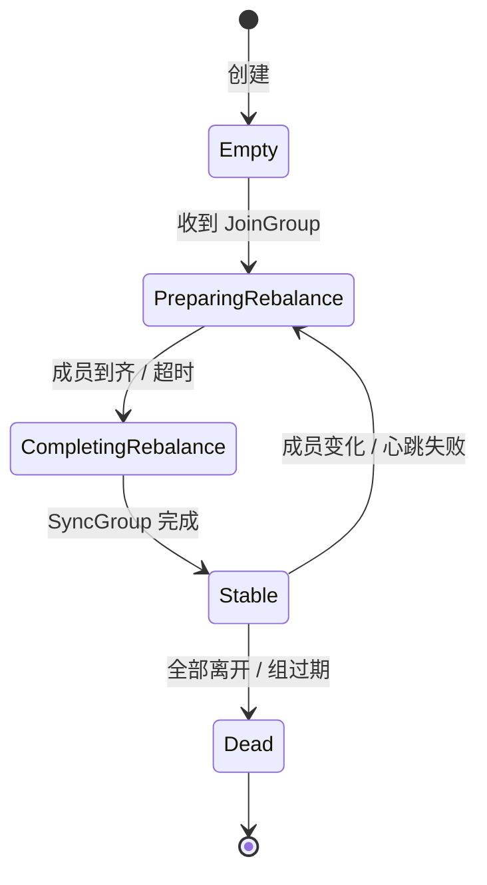

# 消费组与再均衡

> join / sync / heartbeat · eager 与 cooperative · 分配策略 · 位点提交 · 重平衡风暴

[文档首页](../../../文档首页.md) › [知识档案](../技术栈知识档案总览.md) › [消息与事件驱动总览](01_事件驱动_总览.md) › 消费组与再均衡

---

> **定位**：消费组是消息平台最容易出线上问题的部件——不是因为它难写，而是因为**成员变化、位点提交、分区分配三件事交织**，任何一处处理不当都会造成「重复消费」「停摆」或「顺序错乱」。本篇讲清协议流程与各类坑。

## 1. 消费组要解决什么 

给定「一个 topic 有 N 个分区」和「一个组有 M 个消费者」，要保证：

1. **不重不漏**：任一时刻，一个分区只被组内一个消费者处理（否则同组重复消费）。
2. **尽量均衡**：M 个消费者分摊 N 个分区，负载接近平均。
3. **可恢复**：消费者挂掉后，它负责的分区能转给其他人，且从正确位点继续。
4. **可伸缩**：加 / 减消费者时能重新分配，且过程尽量不中断。

这四点的实现就是「再均衡协议 + 位点管理」。

## 2. 经典协议流程（Kafka 风格） 

| 阶段 | 作用 | 常见问题 |
| --- | --- | --- |
| JoinGroup | 成员注册，触发新一轮分配 | 成员迟迟不到齐 → 等满 `rebalance.timeout` |
| SyncGroup | leader 下发分配方案 | leader 崩溃 → 重新 Join |
| Heartbeat | 保活 + 感知再均衡 | 心跳线程阻塞 → 被误判死亡（见下） |
| LeaveGroup | 主动离开 | 不发送 → 只能等超时才发现 |

**Coordinator 的选择**：通常由 `hash(group_id) % broker_count` 决定，这样同组的协调工作集中在一个 broker，避免所有 broker 都维护全量组状态。

## 3. 分配策略 

| 策略 | 做法 | 优点 | 缺点 |
| --- | --- | --- | --- |
| Range | 按 topic 排序，每个消费者分连续区间 | 简单、同 topic 内分区集中 | 多 topic 时负载不均（排在前面的消费者多分） |
| RoundRobin | 所有分区排序后轮流发 | 均衡性好 | 每次分配结果变化大，再均衡成本高 |
| Sticky（粘性） | 尽量保留上次分配，只移动必要的分区 | 减少再均衡的数据迁移 | 实现复杂，需记录历史分配 |
| Cooperative-Sticky | 增量再均衡：先分配新增，再撤销多余 | **不全局暂停**，抖动小 | 需要协议支持两阶段（revoke / assign） |

**Sticky 的价值**：再均衡时若把分区全打乱，每个消费者都要从新位点重新拉取，缓存全部失效，还可能触发大量重复消费。粘性分配让「没必要的分区不动」，把再均衡代价从「全量重分配」降到「局部调整」。**这是生产环境的默认推荐**。

## 4. eager vs cooperative 

| 模式 | 流程 | 影响 |
| --- | --- | --- |
| Eager（默认经典） | 所有消费者**先全部撤销**自己的分区 → 重新分配 → 再开始消费 | 再均衡期间全组停摆（秒级到分钟级） |
| Cooperative（增量） | 只撤销需要迁移的分区，其余继续消费 | 停摆范围小，适合大分区数、高吞吐 |

**必须知道的代价**：cooperative 需要「两轮再均衡」（第一轮 revoke 多余分区，第二轮 assign），协议更复杂；且如果客户端不支持，会退化为 eager。

## 5. 位点提交 

| 方式 | 语义 | 风险 |
| --- | --- | --- |
| 自动提交（周期） | 每 N 秒提交当前处理位置 | 提交时可能已处理但未完成 → 丢；或已提交但未处理完 → 丢 |
| 手动同步提交 | 处理完再提交，等提交成功 | 吞吐下降（每次等 RTT） |
| 手动异步提交 | 处理完提交，不等待 | 提交失败可能丢位点；需处理回调 |
| 事务提交 | 处理结果与位点同事务 | 仅限支持事务的边界 |

**正确姿势**：**处理完一条（或一批）再提交，且提交的是「已处理完的最后一条 + 1」**。批处理时若批内部分失败，要么整批重来（至少一次），要么记录批内进度（复杂）。

**位点存储位置**：Kafka 存内部 topic `__consumer_offsets`（本身是分区日志，可复制）；RocketMQ 存 broker 端 offset 表；Pulsar 存 cursor（BookKeeper）。**自研时优先用「独立位点文件 + 定期刷盘」**，简单可靠；规模上来后再考虑把位点也放进分区日志。

## 6. 重平衡风暴 

| 现象 | 根因 | 后果 |
| --- | --- | --- |
| 组反复 rebalance | 心跳超时被误判死亡，成员反复进出 | 消费长期停摆，位点不推进 |
| 心跳线程被业务阻塞 | 处理消息的线程与心跳线程共用 | 处理慢 → 心跳延迟 → 被踢 → 再均衡 → 更慢 |
| 大批消费者同时重启 | 部署滚动更新 | 连续多轮再均衡，积压暴涨 |
| `session.timeout` 过小 | 网络抖动即触发 | 频繁再均衡 |
| 分区数远大于消费者数 | 每次分配计算量大 | 再均衡耗时与分区数成正比 |

**防法**：

1. **心跳与处理分离**：心跳放在独立线程 / 协程，不被业务阻塞。
2. **`max.poll.interval` 与处理时长匹配**：单批处理时间必须小于该值，否则被踢。
3. **滚动重启加延迟**：一次只重启一个实例，等组稳定再下一个。
4. **静态成员（static membership）**：给消费者固定 `group.instance.id`，短暂重启不触发再均衡（Kafka 2.3+）。
5. **cooperative + sticky**：把再均衡从「全停」降到「局部调整」。

## 7. 消费者状态机 

状态机的意义：**任何一个状态卡住，都会表现为「消费不动」**。排障时先看组处于哪个状态——`PreparingRebalance` 卡住通常是成员反复进出，`Stable` 但位点不推进通常是业务处理阻塞或提交失败。

## 8. 业界对照 

| 能力 | Kafka（经典协议） | Kafka（KIP-848 新协议） | Pulsar | RocketMQ |
| --- | --- | --- | --- | --- |
| 协调者 | Group Coordinator（broker） | Group Coordinator（broker，状态机在服务端） | Broker（按 topic 归属） | Broker（按 queue 归属） |
| 再均衡 | 客户端主导（leader 算分配） | **服务端主导**，客户端只接收 | 服务端主导 | 客户端定时拉取重平衡 |
| 增量再均衡 | cooperative-sticky | 原生支持 | 支持 | 顺序消费用锁，不整体 rebalance |
| 位点 | `__consumer_offsets` | 同 | cursor（BookKeeper） | broker 端 offset 表 |
| 静态成员 | 支持 | 支持 | 支持 | 无（靠 queue 分配） |

**趋势是「服务端主导 + 增量」**：KIP-848 把分配计算从客户端挪到 coordinator，减少客户端版本差异带来的不一致，也让再均衡更可控。自研时如果客户端与 broker 都是自己写，服务端主导是更简单的选择——只有一套实现，不存在版本兼容问题。

## 9. 对 msg 的设计约束 

| 决策点 | 建议 | 理由 |
| --- | --- | --- |
| 主导方 | 服务端主导（broker 算分配） | 客户端与 broker 同源，无需兼容多版本 |
| 分配策略 | 粘性优先，首期可先做 range | 先跑通，再优化迁移成本 |
| 再均衡模式 | 首期 eager 实现简单，预留 cooperative | PoC 单消费者，暂不涉及 |
| 心跳 | 独立协程，与消费循环分离 | 避免处理慢导致误判 |
| 位点 | 独立位点文件（`{group}/{topic}-{partition}.offset`）+ 定期刷盘 | 简单、可恢复 |
| 静态成员 | 首期不做 | 单机单消费者，收益低 |

## 10. 失败模式与自检 

| 失败模式 | 现象 | 防法 |
| --- | --- | --- |
| 心跳与业务同线程 | 处理慢 → 被踢 → 风暴 | 心跳独立 |
| 自动提交 + 长处理 | 重复消费或丢消息 | 处理完再手动提交 |
| 提交位点语义搞错 | 跳过未处理消息 | 提交「已处理完最后一条 + 1」 |
| 分区数 > 消费者数 | 部分消费者空闲 | 按分区数规划消费者上限 |
| 再均衡不撤销旧分区 | 同组重复消费 | 严格 revoke → assign 两阶段 |
| 组状态卡在 Preparing | 消费停摆 | 监控组状态 + 成员进出日志 |

## 11. 待实测 

| # | 事项 | 归属 |
| --- | --- | --- |
| 1 | 再均衡停摆时长与分区数 / 消费者数的关系 | 8B_02 |
| 2 | 位点文件刷盘频率对重复消费窗口的影响 | 8B_04 |
| 3 | 粘性分配相对 round-robin 的迁移量下降比例 | 8B_02 |
| 4 | 服务端主导 vs 客户端主导的实现复杂度对比 | 8B_02 |

## 12. 参考 

- Kafka 官方文档：Consumer Group Protocol / Static Membership / KIP-848
- Pulsar 官方文档：Subscriptions（Exclusive / Shared / Failover / Key_Shared）
- RocketMQ 官方文档：消费者分组与重平衡
- 《Kafka: a Distributed Messaging System for Log Processing》（LinkedIn 论文）

---

> 依《[文档生成规范](../../../规范/文档生成规范.md)》编写
