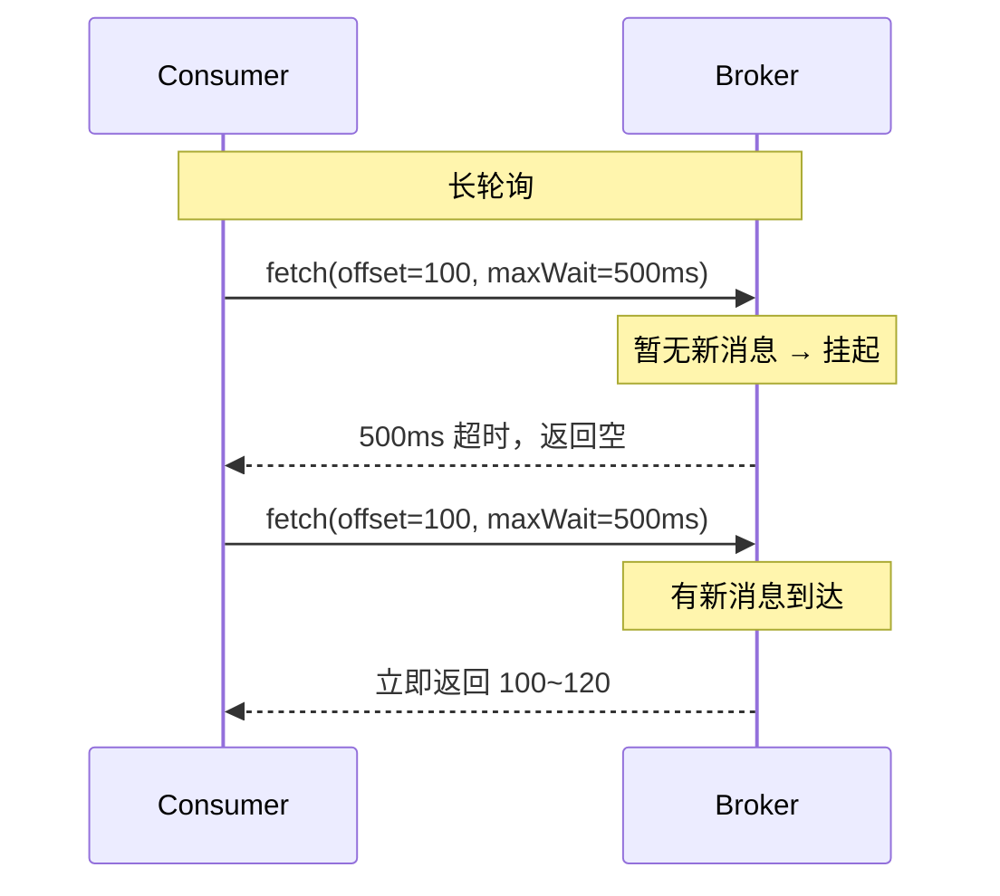
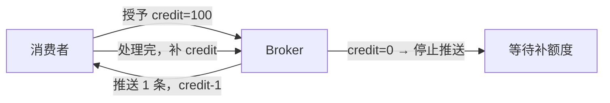
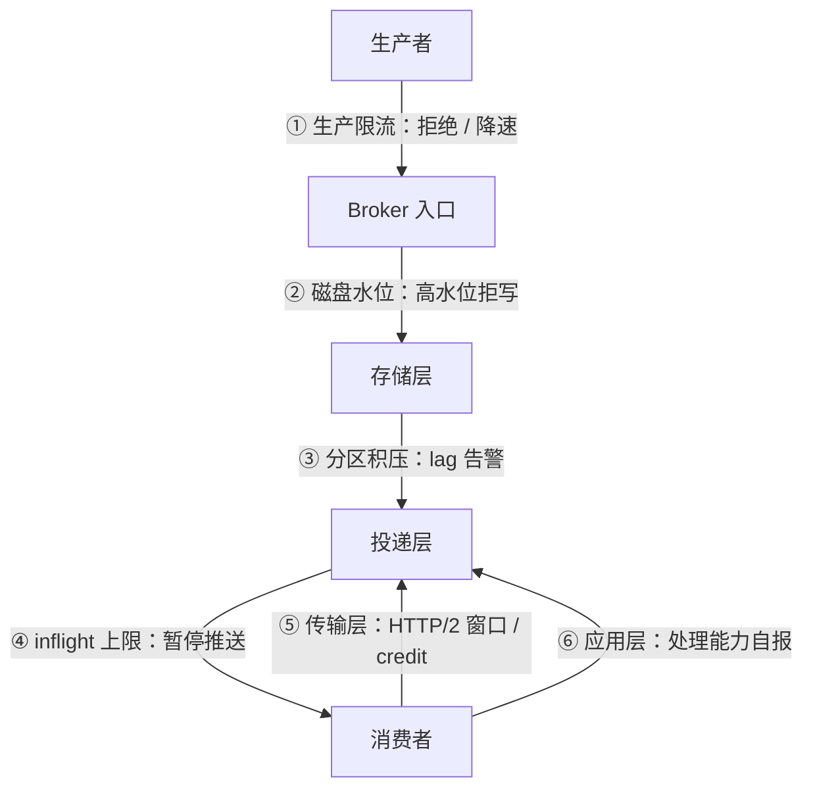

# 背压与流控

> pull 与 push · 长轮询 · 信用额度 · 水位线 · 慢消费者隔离 · 队头阻塞

[文档首页](../../../文档首页.md) › [知识档案](../技术栈知识档案总览.md) › [消息与事件驱动总览](01_事件驱动_总览.md) › 背压与流控

---

> **定位**：消息平台最容易被忽略、上线后最先出事的部件。没有背压，「生产快、消费慢」会在几分钟内把内存与磁盘打满，然后整个 broker 雪崩。本篇讲清背压加在哪、怎么加、代价是什么。

## 1. 为什么必须有背压 

消息系统的天然矛盾：**生产速率与消费速率独立**。生产者可能瞬间打满带宽，消费者可能因为下游数据库慢而停滞。没有背压时，中间层只有两个结局：

1. **无限缓冲** → 内存或磁盘涨到 OOM / 磁盘满，整机不可用。
2. **无限丢弃** → 消息静默丢失，业务方毫不知情。

背压的本质是**把「下游处理不过来」这个事实，以可接受的代价传导给上游**：要么让生产者变慢，要么明确拒绝并返回错误，要么把溢出部分转移到可管理的存储（磁盘 / 死信）。

## 2. pull 与 push 

| 模型 | 谁驱动 | 优点 | 缺点 |
| --- | --- | --- | --- |
| **Pull（拉）** | 消费者主动请求 | 消费者按自身能力拉取，天然背压；broker 不必维护每消费者状态 | 无消息时轮询空转，延迟高 |
| **Push（推）** | broker 主动推送 | 低延迟；broker 可控制节奏 | broker 必须知道消费者能力，否则推爆；需维护大量推送状态 |
| **长轮询（long polling）** | 消费者请求，broker 挂起直到有消息或超时 | 兼顾低延迟与天然背压（Kafka 默认） | 需要挂起连接管理 |

**长轮询是拉模型的补丁**：既保留「消费者能力驱动」的背压，又把空轮询的延迟从「轮询间隔」降到「消息到达即返回」。代价是 broker 要为每个挂起的 fetch 维护状态，连接数大时内存开销上升。

## 3. 信用额度（credit-based） 

推模型要背压，常用「信用额度」：消费者预先告知「我还能处理 N 条」，broker 每推一条减一，减到 0 就停；消费者处理完再补额度。

| 优点 | 缺点 |
| --- | --- |
| 推模型也能精确背压 | 需要额外的额度管理协议 |
| 延迟低（无需等请求） | 额度耗尽后仍需等待，本质等价于拉 |
| 适合流式 / 双向场景 | 实现复杂度高于长轮询 |

gRPC 的流控、HTTP/2 的窗口、Pulsar 的 receiver queue size 都是信用额度思想的变体。

## 4. 水位线与阈值 

不看单条消息，看**整体水位**：

| 指标 | 含义 | 超限动作 |
| --- | --- | --- |
| 磁盘使用率 | 数据目录占用 / 容量 | 超过高水位（如 85%）→ 拒绝新消息或只允许低优先级 |
| 单分区积压（lag） | LEO − 已提交位点 | 超过阈值 → 告警 + 限速生产 |
| 内存中 inflight 字节 | 已投递未 ack 的总大小 | 超过上限 → 暂停推送 |
| 连接级缓冲 | 单连接待发送字节 | 超过窗口 → 依赖传输层流控 |

**高低水位（high/low watermark）**：超过高水位进入「限流 / 拒绝」状态，回落到低水位才恢复。中间留滞回区，避免在阈值附近反复抖动。

## 5. 慢消费者隔离 

一个组里若有消费者极慢，会拖累整个组（分区被它占着不动）。隔离手段：

| 手段 | 做法 | 代价 |
| --- | --- | --- |
| 消费超时 | 超过 `visibility timeout` 未 ack → 收回分区 / 重投 | 慢但正确的消费者会被误伤 |
| 最大 inflight 限制 | 单消费者未 ack 数超限 → 暂停给它投递 | 需要按消费者维护计数 |
| 独立队列 / 死信 | 反复超时的消息转死信，不阻塞主链路 | 需要人工处置 |
| 消费组隔离 | 慢业务用独立组、独立 topic | 架构上拆分，成本高 |
| 速率限制 | 按消费者 / 组限速 | 治标不治本 |

**核心原则**：**慢消费者的代价不能由 broker 承担**。broker 只负责「不把资源无限投给它」，最终要么它追上，要么消息进死信。

## 6. 队头阻塞（head-of-line blocking） 

| 场景 | 现象 | 解法 |
| --- | --- | --- |
| 单分区内一条消息处理失败 | 后续消息全部等待（保序） | 同 key 阻塞重试 / 跳过并进死信（放弃局部顺序） |
| HTTP/1.1 单连接多请求 | 前一个响应慢，后面全等 | 多连接或升级 HTTP/2（多路复用） |
| HTTP/2 单 TCP 连接丢包 | 所有 stream 一起等重传 | 多连接并行 / QUIC（HTTP/3） |
| 单消费者处理串行 | 吞吐受单条最慢消息限制 | 批量 + 并发处理（放弃分区内顺序） |

**顺序与并发的根本取舍**：要严格顺序，就必须串行处理，队头阻塞不可避免；要吞吐，就得放弃局部顺序或做「分区内并发 + 按 key 串行」。

## 7. 多层背压 

六个层次要**同时存在**，因为任何一层单独都不够：

- 只有传输层流控 → 磁盘可能先满。
- 只有磁盘水位 → 内存 inflight 可能先爆。
- 只有应用层自报 → 恶意或故障客户端可以谎报。

## 8. 业界对照 

| 实现 | 主要机制 | 特点 |
| --- | --- | --- |
| **Kafka** | 长轮询 + 分区级 fetch 上限（`fetch.max.bytes` / `max.partition.fetch.bytes`）+ 磁盘水位 | 消费者自控节奏，broker 只做上限保护 |
| **RocketMQ** | 推模式为主 + 消费端流控（`pullThresholdForQueue`）+ 长轮询 | 推拉结合，客户端维护本地队列 |
| **Pulsar** | 推模式 + receiver queue size（信用额度）+ 消费端限流 | 信用额度模型最清晰 |
| **NATS JetStream** | pull consumer 为主 + `MaxAckPending`（未 ack 上限） | 用「未确认数」直接做背压 |
| **HTTP/2** | 连接级与流级窗口（`WINDOW_UPDATE`） | 传输层背压，与应用层叠加 |

**共识**：拉模型 + 未确认上限（inflight / MaxAckPending）是最简单可靠的组合；推模型需要信用额度才能不失控。

## 9. 对 msg 的设计约束 

| 决策点 | 建议 | 理由 |
| --- | --- | --- |
| 消费模型 | 长轮询（subscribe 挂起直到有消息或超时） | 天然背压 + 低延迟；8B_01 已按此设计 |
| 未确认上限 | 单消费者 `max_inflight` 条 / 字节双阈值 | 防内存爆；超限暂停推送 |
| 磁盘水位 | 高 / 低水位滞回 | 防磁盘满导致整机不可用 |
| 积压监控 | 按分区 lag 暴露指标 | 8B_10 运维面输入 |
| 慢消费者 | 可见性超时重投 + 重试上限进死信 | 不阻塞主链路 |
| 传输层 | 复用 HTTP/2 流控窗口，不另造一套 | 避免双重流控冲突 |

## 10. 失败模式与自检 

| 失败模式 | 现象 | 防法 |
| --- | --- | --- |
| 无 inflight 上限 | 内存随积压线性上涨 → OOM | 条数 + 字节双阈值 |
| 只有磁盘水位 | 内存先爆 | 多层背压同时存在 |
| 长轮询无超时 | 连接永久挂起，资源泄漏 | 必须有 `maxWait` |
| 慢消费者不隔离 | 整组消费停滞 | 可见性超时 + 死信 |
| 阈值为单点 | 阈值附近反复抖动 | 高低水位滞回 |
| 重试无上限 | 毒消息无限循环 | 最大重试次数 + DLQ |

## 11. 待实测 

| # | 事项 | 归属 |
| --- | --- | --- |
| 1 | 长轮询挂起连接数对内存的影响 | 8B_01 |
| 2 | inflight 上限与吞吐 / 延迟的关系 | 8B_01 / 8B_12 |
| 3 | HTTP/2 窗口与自建 inflight 阈值的叠加效果 | 8B_01 |
| 4 | 慢消费者场景下的积压增长速度 | 8B_12 |

## 12. 参考 

- Kafka 官方文档：Consumer Configs（`fetch.max.bytes` / `max.poll.records`）
- Pulsar 官方文档：Consumer（receiver queue size / flow control）
- NATS JetStream：`MaxAckPending` / pull consumer
- RFC 9113 §5（HTTP/2 Flow Control）
- Reactive Streams 规范（背压语义）

---

> 依《[文档生成规范](../../../规范/文档生成规范.md)》编写
