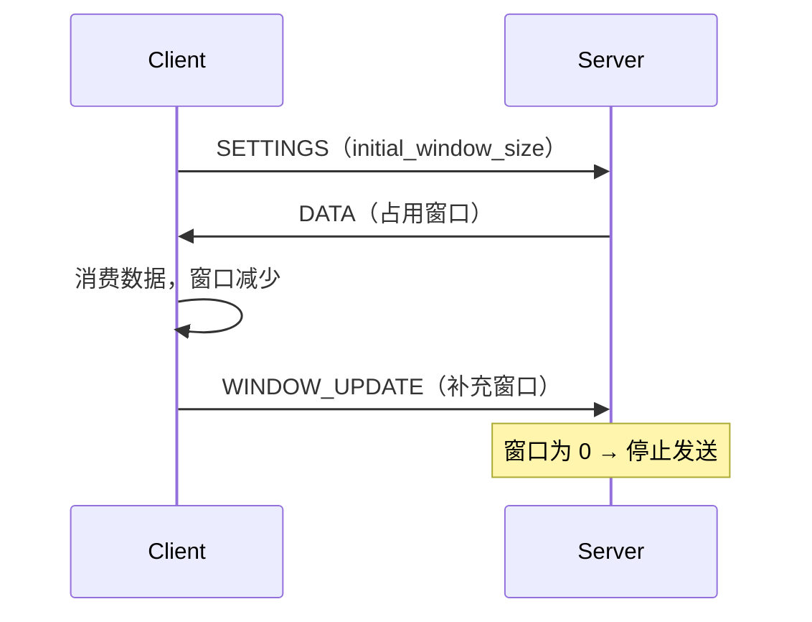

# 协议与传输

> 帧格式与版本演进 · HTTP/2 多路复用 / HPACK / 流控窗口 · h2c 与 TLS · 连接管理

[文档首页](../../../文档首页.md) › [知识档案](../技术栈知识档案总览.md) › [消息与事件驱动总览](01_事件驱动_总览.md) › 协议与传输

---

> **定位**：协议是「客户端与 broker 之间的合同」，一旦上线就要长期兼容；传输决定了每条连接的并发上限与延迟。本篇是 8B_01「传输与协议 PoC」的核心知识输入。

## 1. 先决定：复用标准协议还是自定义 <a id="choice"></a>

| 路线 | 代表 | 优点 | 缺点 |
| --- | --- | --- | --- |
| 自定义 TCP 协议 | Kafka、RocketMQ | 极致精简、可控 | 连接管理、TLS、跨语言、调试工具全自研 |
| HTTP/2 + 二进制帧 | gRPC、本文方案 | 复用成熟传输（多路复用、流控、HPACK）、可被现有网关 / 抓包工具识别 | 头部与帧有固定开销；订阅长流要额外设计 |
| WebSocket | 部分实时系统 | 双向、浏览器友好 | 需自建重连 / 背压；与服务端 HTTP 栈边界模糊 |
| 消息队列标准协议 | AMQP / MQTT / STOMP | 有现成客户端与生态 | 协议语义与需求不完全匹配；Python 实现质量参差 |

**对 msg 的结论**：**HTTP/2（h2c）+ MessagePack**。理由：

1. 多路复用解决「一条连接上并发多请求」，避免 HTTP/1.1 的队头阻塞。
2. 流控窗口天然提供传输层背压（与 06 篇的应用层阈值叠加）。
3. 复用现有网关、TLS 终止、抓包与调试生态。
4. 不需要像 gRPC 那样引入 Protobuf 工具链（8B 首期用 MessagePack 更快）。

## 2. 帧格式 <a id="frame"></a>

```text
+--------+--------+--------+--------+------------------+
| magic  | ver    | type   | flags  | header length    |
| 2B     | 1B     | 1B     | 2B     | 4B               |
+--------+--------+--------+--------+------------------+
| header（MessagePack map：topic / key / tenant / trace…） |
+--------------------------------------------------------+
| payload（bytes，业务负载，可为空）                       |
+--------------------------------------------------------+
| crc32（可选，4B；长连接场景可关）                        |
+--------------------------------------------------------+
```

| 字段 | 作用 | 设计要点 |
| --- | --- | --- |
| `magic` | 协议识别 | 固定两字节，用于快速拒绝非本协议流量 |
| `ver` | 协议版本 | 主版本不兼容即断连；次版本只增字段 |
| `type` | 帧类型 | `publish` / `ack` / `subscribe` / `error` / `heartbeat` |
| `flags` | 位标记 | 压缩、流结束、需响应、批量 |
| `header length` | 头部长度 | 与 payload 分开，便于只读头做路由 |
| `header` | 结构化头 | MessagePack map，**只增字段不删字段** |
| `payload` | 业务字节 | broker 默认不解包（保零拷贝） |

**为什么头与体分离**：broker 路由只需要头（topic / partition key / tenant），不需要反序列化业务负载。头体分离让「路由」与「转发」解耦，是保持零拷贝转发的前提。

## 3. 版本演进与兼容 <a id="version"></a>

| 变更类型 | 是否兼容 | 处理方式 |
| --- | --- | --- |
| 新增可选 header 字段 | 兼容 | 老客户端不传 → 用默认值 |
| 新增帧类型 | 兼容（若对端忽略未知类型） | 明确「未知帧类型必须忽略而非报错」 |
| 修改字段语义 | **不兼容** | 升次版本 + 双写过渡期，或新增字段替代 |
| 删除字段 | **不兼容** | 先标记废弃，观察一个版本后再删 |
| 修改帧布局 | **不兼容** | 升主版本，双协议并行 |

三条铁律：

1. **永不重用字段名表达新语义**——老客户端会按旧语义解释。
2. **未知字段必须能忽略**——否则任何新增都会断老客户端。
3. **协议版本要能从连接元数据看到**——排障时第一句话就是「你连的是哪个版本」。

## 4. 错误码 <a id="errors"></a>

| 层 | 错误示例 | 处理 |
| --- | --- | --- |
| 传输层 | 帧过大、magic 不符、版本不支持 | 断连 + 日志 |
| 协议层 | 缺必填头、类型不合法 | 返回 `error` 帧，不断连 |
| 业务层 | 主题不存在、消息过大、限流 | 返回 `error` 帧 + 可重试标记 |
| 系统层 | 磁盘满、内部异常 | 返回 `error` 帧 + 不可重试 |

**错误必须带 `retryable` 标记**：客户端据此决定「重试」还是「放弃进死信」。没有这个标记，客户端只能盲目重试，把不可恢复的错误放大成雪崩。

**错误码分段**（msg 暂定，最终以 07C 登记为准）：`35xxx` 为产品段；`35001` 主题不存在、`35004` 超时、`35005` 背压 / 限流、`35006` 消息过大。**段位一旦登记就不改**，新增只往后加。

## 5. HTTP/2 关键机制 <a id="h2"></a>

### 5.1 二进制分帧与多路复用

HTTP/2 把请求 / 响应拆成 `HEADERS` + `DATA` 帧，每个请求一个 **stream**，同一 TCP 连接上多个 stream 并发传输。这解决了 HTTP/1.1 的队头阻塞（前一个响应慢会卡住后续请求）。

| 概念 | 含义 |
| --- | --- |
| Stream | 一次请求 / 响应，有唯一 `stream_id`（奇数客户端发起，偶数服务端推送） |
| Frame | 最小传输单位，带 `stream_id` |
| 并发上限 | `SETTINGS_MAX_CONCURRENT_STREAMS` 控制单连接并发流数 |
| 流状态 | `idle → open → half-closed → closed` |

### 5.2 HPACK 头部压缩

HTTP/2 用 HPACK 压缩头部：静态表（61 个常见头）+ 动态表（连接级）+ Huffman 编码。消息场景头字段高度重复（`:method`、`content-type`、`x-tenant`），HPACK 能把每条请求的头开销从几十字节压到几字节。**代价**：动态表是连接级状态，连接复用越久收益越大，频繁建连反而更亏。

### 5.3 流控窗口

HTTP/2 有两级流控：**连接级**与**流级**，初始窗口 65535 字节，通过 `WINDOW_UPDATE` 扩大。



**这是传输层背压**，与 06 篇的应用层 inflight 上限叠加。**不要只依赖一层**：窗口只保护单连接，保护不了磁盘与内存总量。

### 5.4 h2c 与 TLS

| 模式 | 说明 | 适用 |
| --- | --- | --- |
| **h2c（prior knowledge）** | 明文 HTTP/2，建连即发 preface，不做 ALPN 协商 | 内网、PoC、基准测试 |
| h2 over TLS | TLS + ALPN 协商 `h2` | 生产、跨网 |
| HTTP/1.1 Upgrade | `Upgrade: h2c` 升级 | 兼容老客户端，开销大 |

PoC 用 h2c 的理由：**排除 TLS 握手与加解密的干扰**，基准测的是协议与序列化本身。生产再切 TLS，两者在应用层代码上差异很小（换 socket 层）。

## 6. 连接管理 <a id="conn"></a>

| 机制 | 作用 | 参数 |
| --- | --- | --- |
| 心跳（PING / heartbeat 帧） | 探测半开连接 | 间隔、超时、连续失败次数 |
| 最大并发流 | 防单连接压垮 broker | `MAX_CONCURRENT_STREAMS` |
| 空闲回收 | 释放长期不用的连接 | 空闲超时 |
| 断线重连 | 客户端自动恢复 | 指数退避 + 抖动 |
| 连接池 | 多连接分摊 | 按目标 broker / 租户分池 |
| GOAWAY | 优雅关闭，告知对端「不要再发新流」 | 滚动重启必备 |

**半开连接是最隐蔽的问题**：网络中断后一端不知道对端已死，连接仍占着资源。心跳 + 超时是唯一可靠判据。**不要用 TCP keepalive 替代应用心跳**——默认 2 小时的探测间隔对消息场景毫无意义。

## 7. 为什么不用 gRPC <a id="why-not-grpc"></a>

| 维度 | gRPC | 本方案 |
| --- | --- | --- |
| 契约 | `.proto` + 代码生成 | MessagePack + 手写 schema |
| 传输 | HTTP/2（强制） | HTTP/2（h2c 可选 TLS） |
| 流式 | 原生四种（unary / server / client / bidi） | 自己实现订阅长流 |
| 工具链 | protoc、多语言 stub | 无 |
| 调试 | 需要 grpcurl 等专用工具 | 可用通用 HTTP/2 工具 |
| 适合 | 跨语言、强契约 | 单语言（Python）内部、快速迭代 |

**不是不能用 gRPC**，而是首期引入 protoc 工具链会拖慢 PoC，且 bms 已有 OpenAPI 契约体系，再引入一套 proto 契约会让「双轨」变「三轨」。等跨语言需求出现再评估。

## 8. 业界对照 <a id="compare"></a>

| 实现 | 传输 | 协议特征 |
| --- | --- | --- |
| **Kafka** | 自定义 TCP 二进制协议 | 请求 / 响应带 correlation id，支持批量与压缩；无多路复用（一连接一串行请求） |
| **RocketMQ** | 自定义 TCP（RemotingCommand） | 头 + 体分离，头是 JSON-like 结构；支持多版本 |
| **Pulsar** | 自定义 TCP（Protobuf 编解码） | 命令 + 载荷分离，Protobuf 定义 |
| **NATS** | 文本协议（可转二进制） | 极简、可读、易调试；性能好但表达力有限 |
| **gRPC** | HTTP/2 + Protobuf | 强契约、多语言、流式完整 |

**共同点**：头部都有 `type` + `correlation/stream id` + `version`；都用「头体分离」让 broker 少解包。**差异**：只有 gRPC 与本文方案用 HTTP/2，其余都是自定义 TCP——因为它们在 HTTP/2 普及前就已定型，且自定义协议在高吞吐下开销更低。

## 9. 对 msg 的设计约束 <a id="msg"></a>

| 决策点 | 建议 | 理由 |
| --- | --- | --- |
| 传输 | HTTP/2 h2c（`h2` 库直连），生产切 TLS | 排除框架干扰，直测协议 |
| 端点 | `POST /msg/publish`、`GET /msg/subscribe`（长驻）、`POST /msg/ack` | 与 8B_01 设计一致 |
| 序列化 | MessagePack | 紧凑、Python 原生 |
| 头体分离 | header 用 MessagePack map，payload 原样字节 | 保零拷贝转发 |
| 版本 | `ver` 字段 + 「未知字段忽略」 | 兼容演进 |
| 错误 | `error` 帧 + `retryable` | 客户端可判定重试 |
| 连接 | PING 心跳 + GOAWAY + 指数退避重连 | 半开连接与滚动重启 |

## 10. 失败模式与自检 <a id="failure"></a>

| 失败模式 | 现象 | 防法 |
| --- | --- | --- |
| 无 `maxWait` 的订阅 | 连接永久挂起 | 订阅必须带超时或心跳 |
| 帧长度无上限 | 超大帧打爆内存 | 头 / 体长度上限 |
| 未知字段报错 | 无法演进 | 强制「忽略未知」 |
| 用 TCP keepalive 当心跳 | 半开连接数小时不释放 | 应用层 PING |
| HTTP/1.1 承载推送 | 队头阻塞 | 升级 HTTP/2 |
| 只靠传输层流控 | 磁盘 / 内存仍可能爆 | 叠加应用层阈值 |

## 11. 待实测 <a id="todo"></a>

| # | 事项 | 归属 |
| --- | --- | --- |
| 1 | `h2` 库服务端在 Python 下的吞吐与延迟 | 8B_01 |
| 2 | h2c vs HTTP/1.1 + JSON 的基准对比 | 8B_01 |
| 3 | HPACK 动态表在长连接下的收益 | 8B_01 |
| 4 | 订阅长流的连接数上限 | 8B_01 |
| 5 | 帧头 + MessagePack 相对 JSON 的体积与耗时 | 8B_01 |

## 12. 参考 <a id="refs"></a>

- RFC 9113（HTTP/2）、RFC 7541（HPACK）、RFC 8441（HTTP/2 over TLS）
- gRPC 官方文档：Core concepts / Protocol
- Kafka Protocol Guide（官方）
- RocketMQ：RemotingCommand 协议设计
- Pulsar：Binary Protocol（Protobuf）
- NATS Protocol（官方）

---

> 依《[文档生成规范](../../../规范/文档生成规范.md)》编写
