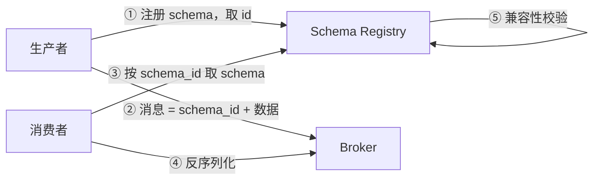

# 序列化与 Schema

> **状态说明（2026-11-13）**：RocketMQ 已从本平台下线，事件总线改用自研 `msg`；本文涉及 RocketMQ 的内容仅作技术参考，不代表当前实现。

> JSON / MessagePack / Protobuf / Avro 取舍 · Schema 演进规则 · 兼容性 · 压缩

[文档首页](../../../文档首页.md) › [知识档案](../技术栈知识档案总览.md) › [消息与事件驱动总览](01_事件驱动_总览.md) › 序列化与 Schema

---

> **定位**：序列化决定了「一条消息在线上的字节数」与「两端能否读懂彼此」。在消息平台里，它比在 RPC 里更敏感——因为**消息会被持久化、被长期保留、被多个消费方读取**，格式一旦定错，回滚成本极高。

## 1. 序列化在链路中的位置 

三个关键事实：

1. **broker 默认不解包**（保零拷贝），所以格式变更的兼容性责任完全在生产者与消费者。
2. **消息会被长期保留**（retention 天数级），老格式消息与新消费者必须能共存。
3. **同一 topic 可能有多个消费方**，格式演进不能只顾一个消费者。

## 2. 格式对比 

| 格式 | 类型 | 体积 | 编解码速度 | 强类型 | 跨语言 | 可读性 | 典型场景 |
| --- | --- | --- | --- | --- | --- | --- | --- |
| **JSON** | 文本 | 大（含字段名） | 中 | 否 | 极好 | 极好 | 对外 API、调试、低频消息 |
| **MessagePack** | 二进制（自描述） | 中（比 JSON 小） | 快 | 否 | 好 | 差（需工具） | 内部消息、RPC（**首选**） |
| **Protobuf** | 二进制（schema 驱动） | 小 | 很快 | 是 | 极好 | 差 | 跨语言、强契约、长期演进 |
| **Avro** | 二进制（schema 驱动） | 小 | 快 | 是 | 好 | 差（依赖 schema） | 大数据管道、Schema Registry |
| **Thrift** | 二进制（schema 驱动） | 小 | 快 | 是 | 中 | 差 | 遗留系统 |

**体积为什么差这么多**：JSON 每条消息都带字段名（`{"order_id": 123, "status": "PAID"}`），字段名重复几十字节；MessagePack 用整数类型标记 + 短字符串，字段名仍要带但更紧凑；Protobuf / Avro 用**字段编号**代替字段名，schema 只传一次（或按 id 引用），消息体只剩编号 + 值。

**为什么首期选 MessagePack 而不是 Protobuf**：

| 维度 | MessagePack | Protobuf |
| --- | --- | --- |
| 上手成本 | 一个 `msgpack.packb()` | 写 `.proto` + protoc 生成 + 版本管理 |
| Python 支持 | 原生 C 扩展，快 | `protobuf` 库，需生成代码 |
| Schema 演进 | 无强制约束（易漂移） | 字段编号 + 保留规则（有约束） |
| 调试 | 需 `msgpack` 工具解 | 需 `.proto` + `protoc --decode` |
| 适合阶段 | PoC / 内部快速迭代 | 长期、跨语言、强契约 |

**代价要说清**：MessagePack 没有 schema，字段类型漂移只能靠约定与测试兜底。**缓解办法**：把消息 schema 写进事件契约文档（bms 已有 `deploy/events` 契约），并在消费端做字段校验，失败进死信。

## 3. Schema 演进规则 

无论用哪种格式，**兼容性规则都是同一套**：

| 变更 | 是否兼容 | 说明 |
| --- | --- | --- |
| 新增可选字段 | ✅ 向后兼容 | 老消费者忽略新字段；新消费者对缺失字段用默认值 |
| 新增必填字段 | ❌ 不兼容 | 老生产者不传，新消费者无法处理 |
| 删除可选字段 | ⚠️ 有条件 | 需先确认无消费方依赖；Protobuf 用 `reserved` 防重用编号 |
| 删除必填字段 | ❌ 不兼容 | 类型契约破坏 |
| 改字段类型 | ❌ 不兼容 | `int → string` 会解析失败 |
| 改名（保留语义） | ⚠️ 视格式 | JSON / MessagePack 改名即破坏；Protobuf / Avro 可借编号 / 别名 |
| 改字段语义 | ❌ 不兼容 | 最容易漏——名字没变、含义变了 |
| 枚举新增值 | ⚠️ 有条件 | 老消费者遇到未知枚举值应能降级而非崩溃 |

**三种兼容方向**（Avro 术语，通用）：

| 方向 | 含义 | 谁能读谁 |
| --- | --- | --- |
| 向后兼容（backward） | 新 schema 能读旧数据 | 新消费者读旧消息 |
| 向前兼容（forward） | 旧 schema 能读新数据 | 旧消费者读新消息 |
| 完全兼容（full） | 双向都行 | 滚动升级期间必须 |

**消息平台必须至少做到「完全兼容」**：因为生产者和消费者是独立部署的，滚动升级期间必然存在新旧混跑。

## 4. Schema Registry 

当消息量大、消费方多时，把 schema 集中管理：

| 能力 | 作用 |
| --- | --- |
| Schema 版本化 | 每个 schema 有 id 与版本，消息只带 id |
| 兼容性校验 | 注册时按 backward / forward / full 规则拒绝破坏性变更 |
| 跨语言 | 各语言客户端按 id 拉 schema 生成解码器 |
| 演进审计 | 谁在什么时候改了什么 |

**代价**：多一个服务、多一次网络往返（可缓存）、多一套运维。**首期不做**——bms 已有事件契约快照（`deploy/events`），足够约束内部消息；等跨团队、跨语言消费方出现再引入。

## 5. 压缩 

| 算法 | 压缩比 | 速度 | 适用 |
| --- | --- | --- | --- |
| gzip | 高 | 慢 | 归档、低频 |
| snappy | 中 | 很快 | **消息批量默认** |
| lz4 | 中 | 极快 | 低延迟 |
| zstd | 高 | 快 | 新系统首选（可调级别） |

**必须知道的取舍**：

1. **压缩要按批，不要按条**。单条小消息压缩后可能更大（头开销 > 收益）。
2. **压缩与零拷贝冲突**：broker 若要解压校验，就无法原样转发。常见做法是**生产者压缩、broker 原样存、消费者解压**。
3. **压缩比与 CPU 是跷跷板**：zstd 级别从 1 调到 19，压缩比上升、延迟暴涨。默认用级别 1~3。

## 6. 跨语言与契约 

| 需求 | 推荐 |
| --- | --- |
| 仅 Python 内部 | MessagePack + 事件契约文档 |
| Python + 前端（TS） | JSON（简单）或 MessagePack（需库） |
| Python + Java / Go | Protobuf + Schema Registry |
| 大数据管道（Spark / Flink） | Avro + Schema Registry |

msg 首期只有 Python 消费方，**MessagePack 够用**；跨语言需求出现时，按 topic 粒度迁移到 Protobuf，而不是全量重写——这要求协议头有 `content_type` 字段（见 07 篇）。

## 7. 业界对照 

| 实现 | 默认格式 | Schema 管理 |
| --- | --- | --- |
| **Kafka** | 字节数组（格式由用户定） | 生态用 Confluent Schema Registry（Avro / Protobuf / JSON Schema） |
| **RocketMQ** | 字节数组 | 无内置；靠业务约定 |
| **Pulsar** | 字节数组 + `schema` 元数据 | **内置 Schema Registry**（Avro / JSON / Protobuf / KeyValue） |
| **NATS JetStream** | 字节数组 | 无内置 |
| **gRPC** | Protobuf | `.proto` 文件即契约 |

**Pulsar 是唯一内置 Schema 的**：生产 / 消费时声明 schema，broker 校验兼容性。这是它相对 Kafka 的一个差异点，但也带来 broker 侧解包开销。

## 8. 对 msg 的设计约束 

| 决策点 | 建议 | 理由 |
| --- | --- | --- |
| 默认格式 | MessagePack | 紧凑、Python 原生、无工具链 |
| 头字段 | `content_type`（如 `application/x-msgpack`） | 为将来切 Protobuf 留口 |
| 演进规则 | 只增可选字段；不改名、不改语义 | 与 bms 事件契约「字段只增不删」一致 |
| 校验 | 消费端做字段校验，失败进死信 | MessagePack 无 schema，靠显式校验兜底 |
| Schema Registry | 首期不做 | 内部单语言，事件契约快照已够 |
| 压缩 | 按批 + 建议 snappy / zstd 低级别 | 单条压缩不划算；broker 不解压 |

## 9. 失败模式与自检 

| 失败模式 | 现象 | 防法 |
| --- | --- | --- |
| 无 schema，字段随意加 | 消费端 KeyError → 死信堆积 | 事件契约 + 消费端校验 |
| 改字段名 | 老消费者读不到 | 只增不改；废弃走新字段 |
| 改字段语义 | 数据错但不报错（最危险） | 语义变更必须换新字段名 |
| 枚举新增值 | 老消费者抛异常 | 消费端对未知枚举降级 |
| 单条压缩 | 体积反而变大 | 按批压缩 |
| broker 解压校验 | 零拷贝失效、吞吐骤降 | 只存不解析 |

## 10. 待实测 

| # | 事项 | 归属 |
| --- | --- | --- |
| 1 | MessagePack vs JSON 的体积与编解码耗时 | 8B_01 |
| 2 | 批量压缩（snappy / zstd）的吞吐影响 | 8B_01 / 8B_12 |
| 3 | MessagePack 在 Python 下的 CPU 占比 | 8B_01 |
| 4 | 消费端字段校验的开销 | 8B_04 |

## 11. 参考 

- MessagePack 规范（github.com/msgpack/msgpack）
- Protocol Buffers Language Guide（字段编号与 `reserved`）
- Apache Avro 规范（Schema Resolution / 兼容性）
- Confluent Schema Registry 文档
- Pulsar Schema 文档
- RFC 8878（zstd）、RFC 7932（brotli）

---

> 依《[文档生成规范](../../../规范/文档生成规范.md)》编写
