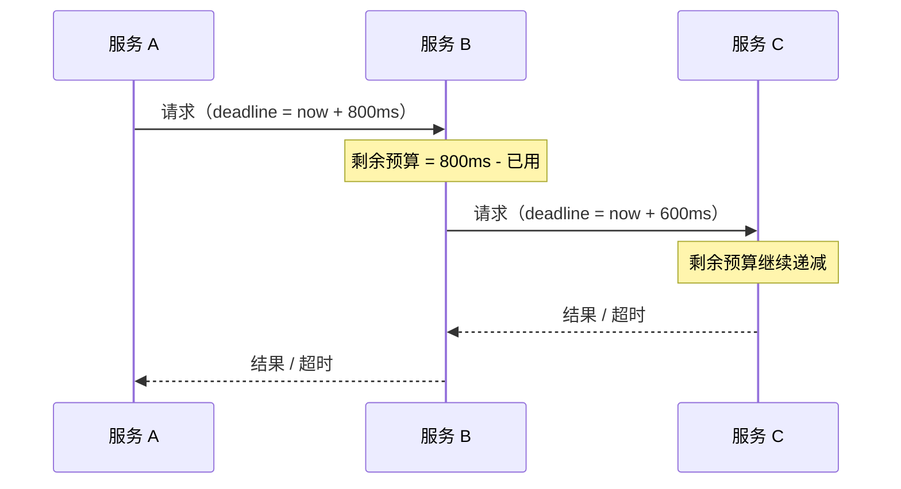

# RPC 模型

> 请求响应 · 关联 ID · 超时传播 · 取消 · 流式 · 幂等重试 · 熔断限流

[文档首页](../../../文档首页.md) › [知识档案](../技术栈知识档案总览.md) › [消息与事件驱动总览](01_事件驱动_总览.md) › RPC 模型

---

> **定位**：消息解决「异步、解耦、削峰」，RPC 解决「同步、要结果、要报错」。bms 现有 `HttpServiceClient`（httpx + JSON）能跑但性能不足，本篇讲清「一条好的 RPC 链路需要哪些机制」，是 8B_03 的设计输入。

## 1. RPC 与消息的分工 

| 维度 | RPC | 消息 |
| --- | --- | --- |
| 调用形态 | 请求 → 等响应 | 发送 → 不等 |
| 失败感知 | 立即可知（错误码 / 超时） | 异步（消费失败才知道） |
| 耦合 | 调用方知道被调方 | 生产者不知道消费者 |
| 延迟 | 低（一次往返） | 取决于消费速度 |
| 适用 | 查询、校验、强依赖的写 | 通知、联动、削峰 |

**不要用消息模拟 RPC**（发出去等回信），也不要**用 RPC 模拟消息**（同步等一堆下游）。两者的可靠性模型完全不同。

## 2. 一条 RPC 链路的组成 

| 组件 | 职责 | 常见坑 |
| --- | --- | --- |
| Stub | 序列化、编解码、错误映射 | 生成的代码与业务强耦合 |
| 关联 ID | 请求与响应的匹配 | 并发下用错 ID 导致串包 |
| 超时 | 防止无限等待 | 只设客户端超时，服务端继续跑 |
| 重试 | 处理瞬时故障 | 非幂等操作重试导致重复 |
| 熔断 | 防止雪崩 | 阈值拍脑袋，误熔断 |
| 限流 | 保护自身 | 只限入口，不限下游调用 |

## 3. 请求响应与关联 ID 

同步 RPC 的两种实现风格：

| 风格 | 做法 | 优点 | 缺点 |
| --- | --- | --- | --- |
| 一问一答（HTTP/2 stream） | 一个 stream 一个请求，流关闭即响应结束 | 无状态、易调试 | 并发靠多 stream |
| 多路复用 + 关联 ID | 一条连接上并发多请求，响应带 `correlation_id` | 连接数少 | 需维护「等待中的请求表」 |

**关联 ID 的三个要求**：

1. **全局唯一**（连接内唯一即可，但要防回绕）。
2. **生命周期短于连接**（连接断开时清理所有等待项）。
3. **超时后必须清理**，否则内存泄漏。

HTTP/2 的 `stream_id` 天然承担关联 ID 的角色，这是它相对自定义协议的便利之处。

## 4. 超时：必须传播，不能只在客户端 

**只设客户端超时是最常见的错误**：客户端 1s 超时返回了，服务端可能还在跑 30s，继续占资源、继续调下游。

正确的做法是 **deadline 传播**：

| 要点 | 说明 |
| --- | --- |
| 绝对时间 vs 相对时间 | 跨机器必须用「剩余毫秒」或「绝对时间戳 + 时钟同步」，不能用「本地超时」 |
| 预算递减 | 每跳扣除已消耗时间，留出返回余量 |
| 超时分级 | 客户端超时 > 服务端处理超时（否则客户端先放弃，服务端白干） |
| 超时不是错误码 | 它是「结果未知」，不能当作「失败」直接重试 |

## 5. 取消 

客户端取消（用户关闭页面、上游超时）时，服务端应尽快停止：

| 层 | 手段 |
| --- | --- |
| 传输 | HTTP/2 `RST_STREAM`；gRPC 的 `CANCELLED` |
| 服务端 | 监听取消信号，中断处理协程 |
| 下游 | 把取消继续传播下去（同样靠 deadline / 取消信号） |
| 资源 | 回滚未提交的写、释放锁、关闭游标 |

**取消是尽力而为**：服务端可能已经完成了副作用，取消只保证「不再继续」。所以**取消不能替代幂等**。

## 6. 流式 

| 类型 | 方向 | 典型场景 |
| --- | --- | --- |
| Unary | 一请求一响应 | 普通查询 / 命令 |
| Server streaming | 一请求多响应 | 订阅、分页拉取、进度推送 |
| Client streaming | 多请求一响应 | 批量上传、聚合上报 |
| Bidirectional | 双向多消息 | 实时协作、双向流 |

**消息平台的 `subscribe` 本质就是 server streaming**：一个请求，服务端持续推消息。这也是为什么 8B_01 选 HTTP/2——它原生支持长驻流，而 HTTP/1.1 需要 chunked + 自建心跳。

**流式的三个坑**：

1. **背压**：服务端推太快会打爆客户端缓冲区（见 06 篇）。
2. **半开流**：一端死了另一端不知道，必须有心跳或空闲超时。
3. **流内错误**：流已经开始后出错，不能再用 HTTP 状态码表达，要在流内发错误帧。

## 7. 错误语义 

| 类别 | 例子 | 客户端动作 |
| --- | --- | --- |
| 参数错误 | 缺字段、类型错 | 不重试，修代码 |
| 业务拒绝 | 余额不足、状态不允许 | 不重试，提示用户 |
| 瞬时故障 | 连接失败、503、限流 | **可重试**（带退避） |
| 超时 / 未知 | deadline exceeded | **谨慎重试**（可能已执行） |
| 服务端 bug | 500、反序列化失败 | 不自动重试，告警 |

**每个错误必须带 `retryable` 标记**。没有它，客户端只能「全部重试」或「全部不重试」，两种都会出事。

## 8. 幂等与重试 

| 操作类型 | 可重试？ | 前提 |
| --- | --- | --- |
| 查询（GET） | ✅ | 天然幂等 |
| 幂等写（带幂等键） | ✅ | 服务端按幂等键去重 |
| 非幂等写（创建订单） | ❌ 直接重试 | 必须带幂等键或客户端生成唯一 ID |
| 有副作用的命令（发短信） | ❌ | 需要去重表 |

**重试的四个参数**：最大次数、初始退避、退避倍数、抖动。**没有抖动的重试会把下游打成脉冲**（惊群）。

**重试风暴的防法**：

1. 只重试可重试错误。
2. 指数退避 + 抖动。
3. 熔断打开时直接失败，不重试。
4. 重试预算（整个调用链共享重试次数）。

## 9. 熔断、限流与降级 

| 机制 | 作用 | 关键参数 |
| --- | --- | --- |
| 熔断 | 下游持续失败时快速失败，避免拖死自己 | 失败率阈值、窗口大小、半开探测间隔 |
| 限流 | 保护自身或下游 | QPS / 并发数、令牌桶或漏桶 |
| 隔离 | 不同下游用不同连接池 / 线程池 | 池大小、队列长度 |
| 降级 | 下游不可用时返回兜底 | 兜底数据、缓存 |

**熔断的三个状态**：关闭（正常）→ 打开（快速失败）→ 半开（少量探测）。**半开期必须有流量限制**，否则恢复瞬间又被压垮。

## 10. 服务发现与负载均衡 

| 方式 | 做法 | 适用 |
| --- | --- | --- |
| DNS | 服务名解析到多个 IP | Compose / K8s 默认 |
| 客户端负载均衡 | 客户端拿到实例列表，自己选 | 需要低延迟、精细策略 |
| 服务端 / 网关负载均衡 | 请求先到网关 | 简单，但多一跳 |
| 注册中心 | 实例注册 + 健康检查 + 推送 | 大规模、动态扩缩 |

**bms 现状**：Compose DNS（`http://{service}:8000`）+ 显式端点配置，没有注册中心。**首期不需要改**：K8s / Compose 的 DNS 已能覆盖；等需要灰度、按权重路由时再引入。

**负载均衡策略**：轮询、随机、最少连接、一致性哈希（同 key 同实例，便于缓存命中）。消息场景更常用「按分区归属路由」，而不是通用 LB。

## 11. 与 REST / OpenAPI 的取舍 

| 维度 | REST + OpenAPI | 二进制 RPC |
| --- | --- | --- |
| 契约 | OpenAPI 文档 | `.proto` / 自定义 |
| 可读性 | 好（JSON） | 差（需工具） |
| 性能 | 中（文本 + 头部开销） | 高 |
| 浏览器直连 | 原生 | 需 grpc-web / 代理 |
| 缓存 | HTTP 缓存成熟 | 需自建 |
| 对外 | 推荐 | 不推荐 |

**bms 的定位**：对外继续 OpenAPI（`/api/open`），**内部服务间调用**换成二进制 RPC。这也是本篇存在的理由——不是要取代 REST，而是补上内部链路。

## 12. 与消息共用连接 

HTTP/2 让「事件发布」与「RPC」共用一条连接成为可能：

| 共用方式 | 优点 | 风险 |
| --- | --- | --- |
| 同一连接、不同 stream | 连接数少、握手省 | 一个慢流会占窗口；流控相互影响 |
| 同一连接、不同 path | 路由清晰（`/msg/publish` vs `/rpc/invoke`） | 需要统一鉴权与限流 |
| 分开连接 | 隔离好 | 连接数翻倍 |

**建议**：**共用连接、分开 path、按 path 做限流与优先级**。但要给 RPC 与事件设不同的流控配额，避免大消息发布把 RPC 挤死。

## 13. 业界对照 

| 实现 | 传输 | 契约 | 特点 |
| --- | --- | --- | --- |
| **gRPC** | HTTP/2 | Protobuf | 四种流式、deadline、metadata、拦截器 |
| **Thrift** | 自定义 TCP | IDL | 老牌、多语言、性能好 |
| **Dubbo** | 自定义 TCP（dubbo 协议） | 接口 + 序列化 | 服务治理完整（注册中心、路由、熔断） |
| **Finagle** | Thrift / HTTP | IDL | Twitter 出品，重治理 |
| **bms 现状** | HTTP/1.1 + JSON | OpenAPI | 简单、可读，性能不足 |

**gRPC 的设计值得抄的四点**：deadline 传播、四种流式、统一的 status code、metadata（跨切面传 trace / tenant）。

## 14. 对 msg 的设计约束 

| 决策点 | 建议 | 理由 |
| --- | --- | --- |
| 传输 | 复用 HTTP/2 连接与帧 | 与事件共用，减少连接数 |
| 关联 | HTTP/2 `stream_id` | 天然关联，不用自造 ID |
| 超时 | 请求头带剩余毫秒（deadline） | 支持跨跳传播 |
| 取消 | `RST_STREAM` + 服务端协程取消 | 释放资源 |
| 错误 | 统一错误码 + `retryable` | 客户端可判定 |
| 流式 | 首期只做 unary + server streaming | 覆盖 RPC 与订阅两类需求 |
| 韧性 | 复用 bms 基座 `ServiceCallPolicy` | 不重复造熔断 / 限流 |
| 服务发现 | 沿用 Compose DNS / 显式端点 | 首期不引入注册中心 |

**8B_03 的验收标准**：能替换一个真实的 `HttpServiceClient` 调用，且超时、错误码、取消行为与设计一致。

## 15. 失败模式与自检 

| 失败模式 | 现象 | 防法 |
| --- | --- | --- |
| 只设客户端超时 | 服务端白跑，资源泄漏 | deadline 传播 |
| 无 `retryable` 标记 | 全量重试或全量不重试 | 错误分类 |
| 重试无抖动 | 下游被打成脉冲 | 指数退避 + 抖动 |
| 非幂等操作重试 | 重复创建 / 重复扣款 | 幂等键 |
| 熔断阈值拍脑袋 | 正常抖动触发熔断 | 压测 + 观察窗口 |
| 半开期无限制 | 恢复瞬间被打挂 | 半开期限流 |
| 共用连接无隔离 | 大消息挤死 RPC | 按 path 分配配额 |
| 取消不传播 | 下游继续跑 | 取消信号透传 |

## 16. 待实测 

| # | 事项 | 归属 |
| --- | --- | --- |
| 1 | HTTP/2 上 unary RPC 的 P50 / P99 | 8B_03 |
| 2 | deadline 传播在多层调用下的实际效果 | 8B_03 |
| 3 | 事件发布与 RPC 共用连接的相互影响 | 8B_03 / 8B_12 |
| 4 | 取消信号在 Python asyncio 下的响应速度 | 8B_03 |
| 5 | 相对 `HttpServiceClient` 的性能提升幅度 | 8B_03 |

## 17. 参考 

- gRPC 官方文档：Core concepts / Deadlines / Cancellation / Status codes
- RFC 9113（HTTP/2）：Streams / RST_STREAM / Flow Control
- Apache Thrift 官方文档
- Apache Dubbo 官方文档：服务治理
- Google SRE Book：Handling Overload / Load Balancing
- 《Release It!》（Michael Nygard）：熔断、舱壁、超时

---

> 依《[文档生成规范](../../../规范/文档生成规范.md)》编写
