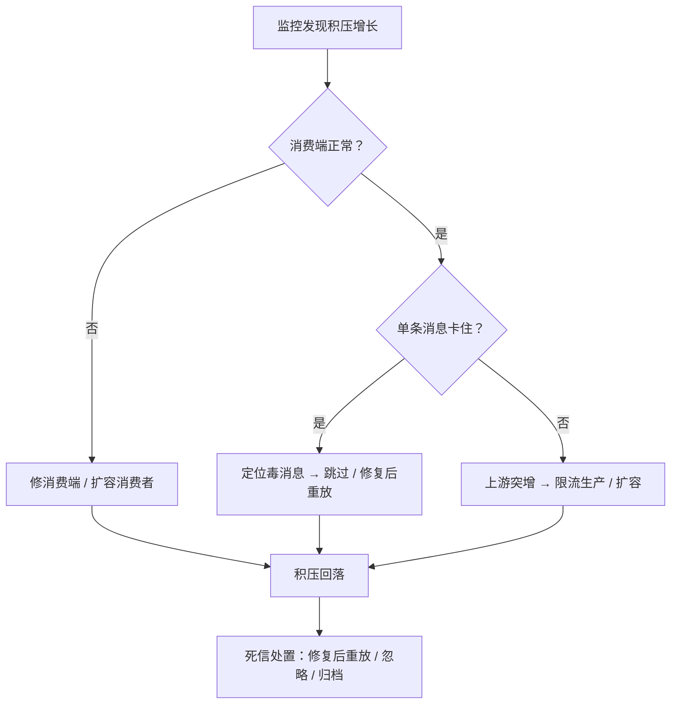

# 运维与可观测

> **状态说明（2026-11-13）**：RocketMQ 已从本平台下线，事件总线改用自研 `msg`；本文涉及 RocketMQ 的内容仅作技术参考，不代表当前实现。

> 指标 · 日志 · 链路追踪 · 管理台 · 积压与死信处置 · 告警设计

[文档首页](../../../文档首页.md) › [知识档案](../技术栈知识档案总览.md) › [消息与事件驱动总览](01_事件驱动_总览.md) › 运维与可观测

---

> **定位**：自研消息平台最容易「功能做完、运维没做」——上线后出问题只能重启。本篇明确「必须先用起来的运维能力」，并给出指标与处置流程的设计口径。

## 1. 为什么运维要先于功能 <a id="why"></a>

| 阶段 | 有运维 | 没有运维 |
| --- | --- | --- |
| 上线前 | 压测有数据、容量有依据 | 靠感觉扩容 |
| 出故障 | 看指标定位到分区 / 消费组 | 只能重启，重启后复发 |
| 数据不一致 | 按位点重放修复 | 人工改库，风险更高 |
| 容量规划 | 按增长率预测 | 等到磁盘满才发现 |

**结论**：**能看见积压、延迟、死信**，应该作为 8B_02 的验收项，而不是等到 8B_06。

## 2. 指标：四大黄金信号 + 消息特有 <a id="metrics"></a>

### 2.1 四大黄金信号（通用）

| 信号 | 消息平台上的含义 | 指标示例 |
| --- | --- | --- |
| 延迟（Latency） | 发布 → 被消费的端到端时间 | `publish_to_consume_ms`（直方图） |
| 流量（Traffic） | 每秒消息数 / 字节数 | `messages_in_total` / `bytes_in_total` |
| 错误（Errors） | 发布失败、消费失败、协议错误 | `publish_errors_total{reason}` |
| 饱和度（Saturation） | 磁盘、内存、连接、分区负载 | `disk_used_ratio` / `inflight_bytes` / `connections` |

### 2.2 消息平台特有

| 指标 | 定义 | 为什么重要 |
| --- | --- | --- |
| **积压（Lag）** | `LEO − committed_offset`（按分区） | 最直接的「消费跟不跟得上」 |
| ISR 收缩次数 | 副本掉出 ISR 的频率 | 预示复制不稳 |
| 未确认数（Inflight） | 已投递未 ack 的消息数 | 背压与重复消费的信号 |
| 重试次数 | 按原因分类 | 定位毒消息 |
| 死信增长 | 单位时间进 DLQ 的数量 | 业务或代码出问题的第一信号 |
| fsync 耗时 | 刷盘 P99 | 磁盘性能拐点 |
| 请求排队时间 | 从收到请求到开始处理 | 线程 / 协程池是否打满 |

### 2.3 指标类型选择

| 类型 | 用途 | 例子 |
| --- | --- | --- |
| Counter | 只增计数 | `messages_in_total` |
| Gauge | 瞬时值 | `lag`、`disk_used_bytes` |
| Histogram | 分布（算 P50 / P99） | `publish_latency_ms` |
| Summary | 客户端分位数 | 少用（不可聚合） |

**必须避免的低基数陷阱**：不要把 `topic` / `partition` / `consumer` 作为标签无限展开——标签基数爆炸会让监控系统先挂。做法是**核心指标按 topic 聚合，明细走管理台查询**。

## 3. 日志 <a id="logs"></a>

| 原则 | 做法 |
| --- | --- |
| 结构化 | JSON 或 key=value，便于检索 |
| 关联 | 每条日志带 `trace_id` / `message_id` / `topic` / `partition` / `offset` |
| 分级 | ERROR 只给「需要人处理」的；正常重试用 WARN / INFO |
| 采样 | 高频路径抽样，避免日志打满磁盘 |
| 脱敏 | payload 不落日志（可能是敏感数据）；只记长度与摘要 |
| 不刷屏 | 同类错误聚合（每分钟一条 + 计数） |

**消息平台最容易犯的日志错误**：把每条消息的收发都打 INFO，结果日志量是消息量的 10 倍。**正确做法是聚合指标 + 抽样日志**。

## 4. 链路追踪 <a id="tracing"></a>

消息链路的追踪比 RPC 难，因为**生产与消费是异步断开的**：


| 要点 | 说明 |
| --- | --- |
| trace 注入 | 消息头带 `trace_id` / `span_id` / `parent_span_id` |
| broker 不解包 | 只在头里透传，不影响零拷贝 |
| 消费者建 span | 消费动作作为新 span，parent 指向生产 span |
| 批量消费 | 一批消息可能来自多个 trace，需逐条记录 |
| 采样 | 全量采样成本高；按 trace 采样，保证同一条链路完整 |

**断链的常见原因**：生产者没注入、broker 丢了头、消费者没读取。三者任一断，链路就断在消息队列处——这也是为什么「消息队列是追踪黑洞」的说法存在。

## 5. 管理台 <a id="console"></a>

| 功能 | 最小可用 | 说明 |
| --- | --- | --- |
| 主题列表 | 主题、分区数、消息量、保留期 | 只读视图 |
| 消费组列表 | 组、成员数、积压、最后提交时间 | 排障第一入口 |
| 分区详情 | LEO、HW、ISR、积压 | 定位单分区问题 |
| 消息查询 | 按 offset / key / 时间查消息 | 需要索引支持 |
| 死信列表 | 死信、原因、重试次数 | 处置入口 |
| 重放 | 按 offset / 时间 / key 重放 | **必须限流** |
| 配额 | 租户 / topic 的限额与用量 | 多租户必备 |
| 操作审计 | 谁建了 / 删了 / 重放了 | 合规要求 |

**权限码建议**：`msg:query`（只读）与 `msg:manage`（写操作），与 bms 权限体系对齐。

**重放必须限流**：一次重放百万条会把消费端打挂，还会把 broker 带宽吃满。做法是「重放任务化」——建任务、限速、可暂停、可查看进度。

## 6. 告警设计 <a id="alert"></a>

| 级别 | 触发 | 通知 |
| --- | --- | --- |
| P0 | 全平台不可写 / 数据损坏 | 立即电话 |
| P1 | 单 topic 积压超阈值且持续增长 | 立即消息 |
| P2 | 死信快速增长 / ISR 频繁收缩 | 工作时间内处理 |
| P3 | 磁盘使用率接近高水位 | 日常巡检 |

**告警的三条纪律**：

1. **告警必须可行动**：不能行动的告警是噪音，会让人忽略真正的告警。
2. **必须有抑制**：一个根因引发的连锁告警要合并，不要一次发 50 条。
3. **必须有恢复通知**：只报「异常」不报「恢复」，值班的人不知道还要不要处理。

## 7. 积压与死信处置流程 <a id="dlq"></a>



| 场景 | 处置 |
| --- | --- |
| 消费端 bug | 修复 + 重放死信 |
| 消费端太慢 | 扩容消费者（受分区数限制）或优化处理 |
| 上游突增 | 限流生产 + 告警 |
| 毒消息（反序列化失败） | 跳过 + 记死信 + 人工修数据 |
| 顺序阻塞 | 单独隔离该 key，避免阻塞整分区 |

## 8. 容量与水位 <a id="capacity"></a>

| 水位 | 阈值（建议） | 动作 |
| --- | --- | --- |
| 磁盘低水位 | 70% | 告警，准备扩容 / 缩短保留期 |
| 磁盘高水位 | 85% | 拒绝新消息或只允许高优先级 |
| 内存 inflight | 配置上限 | 暂停推送 |
| 连接数 | 配置上限 | 拒绝新连接 |
| 分区数 | 单机上限 | 迁移分区 / 加节点 |

**容量估算的简单模型**：

```text
日增字节 = 每秒消息数 × 平均消息大小 × 86400
所需磁盘 = 日增字节 × 保留天数 × 副本数 × 1.3（索引与预留）
```

## 9. 业界对照 <a id="compare"></a>

| 实现 | 指标暴露 | 管理台 | 重放 |
| --- | --- | --- | --- |
| **Kafka** | JMX + 各类 exporter | 无官方 UI（第三方 CMAK / AKHQ） | 靠消费组位点重置 |
| **RocketMQ** | 内置 metrics + Prometheus | 有官方控制台（较老） | 支持按时间 / offset 重投 |
| **Pulsar** | Prometheus + Grafana 模板 | 有官方 Manager | 支持按消息 ID 重放 |
| **NATS JetStream** | `/varz` / `/jsz` + Prometheus | 无官方 UI | 支持按序号 / 时间 |

**共同缺口**：没有一家把「重放」做成好用的产品化能力——通常要写脚本。**自研时这是可以做出差异化的点**：任务化重放 + 进度 + 限速 + 可取消。

## 10. 对 msg 的设计约束 <a id="msg"></a>

| 决策点 | 建议 | 理由 |
| --- | --- | --- |
| 指标 | Prometheus 格式，核心按 topic 聚合 | 避免标签爆炸 |
| 日志 | 结构化 + 聚合，payload 不落日志 | 隐私与体积 |
| 追踪 | 消息头透传 trace，broker 不解包 | 保零拷贝 |
| 管理台 | 先做只读（主题 / 组 / 积压 / 死信），写操作后置 | 只读就能解决 80% 排障 |
| 重放 | 任务化 + 限速 + 可暂停 | 防止重放打挂消费端 |
| 告警 | 积压 / 死信 / ISR / 磁盘四类起步 | 覆盖主要故障 |
| 权限 | `msg:query` / `msg:manage` | 与 bms RBAC 对齐 |

## 11. 失败模式与自检 <a id="failure"></a>

| 失败模式 | 现象 | 防法 |
| --- | --- | --- |
| 只有日志没有指标 | 出事只能翻日志 | 指标先行 |
| 标签基数爆炸 | 监控系统被拖垮 | 核心聚合 + 明细走管理台 |
| 全量日志 | 磁盘被日志打满 | 聚合 + 采样 |
| 重放不限流 | 消费端被打挂 | 任务化 + 限速 |
| 告警不可行动 | 值班忽略告警 | 每条告警定义处置动作 |
| 无恢复通知 | 不知道是否已恢复 | 告警成对发送 |
| 管理台无审计 | 谁重放的说不清 | 操作留痕 |

## 12. 待实测 <a id="todo"></a>

| # | 事项 | 归属 |
| --- | --- | --- |
| 1 | 指标采集对 broker 吞吐的影响 | 8B_06 |
| 2 | 亿级 offset 下的管理台查询响应 | 8B_06 |
| 3 | 重放限速参数与消费端承受能力 | 8B_06 |
| 4 | 全链路追踪在批量消费下的实现 | 8B_06 |

## 13. 参考 <a id="refs"></a>

- Google SRE Book：Monitoring Distributed Systems（四大黄金信号）
- Prometheus 官方文档：Metric types / Naming best practices
- OpenTelemetry 规范：Trace / Span / Context Propagation
- Kafka 官方文档：Monitoring（JMX 指标清单）
- Apache Pulsar：Metrics / Pulsar Manager
- RocketMQ：监控与告警

---

> 依《[文档生成规范](../../../规范/文档生成规范.md)》编写
