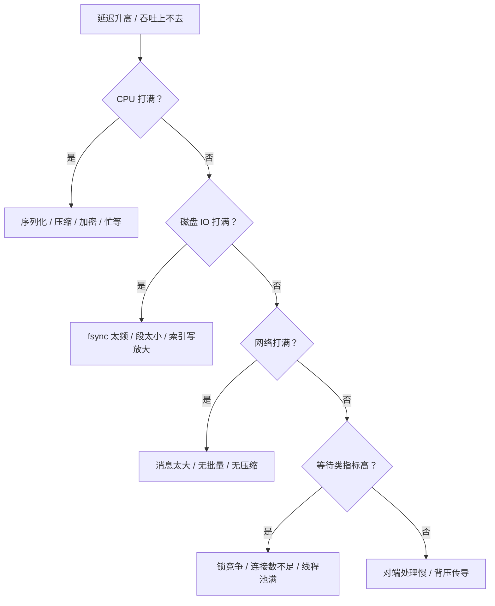

# 压测与容量规划

> 压测类型 · 指标定义 · 瓶颈定位 · 容量模型 · 故障演练

[文档首页](../../../文档首页.md) › [知识档案](../技术栈知识档案总览.md) › [消息与事件驱动总览](01_事件驱动_总览.md) › 压测与容量规划

---

> **定位**：压测不是「跑个数字发朋友圈」，而是回答三个问题：**能扛多少、瓶颈在哪、坏了会怎样**。本篇给出方法论与判据，是 8B_01 / 8B_12 的执行依据。

## 1. 压测要回答的三个问题 <a id="why"></a>

| 问题 | 需要的测试 | 输出 |
| --- | --- | --- |
| 能扛多少 | 容量测试（逐步加压到拐点） | 最大吞吐、拐点位置、P99 曲线 |
| 瓶颈在哪 | 分项拆解（CPU / IO / 网络 / 锁） | 瓶颈部件与优化优先级 |
| 坏了会怎样 | 故障演练（杀进程 / 断网 / 磁盘满） | 恢复时间、数据是否丢、是否自动恢复 |

**没有第三项，压测结论是不完整的**：一个「顶配机器跑出高吞吐」的系统，可能在磁盘满时直接崩溃。

## 2. 五类压测 <a id="types"></a>

| 类型 | 目的 | 做法 | 判据 |
| --- | --- | --- | --- |
| **基准（benchmark）** | 建立基线 | 固定负载跑固定时长 | 可重复、方差小 |
| **负载（load）** | 验证预期峰值 | 按设计峰值跑 1~2 小时 | 延迟与错误率达标 |
| **压力（stress）** | 找拐点 | 逐步加压直到延迟飙升 / 报错 | 找到拐点并解释原因 |
| **稳定性（soak）** | 发现泄漏 | 中低负载跑 8~24 小时 | 内存 / 句柄 / 磁盘不持续增长 |
| **故障演练（chaos）** | 验证恢复 | 注入故障 | 恢复时间与数据完整性 |

**顺序不能乱**：先基准、再负载、再压力。没有基准的「压力测试」结论无法复现。

## 3. 指标定义 <a id="metrics"></a>

| 指标 | 定义 | 注意 |
| --- | --- | --- |
| 吞吐 | 每秒成功处理的消息数（不是发送数） | 要区分「发出」与「被确认」 |
| 延迟 | 端到端（发布 → 被消费 ack） | 必须看分位，不能只看平均 |
| P50 / P95 / P99 | 分位延迟 | P99 才是用户感知的「卡」 |
| 错误率 | 失败数 / 总数 | 要按原因分类 |
| 资源 | CPU / 内存 / 磁盘 IO / 网络 | 记录峰值与均值 |
| 积压 | 压测结束时未消费数 | 反映是否真的「消化」了 |
| GC / 协程数 | 运行时指标 | Python 看协程与事件循环延迟 |

**平均值陷阱**：平均延迟 10ms 但 P99 是 2s，用户感受到的是 2s。**必须报分位数**。

**吞吐陷阱**：「发送 10 万条/秒」不等于「处理 10 万条/秒」。若消费端只处理 5 万，另一半在积压——这不叫吞吐，叫堆积。

## 4. 压测方法论 <a id="method"></a>

| 步骤 | 要点 |
| --- | --- |
| 1 固定环境 | 同一台机器、同一 Python 版本、同一依赖、关闭无关进程 |
| 2 预热（warmup） | 先跑 10%~20% 的量，让缓存、连接池、JIT（如有）稳定 |
| 3 逐步加压 | 从低到高，每档稳定运行后再进下一档 |
| 4 多次取中位 | 每档至少 3 次，报中位数与方差 |
| 5 记录全量 | 吞吐、延迟分位、资源、配置、代码版本 |
| 6 单变量 | 一次只改一个参数（fsync、批量大小、分区数） |

**必须避免的四种污染**：

1. **压测客户端成为瓶颈**：客户端自己跑满 CPU，测的是客户端不是服务端。
2. **数据量太小**：只测 1 万条，缓存全命中，看不出真实 IO。
3. **未清理上次数据**：磁盘已有大量旧段，影响写入。
4. **环境不干净**：后台任务、其他进程抢资源。

## 5. 瓶颈定位 <a id="bottleneck"></a>



| 现象 | 常见根因 |
| --- | --- |
| CPU 高但吞吐低 | 单条处理开销大（JSON、逐条 fsync、锁） |
| IO 等待高 | fsync 每条形、段太小、索引稠密 |
| 延迟随并发线性上升 | 队列排队（处理能力不足） |
| 延迟抖动大 | GC / 事件循环阻塞 / 磁盘抖动 |
| 吞吐先升后降 | 锁竞争或上下文切换开销 |

**Python 特有**：GIL 让 CPU 密集任务无法多核并行；asyncio 的事件循环若被同步调用阻塞，所有协程一起卡。定位要看「事件循环延迟」而不是只看 CPU。

## 6. 容量模型 <a id="capacity"></a>

```text
单机最大吞吐 ≈ min(CPU 上限, 磁盘带宽上限, 网络带宽上限) × 安全系数

磁盘需求 = 日增字节 × 保留天数 × 副本数 × 1.3（索引与预留）
日增字节 = 峰值 msg/s × 平均消息大小 × 86400 × 峰值占比
分区数   = 峰值消费并行度 × 1.5 ~ 2
节点数   = 峰值吞吐 / 单机安全吞吐 × 1.5（冗余）
```

**安全系数怎么定**：

| 场景 | 系数 | 理由 |
| --- | --- | --- |
| 有自动扩容 | 1.2~1.3 | 能快速补 |
| 手动扩容 | 1.5~2.0 | 扩容要时间 |
| 无复制 | 2.0+ | 单点，不敢跑满 |

**容量规划必须留「故障余量」**：N 台机器里坏 1 台，剩下的要能扛住全量。这意味着一开始就要按「N−1」设计，而不是按 N 设计。

## 7. 故障演练 <a id="chaos"></a>

| 故障 | 注入方式 | 观察点 | 期望 |
| --- | --- | --- | --- |
| 进程崩溃 | kill -9 | 恢复时间、是否丢已 ack 消息 | 不丢已确认，未确认可重投 |
| 磁盘满 | 填满数据目录 | 是否拒绝写、是否可恢复 | 高水位拒绝写，清理后恢复 |
| 慢盘 | 限制 IO 带宽 | 延迟、fsync 耗时 | 延迟上升但不丢 |
| 网络分区 | 防火墙 / tc | 脑裂、选主 | 少数派不可写，多数派继续 |
| 消费者卡死 | 暂停消费进程 | 积压、背压 | 积压上涨但不影响生产 |
| 毒消息 | 发非法 payload | 是否阻塞分区 | 进死信，不阻塞后续 |

**演练必须可重复**：写成脚本，每次发版前跑一遍。手工演练一次就忘的，等于没做。

## 8. 常见压测错误 <a id="mistakes"></a>

| 错误 | 后果 | 正确做法 |
| --- | --- | --- |
| 只报平均延迟 | 掩盖长尾 | 报 P50 / P95 / P99 |
| 只测发送不测消费 | 掩盖积压 | 端到端测 |
| 客户端与服务端同机 | 争抢资源 | 分离部署 |
| 数据量太小 | 全内存命中 | 数据量 ≥ 内存的 1.5 倍 |
| 只跑一次 | 结论不可信 | 至少 3 次取中位 |
| 无 warmup | 前几秒数据失真 | 预热后开始统计 |
| 改多个参数 | 无法归因 | 单变量 |
| 不记录配置 | 无法复现 | 记录版本、配置、环境 |

## 9. 业界对照 <a id="compare"></a>

| 工具 | 类型 | 适用 |
| --- | --- | --- |
| **k6** | 脚本化负载 | HTTP / WebSocket，脚本用 JS |
| **wrk / wrk2** | HTTP 压测 | 高并发 HTTP，wrk2 支持恒定速率 |
| **JMeter** | 图形化 | 复杂场景，资源占用高 |
| **Locust** | Python 脚本 | 与 bms 技术栈一致，易写自定义协议 |
| **自研压测客户端** | 自定义协议 | HTTP/2 + MessagePack 场景最贴合 |
| **chaosblade / toxiproxy** | 故障注入 | 网络延迟、丢包、磁盘 |

**msg 的建议**：**自研压测客户端**（复用协议代码）+ **Locust 做对照** + **toxiproxy 做故障注入**。因为 8B_01 用的是 h2c + MessagePack，通用工具测不了。

## 10. 对 msg 的设计约束 <a id="msg"></a>

| 决策点 | 建议 | 理由 |
| --- | --- | --- |
| 基准对比 | HTTP/2 + MessagePack vs HTTP/1.1 + JSON（同逻辑） | 8B_01 的 go/no-go 依据 |
| 消息大小 | 至少测 1KB / 10KB / 100KB 三档 | 大消息走不同路径 |
| fsync 策略 | 0 / 按批 / 每条 三档对比 | 决定默认策略 |
| 客户端部署 | 与服务端分离 | 避免争抢 |
| 故障演练 | 崩溃 / 磁盘满 / 慢盘 三类起步 | 覆盖最常见故障 |
| 容量模型 | 按 N−1 设计 | 留故障余量 |
| 记录 | 版本 + 配置 + 环境 + 原始数据 | 可复现 |

**8B_01 的通过判据**（设计口径）：吞吐 ≥ 基线 1.5 倍、P99 ≤ 基线 0.7 倍、重启恢复不丢已确认、10k 条无崩溃。这些数字需要在真实环境中确认后写进测试记录，不写进知识层。

## 11. 待实测 <a id="todo"></a>

| # | 事项 | 归属 |
| --- | --- | --- |
| 1 | HTTP/2 + MessagePack vs HTTP/1.1 + JSON 的完整对比 | 8B_01 |
| 2 | fsync 三档策略的吞吐 / P99 曲线 | 8B_01 / 8B_12 |
| 3 | 单机 Python broker 的最大吞吐拐点 | 8B_12 |
| 4 | 磁盘满 / 慢盘下的行为与恢复 | 8B_12 |
| 5 | 24 小时稳定性（内存 / 句柄） | 8B_12 |

## 12. 参考 <a id="refs"></a>

- Google SRE Book：Load Balancing / Handling Overload
- k6 / wrk / Locust 官方文档
- chaosblade / toxiproxy 文档
- Kafka 官方文档：Performance（基准方法与结果口径）
- 《Systems Performance》（Brendan Gregg）：USE 方法（Utilization / Saturation / Errors）

---

> 依《[文档生成规范](../../../规范/文档生成规范.md)》编写
