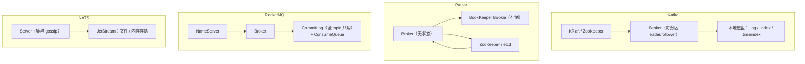

# 开源实现对照

> Kafka · Pulsar · RocketMQ · NATS 的存储 / 复制 / 消费 / 协议逐项拆解与取舍

[文档首页](../../../文档首页.md) › [知识档案](../技术栈知识档案总览.md) › [消息与事件驱动总览](01_事件驱动_总览.md) › 开源实现对照

---

> **定位**：自研不是闭门造车。本篇把四家成熟实现的**核心设计与代价**横向摆开，用于在 8B 各阶段「抄对地方、避开它们的坑」。**不评价优劣**，只看「什么场景适合什么取舍」。

## 1. 四家的定位差异 

| 实现 | 出身 | 核心定位 | 一句话 |
| --- | --- | --- | --- |
| **Kafka** | LinkedIn | 高吞吐分布式日志 | 分区日志 + ISR，流处理生态最完整 |
| **Pulsar** | Yahoo | 多租户消息 + 流 | 计算存储分离，BookKeeper 承载存储 |
| **RocketMQ** | 阿里 | 电商交易消息 | CommitLog + ConsumeQueue，事务消息最实用 |
| **NATS** | Apcera / CNCF | 轻量云原生消息 | 极简协议 + JetStream 持久化 |

## 2. 整体架构 

| 特征 | Kafka | Pulsar | RocketMQ | NATS |
| --- | --- | --- | --- | --- |
| 存储与计算 | 一体 | **分离**（BookKeeper） | 一体 | 一体 |
| 元数据组件 | KRaft（新）/ ZK（旧） | ZK / etcd | NameServer（无状态） | 内置 gossip |
| 扩容存储 | 加 broker + 迁移分区 | **加 bookie，无需迁移** | 加 broker | 加 server |

**最大差异是「计算存储是否分离」**：

- 一体架构（Kafka / RocketMQ / NATS）：扩容要搬数据，但延迟低、部署简单。
- 分离架构（Pulsar）：存储独立扩容，但多一层网络往返与运维组件。

## 3. 存储设计对照 

| 维度 | Kafka | Pulsar | RocketMQ | NATS JetStream |
| --- | --- | --- | --- | --- |
| 日志组织 | 每分区一组 segment | Segment 存 BookKeeper（ledger） | **全 broker 一个 CommitLog**（1GB 定长） | 每 stream 一组文件 |
| 索引 | 稀疏 `.index` + `.timeindex` | Ledger 元数据 + 游标 | ConsumeQueue（20 字节定长条目）+ IndexFile（按 key 哈希） | 文件内索引 |
| 删除 | 按段删除 | 按 ledger 删除 | 按文件过期删除（默认 72h） | 按 retention policy |
| 压缩 | compaction | compaction / 分层存储 | 不支持 compaction | 有限 |
| 零拷贝 | `sendfile` | 经 BookKeeper，较难 | `mmap` + 堆外 | 未强调 |

**三种存储哲学**：

1. **Kafka：分区自治**。每个分区独立目录，删除、迁移、限流都以分区为单位。缺点是分区多了文件句柄与元数据压力大。
2. **RocketMQ：写集中、读分散**。所有 topic 顺序写同一个 CommitLog（写放大最小），ConsumeQueue 做轻量索引。缺点是 CommitLog 成为单点热点，删除粒度粗。
3. **Pulsar：存储下沉**。Broker 无状态，BookKeeper 负责多副本。缺点是写路径长（Broker → Bookie），延迟略高。

**对自研的启示**：**首期选 Kafka 式「每分区一组文件」**——删除、隔离、迁移都简单，符合单机先行的路线。CommitLog 式写集中适合「topic 极多、单条极小」的场景，但删除与隔离复杂。

## 4. 复制对照 

| 维度 | Kafka | Pulsar | RocketMQ | NATS |
| --- | --- | --- | --- | --- |
| 模型 | leader + ISR（半同步） | BookKeeper ensemble（多数派） | 主从（同步 / 异步可配） | Raft（stream 级） |
| 选主 | Controller / KRaft | Bookie 自动 | 4.x 无自动；5.x Controller | Raft 选举 |
| 一致性 | HW 之前不丢 | 多数派写入即提交 | 取决于同步配置 | 强一致 |
| 副本数 | 可配（常 3） | 默认 3 | 主从 2 | 可配（常 3 / 5） |

**取舍**：

- ISR 式（Kafka）：吞吐高，但「哪些副本算同步」靠超时判断，存在误判窗口。
- 多数派式（Pulsar / NATS）：一致性强，但写入要等多数派，延迟更高。
- 主从式（RocketMQ 4.x）：简单，但无自动选主，故障要人工介入。

## 5. 消费模型对照 

| 维度 | Kafka | Pulsar | RocketMQ | NATS |
| --- | --- | --- | --- | --- |
| 消费单位 | consumer group | subscription（4 种） | 集群 / 广播消费 | consumer（push / pull） |
| 位点存储 | `__consumer_offsets` | cursor（BookKeeper） | Broker 端 offset 表 | 消费端 ack 状态 |
| 再均衡 | 客户端主导（经典）/ 服务端（KIP-848） | 服务端主导 | 客户端定时重平衡 | 服务端 |
| 顺序 | 分区有序 | 分区有序；key_shared 按键 | 队列有序（顺序消费加锁） | 单 subject 有序 |
| 重试 | 无原生；靠应用 | 原生 retry topic + DLQ | 原生重试 topic + DLQ | `MaxDeliver` + DLQ |

**Pulsar 的 subscription 类型最灵活**：exclusive（独占）、shared（共享）、failover（主备）、key_shared（按键分组）。**RocketMQ 的重试与死信最实用**：原生 retry topic，不需要应用自己实现。

**对自研的启示**：**先做 shared（组内分摊）**，覆盖 90% 场景；retry / DLQ 做成内建能力，不要留给应用。

## 6. 协议对照 

| 维度 | Kafka | Pulsar | RocketMQ | NATS |
| --- | --- | --- | --- | --- |
| 传输 | 自定义 TCP 二进制 | 自定义 TCP（Protobuf） | 自定义 TCP（RemotingCommand） | 文本协议（可二进制） |
| 多路复用 | 否（一连接串行） | 是（请求 ID） | 是（请求 ID） | 是（subject） |
| 序列化 | 用户自定义（字节） | Protobuf（命令）+ 用户字节 | JSON-like 头 + 字节体 | 文本 + 字节 |
| 契约 | 无强契约 | Protobuf | 无强契约 | 无强契约 |
| 版本演进 | API version 协商 | Protobuf 兼容规则 | 版本字段 | 客户端 / 服务端协商 |

**为什么四家都不用 HTTP/2**：它们大多定型于 HTTP/2 普及之前，且自定义协议在高吞吐下开销更低。**但 HTTP/2 的优势在「复用现有基础设施」**——这是 msg 选它的理由，不是因为它「更快」。

## 7. 运维对照 

| 维度 | Kafka | Pulsar | RocketMQ | NATS |
| --- | --- | --- | --- | --- |
| 部署复杂度 | 中（ZK / KRaft） | **高**（Broker + Bookie + ZK） | 中（NameServer + Broker） | **低**（单二进制） |
| 管理台 | 无官方（第三方） | Pulsar Manager | 官方控制台 | 无官方 |
| 指标 | JMX + exporter | Prometheus 原生 | Prometheus | `/varz` / `/jsz` |
| 扩缩容 | 分区迁移（较重） | 存储独立扩 | 分区迁移 | 轻 |

**运维复杂度排序（低 → 高）**：NATS < Kafka ≈ RocketMQ < Pulsar。

这也解释了为什么「单人运维」场景下，Pulsar 的分离架构虽然优雅，但落地成本最高。

## 8. 四家的典型取舍 

| 实现 | 最值得学的 | 最容易踩的坑 |
| --- | --- | --- |
| **Kafka** | 分区日志 + 稀疏索引 + 零拷贝 + ISR | 分区数过多导致元数据与再均衡压力；无原生重试 / DLQ |
| **Pulsar** | 计算存储分离 + 三级多租户 + 四种订阅 | 组件多、运维重；写路径长导致延迟略高 |
| **RocketMQ** | CommitLog 写集中 + 事务消息 + 原生重试 | 无自动选主（4.x）；CommitLog 删除粒度粗 |
| **NATS** | 极简协议 + 低运维 + account 隔离 | 功能相对少；持久化能力弱于前三家 |

## 9. 对 msg 的取舍结论 

| 能力 | 抄谁 | 理由 |
| --- | --- | --- |
| 存储 | Kafka（每分区一组文件 + 稀疏索引） | 删除 / 隔离 / 迁移简单，单机先行 |
| 复制 | Kafka ISR 式半同步（后置） | 吞吐优先，与现有事件量匹配 |
| 消费组 | 服务端主导 + 粘性分配 | 客户端与 broker 同源，无需兼容多版本 |
| 重试 / 死信 | RocketMQ（原生内置） | 不要把重试甩给应用 |
| 多租户 | Pulsar（租户 / 命名空间 / 主题三级） | 预留租户内业务线划分 |
| 协议 | 不抄（HTTP/2 + MessagePack） | 复用现有网关与生态，PoC 可控 |
| 运维 | NATS（极简） | 单人运维，越少组件越好 |

**一句话**：**存储学 Kafka、重试学 RocketMQ、租户学 Pulsar、运维学 NATS、协议自己做**。

## 10. 参考 

- Kafka 官方文档：Design / Implementation / Protocol
- Apache Pulsar：Architecture Overview / Messaging
- Apache RocketMQ：Design / 事务消息 / 重试与死信
- NATS：JetStream / Protocol / Accounts
- 《Kafka: a Distributed Messaging System for Log Processing》（LinkedIn 论文）
- 《Apache Pulsar: A Cloud-Native Messaging System》（Yahoo 论文）

---

> 依《[文档生成规范](../../../规范/文档生成规范.md)》编写
