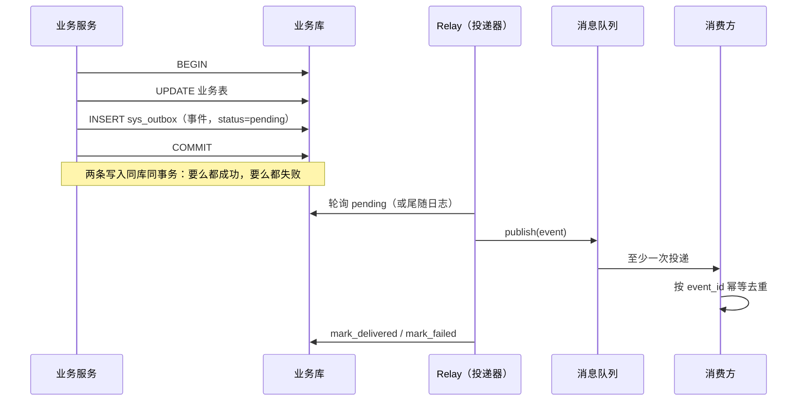

# 事务性发件箱（Outbox）

> 同库同事务 · relay 投递 · 幂等与死信 · 「不要求一库一服务」的边界澄清

[文档首页](../../../文档首页.md) › [知识档案](../技术栈知识档案总览.md) › [消息与事件驱动总览](01_事件驱动_总览.md) › 事务性发件箱

---

> **定位**：本篇讲清 Outbox 模式的**硬前提、实现要点与边界**。默认口径以平台《架构设计 · 服务间通信与一致性》为准；本篇只做知识展开与现状对照。

## 1. 原理：把「发消息」变成「写一张本地表」 

Outbox 的核心不是「多一张表」，而是**把两个资源的选择题，变成一次本地事务**：

由此得到两条保证：

- **业务提交 ⇒ 事件已入账**（不会「库改了、消息没发」）；
- **业务回滚 ⇒ 事件不存在**（不会「消息发了、业务没改」）。

代价是「至少一次」：relay 可能在「发送成功、标记失败」之间崩溃，重启后重发；所以消费方必须幂等。

## 2. 硬前提与常见误解 

### 2.1 唯一的硬前提：同库、同一本地事务

- outbox 表必须与业务表在**同一个数据库**；
- outbox 行的插入必须与业务变更在**同一个本地事务**里提交；
- relay 可以是独立进程 / 后台任务，但它只读这个库。

### 2.2 不要求「一库一服务」

这是最常见的误解。**Outbox 模式本身不要求每个服务一个数据库**：

- microservices.io 的参与者只有 Sender、Database（业务实体 + outbox）、Message outbox、Message relay；
- Debezium 的示例也只要求 outbox 表在「服务的数据库」里，与业务变更同事务。

多个服务共用一个物理库时，只要满足下面任一条，Outbox 仍然成立：

| 共库隔离方式 | 做法 | 优点 | 代价 |
| --- | --- | --- | --- |
| 每服务独立表名 | `platform_outbox` / `audit_outbox` | 简单、无 schema 变更、relay 各扫各表 | 表名要参数化，DDL/对账/文档同步 |
| 共享表 + `producer` 列 | 一张 `outbox`，relay 按 `producer = 本服务` 过滤 | 表结构统一、扩展新服务零建表 | 所有查询/清理/死信带 producer 条件；单表容易膨胀 |
| 独立 schema / 独立库 | PG/DM schema 或 MySQL 库 | 隔离最彻底 | 跨方言、迁移与运维成本 |

> **BMS 的现状**：`sys_outbox` 表名写死，靠「每服务独立库」天然隔离。这不是 Outbox 模式的要求，而是实现假设；共库时会撞名。修法很轻（表名参数化或 `producer` 列），不需要重做事件总线。

## 3. 表结构与索引（BMS 现状） 

字段唯一事实源为表文件，本节只列设计要点：

| 表 | 作用 | 表文件 |
| --- | --- | --- |
| `sys_outbox` | 事务性发件箱（待投递事件账本） | 平台《sys_outbox》表文件 |
| `sys_event_consumed` | 消费幂等账本（`consumer + event_id` 唯一） | 平台《sys_event_consumed》表文件 |
| `sys_event_dead_letter` | 死信看板（投递 / 消费失败待处置） | 平台《sys_event_dead_letter》表文件 |

`sys_outbox` 的关键列：

| 列 | 作用 |
| --- | --- |
| `event_id` | 事件幂等键（唯一约束） |
| `event_type` / `event_version` | 事件契约类型与版本 |
| `aggregate_key` | 聚合 / 分区键；同聚合按 `id` 顺序投递 |
| `tenant_id` / `trace_id` | 租户与链路追踪 |
| `payload` / `occurred_at` | 事件负载与发生时间 |
| `status` | `pending` / `delivered` / `dead` |
| `retry_count` / `next_retry_at` / `error_msg` | 重试与排障 |
| `delivered_at` | 投递成功时间 |

设计要点：

- **行不作软删除**：基础设施账本要求跨方言严格唯一，唯一约束不并入 `deleted_at`（MySQL / PG / SQLite 对复合唯一中的 NULL 视作互异）。
- **同聚合有序**：`(aggregate_key, id)` 索引；relay 取待投递时同聚合只取队首。
- **消费幂等**：`sys_event_consumed` 的 `(consumer, event_id)` 唯一约束，消费副作用与幂等记录同事务写入。

## 4. Relay：轮询 vs 日志尾随 

| 形态 | 原理 | 优点 | 代价 | BMS 现状 |
| --- | --- | --- | --- | --- |
| **轮询（Polling Publisher）** | 定时查 `status=pending` 的行，逐条 publish | 实现简单、方言无关、可移植 | 有轮询延迟；高并发需行锁 / 租约防重复抢 | **已采用**（`PollOutboxDispatcher`） |
| **日志尾随（Log Tailing / CDC）** | 读数据库事务日志，按提交顺序捕获 outbox 插入 | 近实时、对业务库压力小 | 需 Debezium / binlog 组件；方言差异大 | 未采用（达梦无 Debezium connector） |

BMS 的 `PollOutboxDispatcher`：

- `dispatch_once(db_key)`：开该库事务 → `claim_pending`（同聚合队首、到期者）→ 逐条 `EventPublisher.publish` → 成功 `mark_delivered`、失败 `mark_failed`（指数退避，超限转死信）→ 提交。
- `dispatch_due()`：遍历目标库键（显式 `db_keys` 或引擎注册表活跃键），单库异常隔离。
- `setup()` 在 `[outbox].enabled = true` 时启动后台轮询；`aclose()` 取消并等待。
- 指标：`bms_outbox_backlog`（积压）、`bms_outbox_delivery_total`（投递计数）。

**已知开放项**（01_01 实施记录）：多实例同时轮询时，`claim_pending` 没有 `FOR UPDATE SKIP LOCKED` / 租约列，可能重复抢批；当前靠「消费端幂等」兜底效果，但会放大无效投递。达梦是否支持 `SKIP LOCKED` 仍待实测（《[微服务 · 12 选型对比](../微服务/12_微服务_选型对比.md)》待实测 #3）。

## 5. 幂等、重放与死信 

### 5.1 消费幂等

- 消费方在处理业务副作用前，先写 `sys_event_consumed(consumer, event_id)`；
- 与业务副作用**同事务**提交；命中唯一键即跳过；
- 这样即使 relay 重复投递，业务效果仍是一次。

### 5.2 重放

`BaseOutboxStore.replay()` 把 `delivered` / `dead` 的行重置为 `pending`，支持按 `event_id` / `event_type` / `aggregate_key` / `since` / `limit` 筛选。适用场景：

- 下游新增消费方，需要补历史事件；
- 消费逻辑修复后，重放失败事件；
- 排障时复现某条事件。

> 重放会再次触发消费，消费方必须继续幂等；否则会重复产生副作用。

### 5.3 死信

- 投递失败超限（`max_retries`）→ `status=dead`，并插入 `sys_event_dead_letter`；
- 消费失败超限 → 同一张死信看板（`source=consumer`）；
- 死信状态：`pending`（待处置）/ `replayed`（已重投）/ `ignored`（已忽略）；
- 运维入口：死信列表、详情、重投、忽略。

## 6. 何时不该用 Outbox 

Outbox 不是银弹，下列场景可以不使用或不应使用：

| 场景 | 建议 | 原因 |
| --- | --- | --- |
| 事件丢了也无所谓（指标、缓存失效、非关键通知） | 直接发布 + 重试 / 对账 | Outbox 的表与 relay 是额外成本 |
| 需要「省掉 outbox 表与投递器」且能接受绑定 RocketMQ | [15 事务消息](15_事件驱动_事务消息.md) | 半消息 + 回查替代 outbox |
| 数据库写放大敏感、事件量极大 | CDC 尾随业务表 / 事务消息 | outbox 每事件多一次 insert |
| 需要全局严格有序（跨聚合） | 重新设计分区键或单分区 | Outbox 只保证同聚合有序 |
| 业务不在本地库（纯外部 API 写入） | 无本地事务可用，Outbox 不适用 | 没有「同库同事务」的前提 |

## 7. BMS 现状与迁移提示 

- **已交付**：01_01（outbox + 投递器 + 幂等 + 死信 + 指标）；06_01 的审计事件已接入 `audit-chain` 有序组。
- **表名写死**：`sys_outbox` / `sys_event_consumed` / `sys_event_dead_letter` 固定表名；共库时需参数化或加 `producer` 列。
- **多实例投递**：无行锁 / 租约，属开放项；扩容前需补（15_01 容量与延迟）。
- **审计发射**：`AuditEventEmitter` 用平台库短事务写 outbox，失败只告警，不影响业务；这是「审计不阻断业务」的实现基础。
- **迁移到事务消息时**：操作 / 登录审计发生在响应之后，没有业务行可作为回查依据，需要保留审计暂存表或接受 best-effort（详见 [15 事务消息](15_事件驱动_事务消息.md) §5）。

## 8. 在消息平台（L3）中的位置 

2026-11 决策为「自研消息平台 L3（msg 产品）」后，Outbox 不是被淘汰，而是**角色收窄**：

| 阶段 | Outbox 的角色 | 迁移动作 |
| --- | --- | --- |
| 现状 | 事件投递的**唯一**可靠通道（outbox → relay → RocketMQ） | — |
| 过渡 | 业务侧仍「同库同事务写 outbox」，relay 换成 msg 客户端 | 只换 `EventPublisher` 实现，业务代码不改 |
| 目标 | outbox 表由 msg 的 connector 扫描，或改用 msg 事务消息 | 见 8B_04「可靠性与事务」 |

三种可选形态：

1. **outbox 表保留 + relay 换 msg 客户端**（改动最小）：业务侧不变，只把 `PollOutboxDispatcher` 的发布目标从 RocketMQ 换成 msg。**推荐作为first step**。
2. **outbox 表保留 + msg connector 扫描**（对齐 Debezium 思路）：msg 侧提供 outbox connector，读业务库 outbox 表直接投递；业务侧连 relay 都不用自己跑。
3. **改用 msg 事务消息**（绑定平台）：业务直接调 msg 的半消息 + 回查；前提是 msg 的事务消息能力成熟（8B_04），且业务有可回查的本地行。

**不变的两条底线**：无论哪种形态，「至少一次 + 消费端幂等」不变；「业务提交 ⇒ 事件一定可投递」不变。变的只是「投递由谁驱动」。

> 平台侧日志存储、位点与重放能力见 [03 存储引擎](03_事件驱动_存储引擎.md) 与 [05 消费组与再均衡](05_事件驱动_消费组与再均衡.md)；投递语义的完整定义见 [02 消息模型与语义](02_事件驱动_消息模型与语义.md)。

## 9. 参考资源 

| 资源 | 网址 | 说明 |
| --- | --- | --- |
| microservices.io：Transactional Outbox | https://microservices.io/patterns/data/transactional-outbox.html | 模式定义与参与者 |
| microservices.io：Polling Publisher | https://microservices.io/patterns/data/polling-publisher.html | 轮询 relay |
| microservices.io：Transaction Log Tailing | https://microservices.io/patterns/data/transaction-log-tailing.html | 日志尾随 relay |
| Debezium：Outbox Pattern | https://debezium.io/blog/2019/02/19/reliable-microservices-data-exchange-with-the-outbox-pattern/ | 表结构与 relay 实现 |
| 本项目 01_01 实施记录 | 平台《01_01 事件总线》实施记录（现状、开放项与验证结论） |

## 10. 项目内关联文档 

| 文档 | 说明 |
| --- | --- |
| [01 总览](01_事件驱动_总览.md) | 三层地图与阅读路径 |
| [02 消息模型与语义](02_事件驱动_消息模型与语义.md) | 投递语义与顺序性的定义 |
| [03 存储引擎](03_事件驱动_存储引擎.md) | 平台侧日志存储与崩溃恢复 |
| [15 事务消息](15_事件驱动_事务消息.md) | 不用 outbox 表的替代方案 |
| [16 CDC 与日志尾随](16_事件驱动_CDC与日志尾随.md) | 日志尾随式 relay 的工程实现 |
| [18 选型对比（BMS）](18_事件驱动_选型对比（BMS）.md) | 何时保留、何时替换 |
| [分布式事务 · 总览](../分布式事务/01_分布式事务_总览.md) | 跨服务写与事件投递的边界 |

---

> 依《[文档生成规范](../../../规范/文档生成规范.md)》编写
