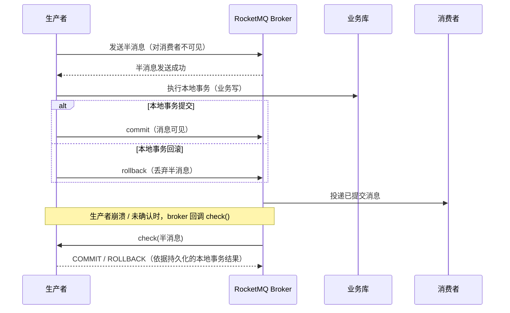

# 事务消息（RocketMQ）

> 半消息 · 本地事务 · 提交/回滚 · 回查 · 不用 outbox 表的替代方案

[文档首页](../../../文档首页.md) › [知识档案](../技术栈知识档案总览.md) › [消息与事件驱动总览](01_事件驱动_总览.md) › 事务消息

---

> **定位**：本篇讲清 RocketMQ 事务消息的机制、Python 5.x 客户端的可用性、与 Outbox 的取舍，以及 BMS 落地时必须先解决的「回查依据」问题。

## 1. 机制：半消息 + 本地事务 + 回查 <a id="mechanism"></a>

RocketMQ 事务消息把「发消息」拆成两阶段，使**本地事务结果**决定消息是否对消费者可见：



关键点：

- **半消息**对消费者不可见，避免「消息先到、本地事务还没提交」；
- **本地事务**由生产者执行，通常是业务库写；
- **回查（check）**是兜底：生产者崩溃后，broker 必须能问到一个**持久化**的本地事务结果，否则无法判定提交或回滚；
- 事务消息仍然可能重复投递，消费端仍需幂等。

## 2. RocketMQ 5.x Python 客户端支持 <a id="python"></a>

Apache `rocketmq-clients` 的 Python 5.x SDK 提供了事务消息示例（`python/example/transaction_producer_example.py`）：

```python
from rocketmq import (
    ClientConfiguration,
    Credentials,
    Message,
    Producer,
    TransactionChecker,
    TransactionResolution,
)


class TestChecker(TransactionChecker):
    def check(self, message: Message) -> TransactionResolution:
        # 依据持久化的本地事务结果判定
        return TransactionResolution.COMMIT


config = ClientConfiguration("broker-proxy:8081", Credentials())
producer = Producer(config, ("topic",), checker=TestChecker())
producer.startup()

transaction = producer.begin_transaction()
msg = Message()
msg.topic = "topic"
msg.body = b"hello, rocketmq."
producer.send(msg, transaction)
transaction.commit()      # 或 transaction.rollback()
producer.shutdown()
```

事实核对：

| 事实 | 结论 |
| --- | --- |
| 项目当前客户端 | 5.x gRPC（`rocketmq-python-client`，模块名 `rocketmq`） |
| 5.x Python 是否支持事务消息 | **支持**（官方示例含 `Producer(..., checker=...)`、`begin_transaction`、`send(msg, transaction)`、`commit/rollback`、`TransactionChecker.check`） |
| 4.x 客户端 | `rocketmq-client-python` 有 `TransactionMQProducer`，但为 C++ 扩展，官方只支持 Linux / macOS；Windows 开发机不可用 |
| 本项目是否需换客户端 | **不需要**（5.x gRPC 即可）；但需真机验证 broker 版本与回查行为 |

> 结论修正：此前《[微服务 · 12 选型对比](../微服务/12_微服务_选型对比.md)》待实测 #1「RocketMQ 版本与 Python 事务消息稳定性」——官方示例已证明 5.x Python 客户端具备事务消息 API；**稳定性与 broker 版本兼容仍需真机实测**。

## 3. 与 Outbox 的对比 <a id="compare"></a>

| 维度 | 本地 Outbox | RocketMQ 事务消息 |
| --- | --- | --- |
| 原子性 | 业务库本地事务 | 半消息 + 本地事务 + 回查 |
| 额外表 / 组件 | outbox 表 + relay | 无 outbox 表、无 relay |
| 事件账本 / 重放 | **有**（可查、可重放、可取证） | **无**（依赖 MQ 保留期） |
| 死信看板 | 自带（`sys_event_dead_letter`） | 依赖 MQ 死信队列 / 消费方 |
| Broker 绑定 | 不绑（可换 Kafka 等） | **绑定 RocketMQ** |
| 回查依据 | 不需要 | **必须有持久化的本地事务结果** |
| 运维面 | 表积压、relay 延迟、死信 | 半消息堆积、回查失败、事务超时 |
| 适用 | 需要账本 / 重放 / 多 broker 可移植 | 想省表与 relay、且绑定 RocketMQ 可接受 |

## 4. 回查依据：事务消息的真正难点 <a id="check"></a>

回查不是「再发一次」，而是「**问生产者：这笔本地事务到底提交了吗？**」。因此必须有一份**持久化、可按事务 ID 查询**的本地结果。

| 事件类型 | 本地事务结果 | 能否直接用作回查依据 |
| --- | --- | --- |
| 业务事件（订单创建 / 取消） | 业务行状态 | 能（按业务主键 / 事务 ID 查） |
| 字段级审计（在业务事务内捕获） | 业务行变更 | 能（业务行存在 / 版本号） |
| 操作日志（请求完成后发射） | 无业务行 | **不能**；需审计暂存表或接受 best-effort |
| 登录日志（认证流程完成后发射） | 无业务行 | **不能**；同上 |

这意味着：

- 「业务事件 + 字段级审计」可以**彻底去掉 outbox 表**；
- 「操作 / 登录审计」若要求不丢，就必须保留一张**审计暂存表**（本质仍是 outbox，只是只服务审计），或者接受 best-effort；
- 把操作 / 登录审计也做成事务消息，需要把「先响应、后落审计」改成「先落审计库、再提交消息」，链路要重排。

## 5. 适用与不适用 <a id="fit"></a>

| 场景 | 建议 |
| --- | --- |
| 业务事件（有业务行、低频、要求不丢） | 事务消息或 outbox 均可；想省表选事务消息 |
| 字段级审计（业务事务内、有业务行） | 事务消息很合适（本地事务就是业务写） |
| 操作 / 登录审计（响应后发射、无业务行） | 保留极简 outbox / 审计暂存表；不建议裸事务消息 |
| 需要事件账本 / 重放 / 取证 | 保留 outbox（或另建只读事件归档） |
| 需要多 broker 可移植 | 保留 outbox |
| 通知 / 指标等 best-effort | 直接发布即可，不必事务消息 |

## 6. BMS 落地要点 <a id="bms"></a>

1. **接口已留**：`EventPublisher.publish_transactional()` 已在基座契约中，当前实现只是委托 `publish()`；切换时实现真实半消息 + 回查。
2. **事务结果登记**：为每类事件定义「本地事务 ID → 结果」的持久化查询；业务事件用业务主键，字段审计用业务行 / 版本号。
3. **回查幂等**：`check()` 必须只读、可重复、快速返回；不能依赖请求上下文。
4. **超时与重试**：事务消息有超时与最大回查次数，需与业务事务时长匹配；避免长事务导致半消息长期悬挂。
5. **真机验证**：用真实 RocketMQ 5.x broker 验证「提交 / 回滚 / 崩溃回查 / 重复投递」四条路径，再决定是否迁移。
6. **保留回滚路径**：迁移期保留 outbox 开关（配置切换），出问题可切回。

> 上述第 1~6 项归 08B_04「可靠性与事务」与 06_02 恢复后的设计范围；06_02 暂停等待 8B 结论。

## 7. 在消息平台（L3）中的位置 <a id="l3"></a>

若 msg 自研 broker 要承载事务消息，需在平台侧新增四件事：

| 组件 | 作用 | 难点 |
| --- | --- | --- |
| 半消息存储 | 事务消息第一阶段落盘，对消费者不可见 | 需要「不可见」标记与超时清理 |
| 事务状态表 | `(producer, transaction_id) → 状态` | 状态机简单，但要防重复提交 |
| 回查调度器 | 超时未确认的半消息触发回查 | 定时扫描 + 退避 + 最大次数 |
| 回查接口 | 生产者实现 `check(transaction_id)` | 必须只读、幂等、快速 |

**对 msg 的取舍建议**：

| 形态 | 首期是否做 | 理由 |
| --- | --- | --- |
| outbox 表保留 + relay 换 msg 客户端 | ✅ 做（8B_04） | 改动最小，可靠性口径不变 |
| outbox connector（msg 扫业务库 outbox） | ⏳ 后置 | 需要跨库访问与权限模型 |
| msg 原生事务消息（半消息 + 回查） | ⏳ 后置 | 工作量约等于再造一套 outbox，收益有限 |

**核心判断**：事务消息解决的是「不想维护 outbox 表 + relay」，而自研平台本来就有持久化日志与消费位点，**outbox 相对事务消息的优势（账本、重放、可取证）在平台内被日志天然覆盖**。因此 L3 阶段更合理的路径是「outbox 适配」而非「照搬事务消息」。

## 8. 参考资源 <a id="refs"></a>

| 资源 | 网址 | 说明 |
| --- | --- | --- |
| RocketMQ：Transactional Message | https://rocketmq.apache.org/docs/featureBehavior/04transactionmessage/ | 半消息、回查、事务状态 |
| RocketMQ 5.x Python 示例 | https://github.com/apache/rocketmq-clients/blob/master/python/example/transaction_producer_example.py | 官方事务消息示例 |
| RocketMQ Clients 仓库 | https://github.com/apache/rocketmq-clients | 5.x gRPC 多语言 SDK |
| RocketMQ 4.x Python 客户端 | https://github.com/apache/rocketmq-client-python | `TransactionMQProducer`（Linux / macOS） |
| 本项目 RocketMQ 技术介绍 | [RocketMQ 技术介绍](../后端核心/RocketMQ技术介绍.md) | 接入形态与本项目用法 |

## 9. 项目内关联文档 <a id="related"></a>

| 文档 | 说明 |
| --- | --- |
| [14 事务性发件箱](14_事件驱动_事务性发件箱.md) | 现行基线 |
| [16 CDC 与日志尾随](16_事件驱动_CDC与日志尾随.md) | 另一种「不用 outbox 表」的方案 |
| [18 选型对比（BMS）](18_事件驱动_选型对比（BMS）.md) | 何时切事务消息 |
| [20 项目评估（BMS）](20_事件驱动_项目评估（BMS）.md) | 迁移路径与工时 |
| 平台《架构设计 · 事件总线》 | 事务消息为备选方案的原始口径 |

---

> 依《[文档生成规范](../../../规范/文档生成规范.md)》编写
