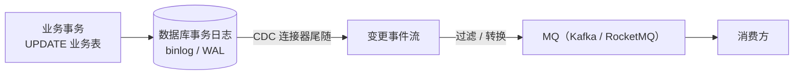

# CDC 与日志尾随

> binlog / WAL · Debezium · Python 自研 · 三库差异与运维代价

[文档首页](../../../文档首页.md) › [知识档案](../技术栈知识档案总览.md) › [消息与事件驱动总览](01_事件驱动_总览.md) › CDC 与日志尾随

---

> **定位**：本篇讲清 CDC（Change Data Capture）作为事件源的原理、工程形态与代价，以及为什么它通常不是单人兼职团队的首选。

## 1. 原理：把数据库事务日志当作事件流 

CDC 不读业务表，也不要求业务代码写 outbox，而是**尾随数据库的事务日志**（MySQL binlog、PostgreSQL WAL、达梦日志），把已提交的变更按顺序读出来：

关键性质：

- **不侵入业务代码**：业务只要正常写库，变更自动被捕获；
- **按提交顺序**：日志天然按事务提交顺序排列；
- **可重放**：只要日志 / MQ 保留期足够，可以从某个位点重新消费；
- **解耦**：应用不需要知道谁在消费。

## 2. 工程形态 

| 形态 | 代表 | 说明 |
| --- | --- | --- |
| **Debezium + Kafka Connect** | Debezium | 现成的 CDC 连接器 + 单消息转换（SMT）；outbox 场景有 `EventRouter` |
| **Debezium Server** | Debezium | 不依赖 Kafka Connect，独立进程；适合轻量部署 |
| **云托管 CDC** | 各云厂商 | 托管连接器，按量计费；绑定云 |
| **Python 自研** | `mysql-replication` / `pgoutput` / DM 日志包 | 按方言分别实现，工作量大、边界多 |

### 2.1 Debezium 的 Outbox Event Router

Debezium 提供 `EventRouter` SMT，可以把 outbox 表的一行路由成一条领域事件：

- `aggregatetype` → topic；
- `aggregateid` → 消息 key（保证同聚合分区有序）；
- `type` → 事件类型；
- `payload` → 事件体。

也就是说，**CDC 常与 outbox 表配合**：业务仍写 outbox（同库同事务），CDC 负责把 outbox 行投递出去。这解决的是「relay 用轮询还是日志尾随」的问题，而不是「要不要 outbox 表」的问题。

> 注意：CDC 也可以直接尾随业务表（不建 outbox），但这样事件 schema 会与表结构强耦合，字段改名 / 拆分 / 合并都会破坏事件契约，需要额外的转换层。

## 3. 三库差异（BMS 语境） 

| 库 | 日志 / CDC 能力 | BMS 现状与限制 |
| --- | --- | --- |
| MySQL 8 | binlog（ROW 模式）；Debezium MySQL Connector | 可用；需开启 binlog、配置复制账号、处理 DDL |
| PostgreSQL 16 | WAL + 逻辑复制（`pgoutput`）；Debezium PostgreSQL Connector | 可用；需 `wal_level=logical`、复制槽管理 |
| 达梦 DM8 | 日志挖掘（`DBMS_LOGMNR` 等） | **无官方 Debezium connector**；自研需按达梦日志格式实现，方言差异大（《[微服务 · 12 选型对比](../微服务/12_微服务_选型对比.md)》待实测 #5） |
| SQLite | 无事务日志 CDC | 本地开发 / 测试无法验证 CDC 路径 |

这意味着：

- 若走 Debezium，**达梦需要单独的方案**（自研或放弃）；
- 三库行为不一致，测试矩阵膨胀；
- 本地 SQLite 开发环境无法覆盖 CDC，只能靠 CI 真库或远程环境。

## 4. Python 自研 CDC 的现实成本 

“自己用 Python 实现一套 CDC”通常包括：

1. **日志读取**：MySQL binlog（`mysql-replication`）、PG 逻辑复制（`psycopg` + `pgoutput`）、达梦日志包；
2. **位点管理**：记录已消费的 binlog 位点 / LSN / 达梦日志偏移，崩溃后从位点恢复；
3. **事务边界**：按事务提交聚合变更，避免读到未提交数据；
4. **Schema 演进**：DDL 变更、字段增删、类型映射；
5. **事件转换**：表行 → 领域事件（字段裁剪、敏感脱敏、聚合键）；
6. **投递与幂等**：MQ 发送、重试、死信、消费幂等；
7. **运维**：连接保活、位点监控、延迟告警、全量 + 增量切换。

这不是「几百行脚本」，而是**一个小型中间件**。对单人兼职团队，维护成本通常高于 outbox。

## 5. 适用与不适用 

| 场景 | 建议 |
| --- | --- |
| 已有 Kafka / Debezium 基础设施、多语言团队 | CDC 值得考虑 |
| 事件量极大、不想在业务库多写 outbox | CDC 尾随业务表（需转换层） |
| 需要「不侵入业务代码」的全局变更流（搜索索引、数仓） | CDC 是标准做法 |
| 单人兼职、三库（含达梦）、本地 SQLite 开发 | **不建议**；outbox 或事务消息更务实 |
| 事件 schema 需要长期稳定、与表结构解耦 | 不建议直接尾随业务表；用 outbox 或转换层 |

## 6. 与 Outbox / 事务消息的关系 

| 组合 | 含义 |
| --- | --- |
| Outbox + 轮询 relay | BMS 现状；简单、可移植 |
| Outbox + CDC relay | 业务写 outbox，Debezium 尾随 outbox 表；近实时、无轮询延迟 |
| 直接 CDC 业务表 | 不建 outbox；schema 耦合，需要转换层 |
| 事务消息 | 不用 outbox 表；由 MQ 半消息 + 回查保证 |

> CDC 不是「废除 outbox」的同义词：它最常见的用法恰恰是**替代 outbox 的 relay**，而不是替代 outbox 表。

## 7. 在消息平台（L3）中的位置 

CDC 在自研消息平台里有两个可能落点：

| 落点 | 形态 | 首期建议 |
| --- | --- | --- |
| **outbox connector** | msg 侧提供连接器，尾随业务库 outbox 表，直接投递到平台 | ⏳ 8B_04 评估；比「业务自己跑 relay」少一个进程 |
| **业务表变更捕获** | 直接尾随业务表 binlog，省掉 outbox 表 | ❌ 首期不做：schema 耦合 + 三库方言差异 + 权限模型复杂 |

**为什么首期不做业务表 CDC**：

1. bms 需要支持 MySQL / PG / 达梦三库，达梦侧没有成熟的 Debezium connector，自研日志挖掘成本极高。
2. 直接尾随业务表意味着「事件 schema 与业务表 schema 强耦合」，业务改表就会破坏事件契约。
3. 自研平台已有持久化日志与位点，**「账本 + 重放」的需求已由平台承担**，CDC 的边际收益下降。

**保留口子**：若将来要支持「零侵入接入」（业务完全不改代码就产生事件），CDC 是唯一路径；届时应以「outbox connector」为先，而不是直接尾随业务表。

## 8. 参考资源 

| 资源 | 网址 | 说明 |
| --- | --- | --- |
| Debezium 文档 | https://debezium.io/documentation/ | 连接器、SMT、部署形态 |
| Debezium：Outbox Pattern | https://debezium.io/blog/2019/02/19/reliable-microservices-data-exchange-with-the-outbox-pattern/ | Outbox + CDC 完整示例 |
| microservices.io：Transaction Log Tailing | https://microservices.io/patterns/data/transaction-log-tailing.html | 日志尾随模式 |
| MySQL Binlog | https://dev.mysql.com/doc/refman/8.0/en/binary-log.html | binlog 格式与复制 |
| PostgreSQL 逻辑复制 | https://www.postgresql.org/docs/16/logical-replication.html | `pgoutput` 与复制槽 |
| 达梦 DM8 文档 | https://eco.dameng.com/document/dm/zh-cn/pm/ | 日志挖掘与数据库管理 |

## 9. 项目内关联文档 

| 文档 | 说明 |
| --- | --- |
| [14 事务性发件箱](14_事件驱动_事务性发件箱.md) | CDC 可作为 outbox 的 relay |
| [15 事务消息](15_事件驱动_事务消息.md) | 另一种「不用 outbox 表」的方案 |
| [18 选型对比（BMS）](18_事件驱动_选型对比（BMS）.md) | 何时选 CDC |
| [微服务 · 12 选型对比](../微服务/12_微服务_选型对比.md) | 达梦无 Debezium connector 的原始登记 |

---

> 依《[文档生成规范](../../../规范/文档生成规范.md)》编写
