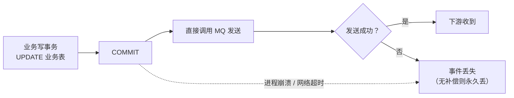

# 直接发布与补偿

> **状态说明（2026-11-13）**：RocketMQ 已从本平台下线，事件总线改用自研 `msg`；本文涉及 RocketMQ 的内容仅作技术参考，不代表当前实现。

> dual-write 的失败模式 · 重试与对账 · best-effort 的适用边界

[文档首页](../../../文档首页.md) › [知识档案](../技术栈知识档案总览.md) › [消息与事件驱动总览](01_事件驱动_总览.md) › 直接发布与补偿

---

> **定位**：本篇说明「不用 outbox、不做事务消息，业务代码直接发 MQ」会发生什么，以及什么场景下这种 best-effort 可以接受。

## 1. 什么是直接发布 

直接发布指业务代码在写完数据库后（或写入过程中）直接调用 MQ 客户端发送事件，不经过 outbox 表，也不使用 MQ 事务消息：

## 2. 两种必然的失败模式 

| 顺序 | 失败模式 | 后果 |
| --- | --- | --- |
| 先写库、后发 MQ | 库提交成功，MQ 发送失败 / 超时 / 进程崩溃 | 下游永远不知道这次变更（丢事件） |
| 先发 MQ、后写库 | MQ 已发送，业务事务回滚 | 下游收到「从未发生」的变更（假事件） |

「发送超时」尤其麻烦：调用方无法区分「消息没送到」与「消息送到了但响应丢了」。没有账本就无法判定，只能重发（可能重复）或不发（可能丢失）。

## 3. 「加重试 / 加对账」能解决吗 

| 手段 | 能解决 | 不能解决 |
| --- | --- | --- |
| 发送失败重试（内存 / 本地队列） | 短暂网络抖动 | 进程崩溃导致内存队列丢失；无法区分超时语义 |
| 定时对账（扫描业务表 vs 下游状态） | 最终发现缺口 | 需要额外的「已发送」账本；对账窗口内不一致；对账本身可能漏 |
| 补偿任务（反向操作） | 假事件的下游撤销 | 补偿不是回滚；业务上未必可撤销；补偿也可能失败 |
| 幂等键 + 去重 | 重复发送 | 丢事件；顺序错乱 |

结论：**直接发布 + 重试/对账 = best-effort**，不是可靠投递。它可以降低概率，但不能给出「业务提交则事件必达」的保证。

## 4. 什么场景可以接受 best-effort 

| 场景 | 可接受？ | 理由 |
| --- | --- | --- |
| 指标上报、埋点 | 可以 | 丢少量数据不影响业务正确性 |
| 缓存失效通知 | 可以（配合 TTL 兜底） | 缓存最终会过期，短时不一致可接受 |
| 非关键站内通知 | 可以（可补发 / 可忽略） | 业务主流程不依赖 |
| 搜索索引同步 | 可以（配合全量重建） | 索引可重建，最终一致 |
| 审计日志（操作 / 登录 / 字段变更） | **不可以** | 合规要求「业务发生则审计必在」；丢事件 = 审计缺口 |
| 资金 / 订单 / 库存等业务事件 | **不可以** | 下游依赖事件做账 / 履约，丢事件 = 业务错误 |

## 5. 与 XA / 事务消息的区别 

| 方案 | 能否覆盖「库 + MQ」 | 说明 |
| --- | --- | --- |
| XA / 2PC | **不能**（MQ 通常不参加 XA） | XA 覆盖数据库之间；RocketMQ 不参与 XA 事务 |
| MQ 事务消息 | **能**（半消息 + 本地事务 + 回查） | MQ 原生两阶段，不是 XA |
| Outbox | **能**（同库同事务 + relay） | 用本地事务桥接 MQ |
| 直接发布 | **不能** | dual-write |

> 常见误解：「上了 TM + XA，事件就可靠了」——不对。TM + XA 解决的是**跨服务写**；库到 MQ 这一段仍需要 outbox 或事务消息。

## 6. 对账的三种形态与真实成本 

很多人以为「加个定时对账」就能兜住直接发布的缺口。实际上对账有硬前提：**必须有一份「应该发什么」的独立记录**，否则拿什么比？

| 形态 | 做法 | 前提 | 能发现 | 发现不了 |
| --- | --- | --- | --- | --- |
| 全量对账 | 定期扫业务表全量，与下游状态比 | 下游有可查询的状态接口 | 累积缺口 | 窗口内瞬时不一致、中间态 |
| 增量水位对账 | 按 `updated_at` / 自增 id 水位增量比 | 业务表有可靠单调列 | 新增缺口 | 水位列被回填 / 时钟回拨 |
| 抽样核对 | 随机抽 N 条业务记录比对 | 业务可反查 | 比例性缺口 | 低频缺口 |

三种都有共同成本：

1. **对账本身要写代码、要跑任务、要处理误报**——工作量往往超过直接上 outbox。
2. **对账窗口内不一致**：业务方在这段时间看到的是错的数据。
3. **对账只能发现问题，不能自动修复**：补齐要靠「重放」，而重放又需要事件账本——绕回 outbox。

**结论**：对账是「事后补救」，outbox / 事务消息是「事前保证」。前者适合「允许短时不一致、可人工介入」的场景，后者适合「不允许缺口」的场景。

## 7. 真要直接发布，实现上要注意什么 

如果评估后确实选择 best-effort，至少要做到：

| 要点 | 做法 |
| --- | --- |
| 发送不阻塞业务 | 异步发送 + 有界本地队列；队列满时**明确丢弃并计数**，不要静默丢或无限堆积 |
| 优雅关闭 | 进程退出前 flush 本地队列，设置最大等待时间 |
| 重试策略 | 指数退避 + 抖动 + 最大次数；超限进本地死信文件并告警 |
| 超时明确 | 区分「连接失败」（可重试）与「已发送但响应超时」（重试可能重复） |
| 幂等键 | 消息带业务唯一键，让下游能去重 |
| 指标 | 发送成功率、丢弃数、重试数、队列长度 |

**最容易出的事故**：本地队列无界 → 消费端故障时内存爆；或优雅关闭没做 → 每次发版丢最后一批。

## 8. 决策清单 

在决定直接发布前，逐条回答：

1. 这条事件丢了，业务会不会错？（会 → 不可直接发布）
2. 这条事件重复了，下游能否幂等？（不能 → 先补幂等）
3. 有没有「已发送」账本可用于对账？（没有 → 无法判定缺口）
4. 进程崩溃时，未发送的事件会不会永久丢失？（会 → 不可接受）
5. 下游是否依赖事件顺序？（依赖 → 需要分区键 + 可靠投递）
6. 合规 / 审计是否要求「业务发生则记录必在」？（要求 → 不可直接发布）

六条里只要有一条踩中，就应使用 outbox 或事务消息。

## 9. 在消息平台（L3）中的位置 

直接发布在消息平台化之后**风险下降但没有消失**：

| 变化 | 影响 |
| --- | --- |
| broker 有持久化日志与保留期 | 「发出去了能查回来」，取证能力增强 |
| 有投递重试与死信 | 「发送失败」不再等于「彻底丢失」 |
| **业务事务与消息投递仍无共同事务** | 「业务回滚但消息已发」「业务提交但消息没发」**依旧存在** |

因此：

- **可以接受直接发布的场景变多了**：缓存失效、指标上报、非关键通知——平台侧的重试与日志已能兜住大部分偶发失败。
- **不能接受直接发布的场景没变**：审计、资金、库存——业务提交与事件投递的原子性缺失依旧要靠 outbox 或事务消息解决。

**msg 可以提供的能力**：`publish` 的 `acks=0`（不等确认）语义，等价于「投递尽力而为」。这是显式的、可配置的选择，而不是让业务在不知情的情况下双写。

> 判据不变：**先问「这条消息丢了业务能不能自己发现并修复」**；能，直接发布可以接受；不能，走 [14 事务性发件箱](14_事件驱动_事务性发件箱.md) 或 [15 事务消息](15_事件驱动_事务消息.md)。

## 10. 参考资源 

| 资源 | 网址 | 说明 |
| --- | --- | --- |
| microservices.io：Transactional Outbox | https://microservices.io/patterns/data/transactional-outbox.html | 为什么需要 outbox |
| AWS：Transactional Outbox | https://docs.aws.amazon.com/prescriptive-guidance/latest/cloud-design-patterns/transactional-outbox.html | dual-write 问题与解法 |
| RocketMQ：Transactional Message | https://rocketmq.apache.org/docs/featureBehavior/04transactionmessage/ | MQ 原生事务消息 |
| 本项目《分布式事务 · 总览》 | [01 总览](../分布式事务/01_分布式事务_总览.md) | XA / TM 的适用边界 |

## 11. 项目内关联文档 

| 文档 | 说明 |
| --- | --- |
| [14 事务性发件箱](14_事件驱动_事务性发件箱.md) | 可靠投递基线 |
| [15 事务消息](15_事件驱动_事务消息.md) | MQ 原生替代 |
| [18 选型对比（BMS）](18_事件驱动_选型对比（BMS）.md) | 场景映射 |
| [19 常见误区](19_事件驱动_常见误区.md) | 「直接发 + 重试就行」的核对 |

---

> 依《[文档生成规范](../../../规范/文档生成规范.md)》编写
