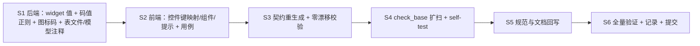

# 登记标识二期（字段控件语义键 / 业务码与动作码 / 自建图标码）详细设计

> 项目骨架 · 01 工程骨架 · 08 登记标识二期 · 详细设计（开发核心文档）

[文档首页](../../../../../../文档首页.md) › [08 登记标识二期](../01_工程骨架_08_登记标识二期控件键与业务码形态.md) › 设计

## 1. 目标与边界 

**目标**：把《命名规范》「登记型标识一律 snake_case、不设例外」落到最后三个登记面——**字段控件语义键**、**业务码 / 动作码**、**自建图标码**——并把口径做成机器护栏，防止后续新增键回退到 kebab。

**范围内**：

1. 字段控件语义键改 snake_case（后端 `fieldtype` 的 `widget` 字面量 + 前端 `FIELD_WIDGETS` / 控件分发映射 / 组件内语义判断）；
2. 业务码 / 动作码形态收紧（schema 正则 + 前端提示 + 反例用例）；
3. 自建图标码 `sys_icon.code` / `custom:{code}` 形态收紧（正则 + schema 描述 + 表文件 / 模型注释 + 前端提示）；
4. `check_base.py` 第 6 项扩扫三类登记面并补 `--self-test` 正反例；
5. 《命名规范》《后端开发规范》《前端开发规范》与相关表文件回写。

**范围外**：

| 项 | 归口 / 理由 |
| --- | --- |
| 上游图标库图标名（`el:User` / `van:todo-o`） | 上游生态命名不可改，《命名规范》§2.1 已列为明文例外 |
| 字段**类型键**（`dict` / `dict_multi` / `option_multi` / `longtext` 等） | 已是 snake_case，不在本次范围 |
| 前端路由 path、CSS 类、HTML 属性、`data-*` 值、组件分包标记（`data-subpackage="chart-kernel"` 等） | 非登记标识（《命名规范》边界条目） |
| 存量业务码 / 动作码 / 图标码数据迁移 | 现存量值无连字符；只收紧校验，存量行不迁移（图标码创建后不可改，读取与 `custom:{code}` 解析不受影响） |
| 模块键 / 能力键 / 注册表键 / 区域项 / i18n pack key | 已由 07C `03_03` 交付（Kiwi 2356） |

## 2. 现状核对 

### 2.1 字段控件语义键（9 个 kebab 值） 

| 现键（kebab） | 新键（snake） | 出现面 |
| --- | --- | --- |
| `org-select` | `org_select` | core `form-render.ts`（`FIELD_WIDGETS` / 类型→控件映射 `dept`/`user`/`post`/`org`）、ui_ep `OrgSelectField`、桌面端表单/筛选、用例 |
| `tree-select` | `tree_select` | core 映射（`tree`）、ui_ep 树选择件、用例 |
| `dict-select` | `dict_select` | 后端 `fieldtype/local.py`（`dict`）、core 映射（`dict`）、ui_ep 字典件、用例 |
| `dict-multi` | `dict_multi` | 后端 `fieldtype/local.py`（`dict_multi`）、core 映射（`dict_multi`）、ui_ep `OptionSetMultiField` / `QueryFilter`、用例 |
| `dropdown-multi` | `dropdown_multi` | core（`FIELD_WIDGETS`）、ui_ep `QueryFilter` / `OptionSetMultiField`、用例 |
| `file-upload` | `file_upload` | core 映射（`file`）、ui_ep 上传件、用例 |
| `image-upload` | `image_upload` | core 映射（`image`）、ui_ep 图片件、用例 |
| `i18n-name` | `i18n_name` | core 映射（`i18n-name` / `i18n_name` 两个入参别名）、ui_ep 多语言名件、用例 |
| `i18n-text` | `i18n_text` | core 映射（`i18n-text` / `i18n_text`）、ui_ep 多语言文本件、用例 |

**事实**：后端只有 `dict-select` / `dict-multi` 两个字面量（`fieldtype/local.py`）；其余七个是前端语义键。控件键**不落库**（表单布局只存字段类型键 `type`，控件键由映射派生），故无数据迁移。

### 2.2 业务码 / 动作码 

| 项 | 现状 |
| --- | --- |
| 后端校验 | `domains/permission_meta/schemas/permission_meta.py` 两处 `pattern=r"^[a-z][a-z0-9-]*$"`（业务码 `code`、动作码 `code`） |
| 权限码派生 | `{business.code}:{action.code}`（组合规则不变；本次只收紧两段码值形态） |
| 存量数据 | 种子与存量业务 / 动作码均为单词（`menu` / `user` / `query` / `create` 等），**无连字符值** |
| 前端提示 | `apps/desktop/src/api/{business,action}.ts` 注释与 `BusinessRecordTab.vue` / `ActionRecordTab.vue` 提示「kebab-case，创建后只读」 |

### 2.3 自建图标码 

| 项 | 现状 |
| --- | --- |
| 后端校验 | `bms_core/icon/base.py::_ICON_CODE_RE = ^[a-z][a-z0-9]*(?:-[a-z0-9]+)*$`；`is_valid_icon_code` 与图标 schema `code` 字段 |
| 表 / 模型注释 | 表文件 `sys_icon.md` 的 `code` 行与模型 `models/platform/icon.py` 注释均写「kebab-case」 |
| 前端提示 | `IconRecordTab.vue` 占位符「kebab-case，如 receipt」 |
| 存量数据 | 租户自建图标码可能含连字符；**创建后不可修改**，本次只收紧新建校验，存量行照常解析（`custom:{code}` 由服务端派生，前端 `ICON_KEY_PATTERN` 不变） |

### 2.4 护栏缺口 

`check_base.py` 第 6 项当前只扫登记**目录 / 包名 / 工具脚本名 / 清单目录名**，不扫运行时值（控件键 / 码值形态），无法防止「新增键用回 kebab」。

## 3. 设计 

### 3.1 控件语义键改 snake_case 

| 层 | 改法 |
| --- | --- |
| 后端 | `bms_core/fieldtype/local.py`：`SimpleFieldType(key="dict", widget="dict_select")`、`key="dict_multi", widget="dict_multi"` |
| 前端 core | `domain/form-render.ts`：`FormWidget` 联合类型、`FIELD_WIDGETS` 全量清单、`FIELD_WIDGET_MAP`（类型→控件）与 `i18n` 别名表一律改新键；**删除** `i18n-name` / `i18n-text` 两个 kebab 入差别名（一次性，不留双形态） |
| 前端 ui_ep | 组件内对语义键的判断（`QueryFilter` 返回 `dropdown_multi`、`OptionSetMultiField` 的 `form` 取值、上传件 / 组织件 / 字典件的 `data-test` 与内部分支）同步 |
| 前端 apps | 表单/筛选/查询方案等使用控件键处同步（如有硬编码） |
| 用例 | core `domain-form-render.spec`、ui_ep `interaction-form-renderer` / 各控件件用例、desktop 表单相关用例同步 |

**命名冲突说明**：改后控件键 `dict_multi` 与字段**类型键** `dict_multi` 同名——两者命名空间不同（`type` vs `widget`），代码中按语义位置区分，不做去重；在《前端开发规范》控件语义键节注明。

### 3.2 业务码 / 动作码形态收紧 

| 项 | 改法 |
| --- | --- |
| schema | 两处 `pattern` 改 `^[a-z][a-z0-9_]*$`；`description` 改「snake_case（小写字母开头，仅小写字母 / 数字 / 下划线；创建后只读）」 |
| 权限码 | 组合 `{business}:{action}` 不变；`sys_permission` 表无码值列，不受影响 |
| 前端 | 维护页提示文案 / 占位符改「snake_case」；输入校验由后端契约（错误码 40209 等）兜底，前端不新增本地正则 |
| 契约产物 | schema `pattern` / `description` 变化经 `pnpm api_types:gen` 重生成并提交；`check_contracts` / `api-types 零漂移` 保证一致 |
| 存量 | 不迁移、不批量改写（现值无连字符）；更新存量行时按新规则校验 |

### 3.3 自建图标码形态收紧 

| 项 | 改法 |
| --- | --- |
| 校验 | `_ICON_CODE_RE` 改 `^[a-z][a-z0-9_]*$`（与业务域 / 表名 / 控件键同口径） |
| 表文件（先） | `bms文档/设计/数据库设计/数据表设计/sys_icon.md`：`code` 行描述改「snake_case，租户内唯一；icon key = `custom:{code}`」+ 变更记录追加一条（仅注释口径，无 DDL） |
| 模型 | `models/platform/icon.py` 的 `code` 列 `comment` 同步（无 DDL 变更，启动建表不涉及） |
| schema | `bms_core/schemas/icon.py` 的 `code` 字段 `description` 同步 |
| 前端 | `IconRecordTab.vue` 占位符 / 提示改「snake_case，如 receipt_note」；`apps/desktop/src/api/icon.ts` 注释随契约重生成 |
| 上游图标名 | `ICON_KEY_PATTERN`（`el:User` / `van:todo-o`）**不改**；《命名规范》§2.1 例外条目保留并明确「仅上游图标名、自建码按 snake」 |

### 3.4 机器护栏（`check_base` 第 6 项扩扫） 

在既有「登记面命名形态」项内追加三类检查（只扫登记面，不扫业务源码字符串）：

| # | 检查 | 判定 |
| --- | --- | --- |
| N1 | 控件语义键 | ① 后端 `fieldtype/local.py` 的 `widget="…"` 字面量全部合 `^[a-z][a-z0-9_]*$`；② 前端 `core/src/domain/form-render.ts` 的 `FIELD_WIDGETS` 数组取值全部合同一形态 |
| N2 | 业务码 / 动作码形态 | 权限元数据 schema 中 `code` 字段的 `pattern` 必须是 `^[a-z][a-z0-9_]*$`（源码断言；再以 schema 反例用例兜住运行期） |
| N3 | 自建图标码形态 | `bms_core/icon/base.py::_ICON_CODE_RE` 的模式文本必须是 snake 口径 |

**实现口径**：新增纯函数 `runtime_identifier_problems(root)`（返回问题清单），由第 6 项汇总输出；`--self-test` 追加 4 例（合规放行 / kebab 控件键拦截 / kebab 业务码模式拦截 / kebab 图标码模式拦截）。**不做**前端源码全文扫描（会误伤 CSS / 路由 / `data-*`），只扫上述三处登记面。

### 3.5 迁移与兼容 

| 面 | 策略 |
| --- | --- |
| 控件键 | 代码常量一次改齐，**不留 kebab 别名**（与 03_03 口径一致）；表单布局无存量键，无需迁移 |
| 业务码 / 动作码 | 只收紧校验：存量行读取 / 展示 / 授权不受影响；新建与更新按新规则；不写迁移脚本 |
| 自建图标码 | 同上；图标码创建后不可改，存量 kebab 码继续可用（`custom:{code}` 解析不看形态） |
| 回滚 | 单批提交，按提交整体 revert；无库结构变更、无数据变更 |

## 4. 影响面 

| 类别 | 对象 | 变更 |
| --- | --- | --- |
| 修改 | `bms_core/fieldtype/local.py` | 2 个 `widget` 值 |
| 修改 | `domains/permission_meta/schemas/permission_meta.py` | 业务码 / 动作码 `pattern` + 描述 |
| 修改 | `bms_core/icon/base.py`、`bms_core/schemas/icon.py` | 图标码正则 + 描述 |
| 修改 | `bms_core/models/platform/icon.py`、表文件 `sys_icon.md` | 列注释口径 + 变更记录 |
| 修改 | 前端 core / ui_ep / apps 控件键与提示（约 10 个文件 + 用例） | 见 §3.1 / §3.2 |
| 修改 | `scripts/tools/base_check/check_base.py` | 第 6 项扩扫 + self-test |
| 重新生成 | `frontend/packages/api_types` | 契约 `pattern` / `description` 变化 |
| 回写 | 《命名规范》§2.1 / 《后端开发规范》字段类型节 / 《前端开发规范》控件语义键节 | 口径与例外 |

## 5. 测试设计 

**Kiwi 用例 2357**（2026-10-25 登记，先登记后编码；覆盖下列断言）。

| # | 用例 | 落点 | 断言 |
| --- | --- | --- | --- |
| 1 | 控件键全量形态 | `frontend/packages/core/tests/domain-form-render.spec.ts` | `FIELD_WIDGETS` 全部 snake；`resolveFieldWidget` 对 `dept`/`user`/`post`/`org`/`tree`/`dict`/`dict_multi`/`file`/`image`/`i18n_name`/`i18n_text` 返回新键 |
| 2 | 控件分发用新键 | `ui_ep/tests/interaction-form-renderer.spec.ts` 等 | 语义键分发（组织 / 字典 / 上传 / 多语言 / 多选）用新键命中；`MULTIPLE_WIDGETS` 含 `dropdown_multi` / `file_upload` / `image_upload` |
| 3 | 字段类型 → 控件 | `libs/bms_core/tests/fieldtype/*` | `dict` → `dict_select`、`dict_multi` → `dict_multi` |
| 4 | 业务码 / 动作码反例 | `services/platform/tests/...`（schema 校验） | `biz-a` / `act-x` 连字符被拒；`biz_a` / `act_x` 通过；权限码组合派生不变 |
| 5 | 自建图标码反例 | `libs/bms_core/tests/icon/*` | `receipt-note` 被拒、`receipt_note` 通过；上游 `el:User` / `van:todo-o` 仍合法 |
| 6 | 护栏扩扫 | `check_base.py --self-test` + 全仓 `check_base` | kebab 控件键 / 业务码模式 / 图标码模式均报错；合规仓库通过 |
| 7 | 契约零漂移 | `check_contracts` / `api-types 契约类型零漂移` / `preflight --fast` | schema 变更后契约快照与生成类型一致 |
| 8 | 回归 | 后端全量 pytest（覆盖率 100%）+ 前端 `pnpm -r test` / `lint` / `typecheck` / 构建 | 无回归 |

## 6. 实施顺序 

单批交付；S1 后先跑后端定向用例，S2 后跑 core / ui_ep / desktop 定向，最后全量。

## 7. 风险与边界 

| 风险 | 处置 |
| --- | --- |
| 控件键遗漏（组件内硬编码 / 用例快照） | 以 `rg "'(org-select|dict-select|…)'"` 全仓清零 + 前端全量用例兜底；`data-test` 属性值不在登记面，允许保留 |
| `i18n-name` 别名删除导致外部表单配置传入 kebab | 表单布局只存字段类型键；别名仅服务旧调用方，仓内清零即可（无外部消费方） |
| 业务码 / 动作码收紧影响存量编辑 | 存量值无连字符；若某租户手工建过 kebab 码，其更新会被拒——按「登记型标识不设例外」处置，实施记录登记 |
| 图标码收紧影响存量编辑 | 图标码创建后不可改，更新路径不改 `code`；存量展示与解析不受影响 |
| `check_base` 扩扫误伤 | 只扫三处登记面（字段类型文件 / 权限元数据 schema / 图标基座），不扫业务源码与前端样式 |
| 契约产物漂移 | S3 重生成并提交；`api-types 零漂移` 门禁拦截 |

## 8. 交付物与验收映射 

| 交付物 | 验收要点（需求 01-8 完成标准） |
| --- | --- |
| 三类登记面改 snake | 全仓无 kebab 控件键；业务码 / 动作码 / 自建图标码连字符输入被拒；上游图标名仍可用 |
| 机器护栏 | `check_base` 对新增 kebab 控件键 / 业务码模式 / 图标码模式报错，`--self-test` 覆盖正反例 |
| 契约与前端 | `api_types` 零漂移；前端全量 test / lint / typecheck / 构建通过 |
| 后端回归 | 全量 pytest（覆盖率 100%）通过 |
| 文档回写 | 命名规范 / 后端开发规范 / 前端开发规范 / `sys_icon.md` 口径一致；`check_links` / `check_docs_scope` / `check_status` / `preflight --fast` 全绿 |

## 9. 开放项与对齐记录 

| # | 事项 | 结论 |
| --- | --- | --- |
| 1 | 是否保留 kebab 兼容期 | 不保留（2026-10-25 拍板，与 03_03 一致） |
| 2 | 自建图标码是否纳入 | 纳入（上游图标名例外） |
| 3 | 控件键 `dict_multi` 与字段类型键同名 | 接受（命名空间不同）；《前端开发规范》注明 |
| — | 实施回写 | 见[实施记录](../实施/01_实施_08_登记标识二期.md)与[测试记录](../测试/01_测试记录_08_登记标识二期.md)（2026-10-25） |

> 本文档依《[文档生成规范](../../../../../../规范/文档生成规范.md)》与《[任务文档规范](../../../../../../规范/任务文档规范.md)》编写
