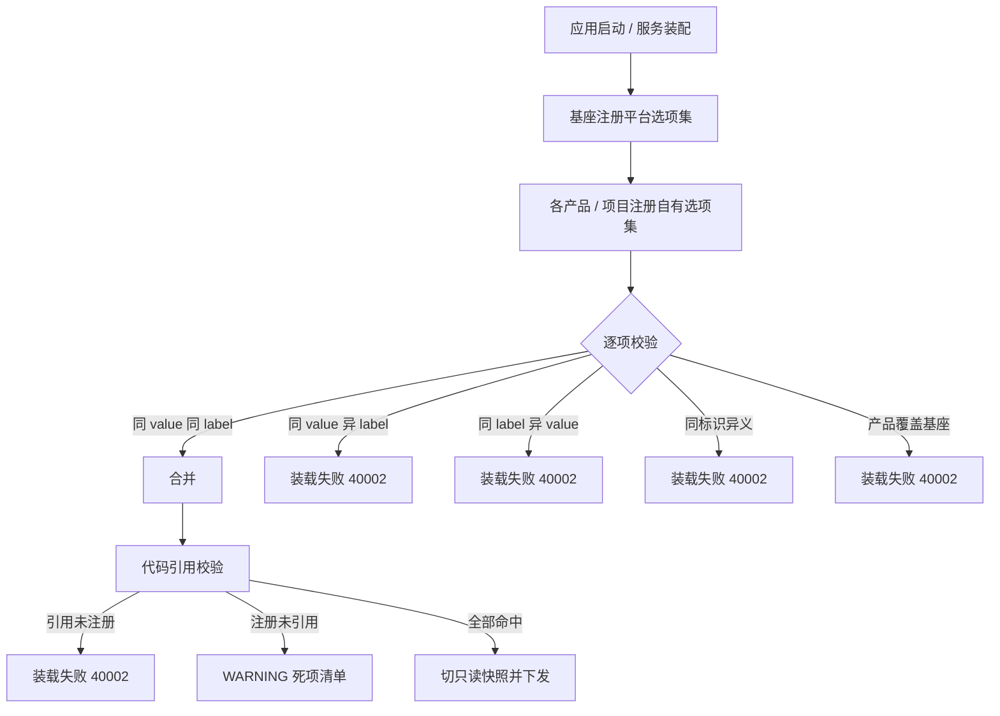

# 选项集注册与校验基座详细设计

> 项目骨架 · 02 后端基座 · 04 跨阶段基座 · 28 选项集注册与校验基座 · 详细设计

[文档首页](../../../../../../../文档首页.md) › [02-4-28 选项集注册与校验基座](../02_后端基座_04_跨阶段基座_28_选项集注册与校验基座.md) › 01 详细设计　|　[← 父任务](../02_后端基座_04_跨阶段基座_28_选项集注册与校验基座.md)

## 1. 概述 <a id="overview"></a>

- **目标**：落地「选项集注册与校验」能力域契约与占位实现——选项集提供者契约 `BaseOptionSet`（`items` / `get` / `validate_value`）、注册表契约 `BaseOptionSetRegistry`（登记 / 解析 / 清单 + `validate` 聚合模板 + **装载期冲突校验**）、占位实现 `NullOptionSetRegistry`、真实注册表 `LocalOptionSetRegistry`、数据契约 `OptionItem` / `OptionSetInfo`；`bms_core/api/deps.py` 提供者 `get_option_set_registry`；服务装配入口装配单例。
- **范围**：`bms_core/optionset/`（新增）、`bms_core/api/deps.py`（提供者导出）、服务装配入口（如 `bms_platform/main.py`）、单测；《后端基类清单》/《后端基类实现契约》/《命名规范》/《后端开发规范》/ 需求 02-58 / 任务 02-4-28 登记。
- **不含**（归后续阶段）：表单元数据承载位（`optionSetKey` 下发）、服务端动态校验接入、导入导出反查、前端选项源消费 → **表单定制阶段**与前端组件体系。
- **依据**：需求 [02-58](../../../../../需求/02_需求_后端基座.md#r02-58)、《[组件设计 · 选项集字段](../../../../../../../设计/组件设计/06_字段类/14_组件设计_选项集字段/14_组件设计_选项集字段.md)》「选项集来源：注册表与字典引用」节、《[概要设计 · 表单定制](../../../../../../../设计/概要设计/36_概要设计_表单定制.md)》「字段属性调整」节、《[概要设计 · 字典管理](../../../../../../../设计/概要设计/09_概要设计_字典管理.md)》「业务规则」节、《[命名规范](../../../../../../../规范/命名规范.md)》「通用原则」节、《[后端开发规范](../../../../../../../规范/后端开发规范.md)》「后端基座体系」节。

## 2. 现状与差距 <a id="gap"></a>

| 现状 | 差距 |
| --- | --- |
| 枚举候选项原由字段属性内联维护（`options` 数组），无全局唯一性与冲突校验 | 同一业务状态可在多处各写一份，出现同 value 异名 / 同名异 value |
| 表单字段类型注册表（02-36）只负责「字段类型 → 校验 / 渲染元数据 / 列类型」，不含候选值域 | 候选值域无独立注册与解析入口 |
| 字典取数（02-44）承载运行期可维护的值域 | 运行期不可变的封闭值域无承载（不应塞进字典） |
| 模块注册、数据源注册已确立「构建期清单 + 装载注入 + 运行期只读」范式 | 选项集缺同构的注册表与冲突校验 |

## 3. 交付物清单 <a id="tree"></a>

```text
backend/
├── libs/bms_core/src/bms_core/optionset/__init__.py       # 新增：能力域包（docstring 口径）
├── libs/bms_core/src/bms_core/optionset/base.py           # 新增：BaseOptionSet / BaseOptionSetRegistry / NullOptionSetRegistry / OptionItem / OptionSetInfo / 常量与校验函数 / get_option_set_registry
├── libs/bms_core/src/bms_core/optionset/local.py          # 新增：LocalOptionSetRegistry（内建平台选项集 + 装载注入）
├── libs/bms_core/src/bms_core/api/deps.py                 # 修改：导出 get_option_set_registry
├── services/platform/src/bms_platform/main.py              # 修改：装配 app.state.option_set_registry（其余服务同口径）
└── libs/bms_core/tests/optionset/optionset/test_optionset.py  # 新增：契约 / 冲突 / 引用校验 / 占位语义 / 依赖解析

bms文档/
├── 后端基类清单.md                          # 已修改：§2 分层总览 + §9 跨阶段基座登记
├── 设计/基类体系/后端基类实现契约.md         # 已修改：§6 契约登记
├── 规范/命名规范.md                         # 已修改：注册制标识命名与登记
├── 规范/后端开发规范.md                     # 已修改：选项集强制走注册表
├── 设计/架构设计/04_架构设计_后端基础类体系.md # 已修改：能力域全景与跨阶段契约清单
├── 设计/组件设计/06_字段类/08_…/08_….md      # 已修改：选项集来源与判据
├── 设计/概要设计/36_概要设计_表单定制.md     # 已修改：字段属性 / 承载位 / 错误码
├── 设计/概要设计/09_概要设计_字典管理.md     # 已修改：与选项集分工
└── 项目/01_项目骨架/任务/02_后端基座/…      # 已修改：父任务子任务清单 + 本任务文档
```

## 4. 契约设计（`bms_core/optionset/base.py`） <a id="contract"></a>

| 成员 | 形态 | 说明 |
| --- | --- | --- |
| `OPTION_SET_KEY_SEPARATOR` | 常量 | `.`；标识按 `{命名空间}.{域}.{对象}` 点分小写 |
| `OPTION_SET_KEY_PATTERN` | 常量（正则） | 首段为已登记命名空间；仅小写字母、数字、点 |
| `OptionItem` | 数据契约（frozen） | `value` / `label` / `label_key` / `color` / `disabled` / `sort`；`label` 与 `label_key` 二选一；前端同构契约写作 `labelKey`（按各自语言命名规范，见《组件设计 · 选项集字段》第 5 节） |
| `OptionSetInfo` | 数据契约（frozen） | 标识 / 名称 / 命名空间 / 条目清单 / 版本 |
| `BaseOptionSet(BaseProvider)` | 选项集提供者契约 | 抽象 `key`（选项集标识）+ `describe()`；同步 `items()` / `get(value)` / `validate_value(value)` |
| `BaseOptionSetRegistry(BaseProviderRegistry)` | 注册表契约 | `key = plugin_key = "option_set_registry"`；登记 / 解析 / 清单继承公共实现 + `resolve(option_set_key)` + `validate(value, *, option_set_key)` 聚合模板 |
| `NullOptionSetRegistry` | 占位实现 | 登记真实、解析恒定空集 / 校验恒定通过；不提供内建选项集 |
| `LocalOptionSetRegistry` | 真实注册表 | `plugin_name = "local"`；装载期登记内建平台选项集 + 各产品注入项 |
| `validate_option_set_key(key)` | 模块函数 | 格式与命名空间校验；非法抛 `PluginError`（40002） |
| `check_registered_references(used_keys)` | 模块函数 | 代码引用了未注册标识 → 抛 `PluginError`（40002） |
| `unused_option_sets(used_keys)` | 模块函数 | 已注册但从未被引用的标识清单（告警用，不抛错） |
| `get_option_set_registry(request)` | 模块函数（提供者） | 取应用级单例（`request.app.state.option_set_registry`） |

**口径**：

| 情形 | 处置 |
| --- | --- |
| 标识唯一性 | `key` 全局唯一；同名重复登记即失败（不静默覆盖） |
| 同 value 同 label | 合并（视为同一项重复声明，保留首个 `sort`） |
| 同 value 异 label | 冲突 → 装载失败（业务码值含义漂移） |
| 同 label 异 value | 冲突 → 装载失败（同名不同义，正是要消灭的笑话） |
| 同标识异义 | 冲突 → 装载失败（两处定义不同选项集内容） |
| 产品覆盖基座 | 禁止 → 装载失败（基座语义不得被下游改写） |
| 未注册引用 | `check_registered_references` 抛 `PluginError`；装载顺序固定「基座 → 产品 → 引用校验」 |
| 注册但零引用 | `unused_option_sets` 返回清单并记 WARNING（死项清理） |
| 运行期写入 | 不提供任何写接口；注册表在装载完成后切只读快照 |
| 解析未命中 | `resolve` 抛 `NotFoundError`（10002），全局处理器转 404 |
| 值域判定 | `validate_value` 返回违规原因元组（空元组通过），供服务端动态校验聚合 |

## 5. 冲突校验与装载顺序 <a id="conflict"></a>



- 校验在**装载期**一次完成，运行期零校验开销（解析为纯内存查表）。
- 失败即阻断启动（fail fast），不进入「先跑起来再说」的降级路径——值域错误会污染业务数据。
- 只读快照与产品注册顺序无关，`keys()` 按注册顺序稳定返回。

## 6. 应用装配与依赖注入 <a id="di"></a>

| 位置 | 变更 |
| --- | --- |
| `bms_core/api/deps.py` | 导出 `get_option_set_registry`；模块 docstring 补「选项集」 |
| 服务装配入口（如 `bms_platform/main.py`）`create_app()` | 装配 `app.state.option_set_registry = LocalOptionSetRegistry()`（置于能力域基座装配段，先于表单元数据 / 校验器装配；各服务同口径） |

提供者为普通同步函数（取 `app.state` 单例，无 IO）；本任务**不落路由**（选项集维护无写接口，管理界面不提供编辑入口）。

## 7. 继承与分层 <a id="base"></a>

- `BaseOptionSet → BaseProvider → BaseCapability → BaseObject`（与 `BaseFieldType` 同型：可注册组件）。
- `BaseOptionSetRegistry → BaseProviderRegistry → BasePluggable → BaseCapability → BaseObject`。
- `NullOptionSetRegistry → BaseOptionSetRegistry + BaseNullObject → BasePlaceholder → BaseObject`。
- 不新增数据表、不新增错误码（复用 `PluginError` 40002 / `NotFoundError` 10002）。

## 8. 登记落点 <a id="register"></a>

| 落点 | 登记内容 |
| --- | --- |
| 《后端基类清单》§9 | 「选项集注册与校验（横切扩展，补登）」一行 |
| 《后端基类实现契约》§6 | 契约成员 / 冲突规则 / 占位语义 / 提供者 |
| 《命名规范》§2.2 / §13 | 注册制标识命名与检查项（`optionSetKey`） |
| 《组件设计 · 选项集字段》§5 / §10.2 / §13 | 来源判据、注册规则、上游登记项、检查清单 |
| 《概要设计 · 表单定制》§1 / §2.1 / §4 / §7 / §8 | 值域来源判据、字段属性承载位、`options` 语义、40408、验收要点 |
| 《概要设计 · 字典管理》§2.2 | 与选项集的分工 |
| 需求 02-58 / 需求总览 00 | 需求正文、计数、补充记录 |
| 02-4-28 任务文档 + 父任务 02-04 | 任务正文、子任务清单、对应需求 |

## 9. 测试设计 <a id="tests"></a>

用例在实施期登记 Kiwi TCMS（本设计不预占编号），自动化文件 `tests/optionset/test_optionset.py`：

| 用例 | 断言要点 |
| --- | --- |
| 契约与继承 | `BaseOptionSet → BaseProvider`；注册表 `key == "option_set_registry"`；占位实现继承 `BaseNullObject` |
| 标识校验 | 合法 `bms.user.status` 通过；缺命名空间 / 大写 / 非法字符 / 空段抛 `PluginError` 40002 |
| 合并 | 同 value 同 label 重复登记不报错、条目数不增加 |
| 冲突四类 | 同 value 异 label / 同 label 异 value / 同标识异义 / 产品覆盖基座，均抛 `PluginError` 40002 |
| 引用校验 | 未注册引用抛 40002；注册未引用进入 `unused_option_sets` 且不影响启动 |
| 解析与值域 | `resolve` 未命中抛 `NotFoundError`；`validate` 委托且返回违规元组；`items()` 按 `sort` 稳定 |
| 占位语义 | `NullOptionSetRegistry` 登记真实、解析空集、校验恒定通过 |
| 依赖解析 | `create_app()` 装配单例；提供者取到同一实例 |

回归：全量 `pytest`（含接口冒烟）。

## 10. 实施步骤 <a id="steps"></a>

1. 新增 `bms_core/optionset/`（常量 / 数据契约 / 两契约 / 占位 / 真实注册表 / 校验函数 / 提供者）。
2. `bms_core/api/deps.py` 导出提供者；服务装配入口装配 `app.state.option_set_registry`。
3. 测试：登记 Kiwi 用例后编写 `tests/optionset/test_optionset.py`。
4. 登记：按第 8 节逐项回写。
5. 验证：`uv run pytest --cov=app -q`、`uv run ruff check .`、`uv run ruff format --check .`、`uv run pyright` 全绿；`python3 scripts/tools/base-check/check-base.py` 通过。
6. 回写：实施 / 测试记录 + 任务（02-4-28、02_04）与需求 02-58 状态、计划表。

## 11. 验收映射 <a id="accept-map"></a>

| 完成标准（需求 02-58 / 任务 02-4-28） | 验证方式 |
| --- | --- |
| 接口 / 抽象声明就位、可被上层引用 | 两契约落地 + 继承断言 |
| 依赖注入可解析、应用可启动不报错 | `create_app` 装配单例 + 提供者解析用例 |
| 冲突与引用校验可单测 | 五类冲突 + 未注册引用 + 死项告警用例 |
| 运行期只读、不落库 | 无写方法 / 无模型 / 无迁移 |
| 不接入表单元数据与前端下发 | 无路由 / 无表单耦合 |
| 无 lint / 类型错误 | `ruff` / `pyright` |

## 12. 边界与开放项 <a id="boundary"></a>

- **表单元数据承载位**（`optionSetKey` 下发）→ 表单定制阶段（概设 36 字段属性层）。
- **服务端动态校验**（必填 / 值域聚合）→ 表单定制阶段（消费 `validate_value`）。
- **导入导出反查**（label ↔ value）→ 表单定制阶段 + 导入导出模块。
- **前端选项源消费** → 前端组件体系（`BaseOptionSource` 经表单元数据取选项集）。
- **管理界面**：不提供选项集增删改入口——运行期可维护的值域走字典，这是本设计的基本边界。

> 本文档依《文档生成规范》编写
