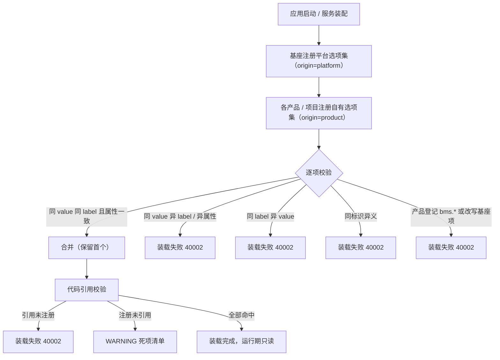

# 选项集注册与校验基座详细设计

> 项目骨架 · 02 后端基座 · 04 跨阶段基座 · 28 选项集注册与校验基座 · 详细设计

[文档首页](../../../../../../../文档首页.md) › [02-4-28 选项集注册与校验基座](../02_后端基座_04_跨阶段基座_28_选项集注册与校验基座.md) › 01 详细设计　|　[← 父任务](../02_后端基座_04_跨阶段基座_28_选项集注册与校验基座.md)

## 1. 概述 <a id="overview"></a>

- **目标**：落地「选项集注册与校验」能力域契约与占位实现——选项集提供者契约 `BaseOptionSet`（`items` / `get` / `validate_value`）、注册表契约 `BaseOptionSetRegistry`（登记 / 解析 / 清单继承公共实现 + **登记期冲突校验** + `resolve` / `validate` 聚合模板 + 双向引用校验）、占位实现 `NullOptionSetRegistry`、真实注册表 `LocalOptionSetRegistry`、数据契约 `OptionItem` / `OptionSetInfo`、常量与标识校验函数；`bms_core/api/deps.py` 导出提供者 `get_option_set_registry`；配置分区与插件装配接线。
- **范围**：`bms_core/optionset/`（新增）、`core/config.py`（配置分区）、`core/assembly.py`（缺省模块导入 / 装配接线 / 真实实现工厂）、`api/deps.py`（提供者导出）、单测与平台插件登记前置断言；《后端基类清单》/《后端基类实现契约》/《后端开发规范》/ 架构 04 / 计划 / 需求 02-58 登记。
- **不含**（归后续阶段）：表单元数据承载位（`optionSetKey` 下发）、服务端动态校验接入、导入导出反查、前端选项源消费 → **表单定制阶段**与前端组件体系；内建平台选项集具体条目（value / label）→ 同阶段按平台字段回补。
- **依据**：需求 [02-58](../../../../../需求/02_需求_后端基座.md#r02-58)、《[组件设计 · 选项集字段](../../../../../../../设计/组件设计/06_字段类/14_组件设计_选项集字段/14_组件设计_选项集字段.md)》「候选来源：注册表选项集（与字典字段分家）」节、《[概要设计 · 表单定制](../../../../../../../设计/概要设计/36_概要设计_表单定制.md)》「字段属性调整」节、《[概要设计 · 字典管理](../../../../../../../设计/概要设计/09_概要设计_字典管理.md)》「业务规则」节、《[命名规范](../../../../../../../规范/命名规范.md)》「通用原则」节、《[后端开发规范](../../../../../../../规范/后端开发规范.md)》「后端基座体系」节、《[后端基类清单](../../../../../../../后端基类清单.md)》「跨阶段基座」节。

## 2. 现状与差距 <a id="gap"></a>

| 现状 | 差距 |
| --- | --- |
| 枚举候选项原由字段属性内联维护（`options` 数组），无全局唯一性与冲突校验 | 同一业务状态可在多处各写一份，出现同 value 异名 / 同名异 value |
| 表单字段类型注册表（02-36）只负责「字段类型 → 校验 / 渲染元数据 / 列类型」，不含候选值域 | 候选值域无独立注册与解析入口 |
| 字典取数（02-44）承载运行期可维护的值域；字段类型已按 `option` / `dict` 分家（02-14） | 运行期不可变的封闭值域无承载（不应塞进字典） |
| 模块注册、表单登记、数据源注册已确立「构建期清单 + 装载注入 + 运行期只读」范式 | 选项集缺同构的注册表与装载期冲突校验 |
| 基类清单 / 实现契约 / 后端开发规范 / 命名规范 / 组件设计 / 概要设计 / 需求已登记本域（设计先行） | 代码侧 `bms_core/optionset/` 不存在；无配置分区、无装配接线、无提供者，依赖注入无落点 |

## 3. 交付物清单 <a id="tree"></a>

```text
backend/
├── libs/bms_core/src/bms_core/optionset/__init__.py   # 新增：能力域包（docstring 口径）
├── libs/bms_core/src/bms_core/optionset/base.py       # 新增：常量 / 数据契约 / BaseOptionSet / BaseOptionSetRegistry / 标识与引用校验函数 / 提供者
├── libs/bms_core/src/bms_core/optionset/null.py       # 新增：NullOptionSetRegistry（登记真实 / 解析空集 / 校验恒定通过）
├── libs/bms_core/src/bms_core/optionset/local.py      # 新增：内建清单常量（本期空）+ LocalOptionSetRegistry（基座清单 + 产品注入）
├── libs/bms_core/src/bms_core/core/config.py          # 修改：Settings 增 option_set_registry 分区（PluginSelection）
├── libs/bms_core/src/bms_core/core/assembly.py        # 修改：_NULL_MODULES 增 optionset.null + PLUGIN_WIRINGS 增接线 + local 工厂登记
├── libs/bms_core/src/bms_core/api/deps.py             # 修改：导出 get_option_set_registry
├── libs/bms_core/tests/optionset/test_optionset.py    # 新增：契约 / 标识 / 合并 / 冲突 / 引用 / 占位 / 真实注册表 / 依赖解析
└── services/platform/tests/crosscut/test_plugin_registration.py  # 修改：期望插件键补 option_set_registry

bms文档/
├── 后端基类清单.md                                   # 修改：§9 本域状态「占位」→「已交付（占位，随表单定制阶段回补真实装载）」
├── 设计/基类体系/后端基类实现契约.md                  # 修改：§6 本域行补登记来源标记与引用校验方法口径
├── 设计/架构设计/04_架构设计_后端基础类体系.md        # 核对：能力域全景与跨阶段契约清单已含本域（不改）
├── 规范/后端开发规范.md                               # 核对：§3.1「选项集必须走注册表」已登记（不改）
├── 规范/命名规范.md                                   # 核对：注册制标识与 optionSetKey 已登记（不改）
├── 项目/01_项目骨架/计划/01_计划_项目骨架.md          # 修改：已完成表补 02-4-28 行；进度台账与 §3.1 口径同步
├── 项目/01_项目骨架/需求/02_需求_后端基座.md          # 修改：需求 02-58 补「> 注：实现期要点」块
└── 项目/…/02_后端基座_04_跨阶段基座_28_…/             # 修改：本设计 / 实施记录 / 测试记录（任务文档不承载进度）
```

## 4. 契约设计（`bms_core/optionset/base.py`） <a id="contract"></a>

| 成员 | 形态 | 说明 |
| --- | --- | --- |
| `OPTION_SET_KEY_SEPARATOR` | 常量 | `.`；标识按 `{命名空间}.{域}.{对象}` 点分小写 |
| `OPTION_SET_KEY_PATTERN` | 常量（正则字符串） | `^[a-z][a-z0-9_]*(?:\.[a-z][a-z0-9_]*)+$`（点分小写、至少两段） |
| `PLATFORM_NAMESPACE` | 常量 | `bms`；基座专属命名空间（产品不得占用） |
| `OPTION_SET_ORIGIN_PLATFORM` / `OPTION_SET_ORIGIN_PRODUCT` | 常量 | `platform` / `product`；登记来源标记取值 |
| `OptionItem` | 数据契约（frozen `BaseValueObject`） | `value` / `label` / `label_key` / `color` / `disabled` / `sort`；前端同构契约写作 `labelKey`（各语言按自身命名规范） |
| `OptionSetInfo` | 数据契约（frozen `BaseValueObject`） | `option_set_key` / `items` / `name` / `namespace` / `version`（条目清单为 `ConcurrentStableFrozenList`） |
| `BaseOptionSet(BaseProvider)` | 选项集提供者契约 | 抽象 `key` + `describe()`；同步 `items()` / `get(value)` / `validate_value(value)`；具体属性 `namespace` / `name` / `version` 与 `info()` |
| `BaseOptionSetRegistry(BaseProviderRegistry[BaseOptionSet])` | 注册表契约 | `key = plugin_key = "option_set_registry"`；覆写 `register` 做装载期校验 + `resolve(option_set_key)` + `validate(value, *, option_set_key)` + `check_references` / `unused_sets` |
| `validate_option_set_key(key, *, namespaces=None)` | 模块函数 | 格式校验（必）；传入 `namespaces` 时校验命名空间归属；非法抛 `PluginError`（40002） |
| `check_registered_references(registry, used_keys)` | 模块函数（薄封装） | 代码引用未注册标识 → 抛 `PluginError`（40002） |
| `unused_option_sets(registry, used_keys)` | 模块函数（薄封装） | 已注册但从未被引用的标识清单（告警用，不抛错） |
| `get_option_set_registry(request)` | 模块函数（提供者） | 按 `settings.option_set_registry.provider` 经 `resolve_plugin` 取应用级单例 |

**口径**：

| 情形 | 处置 |
| --- | --- |
| 标识唯一性 | `key` 全局唯一；同 `key` 的重复声明按内容判定（见第 5 节） |
| 同 value 同 label | 合并（视为同一项重复声明，保留首个 `sort` 与属性） |
| 同 value 异 label / 异属性 | 冲突 → 装载失败（`PluginError` 40002，业务码值含义漂移） |
| 同 label 异 value | 冲突 → 装载失败（同名不同义） |
| 同标识异义 | 同一 `key` 的两次声明内容不一致 → 装载失败 |
| 产品覆盖基座 | 产品来源登记 `bms.*` 标识，或对基座已登记项做内容变更 → 装载失败 |
| 未注册引用 | `check_references` 抛 `PluginError`；装载顺序固定「基座 → 产品 → 引用校验」 |
| 注册但零引用 | `unused_sets` 返回清单（调用方记 WARNING、列入死项清单，不物理删除） |
| 运行期写入 | 不提供任何写接口；注册表在装载完成后只读使用（不落库、不改常量） |
| 解析未命中 | 基座 `resolve` 抛 `NotFoundError`（10002，全局处理器转 404）；占位实现覆写为恒定空集（见第 7 节） |
| 值域判定 | `validate_value` 返回违规原因元组（空元组通过），供服务端动态校验聚合 |

**`BaseOptionSet` 具体成员**（抽象三方法之外，供解析侧统一取信息）：

| 成员 | 形态 | 说明 |
| --- | --- | --- |
| `namespace` | 属性（具体，可覆写） | 缺省取 `key` 首段；解析侧据此判断基座 / 产品归属 |
| `name` | 属性（具体，可覆写） | 缺省取 `key`（真实实现可覆写为中文名称） |
| `version` | 属性（具体，可覆写） | 内容版本（缺省 `1`；条目变更按破坏性变更递增，供后续表单元数据缓存失效比对） |
| `info()` | 具体方法 | 汇总为 `OptionSetInfo`（条目按 `sort` 升序稳定输出） |

**`items()` 排序口径**：按 `sort` 升序；`sort` 相同按声明顺序（稳定）。去重在同一 `key` 内按 `value` 归一。

## 5. 冲突校验与装载顺序 <a id="conflict"></a>



校验落地口径：

- 校验在**装载期**一次完成（`register` 内），运行期零校验开销（解析为纯内存查表）。
- 失败即阻断启动（fail fast），不进入「先跑起来再说」的降级路径——值域错误会污染业务数据。
- 登记指纹：条目按 `(value, label, label_key, color, disabled)` 比对（`sort` 不参与冲突判定，合并时保留首个）。
- 同一 `key` 的重复声明：内容指纹**完全一致** → 合并（不新增条目、不改版本）；否则判「同标识异义」。
- 来源标记：`register(provider, *, origin=OPTION_SET_ORIGIN_PLATFORM)`；`origin=product` 且标识首段为 `bms` → 40002；对已登记的平台项做内容变更（无论来源）→ 40002。
- 命名空间登记（产品简称是否已在标识符登记表 / `PRODUCT_CATALOG`）本期**只校验格式与非 `bms` 占用**；接 `ModuleRegistry` / `ProductRegistry` 的严格命名空间校验随表单定制阶段接入（见第 14 节）。
- `keys()` 按登记顺序稳定返回；`resolve` / `items` 不改变登记顺序。

## 6. 数据契约 <a id="data"></a>

`OptionItem`（选项项）：

| 字段 | 类型 | 必填 | 说明 |
| --- | --- | --- | --- |
| `value` | `str` | 是 | 唯一真值来源（常量字符串，禁空；被业务引用后冻结） |
| `label` | `str` | 否（缺省空串） | 展示文本；与 `label_key` 至少一项非空 |
| `label_key` | `str \| None` | 否 | i18n key（缺翻译回退 `label`；与 `label` 至少一项非空） |
| `color` | `str \| None` | 否 | 语义色（只读标签用，缺省回退默认色） |
| `disabled` | `bool` | 否（缺省 `False`） | 不可新增选择，存量值仍可回显 |
| `sort` | `int` | 否（缺省 `0`） | 展示顺序（升序；相同按声明顺序） |

`OptionSetInfo`（选项集解析结果）：

| 字段 | 类型 | 必填 | 说明 |
| --- | --- | --- | --- |
| `option_set_key` | `str` | 是 | 选项集标识（`optionSetKey`） |
| `items` | `ConcurrentStableFrozenList[OptionItem]` | 是（缺省空） | 条目清单（按 `sort` 升序、同 `value` 去重后的只读快照） |
| `name` | `str` | 否（缺省空串） | 名称（占位实现为空串；真实实现可取中文名） |
| `namespace` | `str` | 否（缺省空串） | 命名空间（标识首段） |
| `version` | `int` | 否（缺省 `1`） | 内容版本（占位实现为 `0`，表示未登记） |

## 7. 占位与真实实现语义 <a id="null"></a>

`NullOptionSetRegistry`（插件名 `null`，缺省）：

| 方法 | 占位行为 |
| --- | --- |
| `register(provider, *, origin=...)` | **登记真实**（继承基座校验与合并规则，冲突照常 40002） |
| `resolve(option_set_key)` | 恒定返回**空选项集**：`items` 空、`name` 空、`namespace` 取标识首段、`version=0`（不抛 404） |
| `validate(value, *, option_set_key)` | 恒定通过（空违规元组，不解析值域） |
| `check_references` / `unused_sets` | 继承基座实现（引用校验照常可测） |

`LocalOptionSetRegistry`（插件名 `local`，真实注册表）：

| 成员 | 行为 |
| --- | --- |
| `PLATFORM_OPTION_SETS` | 内建平台选项集清单常量（**本期为空**；真实平台状态类选项集随表单定制阶段按平台字段回补） |
| `__init__(*, builtin=PLATFORM_OPTION_SETS, injected=())` | 先以 `origin=platform` 登记内建清单，再以 `origin=product` 登记各产品装载注入项（登记即校验） |
| `register` | 继承基座（含冲突 / 来源校验），不做旁路 |
| `resolve` / `validate` | 继承基座（未命中抛 10002；`validate` 委托提供者 `validate_value`） |

## 8. 应用装配与依赖注入 <a id="di"></a>

| 位置 | 变更 |
| --- | --- |
| `core/config.py` `Settings` | 增 `option_set_registry: PluginSelection`（未配置 → 解析到 `null`） |
| `core/assembly.py` `_NULL_MODULES` | 增 `bms_core.optionset.null`（导入即自动登记占位实现） |
| `core/assembly.py` `PLUGIN_WIRINGS` | 增 `PluginWiring("option_set_registry", BaseOptionSetRegistry, "option_set_registry", "option_set_registry")` |
| `core/assembly.py` `register_platform_plugins` | 增 `register_plugin("option_set_registry", "local", LocalOptionSetRegistryFactory())` |
| `core/assembly.py` 工厂段 | 增 `LocalOptionSetRegistryFactory(BasePluginFactory[LocalOptionSetRegistry])`（零参构造，不声明 `plugin_name`，经 `register_plugin` 显式登记） |
| `api/deps.py` | 导出 `get_option_set_registry`；模块 docstring 补「选项集」 |
| `services/platform/tests/crosscut/test_plugin_registration.py` | `_EXPECTED_PLUGIN_KEYS` 补 `option_set_registry`（端口清单前置断言） |

- 提供者取配置选定的应用级单例（`resolve_plugin`，同 provider 复用唯一实例），与字段类型 / 图标等能力域同口径；真实实现替换占位时调用面零改动。
- 本任务**不落路由**：选项集无写接口（运行期只读），也不提供管理界面入口。
- `config.toml` **不写** `[option_set_registry]` 分区（与 `field_type_registry` / `icon_registry` 现状一致）；启用真实注册表用 `BMS_OPTION_SET_REGISTRY__PROVIDER=local`。

## 9. 继承与分层 <a id="base"></a>

- `BaseOptionSet → BaseProvider → BaseCapability → BaseObject`（与 `BaseFieldType` 同型：可注册组件，组合轨）。
- `BaseOptionSetRegistry → BaseProviderRegistry → BasePluggable → BaseCapability → BaseObject`。
- `NullOptionSetRegistry → BaseOptionSetRegistry + BaseNullObject → BasePlaceholder → BaseObject`；`LocalOptionSetRegistry → BaseOptionSetRegistry`。
- 数据契约 `OptionItem` / `OptionSetInfo` → 值对象根 `BaseValueObject`（frozen dataclass；集合字段用 `ConcurrentStableFrozenList`）。
- 不新增数据表、不新增错误码（复用 `PluginError` 40002 / `NotFoundError` 10002）。

## 10. 登记落点 <a id="register"></a>

| 落点 | 登记内容 |
| --- | --- |
| 《后端基类清单》§9 | 本域状态由「占位（设计先行，随表单定制阶段回补）」改为「已交付（占位；真实装载内建项、表单元数据下发与动态校验随表单定制阶段）」 |
| 《后端基类实现契约》§6 | 本域行补：登记来源标记 `origin`、「同 value 同 label 且属性一致合并 / 否则 40002」、注册表方法 `check_references` / `unused_sets` 与模块函数薄封装 |
| 计划《01_计划_项目骨架》 | 已完成表补 `02-4-28` 行（需求 02-58，完成日期 2026-10-21）；§3.1 该行补状态说明；02_04 父任务行投入与偏差列同步 |
| 需求 [02-58](../../../../../需求/02_需求_后端基座.md#r02-58) | 补 `> 注：实现期要点` 块（内建清单本期为空、严格命名空间校验、表单元数据下发、服务端动态校验、导入导出反查随表单定制阶段） |
| 02-4-28 任务文档 | 参考文档补实施 / 测试记录链接（不写状态 / 进度） |
| 架构 04 / 后端开发规范 / 命名规范 / 组件设计 / 概要设计 | 已登记，核对一致，不改 |

## 11. 测试设计（Kiwi 先登记后编码） <a id="tests"></a>

用例**先登记 Kiwi TCMS 取得编号再编码**（分类「平台骨架」、优先级 `P2`、状态 `CONFIRMED`、标签「自动化」）；本任务登记**一条**用例覆盖全部断言，自动化文件 `libs/bms_core/tests/optionset/test_optionset.py`，编号以平台自增主键为准（登记后回填 `@pytest.mark.kiwi_id(<编号>)`）。

| 覆盖面 | 断言要点 |
| --- | --- |
| 契约与继承 | `BaseOptionSet → BaseProvider`；`BaseOptionSetRegistry → BaseProviderRegistry`、`key == plugin_key == "option_set_registry"`；`NullOptionSetRegistry → BaseNullObject` 且 `placeholder` 为真 |
| 标识校验 | 合法 `bms.user.status` / `biz.order.status` 通过；缺段（`status`）、大写、非法字符、空串、`bms..x` 抛 `PluginError`（40002）；传 `namespaces` 时未登记命名空间被拒 |
| 数据契约 | `OptionItem` 缺省（label 空 / 无 label_key / 无 color / 未禁用 / sort 0）；`OptionSetInfo` 缺省（items 空 / name 空 / namespace 空 / version 1）；frozen 不可写 |
| 合并 | 同 value 同 label 同属性重复声明 → 合并、条目数不变、保留首个 sort |
| 冲突 | 同 value 异 label、同 value 异属性（color / disabled）、同 label 异 value、同标识异义、产品登记 `bms.*`、产品改写基座项，均抛 40002 |
| 引用校验 | 引用未注册 → 40002（提示含缺失标识）；注册未引用 → `unused_sets` 返回且不抛；模块函数薄封装与注册表方法结果一致 |
| 解析与值域 | `resolve` 返回 `OptionSetInfo`（条目按 sort 升序）；未命中抛 `NotFoundError`（10002）；`validate` 委托提供者、空元组通过、非法值返回原因、未命中标识抛 10002 |
| 占位语义 | `NullOptionSetRegistry` 登记真实（`keys` 可见）、`resolve` 恒定空集（version 0）、`validate` 恒定通过 |
| 真实注册表 | `LocalOptionSetRegistry` 内建清单为空、注入项以产品来源登记、与基座项冲突时 40002 |
| 依赖解析 | 基座测试应用装配 `NullOptionSetRegistry`；提供者两次解析同一实例；`LocalOptionSetRegistry` 可经插件键解析（显式注册） |

回归：`pytest`（含接口冒烟）、`ruff check` / `ruff format --check` / `pyright`、基座校验脚本；本任务新增 / 改动模块覆盖率 100%。

## 12. 实施步骤 <a id="steps"></a>

1. 新增 `bms_core/optionset/`（`__init__` / `base` / `null` / `local`）。
2. 装配：`core/config.py` 配置分区、`core/assembly.py`（缺省模块 / 装配接线 / local 工厂）、`api/deps.py` 导出。
3. 测试前置断言：平台 `test_plugin_registration.py` 期望键补 `option_set_registry`。
4. 先在平台登记 Kiwi 用例取得编号，再写 `tests/optionset/test_optionset.py` 并标注编号。
5. 验证：定向 `pytest`（本域 + 平台前置断言）+ 覆盖率门禁，`ruff` / `ruff format --check` / `pyright` 全绿，`check-preflight.py` 定向档通过。
6. 登记回写：按第 10 节逐项（基类清单 / 实现契约 / 计划表 / 需求注块 / 任务文档参考链接）。
7. 记录：任务目录 `实施/` 与 `测试/` 各一份；偏差与遗留登记计划与需求归口。
8. 提交：代码（`feat(02_28)`）与文档（`docs(02_28)`）分开提交；推送另议。

## 13. 验收映射 <a id="accept-map"></a>

| 完成标准（需求 02-58 / 任务 02-4-28） | 验证方式 |
| --- | --- |
| 接口 / 抽象声明就位、可被上层引用 | 两契约 + 两数据契约 + 常量 + 校验函数落地；继承 / 契约断言用例 |
| 依赖注入可解析、应用可启动不报错 | 配置分区 + 装配接线 + 提供者；基座测试应用装配与解析用例 |
| 冲突与引用校验规则可单测（五类） | 同 value 异名 / 同 label 异值 / 同标识异义 / 产品覆盖基座 / 未注册引用，逐条用例 |
| 运行期只读、不落库、无写接口 | 无模型、无迁移、无路由；注册表只提供登记 / 解析 / 校验 |
| 不接入表单元数据与前端下发 | 无表单耦合、无渲染输出、无 `optionSetKey` 下发 |
| 无 lint / 类型错误 | `ruff check` / `ruff format --check` / `pyright` |

## 14. 边界与开放项 <a id="boundary"></a>

- **内建平台选项集条目**（用户 / 角色 / 菜单 / 租户状态等 value + label）→ **表单定制阶段**（本期只落空清单常量与注入入口，不臆造条目）。
- **严格命名空间校验**（产品简称是否已在标识符登记表 / 产品档案登记）→ **表单定制阶段**接入 `ModuleRegistry` / `ProductRegistry`；本期校验格式 + 非 `bms` 命名空间被产品占用。
- **表单元数据承载位**（`optionSetKey` 下发）与**服务端动态校验接入**（消费 `validate`）→ 表单定制阶段（概设 36 字段属性层）。
- **导入导出反查**（label ↔ value、分隔符归一）→ 表单定制阶段 + 导入导出模块。
- **前端选项源消费** → 前端组件体系（经表单元数据取已解析选项集）。
- **管理界面**：不提供选项集增删改入口——运行期可维护的值域走字典，这是本设计的基本边界。
- **占位语义已知项**：默认 `null` 实现下 `resolve` 恒定空集、`validate` 恒定通过；真实判定随表单定制阶段回补，属已知、可接受。

## 15. 对齐记录 <a id="align"></a>

| # | 事项 | 结论 |
| --- | --- | --- |
| 1 | 装配与解析口径 | 统一插件口径：`Settings.option_set_registry` + `PluginWiring` + `register_plugin("option_set_registry","local",工厂)` + 提供者 `resolve_plugin`（用户拍板，非直取 `app.state`） |
| 2 | 缺省实现 | `provider` 空串 → `NullOptionSetRegistry`；`local` 已注册待配置启用（用户拍板） |
| 3 | 冲突校验落点 | 覆写 `BaseOptionSetRegistry.register`，null / local 共用（用户拍板） |
| 4 | 禁止产品覆盖基座 | 显式来源标记 `register(provider, *, origin="platform"\|"product")`；产品登记 `bms.*` 或改写基座项即 40002（用户拍板） |
| 5 | `resolve` 未命中 | 基座抛 `NotFoundError`（10002）；占位实现覆写为恒定空集（`version=0`）（用户拍板） |
| 6 | `validate` 返回 | 违规原因元组 `ConcurrentStableList[str]`（空元组通过）（用户拍板） |
| 7 | 引用校验 API | 注册表方法 `check_references` / `unused_sets` + 契约同名模块函数薄封装（用户拍板） |
| 8 | 内建平台选项集 | 本期空清单 + 构造注入入口（用户拍板） |
| 9 | 数据契约基型 | frozen `BaseValueObject`（集合字段 `ConcurrentStableFrozenList`）（用户拍板） |
| 10 | `OptionSetInfo.version` | int 内容版本，缺省 1（占位 `0`）（用户拍板） |
| 11 | Kiwi 用例 | 一条覆盖全部断言（用户拍板） |
| 12 | 测试落点 | `libs/bms_core/tests/optionset/test_optionset.py`（用户拍板） |
| 13 | 投入 / 窗口 | 2026-10-21 当日（阶段一补做窗口序 13）（用户拍板；投入与窗口明细以计划表为准） |
| 14 | 进度回写 | 以计划表为唯一进度落点 + 需求 02-58 实现期要点注块；任务 / 父任务文档不承载进度（用户拍板，遵守《AI开发规范》红线） |
| 15 | `config.toml` | 不写 `[option_set_registry]` 分区（缺省空 → null）（用户拍板） |
| 16 | 条目排序 / 指纹 | `items()` 按 `sort` 升序、同序按声明顺序；冲突指纹为 `(value, label, label_key, color, disabled)`，`sort` 不参与判定（实现细化，不改契约语义） |
| 17 | 提供者信息 | `BaseOptionSet` 增具体 `namespace` / `name` / `version` / `info()`（缺省由 `key` 派生），供 `resolve` 统一产出 `OptionSetInfo`（实现细化） |

> 本文档依《文档生成规范》编写 · 关键决策逐项确认
