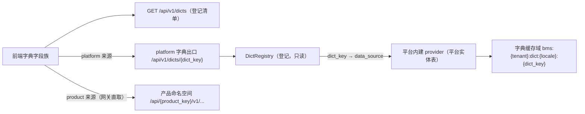

# 09 详细设计 · 字典域剔除「字典类型 / 字典条目」

> 项目骨架 · 02 后端基座 · 子任务 09 · 详细设计 01

[文档首页](../../../../../../文档首页.md) › [02 后端基座](../../02_后端基座.md) › [09 字典域剔除字典类型条目](../02_后端基座_09_字典域剔除字典类型条目.md) › 设计　|　[← 任务文档](../02_后端基座_09_字典域剔除字典类型条目.md)

## 1. 目的与口径 <a id="purpose"></a>

按 2026-10-11 用户拍板（含逐项确认汇总）：**字典域＝原始需求**——字典字段、取数、缓存、翻译、数据权限左列、字典页；「**字典**」＝**基础数据 / 参考数据**（含主数据，但**不止主数据**：bms 的用户 / 角色 / 租户、biz 的仓库储位等也都是字典）。AI 自行编造的「**字典类型 / 字典条目 / 字典属性**」一套（实质是「选项类型 / 选项条目」）被借「字典」之名混入，**剔除之**；被剔处的取数改由**字典数据源登记 + 统一出口**承载。**不存在「拆除字典域」**。

- **保留**：字典三契约与取数 / 批量 / 翻译实现（`dict/base|cache|null`）、运行时取数 `GET /api/v1/dicts/{dict_key}`、`POST /api/v1/dicts/batch`、**高级查询**（`/{dict_key}/attrs`、`/query-providers`、`/{dict_key}/advanced-query`）与查询方案（`sys_query_scheme`，含 `target=business` 列表筛选）、前端字典字段族（`@bms/core` 能力与 `@bms/ui-ep` 件族）、数据权限左列、字典页、需求 02-44 / 02-56。
- **删除**（编造内容）：六表 `sys_dict_type` / `sys_dict_item` / `sys_dict_attr` + `sys_dict_type_i18n` / `sys_dict_item_i18n` / `sys_dict_attr_i18n`；`bms_core/dict/models.py`（六 ORM）、`service.py`（维护写路径）、`seed.py`（六表种子）；`platform/api/dict.py` 的**维护 / 属性端点**（`/types*`、`/items*`、`/attrs*`）；`ops/seed_dict.py` / `ops/backfill_dict_parent_id.py`；六份表文件与总览 / 表登记。
- **改指**（不删，换数据源）：`dict/sql.py` 的**本地六表取数实现** → 改为按登记路由的取数实现；`dict/query.py` 高级查询执行、`dict/providers.py` 业务查询提供者 → 改为经登记出口取数；`dict/http.py` 跨服务读出口 → 改为按登记寻址产品命名空间。
- **新增**：**字典数据源登记**（统一注册表 + 构建期清单，各项目装载注入、运行期只读）+ **字典统一出口** + `GET /api/v1/dicts`（可用字典登记清单）。
- **命名**：**标识统一用 `key`、代码统一用 `code`**（《命名规范》新增条）；字典标识 `dict_type` / `dictType` → **`dict_key` / `dictKey`**（后端参数、`{dict_type}` 路径参、前端字段族、契约快照、`@bms/api-types` 全链改名）；字典条目代码仍 `code`。
- **数据权限**：`sys_data_scope` 归属列由 `dict_type_id`（BIGINT）改 **`dict_key`（VARCHAR(64)）**。

## 2. 影响面清单 <a id="impact"></a>

| # | 层 | 内容 | 量 |
| --- | --- | --- | --- |
| 1 | 数据库 | `sys_dict_*`（六表）drop 迁移（四库兼容、幂等、先删数据后删表）；`sys_data_scope` 归属列改 `dict_key`（VARCHAR 64）+ 存量清空 + 唯一约束列同步 | 6 表 + 1 改列 |
| 2 | 后端基座 | 删 `dict/models|service|seed` 与 `dict/sql` 本地表取数实现、维护 / 属性端点；**改指** `dict/query|providers|http` 经登记出口取数；**新增** `dict/registry.py`（登记 + 注册表 + 构建期清单）+ 统一出口契约与实现；清 `api/deps.py`（`get_dict_service` / `get_dict_query_service` 引用）、`core/assembly.py`（`SqlDict*` 工厂 / `BuiltinDictQueryProvider` 装配）、`core/config.py`（`query_provider_registry` 等配置项按需） | — |
| 3 | 接口 | 保留 `GET /api/v1/dicts/{dict_key}`、`POST /dicts/batch`、`/{dict_key}/attrs`、`/query-providers`、`/{dict_key}/advanced-query`、`/query-schemes`；**新增** `GET /api/v1/dicts`（登记清单）；**移除**维护 / 属性端点；契约快照 + `@bms/api-types` 重生成 | — |
| 4 | 前端 | 字典字段族保留；`dict_type` / `dictType` 全链改 `dict_key` / `dictKey`（`@bms/core` 能力 / `domain/dict.ts`、`@bms/ui-ep` 件族、`@bms/api-types`）；数据权限左列改列「字典」（登记清单）；缓存键段不变（`bms:dict:*`、无需迁移） | — |
| 5 | 数据权限 / 查询方案 | `sys_data_scope.dict_key` + 校验改由登记提供 `allowlist` / 存在性；**`sys_query_scheme.dict_type` → `dict_key`（迁移 0014 + `listing` base/models/store + 契约 / `@bms/api-types` + 前端）**；`role_grant` / `scope/rbac` / `permission` / 契约 `dict_key` | — |
| 6 | 文档 | 需求 02-44 / 02-56 改写；《命名规范》加条；表文件 / 总览登记 / 后端基类清单 §9-§10 / 架构 04 / 07 / 15 / 数据规范 / 概设 09 / 布局 17 / 组件设计（字典字段、权限配置）相关处 | — |

**交付物文件清单**（框线文本）：

```
bms/backend/libs/bms_core/src/bms_core/dict/
├─ base.py            # 三契约（取数 / 翻译 / 缓存域）—— 保留；标识参数 dict_type → dict_key
├─ registry.py        # 新增：DictRecord / DICT_CATALOG / DictRegistry / merge_dict_records（登记 + 构建期清单）
├─ outlet.py          # 新增：字典统一出口（按 dict_key 路由到登记数据源）+ 空实现
├─ cache.py           # 缓存域实现（Memory / Redis）—— 保留；缓存方法更名避与 dict_key 同名
├─ http.py            # 跨服务读出口 —— 改指：按登记寻址产品命名空间
├─ query.py           # 高级查询执行 —— 改指：经出口取数
├─ providers.py       # 业务查询提供者 —— 改指：经出口取数
├─ null.py            # 空实现 —— 保留
├─ sql.py             # 本地六表取数实现 —— 删除（由 outlet/登记实现取代）
├─ models.py          # 六 ORM —— 删除
├─ service.py         # 维护写路径 —— 删除
└─ seed.py            # 六表种子 —— 删除
bms/backend/services/platform/src/bms_platform/api/dict.py   # 维护 / 属性端点删除；新增 GET /dicts（登记清单）
bms/backend/alembic/versions/platform/tenant/0012_*.py       # 新增：sys_data_scope.dict_key 改列 + 存量清空
bms/backend/alembic/versions/platform/tenant/0013_*.py       # 新增：六表 drop
```

## 3. 字典数据源登记（登记 + 统一出口） <a id="registry"></a>

口径：**字典数据源（谁供数）＝登记项**；`dict_key` 为**字典标识业务码字符串**（如 `role` / `tenant` / `org_dept` / `org_post` / `region` / `wms_bin`）。**登记项是数据源清单，不落字典数据本体**——数据本体由各所有者域承载（bms 平台实体表 / mdm 产品 / biz 产品）。**取数通道分两路**：**平台内建**字典经平台统一出口（`/api/v1/dicts/*`）取数；**产品来源**字典由**前端经网关直取**产品命名空间（`/api/{product_key}/v1/...`，与组织字段 06_05 同口径），**后端不直连产品**（`service_client` 只允许 `/api/v1`，且架构 37「消费方不直连权威库」）。

### 3.1 登记记录与注册表 <a id="registry-records"></a>

- **登记记录 `DictRecord`**（不可变值对象）：
  - `dict_key` 字典标识（业务码，`^[a-z][a-z0-9_]*$`，全局唯一）
  - `name` 名称（数据权限左列 / 字典页显示；多语言随所有者域下发）
  - `origin` 来源（`platform` 平台内建 / `product` 产品提供；产品须带 `product_key`）
  - `data_source` 数据出口标识（统一出口按此路由到具体实现）
  - `path` 产品取数路径（`origin=product` 时前端经网关直取用，如 `/data-source/dept-tree`）
  - `allowlist` 可用于数据权限的字段白名单（`match` 策略可匹配字段）
  - `cascade` 是否级联（有无上级字段，供级联取数）
  - `strategies` 可用策略集合（`select` / `region` / `match` / `extension`，供数据权限左列渲染）
  - `status` 状态（`enabled` / `disabled`）
- **单一来源与注入**（口径同服务目录 `ModuleRegistry`、产品服务接入）：`DICT_CATALOG` 是 **bms 侧构建期清单**（平台内建字典）；产品在**构建期注入**自身登记项；应用工厂经 `merge_dict_records()` 拼接清单与注入记录，构造入参进入 `DictRegistry`（**无进程级注册表、不改常量**，运行期只读）。
- **离线校验** `DictRegistry.validate()`：`dict_key` 格式与唯一；`name` / `data_source` 非空；白名单字段名格式；`strategies` 取值合法；`origin=product` 须带 `product_key`。

### 3.2 统一出口 <a id="outlet"></a>

- 保留现有三契约：`BaseDictSource`（`by_type` / `batch`）、`BaseDictTranslator`（`translate`）、`DictCacheRegion`（`domain="dict"`）。参数 / 结果契约字段标识改 `dict_key`。
- **平台统一出口**：按 `dict_key` 查登记 → 取 `data_source` → 路由到对应**平台内建数据源提供者**，承载取数 / 版本比对 / 批量合并 / 标签翻译 / 级联 / 高级查询；承载平台内建字典（`origin=platform`），**未登记 / 停用 / 产品来源 / 无提供者**一律返回空结果（版本 0、`items=()`），调用方无需区分。
- **产品来源字典**：登记项按 `origin=product` + `product_key` + `path` 声明，由**前端经网关直取**产品命名空间（`/api/{product_key}/v1/{path}`）取数；平台出口不代理产品。
- **示例（本期各落一）**：
  - **平台内建**：`role`——平台侧提供者读平台实体表（`sys_role`），经平台出口真实取数。
  - **跨项目**：`org_dept` / `org_post`——登记为产品来源（`mdm`），**前端经网关直取** mdm 既有组织出口（`/api/mdm/v1/org/data-source/...`）；**本期不改 mdm 代码**、后端不经手。
  - 其余登记项先占位（`data_source` 已登记、提供者随各自域回补）。



### 3.3 登记清单端点 <a id="catalog-endpoint"></a>

新增 `GET /api/v1/dicts`（登录即可）：返回**可用字典登记清单**，每项含 `dict_key` / `name` / `origin`（含 `product_key`）/ `path`（产品取数路径）/ `allowlist` / `cascade` / `strategies` / `status`；供**数据权限左列**与**字典页**取可用字典（不再依赖已删的字典类型表），并供前端判定走平台出口还是产品直取。

### 3.4 缓存与命名 <a id="cache-naming"></a>

- 缓存 key **保持** `bms:{tenant}:dict:{locale}:{dict_key}` + 版本键 `bms:{tenant}:dict:version`（`dict_key` 即原字典标识取值，**key 段不变、不 bump**）；`dict/cache.py` 实现保留。
- **更名避同名**：缓存域方法 `DictCacheRegion.dict_key()`（拼缓存 key）与新增的字典标识字段 `dict_key` 同名 → 缓存方法更名为 `type_cache_key()`（及对应 `value_cache_key` / `version_cache_key` 等一致性检视）。
- 前端 `localStorage` 键段不变（`bms:dict:*`），字段名随标识改名同步。

## 4. 数据权限改按字典标识 <a id="data-scope"></a>

- `sys_data_scope` 归属列 `dict_type_id`（BIGINT → 字典类型）改为 **`dict_key` VARCHAR(64)**（字典标识业务码，如 `org_dept` / `sys_user` / `wms_bin`）。
- **迁移**：`platform:tenant` 链新迁移改列 + **存量清理**（字典域废弃、不回填 → 迁移内清空存量行）；唯一约束 `uq_sys_data_scope_role_dict_policy_deleted_at` 列同步改 `dict_key`。
- **校验**：由**字典数据源登记**提供字段白名单与存在性（`dict_key` 须已登记且 `status=enabled`；`match` 的 `field` 须属该登记项 `allowlist`）；不再查 `sys_dict_type` / `sys_dict_attr`。
- **契约 / 运行时**：`schemas/role.py`、`role_grant` / `scope/rbac` / `permission` / `permission/snapshot.py` 的 `dict_type_id` 全链改 `dict_key`；契约快照与 `@bms/api-types` 重生成；前端 `role.ts` / `RolePermissionConfig.vue` / `permissionMeta.ts` 同步（左列改取 `GET /api/v1/dicts`）。

## 5. 迁移与回滚 <a id="migration"></a>

- **历史迁移不动**（`0001_dict_and_query_scheme` / `0010` / `0011` 保持）；新增两条（`platform:tenant` 链）：
  - **`0012_data_scope_dict_key`**：`sys_data_scope.dict_type_id` → `dict_key` VARCHAR(64)；先改唯一约束列（`batch_alter_table` + `postgresql_using` 三库适配）、**清空存量行**、删列重建；`downgrade` 反向回 `dict_type_id`（BIGINT，存量不回填）。
  - **`0013_drop_dict_tables`**：**先删数据后删表**、幂等拆六表（`batch_alter_table` 四库兼容）；`downgrade` 重建六张**空表**。
  - **`0014_query_scheme_dict_key`**：查询方案表 `sys_query_scheme.dict_type` → `dict_key`（纯改名；唯一约束随列重建）；`downgrade` 反向回 `dict_type`。
- **回滚**：以本任务提交为界；数据侧字典行随表拆除**不回填**（`downgrade` 重建空表并显式说明不恢复历史行）。
- **方言**：drop 表与改列四库兼容编写；**未真库实测的结论标「待验」**，实测随部署窗口回写方言特性文档。

## 6. 验收与测试 <a id="accept"></a>

- □ 六表与维护 / 属性端点 / 六表模型 / 写路径 / 种子 / 脚本 / 表文件 / 登记清除，全仓无悬挂引用（编译 / 类型 / 门禁通过）
- □ 字典取数 / 缓存 / 翻译 / 高级查询经**登记出口**跑通；`GET /api/v1/dicts`（登记清单）、`/api/v1/dicts/{dict_key}`、`/dicts/batch` 行为不变；前端字典字段族可用
- □ 本期示例真实取数各一：平台内建（如 `sys_tenant`）+ 跨项目（`org_dept` / `org_post` 经 mdm）；其余登记项占位可解析
- □ 数据权限左列改由登记清单承载并可读；`sys_data_scope` 改按 `dict_key`
- □ 命名全链收口：字典标识 `dict_type` / `dictType` → `dict_key` / `dictKey`；《命名规范》新增条落地
- □ 需求 02-44 / 02-56 保留（仅剔除「字典类型 / 条目」表述，能力改述为「经字典数据源出口」）
- □ 定向用例与门禁全绿（check-links / check-docs-scope / check-base / check-status / preflight）

## 7. 风险与遗留 <a id="risk"></a>

- **面广**：跨数据库 / 后端 / 前端 / 契约 / 文档，且含 **全仓改名**（`dict_type` → `dict_key`，约 800+ 行）；按「先设计后实施」推进，禁止先删代码后改文档。
- **替代前置**：登记 + 出口须先就位，取数方可切数据源；**跨项目示例**依赖 mdm 组织出口在场（本机联调环境）。
- **范围外**：mdm 侧改造（region 等纯参考类落 mdm 数据实体、组织域读取对接）**另立 mdm 任务**，本任务只改 bms。
- **改名副作用**：`dict_key` 与既有缓存域方法 `dict_key()` 同名 → 缓存方法更名；前端 `localStorage` 键段不变、无需缓存迁移。
- **残留**：代码里另有「动作枚举 / 三态枚举」等通用开发用词，与本域无关，不在范围。

> 本文档为需求评审后的详细设计定稿 · 与《文档生成规范》配套
