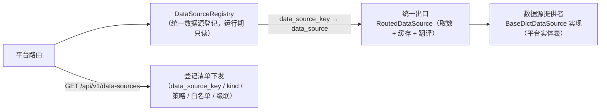
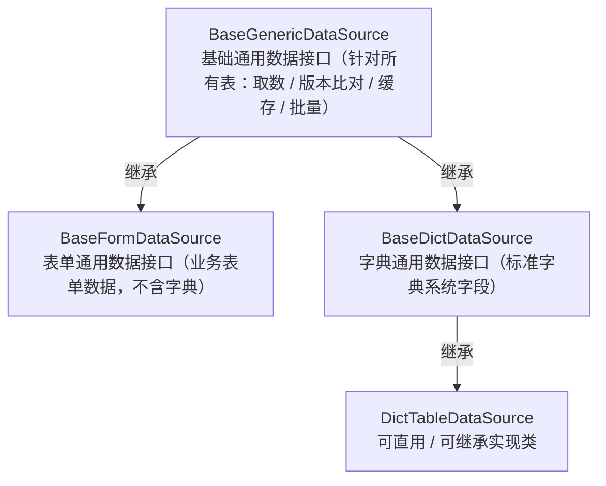
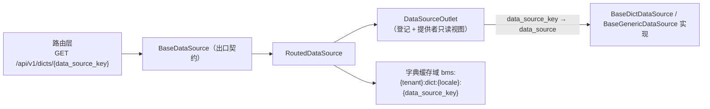

# 10 详细设计 · 统一数据源注册与通用数据接口

> 项目骨架 · 02 后端基座 · 子任务 10 · 详细设计 01

[文档首页](../../../../../../文档首页.md) › [02 后端基座](../../02_后端基座.md) › [10 统一数据源注册与通用数据接口](../02_后端基座_10_统一数据源注册与通用数据接口.md) › 设计　|　[← 任务文档](../02_后端基座_10_统一数据源注册与通用数据接口.md)

## 1. 目的与口径 <a id="purpose"></a>

按 2026-10-11 用户拍板（含逐项确认汇总）：注册的对象本质是「**数据从哪来**」——一个数据源可被**多个界面 / 表单**复用，「字典」只是其中**一类**；表单是**界面**，其背后的数据也是数据源。故把「字典数据源登记」泛化为**统一数据源注册**（按类型区分），并把数据接口抽为**三层**。

本任务（需求 [02-57](../../../../需求/02_需求_后端基座.md#r02-57)）交付四件事：

1. **统一数据源注册**：`DataSourceRegistry` 登记 **数据源**（`data_source_key` / 名称 / **类型**（`dict` 字典 / `form` 表单，预留其它）/ 数据出口 / 字段白名单 / 级联 / 可用策略 / 状态）；**构建期清单 + 各项目装载注入、运行期只读**；`GET /api/v1/data-sources` 下发清单（供通用页面路由 / 数据权限左列）。
2. **通用数据接口三层**：`BaseGenericDataSource`（**基础通用数据接口**，针对**所有表**：取数 / 版本比对 / 缓存 / 批量等通用部分）← `BaseFormDataSource`（**表单通用数据接口**：业务表单数据，**不含字典**）/ `BaseDictDataSource`（**字典通用数据接口**）；后两者继承基础、只声明各自差异。
3. **字典通用数据接口**：`BaseDictDataSource` + **可直用 / 可继承实现类**（读标准字典系统字段 `code` / `name` / `parent_id` / `sort` / `status`），各项目直接使用或继承——原登记于 `02_09` 的补强并入本任务统一处理，亦为 **mdm 需求域二 `02_01` 的前置**。
4. **命名重构 + 回填**：`dict_key → data_source_key` 全链收口（含 `02_09` 改名）；`sys_data_scope` / `sys_query_scheme` 列同步；`form_key` 构建期清单的 `FormRecord.data_source_key` 归并回填（`form_key → data_source_key` 多对一，供 `02_13` 通用页面路由解析）。

**边界（拆分，不越界）**：`form_key` 落表（表文件 / 模型 / 迁移）归 [`02_11`](../../02_后端基座_11_系统字段form_key落表/02_后端基座_11_系统字段form_key落表.md)（已交付）；契约**正式化**与 `@bms/api-types` 重生成归 [`02_12`](../../02_后端基座_12_数据源注册与通用接口契约/02_后端基座_12_数据源注册与通用接口契约.md)；**前端**通用页面路由与 `dictKey → dataSourceKey` 归 [`02_13`](../../02_后端基座_13_前端通用页面路由/02_后端基座_13_前端通用页面路由.md)；产品仓（mdm / biz / cw）表与引用随各自仓库任务。**本次仅 bms 仓**。

**唯一事实源**：表结构（字段 / 类型 / 约束 / 索引）只在各表文件维护（`设计/数据库设计/数据表设计/{表名}.md`），本设计只写**变更增量**；通用约定见《数据库设计 · 数据规范》。

## 2. 决策确认汇总 <a id="decisions"></a>

| # | 事项 | 结论 | 取舍说明（长期收益 / 迁移成本） |
| --- | --- | --- | --- |
| 1 | 泛化层落点 | **新建 `bms_core/datasource/`** 承载 `DataSourceRegistry` 与三层接口；字典专用件（`DictItem` / `DictQuery` / 缓存 / 翻译 / 高级查询 / 出口实现）留 `bms_core/dict/` | 职责分层最清晰、缓存键（`bms:{tenant}:dict:*`）与字典语义零波及；成本＝新增目录 + 少量跨目录 import |
| 2 | 插件键与配置节 | **仅通用取数出口** `dict_source → data_source`（配置节 `[dict_source] → [data_source]`）；`dict_translator` / `dict_cache_region` **保持** | 命名与泛化对齐、波及可控；翻译 / 缓存域本属字典专用，改名收益有限 |
| 3 | 端点路径 | **清单** `GET /api/v1/dicts → GET /api/v1/data-sources`；**运行时取数保留** `/api/v1/dicts/{data_source_key}` 与 `/dicts/batch` | 与「登记泛化、取数仍字典专用」一致；前端字典字段族零路径改动面 |
| 4 | `dict_key` 改名层级 | **全链收口**：DB 列 + ORM 属性 + API 契约字段 + 前端（前端归 `02_13`） | 与任务「列同步改 `data_source_key`」与「前端 `dictKey → dataSourceKey`」一致；成本＝契约快照与 `api-types` 重生成 |
| 5 | `form_key → data_source_key` 回填 | **默认 1:1 同名**（`role → role` / `user → user` / `tenant → tenant`）；结构保留多对一 | 与现有登记示例一致、直白可机检；将来多界面共享一数据源时显式声明即可 |
| 6 | 契约快照 / `api-types` 边界 | **契约快照（`platform.json` + `baseline`）随本任务更新**（保门禁绿）；`@bms/api-types` 归 `02_12` | 避免本任务交付即门禁红；`02_12` 正式化契约并驱动前端类型 |
| 7 | 登记项字段 | **既有字段全保留**（`origin` / `product_key` / `path` / `allowlist` / `cascade` / `strategies` / `status`）**+ 新增 `kind`** | 零信息丢失、产品来源字典不破；成本＝仅多一列 |
| 8 | 三层接口结构 | **按任务字面**：提供者层 `BaseGenericDataSource` ← `BaseFormDataSource` / `BaseDictDataSource`；出口取数契约 `BaseDictSource → BaseDataSource`、路由实现 `RoutedDictSource → RoutedDataSource`；字典侧另给可直用 / 可继承实现类 | 完全对齐需求 02-57；成本＝出口契约与提供者层分名、出口做通用条目→字典条目映射 |
| 9 | 连带改名范围 | 任务点名之外的**同族符号全数顺延**（`DataSourceRecord` / `DATA_SOURCE_CATALOG` / `merge_data_source_records` / `DataSourceOrigin·Strategy·Status` / `DATA_SOURCE_KEY_PATTERN` / `EmptyDictDataSource` / `DataSourceOutlet` / `build_data_source_outlet` / `register_data_source` / `HttpDataSource` / `PlatformDictDataSource`） | 与 `DataSourceRegistry` 命名自洽、不留半旧半新；成本＝本任务多改若干符号（均在改名清单内） |
| 10 | `sys_data_scope` 唯一约束名 | **重命名** `uq_sys_data_scope_role_dict_policy_deleted_at → uq_sys_data_scope_role_data_source_policy_deleted_at` | 约束名与列名口径一致；成本＝迁移多一步 drop + create（SQLite `batch_alter_table` 重建兼容） |
| 11 | 泛化层条目类型 | **泛化层新定义 `DataSourceItem`**（含 `extra` 动态列），出口 `RoutedDataSource` 映射为对外契约 `DictItem` | 泛化层不依赖字典层（避免 `datasource ⇄ dict` 循环，不与决策 1 冲突）；成本＝出口一次映射 |
| 12 | `DATA_SOURCE_CATALOG` 范围 | **扩到覆盖 bms 侧全部字典表**（12 张 `form_key` 各一条，`kind=dict` / `origin=platform` / `data_source=platform`）+ 保留 `org_dept` / `org_post` 跨项目示例；`form_key → data_source_key` 做**成员校验** | 登记表成为数据源**权威清单**、`02_13` 通用路由可直接解析；成本＝新增 9 条登记（默认取值：`allowlist=(code,)` + 内置、`strategies=(select,)`、`cascade` 按有无层级） |
| 13 | 平台字典提供者范围 | **本期仅 `role` 示例、其余返空**（与 `02_09`「示例各落一」一致） | 不臆造新取数逻辑；可直用实现类 `DictTableDataSource` 已交付、各域随各自任务接入 |

## 3. 影响面与交付物清单 <a id="impact"></a>

### 3.1 影响面 <a id="impact-scope"></a>

| # | 层 | 内容 |
| --- | --- | --- |
| 1 | 后端基座（新增） | 新目录 `bms_core/datasource/`（登记表 + 三层接口 + 通用条目）；字典侧新增可直用实现类 `DictTableDataSource` |
| 2 | 后端基座（改名 / 迁移） | `dict/registry.py` → `datasource/registry.py`；`BaseDictDataProvider → BaseDictDataSource`（迁泛化层）；`BaseDictSource → BaseDataSource`、`RoutedDictSource → RoutedDataSource`（留 `dict/`）；插件键 `dict_source → data_source`；`get_dict_source → get_data_source` |
| 3 | 数据库 | `platform:tenant` 链新迁移 `0016_data_source_key`：`sys_data_scope.dict_key → data_source_key`、`sys_query_scheme.dict_key → data_source_key`（含唯一约束列） |
| 4 | 接口 | **新增** `GET /api/v1/data-sources`（登记清单，泛化含 `kind`）；**移除** `GET /api/v1/dicts`（清单迁走）；字典取数 / 批量 / 高级查询路径参数改 `data_source_key` |
| 5 | 数据权限 / 查询方案 | `sys_data_scope` / `sys_query_scheme` ORM 与全链（`role_grant` / `rbac` / `permission` / `listing`）字段改 `data_source_key`；`role` 契约 `dict_key → data_source_key` |
| 6 | 契约 | `deploy/contracts/platform.json` + `deploy/contracts/baseline/platform.json` 重生成（本任务）；`@bms/api-types` 归 `02_12` |
| 7 | 文档 | 表文件 2 份；`后端基类清单.md`；《架构设计》04 / 07 / 15；《概要设计 · 字典管理》；《命名规范》；需求 02-57 与任务 02_10 / 02_12 / 02_13 |

### 3.2 交付物清单 <a id="deliverables"></a>

```
bms/backend/libs/bms_core/src/bms_core/datasource/          # 新增：统一数据源泛化层
├─ __init__.py               # 导出登记表与三层接口
├─ registry.py               # 新增：DataSourceKind / DataSourceRecord / DATA_SOURCE_CATALOG
│                            #      / merge_data_source_records / DataSourceRegistry（自 dict/registry.py 迁入并泛化）
└─ base.py                   # 新增：DataSourceItem + BaseGenericDataSource / BaseFormDataSource / BaseDictDataSource
bms/backend/libs/bms_core/src/bms_core/dict/
├─ registry.py               # 删除（内容迁 datasource/registry.py）
├─ base.py                   # BaseDictSource → BaseDataSource；DictQuery / DictTranslateQuery 字段改 data_source_key
├─ outlet.py                 # BaseDictDataProvider 迁出；DictOutlet → DataSourceOutlet；RoutedDictSource → RoutedDataSource
│                            #      （出口做 DataSourceItem → DictItem 映射）；register_dict_provider → register_data_source
├─ table.py                  # 新增：DictTableDataSource（可直用 / 可继承实现类，读标准字典系统字段）
├─ cache.py / http.py / null.py / providers.py / query.py    # 字段 / 参数改名（语法级，语义不变）
bms/backend/libs/bms_core/src/bms_core/registry/forms.py     # FormRecord.data_source_key 回填（构建期清单）
bms/backend/libs/bms_core/src/bms_core/listing/
├─ base.py                   # QueryScheme.dict_key → data_source_key
├─ models.py                 # SysQueryScheme.dict_key → data_source_key（列 + 属性 + 唯一约束列）
└─ store.py                  # row.dict_key → row.data_source_key
bms/backend/libs/bms_core/src/bms_core/core/
├─ config.py                 # settings.dict_source → settings.data_source
├─ assembly.py               # PluginWiring / register_plugin / 工厂改名（RoutedDataSourceFactory / HttpDataSourceFactory）
└─ api/deps.py               # get_dict_source → get_data_source
bms/backend/services/platform/src/bms_platform/
├─ api/data_source.py        # 新增：GET /api/v1/data-sources（登记清单）
├─ api/dict.py               # 移除 GET /dicts（清单）；路径参数改 data_source_key
├─ api/router.py             # 登记 data_source.router
├─ sources/dict_source.py    # PlatformDictDataProvider → PlatformDictDataSource（继承 BaseDictDataSource）
├─ models/role.py            # SysDataScope.dict_key → data_source_key（列 + 属性 + 唯一约束）
├─ schemas/role.py           # RoleDataScopeEntry{Request,Item}.dict_key → data_source_key
├─ services/{permission,role_grant}.py、scope/rbac.py        # 字段改名
└─ main.py                   # register_data_source(...)
bms/backend/alembic/versions/platform/tenant/0016_data_source_key.py   # 新增：两表列改名
bms/backend/config.dev.toml                                  # [dict_source] → [data_source]
bms/scripts/tools/base-check/check-system-fields.py          # 扩展：form_key → data_source_key 引用有效性
bms/deploy/contracts/platform.json + baseline/platform.json   # 契约快照重生成
bms/bms文档/设计/数据库设计/数据表设计/{sys_data_scope,sys_query_scheme}.md   # 列改名 + 变更记录
```

## 4. 统一数据源注册 <a id="registry"></a>

口径：**登记的对象是「数据从哪来」**——`data_source_key` 为**数据源标识**（业务码字符串，`^[a-z][a-z0-9_]*$`，全局唯一）；「字典」只是**一类**（`kind=dict`），表单数据源（`kind=form`）与将来其它类型同归此表。登记项**只登记数据源清单与元信息，不落数据本体**（数据本体由各所有者域承载）。

### 4.1 登记记录与枚举 <a id="registry-records"></a>

- **枚举**（`datasource/registry.py`）：
  - `DataSourceKind`：`DICT="dict"`（字典）/ `FORM="form"`（表单）——**预留其它**（新增取值即扩展枚举）。
  - `DataSourceOrigin`（原 `DictOrigin`）：`PLATFORM` / `PRODUCT`（数据所有者类别）。
  - `DataSourceStrategy`（原 `DictStrategy`）：`select` / `region` / `match` / `extension`（数据权限可用策略）。
  - `DataSourceStatus`（原 `DictStatus`）：`enabled` / `disabled`。
  - `DATA_SOURCE_KEY_PATTERN`（原 `DICT_KEY_PATTERN`）。
- **登记记录 `DataSourceRecord`**（不可变值对象，`@dataclass(frozen=True)`，继承 `BaseValueObject`；原 `DictRecord`）：

| 字段 | 说明 |
| --- | --- |
| `data_source_key` | 数据源标识（业务码字符串，全局唯一；原 `dict_key`） |
| `name` | 名称（数据权限左列 / 通用页面展示） |
| `kind` | **类型**（`dict` / `form`，预留其它；**新增**） |
| `data_source` | 数据出口标识（出口按此路由到具体实现，如 `platform` / `mdm.org.dept`） |
| `origin` | 来源（`platform` 平台内建 / `product` 产品提供） |
| `product_key` | 产品标识（`origin=product` 时必填，如 `mdm` / `biz`） |
| `path` | 产品取数路径（`origin=product` 时前端经网关直取，如 `/data-source/dept-tree`） |
| `allowlist` | 可用于数据权限的字段白名单（`match` 策略可匹配字段） |
| `cascade` | 是否级联（有无上级字段） |
| `strategies` | 可用策略集合（`select` / `region` / `match` / `extension`） |
| `status` | 状态（`enabled` / `disabled`） |

### 4.2 构建期清单与注入 <a id="registry-catalog"></a>

- `DATA_SOURCE_CATALOG`（原 `DICT_CATALOG`）：**bms 侧构建期清单**——
  - **bms 侧全部字典表**（决策 12：12 张 `form_key` 各一条，覆盖 `02_11` 的 `FORM_CATALOG`）：`role` / `user` / `tenant` / `config` / `module` / `product` / `business` / `action` / `identity_provider` / `client` / `task` / `icon`——均 `kind=dict` / `origin=platform` / `data_source=platform`；`allowlist=(code,)`（外加内置 `code` / `name` / `remark`）、`strategies=(select,)`、`cascade` 按有无层级。
  - **跨项目示例**：`org_dept`（`cascade=True`）/ `org_post`——`kind=dict` / `origin=product` / `product_key=mdm` / `path` 指向 mdm 组织出口。
- `merge_data_source_records(builtin, injected)`（原 `merge_dict_records`）：各项目**构建期注入**自身登记项，应用装配期拼接（**无进程级注册表、不改常量**，运行期只读）——口径同服务目录 `ModuleRegistry`、`form_key` 清单 `FormRegistry`。
- 装配入口：`DataSourceRegistry(merge_data_source_records())`（应用工厂构造入参）。

### 4.3 离线校验 <a id="registry-validate"></a>

`DataSourceRegistry.validate()`（原 `DictRegistry.validate()`）扩展：`data_source_key` 格式与唯一；`name` / `data_source` 非空；**`kind` 取值合法**；`origin` / `strategies` 取值合法；`origin=product` 须带 `product_key`；白名单字段名格式。并断言**字典类数据源覆盖 `FormRegistry` 全部 `form_key`**（决策 12：清单闭合）。

### 4.4 登记清单端点 <a id="registry-endpoint"></a>

- **新增** `GET /api/v1/data-sources`（登录即可，`BaseRouter(prefix="/data-sources")`）：返回全部可用数据源登记项（`data_source_key` / `name` / `kind` / `origin` / `product_key` / `path` / `allowlist` / `cascade` / `strategies` / `status`），供**数据权限左列**与**通用页面**取可用数据源。
- **移除** 原 `GET /api/v1/dicts`（清单职责迁至 `/data-sources`；字典专用仅保留 `kind=dict` 项的过滤能力，由前端 / 消费方按 `kind` 筛）。



## 5. 通用数据接口三层 <a id="layers"></a>

### 5.1 分层与继承 <a id="layers-structure"></a>

口径：**所有表**的通用取数能力收敛在**基础通用数据接口**，表单 / 字典**只声明各自差异**。三层与出口契约分属两条线：



> 出口取数契约线（`BaseDataSource` ← `RoutedDataSource` / `HttpDataSource`）**独立于**上述提供者三层：出口对外（路由层依赖），提供者对内（出口路由到提供者）。二者在 `dict/outlet.py` 汇合。

### 5.2 基础通用数据接口 `BaseGenericDataSource` <a id="layers-generic"></a>

- **落点**：`bms_core/datasource/base.py`；`BasePluggable + ABC`（`key = plugin_key = "data_source"`）。
- **契约**（所有表通用）：
  - `data_source`（抽象属性）：数据出口标识（与登记项 `DataSourceRecord.data_source` 对齐）。
  - `cache_domain`（属性，缺省 `"data_source"`）：缓存域简称（子类可覆写；字典提供者沿用字典域）。
  - 异步 `load(data_source_key, locale) -> tuple[DataSourceItem, ...]`（**抽象**）：取数（加载某数据源全部启用行）。
  - 异步 `version(data_source_key) -> int`（**缺省 `0`**）：版本比对（`0`＝不参与版本比对）。
  - 异步 `batch(data_source_keys, locale)`（**缺省逐键 `load` 合并**）：批量取数。
- **通用条目 `DataSourceItem`**（`BaseSchema`，定义于泛化层，避免 `datasource → dict` 反向依赖）：`id` / `value` / `label` / `code` / `parent_id` / `sort` / `status` / `color` / `extra`（动态扩展列，表单等非标准字段载体）。
- **缺省实现** `EmptyDictDataSource`（原 `EmptyDictDataProvider`，留 `dict/outlet.py`）：恒定空行。

### 5.3 表单通用数据接口 `BaseFormDataSource` <a id="layers-form"></a>

- **落点**：`bms_core/datasource/base.py`；继承 `BaseGenericDataSource`。
- **只声明差异**：`form_key`（抽象属性，与 `FormRecord.form_key` 对齐；业务表单数据按表单标识取数）+ 单据字段语义（`bill_date` / `status` 等，供通用页面路由消费）；取数 / 版本比对 / 缓存 / 批量**继承基础**。
- **实现类**：bms 仓**无落地对象**（业务表单在产品仓），本任务只落基类；产品仓（biz / mdm / cw）随各自任务继承实现。

### 5.4 字典通用数据接口 `BaseDictDataSource` <a id="layers-dict"></a>

- **落点**：`bms_core/datasource/base.py`；继承 `BaseGenericDataSource`。
- **只声明差异**：标准字典系统字段 `code` / `name` / `parent_id` / `sort` / `status`（常量 `DICT_FIELDS`）+ 字典条目语义（`value`=标识、`label`=名称、按 `locale` 本地化）。
- **可直用 / 可继承实现类** `DictTableDataSource`（`bms_core/dict/table.py`）：**读标准字典系统字段**的通用字典表数据源——注入「表名 / 字段映射 / 租户库引擎」，按 `status=enabled` + `deleted_at IS NULL` 取行并映射为 `DataSourceItem`；**可直接实例化使用（配置表名即用），也可被继承**（覆写字段映射 / 过滤 / 本地化）。**为 mdm 需求域二 `02_01`（参考数据域）前置**。
- **平台示例实现** `PlatformDictDataSource`（原 `PlatformDictDataProvider`，`services/platform/src/bms_platform/sources/dict_source.py`）：读平台实体表（**决策 13：本期仅 `role` 示例，其余数据源返空**，与 `02_09`「示例各落一」一致），`register_data_source(...)` 于 `main.py` 装配期注入。

### 5.5 出口契约 `BaseDataSource` 与出口实现 <a id="outlet"></a>

- **出口取数契约 `BaseDataSource`**（原 `BaseDictSource`，留 `bms_core/dict/base.py`）：`key = plugin_key = "data_source"`；异步 `by_type(DictQuery) -> DictTypeResult` + `batch(DictBatchQuery) -> DictBatchResult`（**字典形状，对外契约不变**）。
- **路由实现 `RoutedDataSource`**（原 `RoutedDictSource`，`dict/outlet.py`）：按 `data_source_key` 经 `DataSourceOutlet` 路由到提供者（`BaseGenericDataSource` 实现）+ 承载版本比对三态 / L1+Redis 缓存 / 关键字 / 级联 / 按值子集 / 探针截断；**出口负责 `DataSourceItem → DictItem` 映射**（泛化层不依赖字典契约）。
- **出口视图 `DataSourceOutlet`**（原 `DictOutlet`）：`DataSourceRegistry` + 提供者映射（`data_source → BaseGenericDataSource`）的只读路由视图；`provider_for(data_source_key)` 未登记 / 停用 / 无提供者一律返回空结果（版本 0、`items=()`）。
- **装配**：`register_data_source` / `registered_data_sources` / `build_data_source_outlet`（原 `register_dict_provider` / `registered_dict_providers` / `build_dict_outlet`）；插件键 `data_source`（`provider = "routed"` 平台内建 / `"http"` 跨服务读出口）。



## 6. 命名重构清单 <a id="rename"></a>

### 6.1 代码改名 <a id="rename-code"></a>

| 原名 | 新名 | 落点 |
| --- | --- | --- |
| `DictRegistry` | `DataSourceRegistry` | `datasource/registry.py` |
| `DictRecord` | `DataSourceRecord` | 〃 |
| `DICT_CATALOG` | `DATA_SOURCE_CATALOG` | 〃 |
| `merge_dict_records` | `merge_data_source_records` | 〃 |
| `DictOrigin` / `DictStrategy` / `DictStatus` | `DataSourceOrigin` / `DataSourceStrategy` / `DataSourceStatus` | 〃 |
| `DICT_KEY_PATTERN` | `DATA_SOURCE_KEY_PATTERN` | 〃 |
| —（新增） | `DataSourceKind`（`dict` / `form`） | 〃 |
| —（新增） | `DataSourceItem` | `datasource/base.py` |
| —（新增） | `BaseGenericDataSource` / `BaseFormDataSource` | `datasource/base.py` |
| `BaseDictDataProvider` | `BaseDictDataSource`（继承 `BaseGenericDataSource`） | `datasource/base.py`（自 `dict/outlet.py` 迁入） |
| `EmptyDictDataProvider` | `EmptyDictDataSource` | `dict/outlet.py` |
| `BaseDictSource` | `BaseDataSource` | `dict/base.py` |
| `RoutedDictSource` | `RoutedDataSource` | `dict/outlet.py` |
| `HttpDictSource` | `HttpDataSource` | `dict/http.py` |
| `DictOutlet` | `DataSourceOutlet` | `dict/outlet.py` |
| `build_dict_outlet` | `build_data_source_outlet` | 〃 |
| `register_dict_provider` / `registered_dict_providers` | `register_data_source` / `registered_data_sources` | 〃 |
| `get_dict_source` | `get_data_source` | `dict/base.py` + `core/api/deps.py` |
| `RoutedDictSourceFactory` / `HttpDictSourceFactory` | `RoutedDataSourceFactory` / `HttpDataSourceFactory` | `core/assembly.py` |
| `PlatformDictDataProvider` | `PlatformDictDataSource` | `services/platform/src/bms_platform/sources/dict_source.py` |

**保留不动**（字典专用）：`BaseDictTranslator` / `DictCacheRegion` / `MemoryDictCacheRegion` / `RedisDictCacheRegion` / `DictItem` / `DictQuery` / `DictBatchQuery` / `DictTranslateQuery` / `DictTypeResult` / `DictBatchResult` / `DictQueryService` / `BuiltinDictQueryProvider` / `HttpDictTranslator` / `RoutedDictTranslator` / `NullDict*` / 缓存域 `domain="dict"` / 插件键 `dict_translator` / `dict_cache_region` / 路由模块 `dict.py`（取数端点）。

### 6.2 插件键与配置 <a id="rename-plugin"></a>

| 原名 | 新名 | 落点 |
| --- | --- | --- |
| 插件键 `dict_source` | `data_source` | `PluginWiring` / `register_plugin` / `BaseDataSource.key` / `api/deps.py` |
| 配置节 `[dict_source]` | `[data_source]` | `backend/config.dev.toml`（`provider = "routed"`） |
| `settings.dict_source` | `settings.data_source` | `core/config.py`（`PluginSelection`） |
| — | `dict_translator` / `dict_cache_region` | **保持** |

### 6.3 契约字段与端点 <a id="rename-contract"></a>

| 位置 | 变更 |
| --- | --- |
| `DictQuery` / `DictTranslateQuery` | `dict_key → data_source_key` |
| 字典路由路径参数 | `/dicts/{dict_key} → /dicts/{data_source_key}`（`attrs` / `advanced-query` 同）；`query-providers` 查询参 `dict_key → data_source_key` |
| `listing` 契约 | `QueryScheme.dict_key → data_source_key` |
| `role` 契约 | `RoleDataScopeEntryRequest.dict_key` / `RoleDataScopeEntryItem.dict_key → data_source_key` |
| 高级查询提供者参数 schema | `builtin` 提供者 `dict_key → data_source_key` |
| **端点** | 新增 `GET /api/v1/data-sources`；移除 `GET /api/v1/dicts`（清单）；`POST /dicts/batch` 路径不变 |
| 契约快照 | `deploy/contracts/platform.json` + `deploy/contracts/baseline/platform.json` 重生成（`ops.contract_snapshot export` + `contract_gate baseline-update`） |

### 6.4 数据库列与迁移 <a id="rename-db"></a>

| 表 | 列 | 迁移 |
| --- | --- | --- |
| `sys_data_scope`（platform:tenant） | `dict_key → data_source_key`（VARCHAR(64)）；唯一约束列同步、约束名改 `uq_sys_data_scope_role_data_source_policy_deleted_at` | `0016_data_source_key` |
| `sys_query_scheme`（platform:tenant） | `dict_key → data_source_key`（VARCHAR(64)，可空）；唯一约束 `uq_scheme_scope_name_deleted_at` 列同步 | 〃 |

### 6.5 文档登记 <a id="rename-docs"></a>

- 表文件：`sys_data_scope.md` / `sys_query_scheme.md`（列改名 + 索引约束列 + 变更记录）。
- `后端基类清单.md`：字典取数条目、继承链条目、目录条目（`bms_core/datasource/`）。
- 《架构设计》04（基座分层 / 跨阶段基座契约表）、07（数据架构字典条目）、15（权限计算引擎数据权限）。
- 《概要设计 · 字典管理》（模块定位 / 功能点 / 核心表登记 / 数据流转）。
- 《命名规范》「标识用 `key`、代码用 `code`」条：示例口径更新为 `data_source_key`。
- 需求 `02_需求_后端基座.md` 02-57（口径对齐）；任务 `02_10`（详细设计链接）、`02_12` / `02_13`（前置契约标注）。
- 组件设计（字典字段、权限配置）与布局设计 `17_布局设计_字典页` 中的字段名（前端口径归 `02_13`）。

## 7. `form_key → data_source_key` 回填 <a id="backfill"></a>

- **承载**：`bms_core/registry/forms.py` 的 `FormRecord.data_source_key`（`02_11` 留空位）。
- **规则（决策 5 / 12）**：**默认 1:1 同名**——`form_key` 之名即 `data_source_key`（`role → role`、`user → user`、`tenant → tenant`、`config → config` …）；`DATA_SOURCE_CATALOG` **同步扩到覆盖 bms 侧全部字典表**（12 条），结构上保留**多对一**能力（将来多个界面共享同一数据源时显式声明同一 `data_source_key`）。
- **一致性约束（成员校验）**：`FormRecord.data_source_key` **必须落在 `DATA_SOURCE_CATALOG` 的 `data_source_key` 集合内**；`FormRegistry.validate()` 与 `check-system-fields` 双向断言（清单闭合：字典类数据源覆盖 `FORM_CATALOG` 全部 `form_key`）。
- **消费**：`02_13` 通用页面路由按 `form_key` 解析 `data_source_key` 并经出口取数（`form_key` 面向界面、`data_source_key` 面向数据）。

## 8. 迁移设计 <a id="migration"></a>

- **仅新增一条**（`platform:tenant` 链，head `0015_system_fields_form_key` 之后）：`0016_data_source_key.py`。
- **写法（纯改名，三库兼容）**：
  - `sys_data_scope`：`with op.batch_alter_table("sys_data_scope") as batch: batch.alter_column("dict_key", new_column_name="data_source_key", existing_type=sa.String(64), nullable=False)`；唯一约束改名（drop 旧名 + create 新名，列集不变）——SQLite 经 `batch_alter_table` 重建表兼容。
  - `sys_query_scheme`：`with op.batch_alter_table("sys_query_scheme") as batch: batch.alter_column("dict_key", new_column_name="data_source_key", existing_type=sa.String(64), nullable=True)`（**纯改名**，与 `0014` 同法）。
  - **不动数据**（列语义不变，值仍为数据源标识业务码）。
- **`downgrade`**：逐项反向改回 `dict_key`（约束名同步回退）。
- **历史迁移不动**（`0012` / `0013` / `0014` 保持）；`sys_data_scope` 存量在 `0012` 已清空不回填，本迁移沿用「不改语义」口径。
- **方言**：纯改名不涉方言 SQL；SQLite 开发库实测，三库真库演练随部署窗口（方言特性文档按需标「实测 / 待验」）。

## 9. 基座校验与门禁 <a id="guards"></a>

- **扩展 `bms/scripts/tools/base-check/check-system-fields.py`**：断言 `FormRecord.data_source_key` 非空且 ∈ `DATA_SOURCE_CATALOG` 的 `data_source_key` 集合（`form_key → data_source_key` 引用闭合，决策 12）。
- **`check-backend-base.py` / `check-service-boundaries.py`**：新目录 `bms_core/datasource/` 纳入基类继承与直继承校验（沿用现有扫描面）。
- **契约门禁**：`ops.contract_snapshot export` + `ops.contract_gate baseline-update`（新端点 + 字段改名 → 破坏性变更基线更新）。
- **`preflight --fast` 全绿**：`check-links` / `check-docs-scope` / `check-base` / `check-backend-base` / `check-service-boundaries` / `check-system-fields` / `check-status`。

## 10. 测试设计与验收映射 <a id="accept"></a>

| 验收项 | 测试 / 校验 |
| --- | --- |
| 统一数据源注册（`dict` / `form` 类型）就位 | `DataSourceRegistry.validate()` 取值合法 + 定向用例（登记 / 注入拼接 / 查询 / 校验） |
| `GET /api/v1/data-sources` 下发清单 | 平台 API 用例（清单含 `kind` / 策略 / 白名单 / 级联；登录即可）；契约快照含该路径 |
| 三层接口就位且表单 / 字典继承基础 | 继承链用例（`issubclass(BaseDictDataSource, BaseGenericDataSource)` / `issubclass(BaseFormDataSource, ...)`）+ 基类继承根断言 |
| 字典可直用 / 可继承实现类 | `DictTableDataSource` 定向用例（标准字段映射 + 启用过滤 + 可继承覆写） |
| 命名重构完成（含 02_09 改名） | 全仓 grep 旧限定名（`DictRegistry` / `BaseDictSource` / `BaseDictDataProvider` / `RoutedDictSource` / `dict_source` 插件键、列 `dict_key`）归零 |
| `sys_data_scope` / `sys_query_scheme` 迁 `data_source_key` 可跑 | 迁移用例（`alembic -n alembic:platform:tenant upgrade head`）+ 模型 `__table_args__` 零漂移 |
| 字典取数 / 批量 / 高级查询行为不变 | 既有 `tests/dict/*` 与平台 role / permission 定向用例（字段改名后） |
| `form_key → data_source_key` 回填一致 | `check-system-fields` + `FormRegistry.validate()` |
| 门禁全绿 | `check-links` / `check-docs-scope` / `check-base` / `check-status` / `preflight --fast` |

- 用例**先登记 Kiwi TCMS 取编号**再编码（占位契约用护栏用例：提供者可解析、应用可启动、固定返回可断言）。
- 定向用例只跑受变更影响部分（`libs/bms_core/tests/dict|listing` + `services/platform/tests/{api,role,permission,crosscut}` 相关项）；全量交 CI 按需触发。
- 界面无关（纯后端底座）→ 测试记录「原型对照结论」节写「不适用」+ 理由。

## 11. 登记回写与跨仓 <a id="registry-writeback"></a>

- **回写**：表文件两份（含变更记录）、`后端基类清单.md`、架构 04 / 07 / 15、概设 09、《命名规范》、本任务 `实施/` `测试/` 记录、计划表（进度唯一落点）。
- **契约**：`deploy/contracts/platform.json` + `baseline/platform.json` 重生成（本任务）；`02_12` 正式化契约并生成 `@bms/api-types`。
- **消费方标注**：`02_12`（前置＝本任务：登记 + 三层接口 + `data_source_key` 改名）、`02_13`（前置＝本任务与 `02_12`；消费 `form_key → data_source_key`）、mdm 需求域二 `02_01`（前置＝本任务：字典可直用 / 可继承实现类）。
- **跨仓**：mdm / biz / cw 的业务表单表落 `form_key` 与数据源引用改 `data_source_key` 随各自仓库任务，各仓独立提交（本任务范围外）。

## 12. 风险与遗留 <a id="risk"></a>

- **中间态破坏面（须紧随 `02_12` / `02_13`）**：本任务改名 API 契约字段 `dict_key → data_source_key` 并新增 / 迁移端点，前端 `role.ts` / `ui-ep` 字典字段族在 `02_13` 落地前**会短暂失配**（发送 `dict_key` / 取 `/dicts` 清单）——`02_12` / `02_13` 须紧随交付，本项在计划「偏差与遗留」登记归口。
- **泛化层与字典层双条目类型**：泛化层 `DataSourceItem` 与字典对外契约 `DictItem` 字段同形但分属两层（避免 `datasource → dict` 反向依赖）；出口做一次映射——**设计取舍**：换取「泛化层不依赖字典」的分层纯净。
- **出口契约命名相近**：`BaseDataSource`（出口契约）与 `BaseGenericDataSource`（提供者基础）名字相近，**按需求 02-57 字面落实**；文档与注释显式区分（出口对外 / 提供者对内），防后续误用。
- **`items` 三态与缓存键不变**：`DictTypeResult.items` 三态（`None` 版本一致 / `()` 无数据 / 非空）与缓存键 `bms:{tenant}:dict:*` **保持不变**（字典语义零迁移）。
- **迁移**：`sys_data_scope` 存量在 `0012` 已清空，本迁移**不改语义**；三库真库实测随部署窗口回写方言特性文档。
- **`02_12` 边界**：契约快照随本任务更新、`@bms/api-types` 归 `02_12`——两份任务文档同步标注，防重复生成 / 漏生成。

> 本文档为需求评审后的详细设计稿 · 与《文档生成规范》配套
