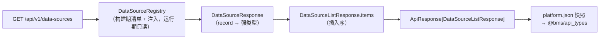

# 12 详细设计 · 数据源注册与通用接口契约

> 项目骨架 · 02 后端基座 · 子任务 12 · 详细设计 01

[文档首页](../../../../../../文档首页.md) › [02 后端基座](../../02_后端基座.md) › [12 数据源注册与通用接口契约](../02_后端基座_12_数据源注册与通用接口契约.md) › 设计　|　[← 任务文档](../02_后端基座_12_数据源注册与通用接口契约.md)

## 1. 目的与口径 <a id="purpose"></a>

本任务（需求 [02-57](../../../../需求/02_需求_后端基座.md#r02-57)）承接 [`02_10`](../../02_后端基座_10_统一数据源注册与通用数据接口/02_后端基座_10_统一数据源注册与通用数据接口.md) 已交付的「统一数据源注册 + 通用数据接口三层 + `data_source_key` 全链改名」，聚焦**契约正式化**：

> `02_10` 交付时，`GET /api/v1/data-sources` 与字典族端点的 JSON 响应仍是无类型的 `ApiResponse`（`data: any`）——公开契约（OpenAPI 快照）与 `@bms/api_types` 里**没有字段定义**，前端拿不到类型化清单。本任务把响应**收敛为具名契约模型**，使契约与生成类型真正带字段，并完成快照 / 基线重生成、破坏性变更复核与前端对接说明。

**边界（含拆分衔接）**：

- 只做**响应契约类型化**，不改字典取数 / 缓存 / 路由 / 数据权限行为（运行时字段值不变）。
- 清单端点 `GET /api/v1/data-sources` 与字典族端点（`api/dict.py`，5 个）响应一并类型化；`/query-schemes` 族（listing 域，`02_09` / `02_14` 已交付）**不在本次范围**。
- `form_key` 落表归 [`02_11`](../../02_后端基座_11_系统字段form_key落表/02_后端基座_11_系统字段form_key落表.md)（已交付）；前端通用页面路由与 `dictKey → dataSourceKey` 全链归 [`02_13`](../../02_后端基座_13_前端通用页面路由/02_后端基座_13_前端通用页面路由.md)；产品仓（mdm / biz / cw）随各自任务。**本次仅 bms 仓**。

**唯一事实源**：公开契约以 `deploy/contracts/platform.json`（快照）为事实源、`@bms/api_types` 为其生成物；本设计只写契约模型与生成口径，不复制全量字段清单到任务文档。

## 2. 决策确认汇总 <a id="decisions"></a>

| # | 事项 | 结论 | 取舍说明（长期收益 / 迁移成本） |
| --- | --- | --- | --- |
| 1 | 契约正式化范围 | **data-sources 端点 + 字典族 5 端点响应一并类型化**（`/dicts/{data_source_key}`、`/dicts/batch`、`/dicts/{data_source_key}/advanced-query`、`/dicts/{data_source_key}/attrs`、`/dicts/query-providers`）；`/query-schemes` 族不在本次 | 同族契约一次收口、不留「半型化」；成本＝多改 5 个端点注解 |
| 2 | 新增响应模型落点与命名 | **`bms_core/schemas/datasource.py::DataSourceResponse`** | 与登记表 `bms_core/datasource` 同源、跨服务可复用；命名对齐既有 `ModuleResponse`；成本＝新增一个 schema 模块 |
| 3 | 枚举字段类型 | **强类型**：`kind` / `origin` / `strategies` / `status` 用 `DataSourceKind` / `DataSourceOrigin` / `DataSourceStrategy` / `DataSourceStatus` | 契约更严、生成 TS 联合字面量，前端可穷尽校验；成本＝契约新增枚举组件 |
| 4 | 列表响应形状 | **包一层包装模型**（`items` 字段用 `Annotated[ConcurrentStableList[...], CONTRACT_COLLECTION]`），`data` 由数组变 `{items:[...]}` | 与既有 `UserExtensionList` / `TenantMembershipListResponse` 一致、契约组件名干净（`ApiResponse_DataSourceListResponse_`），且满足 `check_bare_collections`（禁端点返回注解写裸 `list`）；成本＝三处 `data` 形状变 |
| 5 | 包装模型命名 | `XxxListResponse`：`DataSourceListResponse` / `DictQueryProviderListResponse` / `DictAttrListResponse` | 对齐 `TenantMembershipListResponse`；成本＝三个新模型 |
| 6 | 前端归一化适配 | **顺带最小改** `@bms/core` 的 `normalizeAttrs` / `normalizeProviders`——**同时接受裸数组与 `{items:[...]}`**（兼容旧形状，零破坏） | 列表包装后前端不失效；兼容写法成本极低、回退安全；`permissionMeta` 改指 `/data-sources` 归 `02_13` |
| 7 | 破坏性变更复核 | **本地结构化等价比对 + 记录**（本地无 docker / oasdiff 镜像）；oasdiff 正式拦截留 CI 按需触发 | 不依赖外部环境即可给出复核结论；成本＝自写一次性比对脚本（不入库） |
| 8 | 契约护栏用例 | 新增平台 API 定向用例（`/api/v1/data-sources`：登录即可 / `kind` 过滤 / 字段与契约一致 / 非法 `kind` 报错）；**先登记 Kiwi 取号**再编码 | 新端点有直接护栏；成本＝一次 Kiwi 外部登记 |
| 9 | 前端对接说明落点 | 本详细设计「前端对接说明」节 + [`09 架构设计 · 接口与集成`](../../../../../../设计/架构设计/09_架构设计_接口与集成.md) §2.1 增接口登记条目 | 消费方（`02_13`）可直接按图索骥；成本＝两处文档回写 |
| 10 | `kind` 查询参数类型 | **保持 `str` + `ParamError`**（不改为枚举） | 避免非法 `kind` 由 400 变 422 的行为变更；成本＝前端筛选值仍需自校验 |

## 3. 影响面与交付物清单 <a id="impact"></a>

### 3.1 影响面 <a id="impact-scope"></a>

| # | 层 | 内容 |
| --- | --- | --- |
| 1 | 后端基座（新增） | `bms_core/schemas/datasource.py`（`DataSourceResponse` + `DataSourceListResponse`）；`bms_core/dict/query.py` 增 `DictQueryProviderListResponse` / `DictAttrListResponse` |
| 2 | 后端平台服务 | `api/data_source.py` 返回 `ApiResponse[DataSourceListResponse]`；`api/dict.py` 5 端点返回类型注解化并直接返回模型 |
| 3 | 契约 | `deploy/contracts/platform.json` + `deploy/contracts/baseline/platform.json` 重生成 |
| 4 | 前端 | `packages/api_types/src/platform.ts` 重生成；`packages/core/src/capabilities/dict-query.ts` 两个归一化函数兼容 `{items}` |
| 5 | 文档 | 本设计；`09 架构设计 · 接口与集成` §2.1 登记；`09 概要设计 · 字典管理` 响应口径；`02_12` 任务文档；计划表 |

### 3.2 交付物清单 <a id="deliverables"></a>

```text
bms/backend/libs/bms_core/src/bms_core/schemas/datasource.py     # 新增：DataSourceResponse + DataSourceListResponse
bms/backend/libs/bms_core/src/bms_core/dict/query.py             # 增：DictQueryProviderListResponse / DictAttrListResponse
bms/backend/services/platform/src/bms_platform/api/data_source.py # 返回类型 ApiResponse[DataSourceListResponse]
bms/backend/services/platform/src/bms_platform/api/dict.py        # 5 端点返回类型注解化 + 直接返回模型
bms/backend/services/platform/tests/api/test_data_sources_api.py  # 新增：data-sources 契约护栏用例
bms/backend/services/platform/tests/api/test_dict_api.py          # 可选：字典族响应包装断言（并入既有用例文件）
bms/frontend/packages/core/src/capabilities/dict-query.ts         # 归一化兼容 {items}
bms/frontend/packages/api_types/src/platform.ts                   # 契约类型重生成（生成物）
bms/deploy/contracts/platform.json + baseline/platform.json       # 契约快照 + 基线重生成
bms/bms文档/项目/.../02_后端基座_12_.../设计/12_详细设计_01_数据源注册与通用接口契约.md  # 本文件
bms/bms文档/项目/.../02_后端基座_12_.../实施/12_实施_01_数据源注册与通用接口契约.md
bms/bms文档/项目/.../02_后端基座_12_.../测试/12_测试_01_数据源注册与通用接口契约.md
bms/bms文档/设计/架构设计/09_架构设计_接口与集成.md               # §2.1 接口登记
bms/bms文档/设计/概要设计/09_概要设计_字典管理.md                  # 响应口径
```

## 4. 契约模型设计 <a id="models"></a>

### 4.1 数据源登记响应 <a id="models-datasource"></a>

**落点**：`bms_core/schemas/datasource.py`（与 `bms_core/schemas/module.py::ModuleResponse` 同构）。

- `DataSourceResponse`（`BaseSchema`，与 `DataSourceRecord` 字段一一对应）：

| 字段 | 类型 | 说明 |
| --- | --- | --- |
| `data_source_key` | `str` | 数据源标识（业务码字符串） |
| `name` | `str` | 名称 |
| `kind` | `DataSourceKind` | 类型（`dict` / `form`，预留其它） |
| `data_source` | `str` | 数据出口标识 |
| `origin` | `DataSourceOrigin` | 来源（`platform` / `product`） |
| `product_key` | `str \| None` | 产品标识（`origin=product` 时非空） |
| `path` | `str \| None` | 产品取数路径（`origin=product` 时前端经网关直取） |
| `allowlist` | `tuple[str, ...]` | 数据权限可匹配字段白名单 |
| `cascade` | `bool` | 是否级联 |
| `strategies` | `tuple[DataSourceStrategy, ...]` | 可用策略集合 |
| `status` | `DataSourceStatus` | 状态（`enabled` / `disabled`） |

- `DataSourceListResponse`（`BaseSchema`）：`items: Annotated[ConcurrentStableList[DataSourceResponse], CONTRACT_COLLECTION]`——清单保序（插入序＝构建期清单序 + 注入序）。
- 组装：`DataSourceResponse.model_validate(record)`（`from_attributes=True` 直读 `DataSourceRecord` 冻结数据类）。

### 4.2 字典族响应模型 <a id="models-dict"></a>

**复用既有**（`bms_core/dict/base.py` / `bms_core/dict/query.py`），不新建条目模型；仅为两个列表返回补包装：

| 端点 | 返回 `data` 模型 | 说明 |
| --- | --- | --- |
| `GET /dicts/{data_source_key}` | `DictTypeResult` | `{version, items, has_more, total}`；`items=None`＝版本一致 |
| `POST /dicts/batch` | `DictBatchResult` | `{version, items:{key: DictTypeResult\|null}}` |
| `POST /dicts/{data_source_key}/advanced-query` | `DictAdvQueryResult` | `{items, rows, total, page, size}` |
| `GET /dicts/{data_source_key}/attrs` | `DictAttrListResponse`（**新增**） | `items: ConcurrentStableList[DictAttrInfo]` |
| `GET /dicts/query-providers` | `DictQueryProviderListResponse`（**新增**） | `items: ConcurrentStableList[DictQueryProviderInfo]` |

> `DictQueryProviderListResponse` / `DictAttrListResponse` 落在 `bms_core/dict/query.py`（与各自条目模型同文件），并入 `__all__`。

### 4.3 端点实现口径 <a id="models-endpoint"></a>

- 返回注解：`-> ApiResponse[<模型>]`；**直接返回模型实例**（`ApiResponse.ok(model)`），去掉现有的 `model_dump(mode="json")` 中转（序列化交 `BaseSchema`）。
- 列表端点：构造包装模型（`XxxListResponse(items=ConcurrentStableList(...))`）。
- `list_query_providers` 重构：循环内直接构造 `DictQueryProviderInfo`（`info()` 命中用其返回值，未实现 `info()` 的提供者按契约降级构造），`data_source_key` 过滤改读 `info.data_source_keys`。
- `GET /api/v1/data-sources`：`kind` 查询参数保持 `str | None` + 非法值 `ParamError`（决策 10）。



## 5. 契约快照 / 基线 / 前端类型重生成 <a id="regen"></a>

```bash
cd backend
uv run python -m ops.contract_snapshot export          # 重生成 deploy/contracts/*.json
uv run python -m ops.contract_snapshot check           # 快照零漂移校验
uv run python -m ops.contract_gate baseline-update --service platform   # 基线对齐（复核后）
cd .. && pnpm --config.verify-deps-before-run=false run api_types:gen    # 重生成 @bms/api_types
pnpm --config.verify-deps-before-run=false run api_types:gen:check       # 契约类型零漂移
```

- 预期新增组件：`DataSourceResponse` / `DataSourceListResponse` / `DictQueryProviderListResponse` / `DictAttrListResponse` / `DataSourceKind` / `DataSourceOrigin` / `DataSourceStrategy` / `DataSourceStatus`，以及对应参数化的 `ApiResponse_*` 组件。
- 端点 `200` 响应由 `ApiResponse`（泛型）改为对应的 `ApiResponse_*` 具名组件。

## 6. 破坏性变更复核（本地等价比对） <a id="breaking-review"></a>

本地无 docker / oasdiff 镜像，按决策 7 以**结构化等价比对**替代，复核口径与 oasdiff「只加不删」一致：

1. 取「改动前基线」`deploy/contracts/baseline/platform.json`（改动前）与「改动后重生成快照」；
2. 脚本逐项比对：**删除的路径 / 删除的操作（method）/ 删除的 schema 组件 / 删除的属性 / 变更的属性类型**；
3. 预期结论：**无删除路径 / 无删除操作 / 无删除组件**；`ApiResponse` 组件保留（仍被未类型化端点使用）；变更仅为**新增组件**与**端点响应 `$ref` 由泛型收敛为具名模型**（响应收窄＝对消费方兼容，非删字段）；
4. 结论登记实施 / 测试记录；oasdiff 正式拦截在下次 CI 命中 `backend/**` / `deploy/**` 时按需触发（推送默认 `-o ci.skip`）。

> 说明：本地比对脚本为一次性工具，不入库；不替代 CI 的 oasdiff 门禁结论。

## 7. 前端对接说明 <a id="frontend"></a>

供 [`02_13`](../../02_后端基座_13_前端通用页面路由/02_后端基座_13_前端通用页面路由.md) 及后续消费方直接对接：

- **类型来源**：`import type { platform } from '@bms/api_types'`；端点类型经操作名取（如 `platform.operations['list_data_sources_api_v1_data_sources_get']`），**不手写契约类型**（`api-types` 为生成物，零漂移门禁）。
- **清单端点**：`GET /api/v1/data-sources`（登录即可；`?kind=dict|form` 过滤，非法值 400 业务码 10001）；响应 `data.items` 为 `DataSourceResponse[]`，字段含 `data_source_key` / `name` / `kind` / `data_source` / `origin` / `product_key` / `path` / `allowlist` / `cascade` / `strategies` / `status`。
- **字段命名**：契约字段为 **snake_case**（`data_source_key` 等）；前端本地模型可用 camelCase（`dataSourceKey`）并在边界转换（`dictKey → dataSourceKey` 全链归 `02_13`）。
- **列表响应形状变更**：`/dicts/{key}/attrs` 与 `/dicts/query-providers` 的 `data` 由**裸数组**改为 `{items:[...]}`；`@bms/core` 的 `normalizeAttrs` / `normalizeProviders` 已兼容两种形状。
- **仍需 `02_13` 收口**：`frontend/apps/desktop/src/api/permissionMeta.ts` 仍调用已移除的 `GET /dicts`，须改指 `GET /api/v1/data-sources`（消费 `data.items`）。
- **取数端点路径不变**：`/dicts/{data_source_key}` 路径参数名为 `data_source_key`，`/dicts/batch`、`/dicts/{key}/advanced-query`、`/dicts/query-providers?data_source_key=` 同。

## 8. 基座校验与门禁 <a id="guards"></a>

- **断言（既有）**：`ops.check_contracts`（路由覆盖 / 不可见白名单 / **无空 schema** / **引用型响应 schema 完整**）——`BaseSchema` 序列化模式保留字段，类型化响应不产生空 schema。
- **集合声明护栏**：`check_bare_collections`——列表字段一律 `Annotated[ConcurrentStableList[...], CONTRACT_COLLECTION]`，**禁端点返回注解写裸 `list`**（基线已清零）。
- **契约门禁**：`ops.contract_snapshot check` + `ops.contract_gate baseline-update`（复核后更新基线）。
- **前端类型零漂移**：`pnpm run api_types:gen:check`。
- **`preflight --fast` 全绿**：`check_links` / `check_docs_scope` / `check_base` / `check_backend_base` / `check_service_boundaries` / `check_system_fields` / `check_status`。

## 9. 测试设计与验收映射 <a id="accept"></a>

| 验收项 | 测试 / 校验 |
| --- | --- |
| `GET /api/v1/data-sources` 契约入契约文件与基线 | 契约快照含该路径 + `200` 响应引用 `ApiResponse_DataSourceListResponse_`；平台 API 用例（登录即可 / `kind` 过滤 / 非法 `kind` 报错） |
| 清单字段与登记记录一致且类型化 | API 用例断言 `data.items[0]` 字段集＝`DataSourceResponse.model_fields`；`kind` / `strategies` 为枚举值 |
| 字典族响应类型化 | 字典族 API 用例断言 `data` 形状（`DictTypeResult` / `DictBatchResult` / `DictAdvQueryResult` / `{items}`）；既有行为用例零改动 |
| `@bms/api_types` 重生成零漂移 | `pnpm run api_types:gen:check` |
| 响应契约无空 schema / 引用完整 | `uv run python -m ops.check_contracts --service platform` |
| 契约组件渲染正确 | 快照 `components.schemas` 含 `DataSourceResponse` / `DataSourceListResponse` / `DictQueryProviderListResponse` / `DictAttrListResponse` 且非空 |
| 前端归一化兼容 | `frontend/packages/core` 定向用例（`loadMeta` 归一化裸数组与 `{items}` 两种输入） |
| 破坏性变更复核 | 本地结构化等价比对结论（无删除路径 / 操作 / 组件）登记测试记录 |
| 门禁全绿 | `check_links` / `check_docs_scope` / `check_base` / `check_status` / `preflight --fast` |

- 用例**先登记 Kiwi TCMS 取编号**再编码；定向用例只跑受变更影响部分（`services/platform/tests/api` + `libs/bms_core/tests/{datasource,dict}` + `frontend/packages/core` 定向），全量交 CI 按需触发。
- 界面无关（纯后端契约与前端类型）→ 测试记录「原型对照结论」节写「不适用」+ 理由。

## 10. 登记回写与跨仓 <a id="writeback"></a>

- **回写**：[`09 架构设计 · 接口与集成`](../../../../../../设计/架构设计/09_架构设计_接口与集成.md) §2.1 增「数据源注册接口（`GET /api/v1/data-sources` + 字典族响应契约）登记」条目；[`09 概要设计 · 字典管理`](../../../../../../设计/概要设计/09_概要设计_字典管理.md) 接口清单补响应模型口径；本任务 `实施/` `测试/` 记录；`02_12` 任务文档回写详细设计链接与完成标准；计划表（进度唯一落点）。
- **契约**：`deploy/contracts/platform.json` + `baseline/platform.json` 重生成；`@bms/api_types` 重生成。
- **消费方标注**：`02_13`（前置＝本任务：数据源清单契约 + `@bms/api_types` 类型化；消费 `data.items`）；`permissionMeta` 改指归 `02_13`。
- **跨仓**：产品仓随各自仓库任务（本任务范围外）。

## 11. 风险与遗留 <a id="risk"></a>

- **列表响应形状变更（三处）**：`data` 由裸数组变 `{items:[...]}`，破坏性边界已由复核（§6）确认对消费方为兼容；前端 `@bms/core` 归一化已兼容两种形状，`permissionMeta` 尚待 `02_13` 改指——登记计划「偏差与遗留」。
- **契约组件名冗长（未采用）**：若改用 `Annotated` 直接标注数组会得到冗长组件名；本任务采用包装模型规避（决策 4），保持契约组件名可读。
- **枚举强类型与查询参数**：响应枚举强类型（决策 3）；`kind` 查询参数保持 `str`（决策 10），非法值仍走 `ParamError`（400 / 10001）。
- **oasdiff 未本地跑**：本地无 docker / oasdiff 镜像，破坏性变更以等价比对复核（§6）；正式拦截留 CI 按需触发。
- **`DictBatchResult` 嵌套契约集合**：`items` 为 `Annotated[ConcurrentStableDict[str, DictTypeResult | None], CONTRACT_COLLECTION]`，由 `ops.check_contracts`「无空 schema」断言保障渲染完整。

> 本详细设计为需求评审后的定稿稿 · 与《文档生成规范》配套
