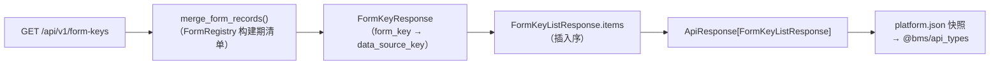

# 13-1 详细设计 · 表单标识清单接口

> 项目骨架 · 02 后端基座 · 13 前端通用页面路由 · 嵌套子任务 01 · 详细设计 01

[文档首页](../../../../../../../文档首页.md) › [02 后端基座](../../../02_后端基座.md) › [13 前端通用页面路由](../../02_后端基座_13_前端通用页面路由.md) › [01 表单标识清单接口](../02_后端基座_13_前端通用页面路由_01_表单标识清单接口.md) › 设计　|　[← 任务文档](../02_后端基座_13_前端通用页面路由_01_表单标识清单接口.md)

## 1. 目的与口径 <a id="purpose"></a>

通用页面路由（父任务 `02_13`）需按 `form_key` 解析页面并经 `form_key → data_source_key`（多对一）取数。该映射已在后端 `FormRegistry`（`bms_core/registry/forms.py`，`02_11`）承载，但**无下发端点**。本子任务补一个**只读清单端点** `GET /api/v1/form-keys`，供前端与后续消费方解析。

**边界**：

- 只做**只读清单下发**：不落表、不做维护 / 增删改（维护端点为 `menu.py` 既有权限表单接口 `/forms`）；不改 `02_10` / `02_12` 已定契约（仅新增端点与响应模型）。
- **路径说明**：`GET /api/v1/forms` 已被「权限表单维护」占用（`menu.py`，`FormItem` 为菜单/权限表单元数据，无 `form_key`）——本端点取 `form-keys` 以区分「表单标识清单」与「权限表单维护」。

**唯一事实源**：公开契约以 `deploy/contracts/platform.json`（快照）为事实源、`@bms/api_types` 为其生成物；`form_key` 清单以 `bms_core/registry/forms.py::FORM_CATALOG` 为唯一来源。

## 2. 决策确认汇总 <a id="decisions"></a>

| # | 事项 | 结论 | 取舍说明（长期收益 / 迁移成本） |
| --- | --- | --- | --- |
| 1 | 端点路径 | **`GET /api/v1/form-keys`** | 与既有 `/forms`（权限表单维护）区分；语义直白（表单标识清单）；成本＝新路由 + 契约重生成 |
| 2 | 任务归属 | **父任务 `02_13` 的嵌套子任务 `02-13-1`** | 后端小改动与前端路由同父任务闭环；任务树可递归；成本＝多一份子任务文档 |
| 3 | 需求登记 | **追 02-57 注块**（不新增需求编号） | 属 02-57「通用页面路由消费」细化；需求总览 / 总清单计数不变 |
| 4 | 响应模型落点与命名 | **`bms_core/schemas/form.py::FormKeyResponse` / `FormKeyListResponse`** | 与 `DataSourceResponse` / `DataSourceListResponse` 同构、跨服务可复用 |
| 5 | 类型（`kind` / `status`） | **强类型**：复用 `FormKind` / `FormStatus` | 契约更严、生成 TS 联合字面量；成本＝枚举组件复用 |
| 6 | 列表形状 | **`{items:[...]}` 包装**（`Annotated[ConcurrentStableList[...], CONTRACT_COLLECTION]`） | 与 `/data-sources` 等一致、满足 `check_bare_collections`（禁裸 `list` 返回注解） |
| 7 | `kind` 查询参数类型 | **保持 `str` + `ParamError`**（不改为枚举） | 与 `/data-sources` 决策 10 同口径，非法值 400 / 10001 |
| 8 | `data_source_key` 可空性 | **`str | None`**（清单校验保证 bms 侧非空） | 容忍产品注入记录暂缺；避免序列化 500；成本＝前端判空 |
| 9 | 装配读取口径 | **读 `merge_form_records()`**（构建期清单，运行期只读） | 与 `DataSourceRegistry`「无进程级注册表、运行期只读」同口径；未接库 |
| 10 | 契约护栏用例 | 新增平台 API 用例（登录即可 / `kind` 过滤 / 字段与契约一致 / 非法 `kind` 报错）；**先登记 Kiwi 取号** | 新端点有直接护栏；成本＝一次 Kiwi 外部登记 |

## 3. 影响面与交付物清单 <a id="impact"></a>

### 3.1 影响面 <a id="impact-scope"></a>

| # | 层 | 内容 |
| --- | --- | --- |
| 1 | 后端基座（新增） | `bms_core/schemas/form.py`（`FormKeyResponse` + `FormKeyListResponse`） |
| 2 | 后端平台服务（新增） | `api/form_key.py`（`GET /api/v1/form-keys`）；`api/router.py` 登记 `form_key.router` |
| 3 | 契约 | `deploy/contracts/platform.json` + `baseline/platform.json` 重生成 |
| 4 | 前端消费 | `packages/api_types/src/platform.ts` 重生成（供 `02_13` 消费） |
| 5 | 文档 | 本设计；父任务设计 §4；`09 架构设计 · 接口与集成` §2.1 登记；需求 02-57 注块；`02_13` 任务文档与计划表 |

### 3.2 交付物清单 <a id="deliverables"></a>

```text
bms/backend/libs/bms_core/src/bms_core/schemas/form.py                    # 新增：FormKeyResponse / FormKeyListResponse
bms/backend/services/platform/src/bms_platform/api/form_key.py            # 新增：GET /api/v1/form-keys
bms/backend/services/platform/src/bms_platform/api/router.py              # 登记 form_key.router
bms/backend/services/platform/tests/api/test_form_keys_api.py             # 新增：端点契约护栏用例
bms/deploy/contracts/platform.json + baseline/platform.json               # 契约快照 + 基线重生成
bms/frontend/packages/api_types/src/platform.ts                           # 契约类型重生成（生成物）
bms/bms文档/项目/.../02_后端基座_13_前端通用页面路由_01_表单标识清单接口/  # 本子任务（文档 / 设计 / 实施 / 测试）
bms/bms文档/设计/架构设计/09_架构设计_接口与集成.md                       # §2.1 接口登记
```

## 4. 契约模型设计 <a id="models"></a>

**落点**：`bms_core/schemas/form.py`（与 `bms_core/schemas/datasource.py` 同构）。

- `FormKeyResponse`（`BaseSchema`，与 `FormRecord` 字段一一对应）：

| 字段 | 类型 | 说明 |
| --- | --- | --- |
| `form_key` | `str` | 表单标识（业务码字符串，全局唯一、保存后不变） |
| `name` | `str` | 名称（通用页面展示） |
| `kind` | `FormKind` | 类型（`dict` 字典 / `form` 表单） |
| `table` | `str` | 物理表名（该标识所在实体表） |
| `data_source_key` | `str \| None` | 数据源标识（`form_key → data_source_key` 多对一） |
| `status` | `FormStatus` | 状态（`enabled` / `disabled`） |

- `FormKeyListResponse`（`BaseSchema`）：`items: Annotated[ConcurrentStableList[FormKeyResponse], CONTRACT_COLLECTION]`——清单保序（构建期清单序 + 注入序）。
- 组装：`FormKeyResponse.model_validate(record)`（直读 `FormRecord` 冻结数据类）。

## 5. 端点实现口径 <a id="endpoint"></a>

- **落点**：`services/platform/src/bms_platform/api/form_key.py`；`BaseRouter(key="form_key", prefix="/form-keys", tags=["form-key"], dependencies=[Depends(require_auth)])`。
- 返回注解 `-> ApiResponse[FormKeyListResponse]`；直接返回模型实例（`ApiResponse.ok(...)`）。
- 读取 `merge_form_records()`（构建期清单，运行期只读），按 `kind` 过滤；`kind` 非法（不在 `{item.value for item in FormKind}`）抛 `ParamError`。
- 登记：`api/router.py` 的 `mount_service_routers(...)` 清单加 `form_key.router`（`ops.check_contracts` 路由覆盖断言随之通过）。



## 6. 契约快照 / 基线 / 前端类型重生成 <a id="regen"></a>

```bash
cd backend
uv run python -m ops.contract_snapshot export          # 重生成 deploy/contracts/*.json
uv run python -m ops.contract_snapshot check           # 快照零漂移校验
uv run python -m ops.contract_gate baseline-update --service platform   # 基线对齐（复核后）
cd .. && pnpm --config.verify-deps-before-run=false run api_types:gen    # 重生成 @bms/api_types
pnpm --config.verify-deps-before-run=false run api_types:gen:check       # 契约类型零漂移
```

- 预期新增组件：`FormKeyResponse` / `FormKeyListResponse` / `ApiResponse_FormKeyListResponse_`，以及复用枚举 `FormKind` / `FormStatus`。
- 端点 `200` 响应引用 `ApiResponse_FormKeyListResponse_`；新增路径 `/api/v1/form-keys`（`get`）。

## 7. 基座校验与门禁 <a id="guards"></a>

- **断言（既有）**：`ops.check_contracts`（路由覆盖 / 不可见白名单 / 无空 schema / 引用型响应 schema 完整）。
- **集合声明护栏**：`check_bare_collections`——列表字段一律 `Annotated[ConcurrentStableList[...], CONTRACT_COLLECTION]`。
- **契约门禁**：`ops.contract_snapshot check` + `ops.contract_gate baseline-update`。
- **前端类型零漂移**：`pnpm run api_types:gen:check`。
- **`preflight --fast` 全绿**：`check_links` / `check_docs_scope` / `check_base` / `check_backend_base` / `check_service_boundaries` / `check_system_fields` / `check_status`。

## 8. 测试设计与验收映射 <a id="accept"></a>

| 验收项 | 测试 / 校验 |
| --- | --- |
| `GET /api/v1/form-keys` 契约入契约文件与基线 | 契约快照含该路径 + `200` 引用 `ApiResponse_FormKeyListResponse_` |
| 清单字段与登记记录一致且类型化 | API 用例断言 `data.items[0]` 字段集＝`FormKeyResponse.model_fields`；`kind` 为枚举值 |
| 登录即可 / `kind` 过滤 / 非法 `kind` 报错 | API 用例（无 token 401；`?kind=dict` 仅字典；`?kind=bad` 400 / 10001） |
| `form_key → data_source_key` 可得且闭合 | 用例断言每条 `data_source_key` 非空且与 `FORM_CATALOG` 一致 |
| `@bms/api_types` 重生成零漂移 | `pnpm run api_types:gen:check` |
| 响应契约无空 schema / 引用完整 | `uv run python -m ops.check_contracts --service platform` |
| 门禁全绿 | `check_links` / `check_docs_scope` / `check_base` / `check_status` / `preflight --fast` |

- 用例**先登记 Kiwi TCMS 取编号**再编码；定向用例只跑受变更影响部分（`services/platform/tests/api`），全量交 CI 按需触发。
- 界面无关（纯后端清单端点）→ 测试记录「原型对照结论」节写「不适用」+ 理由。

## 9. 登记回写与跨仓 <a id="writeback"></a>

- **回写**：`09 架构设计 · 接口与集成` §2.1 增「表单标识清单接口（`GET /api/v1/form-keys`）」登记条目；需求 02-57 注块；父任务 `02_13` 详细设计 §4；本子任务 `实施/` `测试/` 记录；计划表（进度唯一落点）。
- **契约**：`deploy/contracts/platform.json` + `baseline/platform.json` 重生成；`@bms/api_types` 重生成。
- **消费方标注**：父任务 `02_13`（消费 `data.items`：`form_key → data_source_key`）。
- **跨仓**：产品侧 `form_key` 注入随各自仓库任务（本子任务范围外）。

## 10. 风险与遗留 <a id="risk"></a>

- **枚举复用**：`FormKind` / `FormStatus` 位于 `bms_core/registry/forms.py`，在 `schemas/form.py` 引用后进入契约组件；如后续枚举扩容（如新增 `form` 之外类型），契约组件同步扩展。
- **`data_source_key` 可空**：bms 侧清单由 `check_system_fields.py` 保证非空；产品注入记录暂缺时不阻断响应，前端按 `form_keys` 命中失败降级（回退声明内显式 `dataSourceKey`）。
- **端点只读**：清单不落表、不做维护；如需运营态维护（启停 / 改名）另立任务。

> 本详细设计为需求评审后的定稿稿 · 与《文档生成规范》配套
