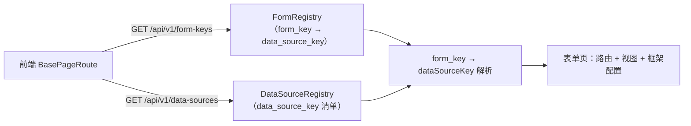
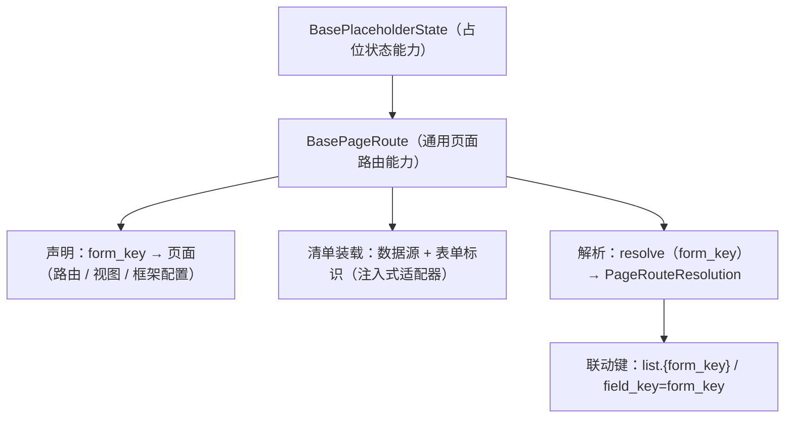

# 13 详细设计 · 前端通用页面路由

> 项目骨架 · 02 后端基座 · 子任务 13 · 详细设计 01

[文档首页](../../../../../../文档首页.md) › [02 后端基座](../../02_后端基座.md) › [13 前端通用页面路由](../02_后端基座_13_前端通用页面路由.md) › 设计　|　[← 任务文档](../02_后端基座_13_前端通用页面路由.md)

## 1. 目的与口径 <a id="purpose"></a>

本任务（需求 [02-57](../../../../需求/02_需求_后端基座.md#r02-57)）承接 [`02_10`](../../02_后端基座_10_统一数据源注册与通用数据接口/02_后端基座_10_统一数据源注册与通用数据接口.md)（统一数据源注册 + 三层接口 + `data_source_key` 全链改名）与 [`02_12`](../../02_后端基座_12_数据源注册与通用接口契约/02_后端基座_12_数据源注册与通用接口契约.md)（契约正式化 + `@bms/api_types` 重生成），落「**前端通用页面路由**」，并收口 `02_10` 划归前端的两项遗留：

> `02_10` 交付后，前端仍发送旧字段 `dict_key` / `dictKey`、调用**已移除**的 `GET /dicts` 清单、`permissionMeta` 未改指——`02_12` 已在前端对接说明中把 `permissionMeta` 改指归 `02_13`。本任务据此完成**前端消费新契约 + `dictKey → dataSourceKey` 全链改名 + 通用页面路由机制**。

四件事（对应任务内容 1 ~ 4）：

1. **通用页面路由**：按 `form_key` 解析页面 / 表单（表单标识 → 页面：路由 + 视图 + 表单框架配置），统一挂载与寻址。
2. **清单接入**：消费 `GET /api/v1/data-sources`（`02_12` 契约，读 `data.items`）与新增的 `GET /api/v1/form-keys`（表单标识清单，含 `form_key → data_source_key`）；`permissionMeta` 由已移除的 `GET /dicts` 改指 `/data-sources`。
3. **联动**：查询方案（`field_key = form_key`）与用户偏好（`list.{form_key}`）按 `form_key` 联动（核心提供解析入口 + 平台页接线）。
4. **契约类型**：消费 `@bms/api_types` 重生成产物，零漂移；前端 `dictKey → dataSourceKey` 全链改名收口。

**边界与拆分**：

- **后端配套端点** `GET /api/v1/form-keys` 作本任务**嵌套子任务 [`02-13-1`](../02_后端基座_13_前端通用页面路由_01_表单标识清单接口/02_后端基座_13_前端通用页面路由_01_表单标识清单接口.md)**（需求追 02-57 注块）；本设计 §4 只写衔接口径，端点细节见其[详细设计](../02_后端基座_13_前端通用页面路由_01_表单标识清单接口/设计/13_01_详细设计_01_表单标识清单接口.md)。
- **本任务仅 bms 仓**；产品仓（mdm / biz / cw）的 `form_key` / `data_source_key` 与业务表单随各自仓库任务。
- **不迁移**既有平台页全量改造为通用页面路由（`RoleView` / `UserView` / `AccountLockView` 等作**接线示范**按声明装载，路径 / 名 / meta 保持，行为不变）；其余模块页随各模块任务迁入。

**唯一事实源**：公开契约以 `deploy/contracts/platform.json`（快照）为事实源、`@bms/api_types` 为其生成物；`form_key` 清单以后端 `FormRegistry` 为来源；本设计只写契约消费口径与改名规则，不复制全量字段清单。

## 2. 决策确认汇总 <a id="decisions"></a>

| # | 事项 | 结论 | 取舍说明（长期收益 / 迁移成本） |
| --- | --- | --- | --- |
| 1 | 改名范围 | **`dictKey → dataSourceKey` 全链改名**（核心 domain / capabilities + `ui-ep` 组件与工具 + 宿主；含 `dict_key` 线参数、`dictKeys` 数组、`DictKeyMeta` 类型） | 与后端契约 / `@bms/api_types` 零漂移；一次收口不留半旧半新；成本＝约 44 文件（32 源 + 12 测试） |
| 2 | 通用页面路由落点 | **核心新增能力基类 `BasePageRoute`**（能力键 `page-route`，`capabilities/page-route.ts`）+ 领域纯函数 `domain/page-route.ts` | 符合「横切功能即链上基类」；可跨端复用；成本＝登记《前端基类清单》+ 组件设计节点 |
| 3 | 页面解析产物 | **路由（路径 / 名）+ 视图（列表 / 详情组件）+ 表单框架配置（标题）+ 数据源（`dataSourceKey`）+ 联动键** | 一次解析满足「统一挂载与寻址」；成本＝声明结构稍厚 |
| 4 | `form_key → data_source_key` 来源 | **新增后端端点 `GET /api/v1/form-keys`**（嵌套子任务 `02-13-1`），前端消费 `data.items` | 口径单一权威、与后端 `FormRegistry` 同源；成本＝跨端端点 + 契约重生成 |
| 5 | 清单拉取时机 | **会话就绪后**（与 `menu.load()` 并列）经能力适配器加载；**幂等 + 失败降级**（不阻断启动） | 与动态菜单同口径；成本＝宿主接线 |
| 6 | 视图名 → 组件解析 | **声明内直挂组件（`list` / `detail`）**；宿主经登记声明提供，未声明回退占位视图 + 开发态告警 | 无需另建视图注册表（声明即映射）；成本＝声明携带组件 |
| 7 | 原型适用性 | **不适用** | 本任务为机制（路由 / 数据解析），不新增可见界面；界面形态既有（[《布局设计 · 表单页》](../../../../../../设计/布局设计/08_布局设计_表单页.html) / [表单框架](../../../../../../设计/布局设计/06_布局设计_表单框架.html)） |
| 8 | 联动深度 | **核心提供解析入口 + 平台页接线**（`field_key = formKey` / `list.{formKey}`）；复用 `BaseQueryScheme` / `BasePersistedState` | 既有机制上补统一入口，不改判定逻辑；成本＝宿主接线 |
| 9 | 既有平台页迁移 | **仅接线示范**（`role` / `user` / `account-locks` 按声明装载，路径 / 名 / meta 保持）；**全量迁移留各模块任务** | 控范围、零行为变更；成本＝少量声明 + 路由表调整 |
| 10 | 测试与用例 | **先登记 Kiwi 取号再编码**；只跑受变更影响定向用例（core / ui-ep / desktop），全量交 CI | 对齐《AI开发规范》与测试规范 |
| 11 | `DictKeyMeta` 命名 | **`DataSourceKeyMeta`**（数据权限左列元数据），字段 `id` / `code` / `name` 不变 | 与 `dataSourceKey` 口径自洽；成本＝类型名替换 |
| 12 | 目录与常量 | 保留字典专用「域内」词（`DictItem` / `BaseDictStore` / `BaseDictSelect` / `/dicts/*` 取数端点 / `dictSource` 文件）；**只改「标识语义」字段名** | 字典是数据源的一类、取数端点语义未变；避免无谓改名 |

## 3. 影响面与交付物清单 <a id="impact"></a>

### 3.1 影响面 <a id="impact-scope"></a>

| # | 层 | 内容 |
| --- | --- | --- |
| 1 | 前端核心（新增） | `capabilities/page-route.ts`（`BasePageRoute`）、`domain/page-route.ts`（`DataSourceRecord` / `FormKeyRecord` / `FormPageDeclaration` / 解析纯函数）、`domain/data-source.ts`（数据源记录归一，可选合并入 page-route） |
| 2 | 前端核心（改名） | `domain/{dict,filter,table,form-render,form-layout,permission-config}.ts`、`capabilities/{dict-source,dict-select,dict-store,dict-query,permission-config}.ts` |
| 3 | 前端 ui-ep（改名） | `utils/{dictSource,dictTranslator}.ts`、`composables/{useBaseDictSelect,useBaseDictQuery,useBasePermissionConfig}.ts`、`components/field/{DictSelectField,DictLabel,DictAdvancedQuery,DictCascaderField}.vue`、`components/data/{DataTable,DescriptionList}.vue`、`components/interaction/{DataScopePanel,PermissionConfig,DynamicDictPicker}.vue`、`components/form_render/FormRendererBody.vue` |
| 4 | 前端宿主（改名 + 接线） | `api/permissionMeta.ts`、`views/system/role/RolePermissionConfig.vue`、`dev/{DictCheck,PermissionConfigCheck}.vue`；新增 `api/registry.ts`（清单拉取）、`router/page-route.ts`（通用页面路由接线 + 平台声明） |
| 5 | 后端配套 | `bms_core/schemas/form.py` + `api/form_key.py` + `api/router.py`（子任务 `02-13-1`） |
| 6 | 契约 | `deploy/contracts/platform.json` + `baseline/platform.json`、`packages/api_types/src/platform.ts` 重生成 |
| 7 | 文档 | 本设计；子任务 `02-13-1`；《前端基类清单》；组件设计节点《页面路由能力》；需求 02-57 注块；`09 架构设计 · 接口与集成`；任务 `02_13`；计划表 |

### 3.2 交付物清单 <a id="deliverables"></a>

```text
# 后端配套（嵌套子任务 02-13-1）
bms/backend/libs/bms_core/src/bms_core/schemas/form.py                    # 新增：FormKeyResponse / FormKeyListResponse
bms/backend/services/platform/src/bms_platform/api/form_key.py            # 新增：GET /api/v1/form-keys
bms/backend/services/platform/src/bms_platform/api/router.py              # 登记 form_key.router
bms/backend/services/platform/tests/api/test_form_keys_api.py             # 新增：端点契约护栏用例

# 前端核心（新增）
bms/frontend/packages/core/src/domain/page-route.ts                       # 新增：清单归一 + 页面解析纯函数
bms/frontend/packages/core/src/capabilities/page-route.ts                 # 新增：BasePageRoute 能力基类
bms/frontend/packages/core/src/capabilities/manifest.ts                   # 能力依赖登记：page-route
bms/frontend/packages/core/src/index.ts                                   # 导出 BasePageRoute 与领域函数

# 前端核心（dictKey → dataSourceKey 改名）
bms/frontend/packages/core/src/domain/{dict,filter,table,form-render,form-layout,permission-config}.ts
bms/frontend/packages/core/src/capabilities/{dict-source,dict-select,dict-store,dict-query,permission-config}.ts
bms/frontend/packages/core/testing/dict.ts + index.ts                     # 测试夹具同步

# 前端 ui-ep（改名）
bms/frontend/packages/ui_ep/src/utils/{dictSource,dictTranslator}.ts
bms/frontend/packages/ui_ep/src/composables/{useBaseDictSelect,useBaseDictQuery,useBasePermissionConfig}.ts
bms/frontend/packages/ui_ep/src/components/{data,field,interaction,form-render}/*.vue

# 前端宿主（改名 + 接线）
bms/frontend/apps/desktop/src/api/permissionMeta.ts                       # 改指 /data-sources（data.items）
bms/frontend/apps/desktop/src/api/registry.ts                             # 新增：清单拉取（/data-sources + /form-keys）
bms/frontend/apps/desktop/src/router/page-route.ts                        # 新增：通用页面路由接线 + 平台表单页声明
bms/frontend/apps/desktop/src/router/index.ts                             # 示范页移出静态路由（改由声明装载）
bms/frontend/apps/desktop/src/main.ts                                     # 会话就绪加载清单 + 装载表单页路由
bms/frontend/apps/desktop/src/views/system/role/RolePermissionConfig.vue + dev/*.vue   # 改名

# 契约与生成物
bms/deploy/contracts/platform.json + baseline/platform.json               # 契约快照 + 基线重生成
bms/frontend/packages/api_types/src/platform.ts                           # 契约类型重生成（生成物）

# 文档
bms/bms文档/项目/.../02_后端基座_13_前端通用页面路由/设计/13_详细设计_01_前端通用页面路由.md   # 本文件
bms/bms文档/项目/.../02_后端基座_13_前端通用页面路由_01_表单标识清单接口/                        # 嵌套子任务（文档 / 设计 / 实施 / 测试）
bms/bms文档/前端基类清单.md                                               # 登记 BasePageRoute
bms/bms文档/设计/组件设计/02_基础组件类/02_能力类/32_组件设计_页面路由能力/                        # 新增组件设计节点
bms/bms文档/设计/架构设计/{08_前端架构,09_接口与集成}.md                  # 动态路由 / 接口登记
bms/bms文档/项目/.../需求/02_需求_后端基座.md                             # 02-57 注块（清单端点）
bms/bms文档/项目/.../计划/01_计划_项目骨架.md                             # 计划表（进度唯一落点）
```

## 4. 后端衔接：表单标识清单接口（嵌套子任务 02-13-1） <a id="backend"></a>

- **端点**：`GET /api/v1/form-keys`（登录即可；可按 `kind=dict|form` 过滤，非法 `kind` 400 / 10001）；响应 `data.items: FormKeyResponse[]`，字段 `form_key` / `name` / `kind` / `table` / `data_source_key` / `status`。
- **来源**：`bms_core/registry/forms.py::FormRegistry`（构建期清单，运行期只读）；命名区分既有 `/forms`（权限表单维护）。
- **细节**：见[子任务详细设计](../02_后端基座_13_前端通用页面路由_01_表单标识清单接口/设计/13_01_详细设计_01_表单标识清单接口.md)。



## 5. 前端核心：通用页面路由能力 <a id="core"></a>

### 5.1 定位与继承 <a id="core-position"></a>

- **落点**：`packages/core/src/capabilities/page-route.ts`；`BasePageRoute extends BasePlaceholderState`（能力键 `page-route`；依赖登记 `['placeholder-state']`）。
- **职责边界**：`form_key → 页面`声明登记与解析、清单（数据源 / 表单标识）装载与解析、联动键派生；**路由挂载动作由宿主注入**（核心不依赖 vue-router，同 `BaseDynamicRoutes`）。
- **不做**：菜单树 → 路由（归 `BaseDynamicRoutes`）；字典取数（归 `/dicts/*` 与 `BaseDictStore`）；页面渲染（归渲染插件）。



### 5.2 领域纯函数 `domain/page-route.ts` <a id="core-domain"></a>

- **记录类型**：`DataSourceRecord`（`dataSourceKey` / `name` / `kind` / `dataSource` / `origin` / `productKey?` / `path?` / `allowlist` / `cascade` / `strategies` / `status`）、`FormKeyRecord`（`formKey` / `name` / `kind` / `table` / `dataSourceKey?` / `status`）。
- **归一**：`normalizeDataSourceRecords(raw)` / `normalizeFormKeyRecords(raw)`——**兼容裸数组与 `{items:[...]}` 包装**（snake_case 字段），脏项剔除。
- **声明**：`FormPageDeclaration`（`formKey` / `title` / `path` / `name?` / `meta?` / `list?` / `detail?` / `dataSourceKey?`）；`normalizeFormPageDeclaration(raw)`。
- **解析**：`resolvePageRoute(declaration, formKeys, dataSources)`——`dataSourceKey` 取「声明显式 → 表单标识清单命中 → `undefined`」，并校验其在数据源清单内（未登记即**不可用**）；产出 `PageRouteResolution`（含 `path` / `name` / `title` / `meta` / `list` / `detail` / `dataSourceKey` / `listPreferenceKey` / `schemeFieldKey`）。
- **联动键**：`listPreferenceKey = buildListPrefKey(formKey)`（复用 `domain/list-preference.ts`）；`schemeFieldKey = formKey`（查询方案 `business` 目标）。

### 5.3 能力基类 `BasePageRoute` <a id="core-capability"></a>

- **注入适配器** `PageRouteAdapter`：`loadDataSources?()` / `loadFormKeys?()`（返回原始响应体）；**未注入即占位零请求**（`requestCount` 恒 0）。
- **声明面**：`declare(decl)` / `declareAll(decls)` / `declarations()` / `declarationOf(formKey)`（`formKey` 唯一，同键拒重）。
- **解析面**：`resolve(formKey): PageRouteResolution | undefined`；`dataSourceKeyOf(formKey): string | undefined`；`listPreferenceKeyOf(formKey)` / `schemeFieldKeyOf(formKey)`。
- **装载面**：`async load()`（幂等；并发去重；失败置降级态 + 保留错误信息，不抛断）；`loaded` / `error` / `degraded` 状态；`reset()`（登出清空）。
- **状态**：`dataSources: DataSourceRecord[]` / `formKeys: FormKeyRecord[]`（保序）。
- **占位语义**：未就绪 / 未注入适配器时不发请求、不写缓存，`resolve()` 返回 `undefined`。

### 5.4 登记 <a id="core-register"></a>

- `capabilities/manifest.ts` 增 `page-route: ['placeholder-state']`。
- `index.ts` 具名导出 `BasePageRoute` 与 `domain/page-route.ts` 导出面。
- 《前端基类清单》§2.1 增行（父基类 `BasePlaceholderState`、能力基类、落点 `capabilities/page-route.ts`、状态 `已交付`）；组件设计新增节点《页面路由能力》（`02_基础组件类/02_能力类/32_组件设计_页面路由能力/`）。

## 6. 前端核心与插件：`dictKey → dataSourceKey` 全链改名 <a id="rename"></a>

### 6.1 改名规则 <a id="rename-rule"></a>

| 旧（前端） | 新（前端） | 说明 |
| --- | --- | --- |
| `dictKey`（字段 / 属性 / props / 局部变量 / 参数名） | `dataSourceKey` | 数据源标识 |
| `dictKeys`（数组 / 清单属性） | `dataSourceKeys` | 多值；契约 `data_source_keys` |
| `dict_key`（线参数 / 响应字段） | `data_source_key` | 与后端契约一致 |
| `DictKeyMeta`（数据权限左列元数据） | `DataSourceKeyMeta` | 字段 `id` / `code` / `name` 不变 |
| `selectedDictTypeId` | `selectedDataSourceKey` | 数据权限左栏选中项 |

**保留不动**（字典专用域名词，语义未变）：`DictItem` / `DictTypeResult` / `DictBatchResult` / `BaseDictStore` / `BaseDictSelect` / `BaseDictQuery` / `DictTranslateQuery` / `DictAdvancedQuery` / `DictCascaderField` / `DictSelectField` / `DictLabel`、取数端点 `/dicts/{data_source_key}`（**路径参数已是新名**）、`dictSource.ts`（HTTP 数据源文件）。

### 6.2 核心改名面 <a id="rename-core"></a>

- `domain/dict.ts`：`DictTypeQuery.dictKey` / `DictBatchQuery`（无）/ `DictQueryProvider.dictKeys`（→`dataSourceKeys`）/ `DictQueryScheme.dictKey` / `dictCacheKey(locale, dataSourceKey)` / `dictSubsetKey` / `dictStorageKey` / `normalizeDictQueryScheme`（读 `data_source_key` 兼容 `dict_key`）。
- `domain/filter.ts`：`QuerySchemeEntry.dictKey → dataSourceKey`。
- `domain/table.ts` / `domain/form-render.ts` / `domain/form-layout.ts`：字段声明的 `dictKey → dataSourceKey`。
- `domain/permission-config.ts`：`DictKeyMeta → DataSourceKeyMeta`、`dictKeys → dataSourceKeys`、`DataScopeEntry.dictKey → dataSourceKey`、`setDataScopeEntry(...)` 参数改名。
- `capabilities/dict-source.ts`：`DictSourceTypeQuery.dictKey` / `DictSourceAttrsQuery.dictKey` / `DictSourceProvidersQuery.dictKey` / `DictSourceAdvQuery.dictKey` → `dataSourceKey`；`DictSourceSchemeQuery`（`fieldKey` 不变）。
- `capabilities/dict-select.ts` / `dict-store.ts` / `dict-query.ts`：`dictKey` / `dictKeys` → `dataSourceKey` / `dataSourceKeys`；`DictQueryProviderList` 归一读 `data_source_keys`。
- `capabilities/permission-config.ts`：`selectedDictTypeId → selectedDataSourceKey`、`dictKeys → dataSourceKeys`、`setDataScope(dataSourceKey, ...)`。

### 6.3 插件（ui-ep）与宿主改名面 <a id="rename-plugin"></a>

- `ui_ep/src/utils/dictSource.ts`：请求参数 `dict_key → data_source_key`（`query-providers`）、`scheme.dictKey → scheme.dataSourceKey`（`schemeToWire` 写 `data_source_key`）；路径参数 `query.dictKey → query.dataSourceKey`。
- `ui_ep/src/utils/dictTranslator.ts`：`(dictKey, value)` → `(dataSourceKey, value)`。
- `ui-ep` 组件 / 组合式：`DataTable`（列 `dictKey` → `dataSourceKey`）、`DescriptionList`、`DictSelectField` / `DictLabel` / `DictAdvancedQuery` / `DictCascaderField`（props `dictKey → dataSourceKey`）、`DynamicDictPicker`、`DataScopePanel`（`dictKeys → dataSourceKeys` / `selectedDictTypeId → selectedDataSourceKey`）、`PermissionConfig`、`FormRendererBody`；`useBaseDictSelect` / `useBaseDictQuery` / `useBasePermissionConfig`。
- 宿主：`api/permissionMeta.ts`（`dictKeys → dataSourceKeys`、`DictKeyMeta → DataSourceKeyMeta`、改指 `/data-sources`）、`views/system/role/RolePermissionConfig.vue`、`dev/{DictCheck,PermissionConfigCheck}.vue`。
- 测试：`packages/core/tests/*`、`packages/ui_ep/tests/*`、`apps/desktop/tests/*` 中相关夹具与断言同步。

> 改名以「**标识语义字段**」为界；`DataScopePanel` 的 `dictKeys` 属性语义为「可用数据源清单」，一并改为 `dataSourceKeys`（类型 `DataSourceKeyMeta[]`）——保持与 `PermissionMetadata.dataSourceKeys` 同口径。

## 7. 宿主接线（apps/desktop） <a id="host"></a>

### 7.1 清单拉取与页面路由装配 <a id="host-wiring"></a>

- **新增** `api/registry.ts`：`fetchDataSourceList()`（`GET /data-sources`，读 `data.items`；透传 `platform` 服务）、`fetchFormKeyList()`（`GET /form-keys`，读 `data.items`）。类型取 `@bms/api_types` 操作名（不手写契约类型）。
- **新增** `router/page-route.ts`：
  - 具体实现类 `PlatformPageRoute extends BasePageRoute`（可实例化）；适配器接 `fetchDataSourceList` / `fetchFormKeyList`；
  - 平台**表单页声明**（`role` → `/sys/roles` + `RoleView`；`user` → `/sys/users` + `UserView`；`account-lock`? → `/sys/account-locks` + `AccountLockView`）——`list` / `detail` 组件经动态 `import` 提供；`meta` 保持（`title` / `keepAlive`）；
  - `outlets`：`ensureFormPageRoutes(router)`（幂等装载；跳过已存在路径；卸载清单记录）/ `uninstallFormPageRoutes(router)`；`resolvePageRoute(formKey)` 供页面按 `form_key` 寻址。
- **`router/index.ts`**：把 `role` / `user` / `account-locks` 三条**示范页静态路由移出**，改由 `ensureFormPageRoutes` 装载（路径 / 名 / meta 不变，行为不变；`installMenuRoutes` 对已存在路径跳过）。
- **`main.ts`**：会话就绪（`menu.load()` 后）`await pageRoute.load()` 并 `ensureFormPageRoutes(router)`；登出 / 失效时 `uninstallFormPageRoutes(router)` + `pageRoute.reset()`（与会话联动动态路由同一路径）。

> **迁移口径**：既有「平台内建页」暂以**声明装载**承载（路径 / 名 / meta 恒定），不引入表单框架壳重构（`FormFrame` 归布局族，本任务不改）；其余模块页随各模块任务迁入。

### 7.2 `permissionMeta` 改指 <a id="host-permission-meta"></a>

- 由 `get('platform', '/dicts')`（**已移除**）改为 `get('platform', '/data-sources')`，读 `data.items`（`DataSourceResponse[]`）；映射为 `DataSourceKeyMeta`（`id = data_source_key` / `code` / `name`）。
- `DictKeyMeta → DataSourceKeyMeta`，`PermissionMetadata.dictKeys → dataSourceKeys`。

## 8. 联动：查询方案与用户偏好 <a id="linkage"></a>

- **查询方案**：列表筛选方案 `target=business`、`field_key = form_key`（后端 `QueryScheme.field_key`）；前端 `DictSourceSchemeQuery.fieldKey` / `QuerySchemeEntry.fieldKey` 传递 `form_key`（`schemeFieldKeyOf(formKey)`）。数据权限左列与字典高级查询 `target=items` 用 `data_source_key`（改名后）。
- **用户偏好**：列表偏好键 `list.{form_key}`（`buildListPrefKey`，`02_04` 既有）；页面经 `pageRoute.listPreferenceKeyOf(formKey)` 取键，`useBaseTable({ formKey })` 读写同一键。
- **一致性**：`FormPageDeclaration.formKey` 即两键的 `form_key`；`resolvePageRoute` 派生 `listPreferenceKey` / `schemeFieldKey`，页面不再各自拼键。

## 9. 契约与生成物重生成 <a id="regen"></a>

```bash
cd backend
uv run python -m ops.contract_snapshot export
uv run python -m ops.contract_snapshot check
uv run python -m ops.contract_gate baseline-update --service platform
cd .. && pnpm --config.verify-deps-before-run=false run api_types:gen
pnpm --config.verify-deps-before-run=false run api_types:gen:check
```

- 新增组件：`FormKeyResponse` / `FormKeyListResponse` / `ApiResponse_FormKeyListResponse_`（后端子任务）；前端消费 `DataSourceResponse` / `FormKeyResponse`。
- 破坏性变更复核：仅**新增路径与组件**，无删除路径 / 操作 / 组件（与 `02_12` 同口径远程等价比对结论登记实施 / 测试记录）。

## 10. 基座校验与门禁 <a id="guards"></a>

- **前端核心**：核心框架无关护栏、契约用例工厂、能力声明校验、`guard-base-registry`（《前端基类清单》↔ 源码 ↔ 导出 ↔ 导入）。
- **后端**：`ops.check_contracts` / `check_bare_collections` / `contract_snapshot check`。
- **零漂移**：`pnpm run api_types:gen:check`。
- **`preflight --fast` 全绿**：`check_links` / `check_docs_scope` / `check_base` / `check_backend_base` / `check_service_boundaries` / `check_system_fields` / `check_status`。
- **界面门禁**：变更集含界面源码（`.vue` 等）时须有「原型对照结论」——本任务写「不适用」+ 理由（机制类，无新增界面）。

## 11. 测试设计与验收映射 <a id="accept"></a>

| 验收项 | 测试 / 校验 |
| --- | --- |
| 通用页面路由可用，按 `form_key` 解析页面 / 表单 | `packages/core/tests/page-route.spec.ts`（声明登记 / 解析 / 联动键 / 占位零请求 / 清单归一兼容裸数组与 `{items}`） |
| 数据源注册清单接入，`form_key → data_source_key` 解析可用 | `domain/page-route` 定向用例（清单命中 / 显式覆盖 / 未登记不可用）；宿主 `apps/desktop/tests/page-route.spec.ts`（装载 + 装载路由 + 卸载） |
| `permissionMeta` 改指 `/data-sources` 且读 `data.items` | `apps/desktop/tests/permission-meta.spec.ts`（mock `/data-sources` 返回 `{items}`） |
| 查询方案 / 用户偏好按 `form_key` 联动 | 核心用例断言 `schemeFieldKey === formKey` / `listPreferenceKey === list.{formKey}` |
| `dictKey → dataSourceKey` 改名收口 | 全仓 grep 旧标识（`dictKey` / `dictKeys` / `dict_key` / `DictKeyMeta`）归零（保留清单除外） |
| `@bms/api_types` 重生成零漂移 | `pnpm run api_types:gen:check` |
| 前端门禁全绿 | `pnpm -C packages/core test`（定向）/ `ui-ep` 定向 / `apps/desktop` 定向 / `lint` / 类型检查 |
| 后端（子任务） | 见子任务 `02-13-1` 测试设计 |
| 门禁全绿 | `check_links` / `check_docs_scope` / `check_base` / `check_status` / `preflight --fast` |

- 用例**先登记 Kiwi TCMS 取编号**再编码；定向用例只跑受变更影响部分（`packages/core/tests` + `packages/ui_ep/tests` 相关 + `apps/desktop/tests` 相关），全量交 CI 按需触发。
- 界面无关（机制 + 既有页面接线，无新增界面）→ 测试记录「原型对照结论」节写「不适用」+ 理由。

## 12. 登记回写与跨仓 <a id="writeback"></a>

- **架构 / 清单 / 规范**：《前端基类清单》§2.1 增 `BasePageRoute`；组件设计新增《页面路由能力》节点；《架构设计 · 前端架构》「扩展点 + 注册表」节补「页面路由（表单标识 → 页面）」；`09 架构设计 · 接口与集成` §2.1 增 `GET /api/v1/form-keys` 登记。
- **需求 / 任务 / 计划**：需求 02-57 追注块（清单端点）；任务 `02_13`（详细设计链接、嵌套子任务、完成标准）；计划表（进度唯一落点）。
- **记录**：本任务与子任务 `实施/` `测试/` 记录（信息 / 过程 / 问题与处置 / 验证 / 覆盖率 / 偏差与遗留 / 原型对照结论）。
- **消费方标注**：产品仓（`form_key` / `data_source_key` 随各自任务）；各模块页迁入通用页面路由归各模块任务。
- **跨仓**：bms 仓独立提交；产品仓随各自仓库任务。

## 13. 风险与遗留 <a id="risk"></a>

- **改名面广**：约 44 文件（含测试）；以「标识语义字段」为界、保留字典专用域名词；靠全仓 grep 归零 + 定向用例把关。
- **示范页迁移**：`role` / `user` / `account-locks` 由静态路由改声明装载，路径 / 名 / meta 恒定以零行为变更；全量迁移留各模块任务（登记计划「偏差与遗留」）。
- **`form_key` 取值对齐**：`RoleRecordTab` 现用 `formKey='role_form'`、`UserRecordTab` 用 `formKey='sys/users'`（`DataTable.formKey` 即列表偏好键）——与后端 `FORM_CATALOG` 的 `role` / `user` 不一致；本任务**在声明与页面上统一为清单值**（`role` / `user`），列表偏好键随之由 `list.role_form` 迁为 `list.role`（本地偏好、无迁移风险）。
- **`/form-keys` 端点跨端**：作嵌套子任务 `02-13-1`，先于前端解析接线落地；未就绪时前端 `resolve()` 降级（仅声明内显式 `dataSourceKey` 可用）。
- **视图解析**：声明直挂组件、未声明回退占位视图 + 开发态告警；专用视图注册表按需再评估（与《动态路由能力》「组件映射归注册表」衔接）。
- **既有本地偏好键变更**：`list.role_form` / `list.sys/users` → `list.role` / `list.user`（仅本地存储，无服务端迁移）。

> 本详细设计为需求评审后的定稿稿 · 与《文档生成规范》配套
