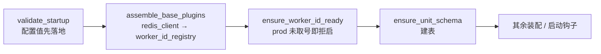

# 01 详细设计 · WorkerId 动态注册（Redis 租约）

> 项目骨架 · 03 后端基础能力 · 子任务 06（需求 03-7）· 详细设计

[文档首页](../../../../../../文档首页.md) › [03 后端基础能力](../../03_后端基础能力.md) › 详细设计　|　[← 任务](../03_后端基础能力_06_WorkerId动态注册.md)　|　[上一任务 ← 05 详细设计](../../03_后端基础能力_05_雪花ID位宽改造/设计/01_详细设计_05_雪花ID位宽改造.md)

## 1. 设计目标与范围 <a id="goal"></a>

把 WorkerId 从「compose 按容器硬编码注入」升级为「**进程启动时经 Redis 租约自动取号**」，使容器动态扩容（`compose scale` / K8s HPA）、短命脚本（seed / migrate / 一次性导入）与作业 worker 都能自动获得全局唯一 WorkerId，并保留配置兜底与生产拒启：

1. **能力域**：新增插件化能力域 `bms_core/workerid/`（端口 `BaseWorkerIdRegistry` + `redis` / `null` 实现 + 装配 + 提供者）。
2. **租约算法**：`SET NX EX` 占号 + Lua 内循环探测（随机起点、回绕、探测上限）+ 周期心跳续租 + 优雅释放（CAS）。
3. **接入面**：API 生命周期（`assemble_base_plugins` 之后）、作业 worker 入口、全部产生雪花 ID 的 ops 入口。
4. **降级与拒启**：Redis 不可用 / 注册失败回落 `[app].worker_id` 并告警；生产「未取到号且兜底为 0」拒启。
5. **口径回写**：架构 33、基类清单、后端开发规范、命名规范、配置键清单、部署说明、需求 03-7、阶段计划。

**范围外**：

| 项 | 归属 |
| --- | --- |
| 位宽 / 存储类型 / 契约字符串化 | 03_05（已交付） |
| Redis 统一客户端与 `[redis]` 配置 | 03_04（已交付） |
| 测试库单库化与用例重写 | 阶段一 `04_06` |
| 手工编号脚本 / 管理面「当前占用表查询」 | 不进本任务（可观测只到结构化日志，见 §9） |
| K8s / etcd 等其它实现 | 只留端口与 `provider` 扩展位，本期不实现 |

## 2. 决策记录（2026-11-01 逐项确认） <a id="decision"></a>

| # | 事项 | 结论 |
| --- | --- | --- |
| 1 | 能力形态 | 插件化能力域 `bms_core/workerid/`：端口 `BaseWorkerIdRegistry`（`plugin_key = worker_id_registry`）+ `redis` / `null` 实现 + 装配 `setup/aclose` + 提供者 |
| 2 | 配置分区 | 新增 `[worker_id]`；`[app].worker_id` 语义降为「显式偏好 + 兜底」 |
| 3 | API 注册时机 | `assemble_base_plugins` 之后、`ensure_unit_schema` 之前；`validate_startup` 的 prod 拒启改由注册结果判定 |
| 4 | 短命进程接入 | 统一上下文管理器（异步 `worker_id_lease()` + 同步 `worker_id_lease_sync()`，同一实现） |
| 5 | 探测算法 | 随机起点 + Lua 内循环 `SET NX EX` + 回绕，探测上限 256 |
| 6 | 租约参数 | TTL 60s / 心跳 20s（心跳 = TTL ÷ 3），可配 |
| 7 | 键值 | 键 `{key_prefix}:{env}:{unit}:worker_id:v2:{id}`；值 `{service}\|{hostname}\|{pid}\|{uuid}` |
| 8 | 释放 | 优雅退出 Lua 校验令牌后 `DEL`；崩溃靠 TTL |
| 9 | 兜底协调 | 配置值优先占号，占不到走注册并告警；Redis 不可用回落配置值并告警；prod 注册失败且兜底为 0 → 拒启 |
| 10 | 命名空间 | `{key_prefix}:{env}:{unit 或 service 或 default}:…`；ops / 作业 worker 经 `BMS_APP__UNIT` 与运行服务共用同一号池 |
| 11 | 心跳失败 | 告警 + 重试；连续失败达 TTL/3 → 重新占号并 `reconfigure` + 告警 |
| 12 | 号段 | 0 保留为「未注册」哨兵；注册池 `1 ~ 2^40−1` |
| 13 | 测试口径 | fakeredis 单测 + 真 Redis 双实例（`BMS_TEST_REDIS_URL` 缺失 skip）+ 开发服务器真机验证 |
| 14 | 测试期行为 | `[worker_id].enabled` 缺省 `true`；公共隔离夹具置 `false`，并行仍按 xdist 注入 |
| 15 | compose 注入 | 保留 `BMS_APP__WORKER_ID`，语义降为「显式偏好 / 兜底」；护栏用例同步改断言 |
| 16 | 回写范围 | 全量（见 §12） |
| 17 | 可观测 | 三个结构化日志事件，不加探针项 |
| 18 | ops 覆盖 | 全部产生雪花 ID 的 ops 入口经公共引导包装（含同步入口适配，见 §8.2） |
| 19 | 拒启形态 | 沿用 `ConfigError`（40001），不新增错误码 |

## 3. 现状事实与基线 <a id="baseline"></a>

| # | 事实 | 位置 |
| --- | --- | --- |
| 1 | `id_generator.reconfigure()` 目前只在 `validate_startup()` 调用（先于 Redis 装配） | `core/config.py::validate_startup` |
| 2 | `validate_startup` 在 `service_lifespan` 第 413 行，`assemble_base_plugins` 在其后 | `application.py` |
| 3 | **作业 worker 与 ops 脚本均不调用 `validate_startup`** ⇒ 实际长期以 WorkerId `0` 生成 ID（prod 同） | `bms_platform/jobs.py`、`ops/*.py` |
| 4 | Redis 统一客户端已就位：端口 `BaseRedisClient` + 进程共享实例（`shared_sync_client` / `shared_async_client`），`[redis].key_prefix` 缺省 `bms` | `redis/base.py` |
| 5 | 能力装配两条通道：`PluginWiring` 清单 + `BASE_PLUGIN_KEYS`（基础能力先行） | `core/assembly.py` |
| 6 | `app.unit` 缺省回落 `app.service`；ops 进程两者皆空 | `core/config.py::AppSettings` |
| 7 | compose 每容器注入 `BMS_APP__WORKER_ID`（API 11+ / jobs 101+），护栏用例断言「每容器都注入且互不相同」 | `deploy/compose/services.yml`、`tests/ops/test_compose_worker_ids.py` |
| 8 | 单测公共隔离夹具注入 `BMS_APP__WORKER_ID`（`gwN → N+1`） | `testing/fixtures.py::isolate_settings` |
| 9 | fakeredis 承载的共享客户端已就位（支持 Lua） | `tests_support/redis.py` |
| 10 | 20^40 空间下随机探测撞号概率 ≈ 1/2^40（跨命名空间非零但可忽略） | 本设计量化（§5.4） |

## 4. 模块与继承链 <a id="module"></a>

```
bms_core/workerid/
├── __init__.py     # 对外导出：端口 / 两实现 / 上下文管理器 / 键构造
├── base.py         # BaseWorkerIdRegistry（端口）+ 键构造 + 命名空间解析
├── redis.py        # RedisWorkerIdRegistry（真实实现，plugin_name = redis）
├── null.py         # NullWorkerIdRegistry（旁路实现，plugin_name = null）
└── lease.py        # worker_id_lease（异步）/ worker_id_lease_sync（同步）/ 生产就绪校验
```

继承链（四段，符合「能力域链固定四段」）：

| 层 | 类 |
| --- | --- |
| 根系 | `BaseObject` |
| 框架对象 | `BaseFrameworkObject`（经 `BasePluggable`） |
| 能力域基类 | `BaseWorkerIdRegistry(BasePluggable, BaseAsyncResource, ABC)` |
| 插件基类 | `RedisWorkerIdRegistry` / `NullWorkerIdRegistry` |

装配接线：`PluginWiring("worker_id_registry", BaseWorkerIdRegistry, "worker_id", "worker_id_registry")`，并**加入 `BASE_PLUGIN_KEYS`**（紧随 `redis_client` 之后，因 `RedisWorkerIdRegistry` 依赖进程共享 Redis 客户端）。

> 与 `redis_client` 的先后：`assemble_plugins` 按 `PLUGIN_WIRINGS` 顺序装配，`worker_id_registry` 排在 `redis_client` 之后即可保证共享实例已登记。

## 5. 租约算法 <a id="algorithm"></a>

### 5.1 键与值

| 项 | 口径 |
| --- | --- |
| 键 | `{key_prefix}:{env}:{unit}:worker_id:v2:{id}`（`key_prefix` 取 `[redis].key_prefix`，缺省 `bms`） |
| 命名空间段 | `unit = app.unit or app.service or "default"` |
| 值 | `{service or "-"}\|{hostname}\|{pid}\|{uuid4 hex}`（持有者令牌，释放时比对） |
| TTL | `[worker_id].lease_ttl_seconds`（缺省 60） |

### 5.2 占号（Lua，一次往返）

```lua
-- KEYS 空；ARGV: 1=键前缀(含 id 前的部分) 2=起点 3=池下限 4=池上限 5=令牌 6=TTL 7=探测上限
local start = tonumber(ARGV[2])
local low, high = tonumber(ARGV[3]), tonumber(ARGV[4])
local token, ttl, limit = ARGV[5], tonumber(ARGV[6]), tonumber(ARGV[7])
local span = high - low + 1
for i = 0, limit - 1 do
  local id = low + ((start - low + i) % span)   -- 起点随机、越界自然回绕
  if redis.call('SET', ARGV[1] .. id, token, 'NX', 'EX', ttl) then return id end
end
return -1
```

- 起点：`secrets.randbelow(span) + low`（池 `1 ~ 2^40−1`，**0 不参与**）。
- 探测上限：`[worker_id].probe_limit`（缺省 256）；用尽返回 `-1` → 按降级处理（§6）。
- Lua 内循环避免 N 次网络往返；2^40 空间下几乎一次命中。

### 5.3 心跳与重新占号

| 步 | 动作 | 结果 |
| --- | --- | --- |
| 1 | 每 `heartbeat_seconds` 执行 CAS 续期脚本（`GET == token` → `EXPIRE`，否则返回 0） | `1` 续期成功 |
| 2 | 返回 `0`（键已消失或已被他人持有） | 记 `failed_since`，下轮重试 |
| 3 | Redis 异常（超时 / 连接） | 告警 `redis 心跳失败`，记 `failed_since` |
| 4 | `failed_since` 持续 ≥ `lease_ttl_seconds / 3` | 重新占号 → 成功即 `reconfigure` + 日志 `worker_id_reallocated`；失败保留原号并告警（下轮再试） |

- 心跳由**后台线程**承载（`threading.Thread` + `threading.Event`），使用 `[redis]` 共享**同步**客户端：注册只在启动期与低频心跳使用，同步实现同时服务异步应用与同步 ops 脚本，避免「异步 / 同步两套实现」与事件循环绑定问题。
- 心跳脚本（Lua）：

```lua
if redis.call('GET', KEYS[1]) == ARGV[1] then return redis.call('EXPIRE', KEYS[1], ARGV[2]) end
return 0
```

### 5.4 跨命名空间撞号概率（量化）

命名空间隔离（env + unit）使不同号池可发出相同 id。若两个进程处于不同命名空间但写同一批库，撞号概率约为 `1 / 2^40 ≈ 9.1e-13` / 对。部署口径要求 ops 与目标服务共用 `BMS_APP__UNIT`（§8.3）把该概率降为 0；本地开发允许差异，风险量级已在实施记录登记。

## 6. 降级与拒启 <a id="fallback"></a>

| 场景 | 行为 | 日志 | prod |
| --- | --- | --- | --- |
| `[worker_id].enabled=false` 或 `provider=null` | 直接使用 `[app].worker_id` | `worker_id_acquired`（`source=config`） | 值 0 → 拒启 |
| 配置了 `[app].worker_id = N (≠0)`，`SET NX` 成功 | 用 N | `worker_id_acquired`（`source=config`） | 正常 |
| 配置值已被占 | 走探测拿新号 | `worker_id_acquired`（`source=registry`）+ `worker_id_configured_taken` 告警 | 正常 |
| 未配置（0） | 走探测 | `worker_id_acquired`（`source=registry`） | 正常 |
| Redis 不可用（连接 / 超时 / Lua 报错） | 回落 `[app].worker_id` | `worker_id_degraded`（`reason`） | 值 0 → 拒启 |
| 探测上限内无可用号 | 回落 `[app].worker_id` | `worker_id_degraded`（`reason=exhausted`） | 值 0 → 拒启 |

**就绪校验**（`ensure_worker_id_ready()`，抛 `ConfigError`）：

```
若 app.env == "prod" 且 impl.worker_id == 0 → ConfigError（提示：置 [app].worker_id 或修复 Redis）
```

调用点：① API lifespan（装配后、建表前）；② `worker_id_lease()` / `worker_id_lease_sync()` 取得租约后、返回前。

> `validate_startup()` 移除原「prod `worker_id == 0` 拒启」，改为仍执行 `id_generator.reconfigure(settings.app.worker_id)`（保证「注册关闭」路径与测试隔离仍按配置生效），prod 拒启统一由就绪校验承担。

## 7. 接口契约 <a id="contract"></a>

### 7.1 端口 `BaseWorkerIdRegistry`

| 成员 | 类型 | 语义 |
| --- | --- | --- |
| `key` / `plugin_key` | `str` | 固定 `worker_id_registry` |
| `worker_id` | `int` 属性 | 当前生效号（`acquire` 后有效，未取号为 0） |
| `source` | `str` 属性 | `registry` / `config` / `fallback` |
| `key_name` | `str \| None` 属性 | 当前持有键（`config` / `fallback` 为 `None`） |
| `acquire()` | `None`（同步） | 取号 + 生效 + 起心跳（幂等：已持号直接返回） |
| `release()` | `None`（同步） | 停心跳 + CAS 释放（幂等） |
| `setup()` | `async` | 插件生命周期入口，等价 `acquire()` |
| `aclose()` | `async` | 服务关闭入口，等价 `release()` |
| `assert_ready(settings, env)` | `None` | 生产就绪校验（不通过抛 `ConfigError`） |

- 失败分支：Redis 异常、探测耗尽、令牌不匹配、生产未取号 —— 全部在 §6 表中显式定义，无静默路径。
- `null` 实现：`acquire` 只 `reconfigure` 配置值、`source=config`、心跳为空操作。

### 7.2 上下文管理器

| API | 形态 | 使用方 |
| --- | --- | --- |
| `worker_id_lease(settings=None)` | `async with` | 异步 ops 入口、作业 worker 入口 |
| `worker_id_lease_sync(settings=None)` | `with` | 同步 ops 入口（排障单步种子等） |

两者内部同一实现：构造实现（`build_worker_id_registry(settings)`，**非应用进程**先经 `redis.bootstrap.ensure_shared_redis_client(settings)` 登记共享客户端）→ `acquire` → `ensure_worker_id_ready` → 退出 `release`。

### 7.3 配置（`[worker_id]`）

| 键 | 缺省 | 约束 | 说明 |
| --- | --- | --- | --- |
| `enabled` | `true` | — | 注册开关（`false` = 用 `[app].worker_id`，测试夹具置 false） |
| `provider` | `redis` | `redis` / `null` | 实现名（`null` 仅应急旁路） |
| `lease_ttl_seconds` | `60` | `≥ 5` | 租约 TTL |
| `heartbeat_seconds` | `20` | `≥ 1` 且 `< lease_ttl_seconds` | 心跳间隔 |
| `probe_limit` | `256` | `1 ~ 65535` | 单次占号探测上限 |

环境变量：`BMS_WORKER_ID__ENABLED` / `__PROVIDER` / `__LEASE_TTL_SECONDS` / `__HEARTBEAT_SECONDS` / `__PROBE_LIMIT`。

## 8. 接入点 <a id="integration"></a>

### 8.1 API 生命周期



- `worker_id_registry` 进 `BASE_PLUGIN_KEYS`：其 `setup()` 在装配期取号并 `reconfigure`，早于建表与引导写入。
- `ensure_worker_id_ready(app, settings)` 紧随 `assemble_base_plugins` 调用，失败抛 `ConfigError`（异常路径沿用既有「释放已装配资源 + 拒启」）。
- 关闭：`ResourceManager` 逆序释放 → `worker_id_registry.aclose()` 停心跳并 CAS 释放（先于 Redis 客户端释放）。

### 8.2 ops 与作业 worker

| 入口 | 形态 | 处理 |
| --- | --- | --- |
| `ops/*.py` 内含 `asyncio.run(...)` 的 21 个入口（`init_schema` / `migrate_*` / `outbox` / `txn_recovery` / `task_scheduler` / `event_consumer` / `test_db` / `db_admin` / `baseline_series` / `gateway_config` / `release` / `provision_tenant` / `init_tenant` / `tenant_topology` / `bootstrap_platform` / `check_modules` / `check_tables` / `seed_rbac` / `seed_oidc_client` / `job_worker` …） | 异步 | `ops/_worker.py::run_with_worker_id(entry)` 统一包一层（`asyncio.run` → 内部 `async with worker_id_lease()`） |
| 同步 ops 入口（`seed_menu` / `seed_module` / `seed_tables` / `seed_tasks` / `seed_user` / `seed_sso` / `seed_tenant` / `seed_config` / `seed_platform` / `contract_*` / `export_errcodes` / 其余只读检查） | 同步 | 用 `worker_id_lease_sync()` 包裹；只读且不产生雪花 ID 的入口（`contract_*` / `check_contracts` / `check_plugins` / `check_budget` / `export_errcodes` / `gateway_config` 等离线校验工具）**有意不接**——它们不写库、且 CI 无 Redis，接入只会给离线校验引入外部依赖；该判据与清单由静态护栏用例固化（§10） |
| `ops/dev_run.py` | 长期进程 | **不包**——它经 `runpy` 进服务入口，租约由应用 lifespan 获得（重复包裹会双租约双号） |
| `services/*/src/bms_<service>/jobs.py`（`main()`） | 长期 / 单轮 | `async with worker_id_lease()` 包裹整段 `_run` |
| `ops/job_worker.py` | 开发便捷入口 | 同上（`build_worker` 前取号，退出释放） |

### 8.3 部署编排

- `deploy/compose/services.yml` 保留 `BMS_APP__WORKER_ID` 注入，注释改为「**显式偏好 / 兜底**：占得到就用，占不到自动换号；唯一性由 Redis 租约保证」。
- `ops` 与作业 worker 容器补 `BMS_APP__UNIT`（缺省取服务标识），与运行服务共用同一号池。
- 护栏用例 `test_compose_worker_ids`：断言改为「每容器注入值互不相同（偏好不冲突）+ 容器命令/服务声明齐备」，并补一条「注入仅是偏好」的说明断言（读取 `services.yml` 段注释标记）。

## 9. 可观测 <a id="observe"></a>

| 事件 | 级别 | 字段 |
| --- | --- | --- |
| `worker_id_acquired` | info | `id` / `source`（`registry` / `config` / `fallback`） / `key` / `ttl` |
| `worker_id_configured_taken` | warning | `configured` / `id` |
| `worker_id_degraded` | warning | `reason` / `id` / `key` |
| `worker_id_reallocated` | warning | `old_id` / `new_id` / `reason` |

不加 `/readyz` 检查项（Redis 不可用已由 `redis` 检查项反应，避免探针抖动触发编排误重启）。

## 10. 护栏与门禁 <a id="guard"></a>

| 护栏 | 内容 | 落点 |
| --- | --- | --- |
| 端口契约 | `worker_id_registry` 可解析、`redis` / `null` 两实现齐备、契约版本一致 | `tests/workerid/test_registry_contract.py` |
| 装配顺序 | `BASE_PLUGIN_KEYS` 含 `worker_id_registry` 且排在 `redis_client` 之后 | 同文件断言 |
| 入口覆盖 | `ops/` 内含 `asyncio.run` 的模块必须在 `ops/_worker.py` 引导集合内（新增入口漏接即失败）；`dev_run` 在排除清单 | `tests/ops/test_ops_worker_bootstrap.py` |
| 部署护栏 | compose 注入语义（偏好不冲突）+ `BMS_APP__UNIT` 声明 | `tests/ops/test_compose_worker_ids.py`（改造） |
| 测试隔离 | 公共夹具置 `[worker_id].enabled=false` | `testing/fixtures.py` |
| 覆盖率 | 新增 / 改动模块 100% 行 + 分支（口径见《[AI开发规范](../../../../../../规范/AI开发规范.md)「覆盖率要求」） | 推送预检 |

## 11. 测试设计与验收映射 <a id="test"></a>

| 验收点（需求 03-7 / 任务 06） | 用例 |
| --- | --- |
| 多进程并发拿到不同号 | fakeredis：两个 registry 实例顺序取号不同；真 Redis：`multiprocessing` 双进程各取一号不同（`BMS_TEST_REDIS_URL` 缺失 skip） |
| 配置值优先占号 / 被占换号 | 配置 11 → 得 11（`source=config`）；先占 11 再取 → 得其它号 + 告警 |
| 释放后复用 | 取号 → 释放（CAS）→ 再取同一号（`probe_limit=1` + 固定起点可控） |
| 令牌不匹配不误删 | 手工改写值为他人令牌 → `release()` 不删除键 |
| TTL 到期回收 | fakeredis：断言 `TTL` 已设；键被 `DEL`（模拟过期）后可被再次占用。真 Redis：`lease_ttl_seconds=1` + 等待过期后可复用（skip 口径同上） |
| Redis 不可用回落 | 注入抛 `ConnectionError` 的客户端 → `worker_id == 配置值`、`source=fallback`、日志 `worker_id_degraded` |
| 生产未取号拒启 | `env=prod` + 配置 0 + Redis 不可用 → `ConfigError`；配置 11 → 通过；`enabled=false` + 0 → `ConfigError` |
| 键按环境 + 单元隔离 | 键构造用例：`unit` 优先、回落 `service`、再回落 `default`；`env` 段跟随配置 |
| 心跳续租 | 心跳一轮后 `TTL` 回到 `lease_ttl_seconds` |
| 心跳失租重新占号 | 手工 `DEL` 键 → 触发心跳 → `worker_id` 变化且 `id_generator` 同步（`worker_id_reallocated`） |
| 心跳 Redis 异常 | 注入抛错客户端 → 不换号、日志告警、后续恢复正常 |
| 装配与生命周期 | 应用装配后 `app.state.worker_id_registry` 就绪、`id_generator` 生效；关闭后键被释放 |
| ops 入口覆盖 | 静态护栏用例（§10） |
| 真机双实例 | 开发服务器真 Redis 起两个进程各取一号，记录键与号（实施记录附录） |
| 覆盖率 | 新增 / 改动模块 100% 行 + 分支 |

**Kiwi 流程**：先在平台登记用例取得编号（当前最大 2396，以平台回读为准），再写用例并在代码标注 `@pytest.mark.kiwi_id(...)`；既有编号不复用、不改派。

## 12. 实施分解（工序先后） <a id="impl"></a>

1. 配置：`WorkerIdLeaseSettings` + `Settings.worker_id` + `config.toml` / `.env.example` / 三环境覆盖。
2. 能力域：`workerid/{base,redis,null,lease}.py` + `redis/bootstrap.py`（`ensure_shared_redis_client`）。
3. 装配：`PLUGIN_WIRINGS` + `BASE_PLUGIN_KEYS` + `WorkerIdRegistryFactory` + `_NULL_MODULES`。
4. 接入：`service_lifespan`（装配后就绪校验）、`validate_startup`（移除 prod 0 拒启）、`ops/_worker.py` + 21 个异步入口 + 同步入口 + 服务 `jobs.py`。
5. 测试隔离：`testing/fixtures.py` 置 `enabled=false`；专项夹具按需开启。
6. 护栏：ops 入口覆盖用例 + compose 护栏改造。
7. 用例：fakeredis 全分支 + 真 Redis 双实例；Kiwi 登记回填。
8. 真机验证：开发服务器真 Redis 双实例。
9. 文档回写（§13）与实施 / 测试记录。

## 13. 登记落点与回写清单 <a id="register"></a>

| 内容 | 落点 |
| --- | --- |
| 架构口径 | 《[架构设计 · 部署与运维](../../../../../../设计/架构设计/33_架构设计_部署与运维.md)》「集群设计要点 · 雪花 WorkerId」与「配置分层 · 雪花 WorkerId」两条 |
| 基类清单 | 《[后端基类清单](../../../../../../后端基类清单.md)》「雪花 ID」行（补 WorkerId 租约与键口径）；「中间层基类 / core 横切基座」补 `BaseWorkerIdRegistry` 行 |
| 规范 | 《[后端开发规范](../../../../../../规范/后端开发规范.md)》「Redis 基础能力」条补 WorkerId 租约口径；《[命名规范](../../../../../../规范/命名规范.md)》补 `worker_id` 键与配置段命名 |
| 配置键清单 | 任务 `03_01` 详细设计「配置分区与键清单」补 `[worker_id]` 段 |
| 部署说明 | `deploy/compose/services.yml` 注释、`backend/.env.example`、开发机部署说明（`BMS_APP__UNIT` 与偏好语义） |
| 需求 / 任务 / 计划 | 需求 03-7 交付注块、任务 06 参考、阶段计划 `03_06` 行（状态 / 工时 / 完成日期 / 偏差） |
| 记录 | `实施/01_实施_06_WorkerId动态注册.md`、`测试/01_测试_06_WorkerId动态注册.md` |

## 14. 风险与开放项 <a id="risk"></a>

| 风险 | 处置 |
| --- | --- |
| 心跳线程与关闭竞态（释放后仍续期） | `aclose()` 先停止线程（`Event` + `join(超时)`）再 CAS 释放；用例覆盖「停止后无续期」 |
| 同步 ops 入口长事务超过 TTL | 心跳线程同样在同步上下文运行，长事务不会失租 |
| `dev_run` 双重租约 | 明确排除，护栏用例固化排除清单 |
| 不同命名空间撞号 | 部署口径统一 `BMS_APP__UNIT`；概率量化见 §5.4 |
| 测试夹具关闭注册导致「注册路径无应用级覆盖」 | 专项用例显式开启（fakeredis）覆盖应用装配路径 |
| 覆盖率 100% 门禁与后台线程分支 | 心跳线程逻辑抽为可注入时钟 / 间隔的可测方法，用例直接驱动单轮心跳 |
| 达梦 / 三库无关 | 本任务不涉库结构 |

**开放项**：无。（真机验证若环境不可达，转入实施记录并即时上报。）

## 15. 参考文档 <a id="ref"></a>

- 需求 [03-7](../../../../需求/03_需求_后端基础能力.md#r03-7)；任务 [06](../03_后端基础能力_06_WorkerId动态注册.md)；前序 [05 详细设计](../../03_后端基础能力_05_雪花ID位宽改造/设计/01_详细设计_05_雪花ID位宽改造.md)
- 计划 [01 计划 · 项目骨架](../../../../计划/01_计划_项目骨架.md)；基类清单《[后端基类清单](../../../../../../后端基类清单.md)》
- 代码落点：`backend/libs/bms_core/src/bms_core/{workerid/*,redis/bootstrap.py,core/config.py,core/assembly.py,application.py,testing/fixtures.py}`、`backend/ops/{_worker.py,*.py}`、`backend/services/*/src/bms_*/jobs.py`、`deploy/compose/services.yml`

> 本文档依《[文档生成规范](../../../../../../规范/文档生成规范.md)》与《[AI开发规范](../../../../../../规范/AI开发规范.md)》编写
