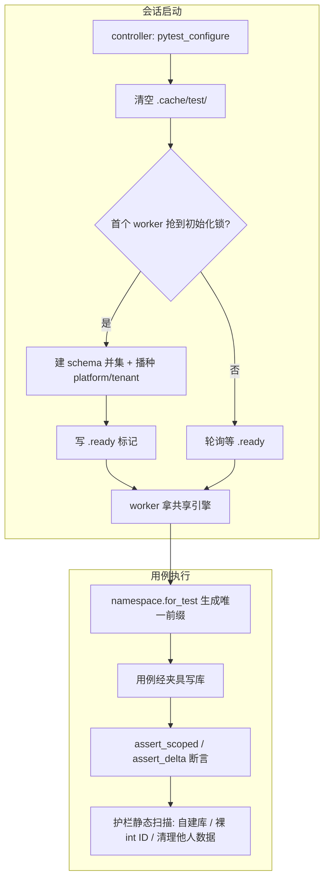

# 01 详细设计 · 单库测试基座与护栏

> 项目骨架 · 04 CI 与阶段验收 · 06 测试库单库化与用例重写 · 子任务 01（需求 04-6）· 详细设计

[文档首页](../../../../../../../文档首页.md) › 项目骨架任务 › [04 CI 与阶段验收](../../../04_CI与阶段验收.md) › [06 测试库单库化与用例重写](../../04_CI与阶段验收_06_测试库单库化与用例重写.md) › [04-6-1](../04_CI与阶段验收_06_测试库单库化与用例重写_01_单库测试基座与护栏.md) › 详细设计

## 1. 设计目标与范围 <a id="goal"></a>

把“每用例一套干净 SQLite”的测试体系换成“**每逻辑数据源一套库 + 用例叠加**”，并把新口径固化成**夹具 + 助手 + 机器护栏**三件套，使存量用例可以分批改造而不会边改边回退：

1. **单库夹具**：`platform` / `tenant` 各一个库文件，全 worker 共用，会话开始删库重建，会话内只建一次 schema 与种子。
2. **命名空间助手**：`bms_core/testing/namespace.py` 三合一（唯一编码 / 断言限定 / 查询过滤），让“叠加语义”有统一写法。
3. **三条护栏**：禁为图省事自建 SQLite、禁原生 SQL 直绑 int ID、禁清理非本用例数据；白名单用 `@pytest.mark.own_db("理由")` 显式登记。
4. **落点与配置**：pytest 会话库落 `.cache/test/`，联调库仍落 `database/bms/test`；临时目录策略进 `pyproject.toml`。
5. **产品仓复用**：`mdm` 仓经 `bms_core.testing` 接入同一实现，不复制第二套。

**范围外**：

| 项 | 归属 |
| --- | --- |
| 存量 1184 个涉库用例的批量改造、A~E 分类台账 | 子任务 [04-6-2](../../04_CI与阶段验收_06_测试库单库化与用例重写_02_涉库用例改造与收口/04_CI与阶段验收_06_测试库单库化与用例重写_02_涉库用例改造与收口.md) |
| 前端 vitest 的临时目录与数据隔离 | 不进本任务（口径随《测试规范》同步，实现另立） |
| 三库（MySQL / PG / 达梦）集成库 | 不进本任务（仍走 CI 常驻库） |

## 2. 决策记录（2026-11-01 逐项确认） <a id="decision"></a>

| # | 事项 | 结论 |
| --- | --- | --- |
| 1 | 用例处置口径 | **分层改造 + 局部重写**（A~E 五类），不做字面全面重写 |
| 2 | “一套库”的粒度 | **每逻辑数据源一套**（`platform` / `tenant` 各一），不是物理单文件 |
| 3 | 独立库例外 | 建库 / 迁移 / 多库拓扑 / 每租户派生库等“建库即被测”进**白名单**，不一律禁止 |
| 4 | 执行顺序 | **先夹具与护栏、再批量改用例**（本子任务先于 04-6-2） |
| 5 | 断言口径 | **命名空间限定 + 相对增量断言** |
| 6 | 任务拆分 | 拆为 04-6-1（基座与护栏）/ 04-6-2（用例改造与收口）两个嵌套子任务（见父任务「子任务清单」） |
| 7 | 文档措辞 | 第 5 条改「**用例改造（分层处置）**」；任务/需求标题沿用立项名 |
| 8 | 命名空间助手形态 | 单一模块 `namespace.py` **三合一**（编码 / 断言 / 过滤） |
| 9 | 白名单登记 | `@pytest.mark.own_db("理由")` + 静态护栏校验（无 marker 自建库即报错） |
| 10 | 库文件生命周期 | **会话开始删库重建**，会话结束保留供排查 |
| 11 | 单文件 / 单用例调试 | **同库同口径**（也走 `.cache/test/`），不自动起独立库 |
| 12 | 规范影响范围 | 《测试规范》《AI开发规范》本次回写；**mdm 226 个用例一并改造** |
| 13 | 测试库落点 | 按用途分两类：pytest 会话库 `.cache/test/`；联调 / 部署 test 库 `database/bms/test` |
| 14 | `DbTestCase` 定位 | 保留为 **opt-in**（外层事务 + 回滚，仅撤本用例自身写入） |
| 15 | mdm 任务文档落点 | 统一记在 bms `04-6-2`，mdm 仓不另建任务 |
| 16 | 并发控制 | WAL + `busy_timeout` + 有限重试；参数与重试次数见 §4.4 |
| 17 | 初始化选主机制 | 文件锁 `O_CREAT\|O_EXCL`（零新增依赖），残留锁按 mtime 超 120s 判过期并抢占 |
| 18 | 会话库清理策略 | 会话开始删库重建、**会话结束保留**（下次开始清掉），便于失败回看 |
| 19 | `tenant` 库首建种子 | 执行**完整租户侧种子**（租户 / 分支 / 模块开关），与生产形态一致 |
| 20 | 护栏用例写法 | `self_test()` 为**判定向量唯一来源**；pytest 只补 `self_test` 够不到的分支（文件枚举 / 增量清单 / 白名单导出 / 缺规则 / 语法错误），不重复抄向量 |
| 21 | 存量误杀核对 | 全仓扫描作为收口时**一次性核对**，逐条判“真违规 / 误杀”，结论落实施记录；不固化成 CI 全仓步骤 |
| 22 | 渐进切换的实现方式 | 不做运行时开关：由**各套件 conftest 选用哪个夹具**决定（`shared_platform_db_url` vs 原 `platform_db_url`），04-6-2 逐套件迁移、迁完删旧夹具；旧 `worker_sqlite_dir` 保留至收口 |

## 3. 总体结构 <a id="arch"></a>



- **单源**：夹具、命名空间助手、护栏规则判定分别只有一处实现（`bms_core/testing/` 与 engkit `base/`），各仓只放配置与薄包装。
- **可回退**：护栏与夹具先落地，存量用例仍能跑（改造前允许白名单临时豁免，见 §6.4）。

## 4. 单库夹具 <a id="fixture"></a>

### 4.1 库与数据源映射 <a id="mapping"></a>

| 逻辑数据源 | 库文件 | 用途 | 夹具 |
| --- | --- | --- | --- |
| `platform` | `<仓根>/.cache/test/platform.db` | 平台库（用户 / 角色 / 菜单 / 模块登记） | `platform_db_url`（沿用既有名） |
| `tenant` | `<仓根>/.cache/test/tenant.db` | 租户库（租户 / 分支 / 模块开关 / 业务表） | `tenant_db_url`（新增） |
| 每租户派生库（`url_template`） | `<仓根>/.cache/test/tenant-<code>.db` | 仅白名单用例（D 类） | 用例自建 + `own_db` |

**关键变更**：`platform_db_url` 由「`tmp_path_factory.mktemp` 派生、每 worker 一套」改为「**仓内固定路径、全 worker 共用**」。原 `fixtures.worker_sqlite_dir()` 与 `BMS_DATABASE__SQLITE_DIR` 的按 worker 分目录逻辑删除——它正是文件爆炸的直接来源。

### 4.2 建库与播种时序 <a id="init"></a>

1. **清库**：`pytest_configure`（controller 进程，`PYTEST_XDIST_WORKER` 为空）删除 `.cache/test/` 下 `*.db*`（含 `-wal` / `-shm`）与 `.ready`；xdist worker 的启动晚于此钩子，不会与清库竞争。
2. **抢锁**：worker 侧在 `pytest_sessionstart` 前解析夹具时，用 `.cache/test/.init.lock`（`os.open(O_CREAT|O_EXCL)`）选主；抢不到即每 200ms 轮询，总超时 120s。锁文件 mtime 超过 120s 视为上次进程崩溃的**残留锁**，删除后重抢一次。
3. **建 schema**：选主 worker 执行 `Base.metadata.create_all`（已导入模型的并集，复用 `alembic` 侧 `unit_metadata` 的推导口径），再跑既有种子（`seed_tenants` / `seed_modules`，`tenant` 库跑租户侧种子）。
4. **发布就绪**：写 `.cache/test/.ready`（内容含 schema 版本戳与建库时间）；其余 worker 轮询 `.ready`（间隔 200ms，超时 120s 报错）。
5. **幂等**：`.ready` 存在且 schema 版本戳一致 → 跳过建库（会话内重启 worker 不重建）。

### 4.3 引擎与会话 <a id="engine"></a>

| 夹具 | 作用域 | 说明 |
| --- | --- | --- |
| `platform_db_url` / `tenant_db_url` | session | 固定路径连接串，供 `apply_platform_db` 等注入 |
| `db_engine` | session | 每个数据源一个 `AsyncEngine`（`NullPool` + `busy_timeout`），会话结束 `dispose` |
| `db_session` | function | 每用例一个 `AsyncSession`，用例内自行 commit；**不回滚**（叠加语义） |
| `rollback_db_session` | function | `DbTestCase` opt-in：外层事务 + savepoint，用例结束回滚（仅撤本用例写入） |

### 4.4 并发控制 <a id="concurrency"></a>

| 参数 | 值 | 说明 |
| --- | --- | --- |
| `journal_mode` | `WAL` | 读不阻塞写；单文件多进程共享的前提 |
| `busy_timeout` | 5000 ms | 拿不到写锁时等待而非立即 `database is locked` |
| `synchronous` | `NORMAL` | 测试库不要求掉电一致性，换取吞吐 |
| 重试次数 / 退避 | 3 次 / 50ms、150ms、400ms | 仅对 `OperationalError: database is locked` 重试 |
| 连接池 | `NullPool` | 避免跨用例连接复用带出未提交事务 |

**实测项**：`-n auto` 下全量写入吞吐与锁冲突率必须实测并登记实施记录；若冲突率导致不稳定，先在 `engkit.toml` 的 pytest 档位下调 worker 数，**不得**退回“每用例一套库”。

### 4.5 失败分支 <a id="fixture-fail"></a>

| 场景 | 行为 |
| --- | --- |
| 初始化锁超时（120s） | 用例失败并提示“另一个 worker 建库未完成”，附 `.cache/test/` 目录清单 |
| 初始化锁残留（上次进程崩溃） | mtime 超 120s 判过期，删除后重抢一次；仍失败即红并提示手动删 `.cache/test/.init.lock` |
| `.ready` 缺失 / schema 版本戳不一致 | 删库重建一次；再失败即红（不静默降级为临时库） |
| `database is locked` 重试耗尽 | 失败并打印语句摘要 + 当前 `busy_timeout` / 重试次数，便于判定是否需调参 |
| `BMS_TEST_ISOLATED_DB=1` | 走旧路径（`tmp_path` 独立库），并在会话头打印醒目提示“当前为隔离调试模式，结果不代表 CI 口径” |
| 库文件被占用无法删除（Windows） | 跳过删除并告警，改用新文件名 `<name>-<时间戳>.db` 并写 `.ready`，避免整轮崩掉 |

## 5. 命名空间助手 <a id="namespace"></a>

### 5.1 接口 <a id="ns-api"></a>

```python
# bms_core/testing/namespace.py
class Namespace:
    prefix: str          # 唯一编码前缀，如 "w3a1b2c3d4"
    def code(self, suffix: str) -> str: ...        # 生成带前缀的业务编码 / 名称
    def like(self) -> str: ...                     # SQL LIKE 用模式（"<prefix>%"）

def for_test(request: pytest.FixtureRequest) -> Namespace: ...
def scoped(statement: Select, column: Any, ns: Namespace) -> Select: ...   # 追加前缀过滤
def assert_scoped(rows: Sequence[Any], ns: Namespace, *, field: str = "code") -> None: ...
def assert_delta(before: int, after: int, *, expected: int = 1) -> None: ...
```

### 5.2 唯一编码规则 <a id="ns-rule"></a>

- **前缀** = `w{worker 序号}{nodeid 摘要 8 位十六进制}`：worker 位保证并行进程不撞，摘要位保证同 worker 内用例不撞；同一用例跨会话前缀**稳定**（便于复现与按前缀反查）。
- **长度上限 16**，只含 `[a-z0-9]`，避免撞上业务编码校验（长度 / 字符集）。
- **反查**：会话内把 `前缀 → nodeid` 追加到 `.cache/test/namespace-map.jsonl`（会话开始重建），排查“这条脏数据是谁写的”时直接查表。
- **禁止**：用例内手写固定编码 / 固定哨兵作为业务键（护栏 §6.1-3 兜底）。

### 5.3 断言与查询限定 <a id="ns-assert"></a>

- `scoped(...)`：列表 / 统计查询必须带前缀过滤；分页 `total` 断言改为“本前缀内计数”。
- `assert_scoped(...)`：拿到返回集合后先按前缀过滤再断言集合相等 / 条数，避免前序数据混入。
- `assert_delta(...)`：无法按前缀过滤的全局统计（如平台总览计数）改为“执行前后差值”。
- **禁止**：`assert len(rows) == N` 直接对全表断言（护栏 §6.1-3 的判定之一）。

### 5.4 失败分支 <a id="ns-fail"></a>

| 场景 | 行为 |
| --- | --- |
| 前缀超长 / 含非法字符 | `for_test` 直接抛错（配置错误，不做静默截断） |
| `assert_scoped` 传入无前缀的数据 | 抛错并提示“疑似使用固定编码，请改用 ns.code()” |
| 分页 `total` 无法按前缀过滤 | 强制走 `assert_delta`，用例显式声明基线 |

## 6. 护栏 <a id="guard"></a>

### 6.1 三条判定 <a id="guard-rules"></a>

| 编号 | 判定 | 违规样例 | 豁免 |
| --- | --- | --- | --- |
| G1 自建库 | 测试代码中出现 `sqlite+aiosqlite:///` / `sqlite:///` 字面量、`create_async_engine(` / `create_engine(`（非白名单）、`tmp_path` 派生 `*.db` | 用例自建 `admin.db` | `@pytest.mark.own_db("理由")` |
| G2 裸 int ID | 原生 SQL 中 ID 列参数未过 `sqlite_id()`；ID 断言按 int 比较（`== 1001` 而契约是字符串） | `conn.execute("… WHERE id = :id", {"id": 1001})` | 无（必须修） |
| G3 清理他人数据 | `DELETE FROM` / `drop_all` / 无前缀限定的 `delete()`；`TRUNCATE` 等价写法 | 用例 teardown 里 `DELETE FROM sys_tenant` | `own_db` 用例内的自建表可自清 |

### 6.2 白名单 marker <a id="guard-allow"></a>

- `@pytest.mark.own_db("建删库是被测功能")`：**理由必填**（空串即护栏报错）；可加在函数或类上。
- 白名单清单由护栏 `--list-own-db` 导出（文件 / 用例 / 理由三列），供 04-6-2 收口统计与审计。
- marker 在 `pyproject.toml` 的 `[tool.pytest.ini_options].markers` 登记，避免 `PytestUnknownMarkWarning`。

### 6.3 实现与接入 <a id="guard-wiring"></a>

| 层 | 落点 | 内容 |
| --- | --- | --- |
| 判定实现 | engkit `src/engkit/base/test_db_isolation.py` | 三条判定的 AST 扫描 + 白名单导出；规则数据落各仓 `engkit.toml` 的 `[rules.test_db_isolation]` |
| 薄包装 | `bms/scripts/tools/base_check/check_test_db_isolation.py` | 参数转发与退出码透传（与既有 `check_snowflake_ids.py` 同构，不含推导） |
| 开发环 | `bms/engkit.toml` `[[devloop.steps]]` | 增量扫描（`--files-from {changed}`） |
| 推送预检 / CI | `bms/engkit.toml` 预检步骤 | 全量扫描（与雪花 ID 护栏同档） |
| 产品仓 | `mdm/engkit.toml` | 只加配置，不加代码 |

### 6.4 误杀与豁免 <a id="guard-false"></a>

- **改造期豁免**：04-6-1 落地时，存量用例必然大面积违规。护栏先以“**只报新增文件 / 新增行**”的增量模式接入开发环（`--files-from` 天然满足），推送预检的全量模式在 04-6-2 收口阶段才启用；切换点写进 04-6-2 的详细设计。
- **不设**“文件级 exclude 清单”：豁免只认 marker，避免排除清单随行号漂移。
- 规则本身的误判（如注释 / 字符串里出现 `create_engine(`）由 AST 扫描规避，不用正则。

## 7. 配置与落点 <a id="config"></a>

| 项 | 值 | 落点 |
| --- | --- | --- |
| pytest 临时根 | `.cache/pytest`（沿用） | `backend/pyproject.toml` `addopts --basetemp` |
| 会话库目录 | `.cache/test/` | 新增常量 `bms_core/testing/fixtures.py`（`TEST_DB_DIR`） |
| 联调 / 部署 test 库 | `database/bms/test/` | `config.test.toml` 的 `[database].sqlite_dir`（不变） |
| 隔离调试开关 | `BMS_TEST_ISOLATED_DB=1` | 环境变量（默认关闭） |
| 清理策略 | 会话开始删库；`.cache/` 整体已被 gitignore | `.gitignore`（已覆盖） |

## 8. 产品仓（mdm）复用 <a id="product"></a>

1. `mdm` 仓测试根以 `-p bms_core.testing.plugin`（或既有入口）加载同一插件，不写 `pytest_plugins`。
2. 仓根 `engkit.toml` 加 `[rules.test_db_isolation]` 与预检步骤，与 bms 同口径。
3. 先迁移一个服务套件验证“夹具可用 + 护栏可跑”，其余用例改造归 04-6-2（任务文档记在 bms 侧）。

## 9. 测试设计 <a id="test-design"></a>

> 用例先登记 Kiwi TCMS 再编码（《测试规范》§5）；下表为待登记项。

| 编号 | 用例 | 落点 | 断言要点 |
| --- | --- | --- | --- |
| T1 | 共享库初始化幂等 | `libs/bms_core/tests/testing/test_shared_db.py` | 两次建库只建一次；`.ready` 版本戳一致 |
| T2 | 多进程并发写不锁死 | 同上 | 4 进程各写 50 行，全部成功且计数为 200 |
| T3 | 锁超时 / ready 缺失失败分支 | 同上 | 抛错信息含目录清单与提示，不静默降级 |
| T4 | `BMS_TEST_ISOLATED_DB=1` 走独立库 | 同上 | 库路径含 `tmp`，且打印隔离模式提示 |
| T5 | 命名空间前缀唯一且稳定 | `libs/bms_core/tests/testing/test_namespace.py` | 同 worker 不同用例前缀不同；同用例跨会话相同；字符集 / 长度合规 |
| T6 | `assert_scoped` / `assert_delta` 语义 | 同上 | 混入他人数据不误判；差值断言正确 |
| T7 | G1 自建库护栏 | `libs/bms_core/tests/testing/test_db_isolation_guard.py` | 违规样例必红；`own_db` 放行；`--list-own-db` 导出正确 |
| T8 | G2 裸 int ID 护栏 | 同上 | 裸 int 必红；`sqlite_id()` 通过 |
| T9 | G3 清理他人数据护栏 | 同上 | 无前缀 `DELETE` 必红；`own_db` 自建表可清 |
| T10 | `DbTestCase` 回滚只撤自身写入 | `libs/bms_core/tests/testing/test_transaction.py` | 回滚后他人数据仍在 |
| T11 | mdm 服务套件接入 | `mdm` 仓对应套件 | 同一夹具可跑通、护栏零误杀 |
| T12 | 护栏分支覆盖（engkit 侧） | `engkit/tests/test_base_test_db_isolation.py` | 文件枚举 / 增量清单过滤 / 白名单导出 / 缺规则返回 2 / `ast.parse` 语法错误；**判定向量不在此重复**，由 `self_test()` 覆盖 |

**护栏用例分层（2026-11-01 拍板）**：`self_test()` 是判定向量的唯一来源（预检的 `--self-test` 步骤直接调用，不依赖仓内容）；pytest 只补 `self_test` 够不到的分支，避免同一批向量维护两处。存量误杀用**一次性全仓核对**（收口时跑，逐条判“真违规 / 误杀”，结论落实施记录），不固化成 CI 全仓步骤——改造期全仓必然大面积命中，固化会让 CI 长期红。

## 10. 验收映射 <a id="accept-map"></a>

| 完成标准（04-6-1） | 证据 |
| --- | --- |
| 两仓同一实现、零复制 | T11 + 代码检索（`bms_core/testing/` 外无第二套夹具） |
| `platform` / `tenant` 各一套库 | `.cache/test/` 目录清单（2 个 `.db`）+ T1 |
| 并行稳定 | T2 + 全量并行实测记录（实施文档） |
| 三条护栏生效且不误杀 | T7 ~ T9 + 增量扫描实跑记录 |
| 白名单可审计 | `--list-own-db` 导出 + T7 |
| 新增模块覆盖率 100% | 推送预检覆盖率报告（`namespace.py` / 护栏模块） |
| 规范回写完成 | 《测试规范》《AI开发规范》diff |

## 11. 风险与待确认 <a id="risk"></a>

| # | 风险 | 处置 |
| --- | --- | --- |
| 1 | 单文件 WAL 下多 worker 写竞争导致偶发超时 | `busy_timeout` + 重试 + 实测调 worker 数；**不得**回退每用例建库 |
| 2 | Windows 下库文件句柄未释放导致删不掉 | §4.5 兜底：改用新文件名并告警 |
| 3 | 初始化选主失败导致整轮卡死 | 120s 超时即红并打印目录清单，不做无限等待 |
| 4 | 改造期护栏大面积误伤存量用例 | 增量模式先接入，全量模式在 04-6-2 收口时切换 |
| 5 | `tenant` 库与 `platform` 库表集重叠导致“写错数据源”测不出来 | 表集按 `registry` 推导的归属划分（与 `topology_migration` 同源），重叠即报错 |

**实施细节已确认（2026-11-01）**：初始化选主用文件锁 `O_CREAT\|O_EXCL`（零新增依赖，残留锁按 mtime 超 120s 判过期并抢占）；会话库**结束保留、下次会话开始清**（便于失败回看，磁盘只有 2 个文件）；`tenant` 库首建执行**完整租户侧种子**（与生产形态一致，首建多几秒只一次）。

> 本文档按《[文档生成规范](../../../../../../../规范/文档生成规范.md)》编写
