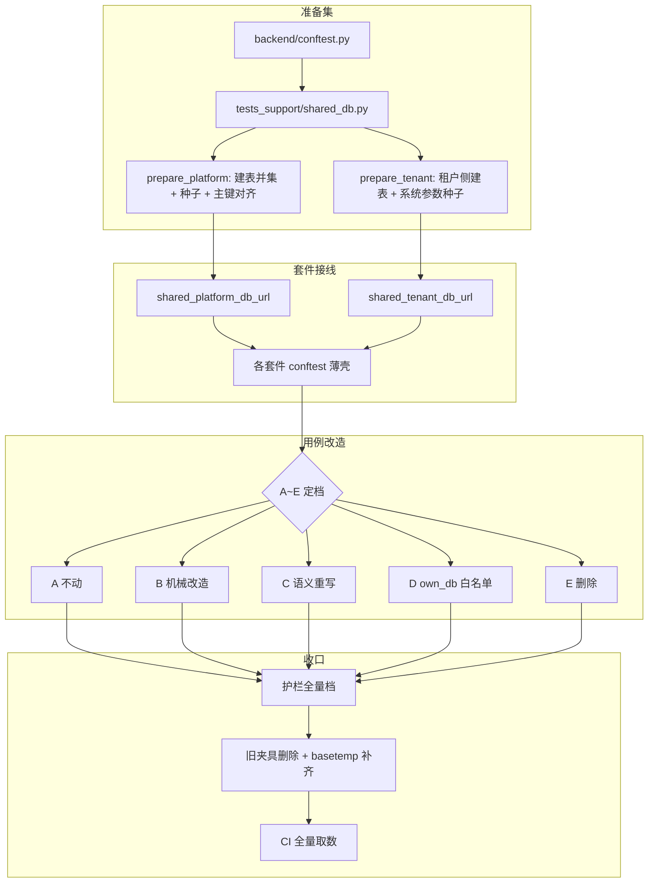

# 01 详细设计 · 涉库用例改造与收口

> 项目骨架 · 04 CI 与阶段验收 · 06 测试库单库化与用例重写 · 子任务 02（需求 04-6）· 详细设计

[文档首页](../../../../../../../文档首页.md) › 项目骨架任务 › [04 CI 与阶段验收](../../../04_CI与阶段验收.md) › [06 测试库单库化与用例重写](../../04_CI与阶段验收_06_测试库单库化与用例重写.md) › [04-6-2](../04_CI与阶段验收_06_测试库单库化与用例重写_02_涉库用例改造与收口.md) › 详细设计

## 1. 设计目标与范围 <a id="goal"></a>

把 [04-6-1](../../04_CI与阶段验收_06_测试库单库化与用例重写_01_单库测试基座与护栏/04_CI与阶段验收_06_测试库单库化与用例重写_01_单库测试基座与护栏.md) 交付的**夹具 + 命名空间助手 + 三条护栏**从前置件变成全仓默认口径：存量涉库用例分批改造到共享库上跑，白名单压到最小，旧夹具与临时库全面清退，收口由 CI 全量取数。目标状态：

1. 一次 pytest 会话内只有 **2 个 SQLite 文件**（`.cache/test/platform.db` / `tenant.db`），全 worker 共用、用例叠加。
2. 存量用例按 **A~E** 五类逐文件闭合，台账可复跑、可审计。
3. 「建库即被测」的用例走 `@pytest.mark.own_db("理由")` 白名单，其余自建库一律为违规（护栏零豁免）。
4. 临时文件（`tmp_path` / 临时库 / 落盘夹具）只保留「被测功能本身要写文件」的部分。
5. 产品仓 `mdm` 与 bms 同口径（同一实现、零复制）。

**范围外**：

| 项 | 归属 |
| --- | --- |
| 共享库夹具、命名空间助手、三条护栏判定实现 | 已由 [04-6-1](../../04_CI与阶段验收_06_测试库单库化与用例重写_01_单库测试基座与护栏/04_CI与阶段验收_06_测试库单库化与用例重写_01_单库测试基座与护栏.md) 交付，本任务只补「按数据源分派准备集」与例外通道 |
| 前端 vitest 的临时目录与数据隔离 | 不进本任务（口径随《测试规范》同步，实现另立） |
| MySQL / PostgreSQL / 达梦三库集成库 | 不进本任务（仍走 CI 常驻库，`pytest.mark.integration` 不变） |
| 业务代码行为变更 | 不进本任务（只改测试与测试基建） |

## 2. 决策记录（2026-11-01 逐项确认） <a id="decision"></a>

| # | 事项 | 结论 |
| --- | --- | --- |
| 1 | 推进方式 | **分批推进**，按工程边界切 5 批（基座 → platform → tenant+identity+file → 其余小服务 → mdm），每批独立回归 + 独立提交 |
| 2 | 播种归属 | 播种实现单源落 `backend/tests_support/shared_db.py`；`backend/conftest.py`（新建）向全工程 rootdir 暴露准备夹具；各套件 conftest 只留薄壳 |
| 3 | 种子主键 | **固定主键保留**（`demo → 1001` / `acme → 2002`）为平台全局基础数据，用例只读引用、不得改主键；用例自造数据一律 `ns` |
| 4 | `tenant` 库 | 本轮同步启用，租户侧套件接线到 `shared_tenant_db_url` |
| 5 | B 类改造 | **脚本改写 + 逐文件复核**，脚本自身纳入护栏用例覆盖 |
| 6 | 台账 | 扫描脚本落测试资产仓 `test/scripts/testing/`；台账 md 落本任务 `实施/`，同目录附原始 json 供对账 |
| 7 | 白名单粒度 | **模块级优先、用例级补充**，收口时逐文件核对压到最小 |
| 8 | E 类 | **本轮实删**，删前核对覆盖率不产生新缺口（必要时补等价用例） |
| 9 | 收口验证 | 本地只跑套件级定向；「全量全绿 + 并行稳定」由 **CI 全量流水线**取数（`trigger.py --watch`），不破例本地全量 |
| 10 | 护栏切换 | **收口时**把 `test-db-isolation` 升为预检全量步骤 + `self_tests` 登记，mdm 同口径 |
| 11 | 例外通道 | 本任务补齐 `BMS_TEST_ISOLATED_DB=1`（落临时独立库 + 会话头提示 + 用例） |
| 12 | 下降度量 | 同套件改造前后各采样一次（`bms_core` + `platform`），文件数与字节数登记测试记录 |
| 13 | `--basetemp` | 本任务补上 `.cache/pytest`（含各服务子工程），修掉 04-6-1 设计已写但未落地的缺口 |
| 14 | 旧夹具 | `worker_sqlite_dir` 等按 worker 派生独立库的实现随第 10 项一并删除 |
| 15 | 准备夹具命名 | 按数据源分开：`platform_db_prepare` / `tenant_db_prepare`，`shared_db_prepare` 保留为兼容回退；`resolve_prepare` 同步改为按数据源解析 |
| 16 | `.ready` 版本戳 | 由准备集模块源码摘要前 12 位**自动派生**，不手写常量 |
| 17 | 台账脚本改写能力 | 脚本**只生成候选 diff 与上下文**，落盘由人工执行并回归 |
| 18 | 设计定稿 | 2026-11-01 定稿，定稿即提交并进入第 1 批实施 |

**与 04-6-1 设计的衔接**（对齐记录）：

- 04-6-1 决策 22 定「渐进切换由各套件 conftest 选用哪个夹具决定」——本任务逐批把 `platform_db_url` 换成 `shared_platform_db_url`，迁完的套件删除本地自建夹具；旧实现保留到第 5 批结束再统一删除。
- 04-6-1 决策 21 定的「存量误杀一次性核对」在本任务收口执行，结论登记实施记录。
- 04-6-1 设计 §4.5 的 `BMS_TEST_ISOLATED_DB=1` 未落地，按决策 11 在本任务补齐（回写 04-6-1 遗留项）。
- 04-6-1 设计 §5 的 `shared_db_prepare` 单回调在决策 15 中改为按数据源分名（原设计未预见两库准备内容不同）。

## 3. 总体结构 <a id="arch"></a>



**三条不变量**：

1. **单源**：准备集只有 `tests_support/shared_db.py` 一份实现；夹具、命名空间、护栏判定分别只有一处（`bms_core/testing/`、engkit `base/`）。
2. **可回退**：每批只动该批目录，其余套件继续走旧夹具，主分支任何时刻可回归。
3. **可审计**：台账由脚本生成而非手写，白名单由护栏导出而非人工汇总。

## 4. 共享库与准备集 <a id="prepare"></a>

### 4.1 数据源与准备内容 <a id="prepare-set"></a>

| 数据源 | 库文件 | 建表 | 种子 | 说明 |
| --- | --- | --- | --- | --- |
| `platform` | `.cache/test/platform.db` | 已导入模型并集 `create_all`（幂等） | `seed_tenants` → `seed_modules` → 租户主键对齐 | 平台库承载用户 / 角色 / 菜单 / 模块登记 / 服务目录 |
| `tenant` | `.cache/test/tenant.db` | 租户侧表集（`create_all` 幂等） | `seed_configs`（系统参数，幂等） | 租户库承载租户 / 分支 / 模块开关 / 业务表 |
| 每租户派生库 | `.cache/test/tenant-<code>.db` | 用例自建 | 用例自建 | **仅 `own_db` 白名单**（D 类） |

**主键对齐并入准备集**：现状 8 个套件里只有 `services/tenant` 的 conftest 做了 `demo → 1001` / `acme → 2002` 对齐（用户↔租户关系表与令牌租户位同库 join 的前提），其余套件靠各自时序巧合通过。改到共享库后该对齐**只做一次**，落进 `prepare_platform`，各套件副本删除。

### 4.2 播种单源与接线 <a id="prepare-wiring"></a>

```text
backend/
├── conftest.py                      # 新建：向全工程 rootdir 暴露 platform_db_prepare / tenant_db_prepare
├── tests_support/
│   └── shared_db.py                 # 新建：prepare_platform / prepare_tenant / prepare_version
└── services/{platform,tenant,identity,file,...}/tests/conftest.py
                                     # 薄壳：shared_platform_db_url / shared_tenant_db_url 三行接线
```

| 层 | 落点 | 内容 |
| --- | --- | --- |
| 准备集实现 | `backend/tests_support/shared_db.py` | `prepare_platform(url)` / `prepare_tenant(url)` / `prepare_version()`；幂等，可重复执行 |
| 全工程接线 | `backend/conftest.py`（新建） | `platform_db_prepare` / `tenant_db_prepare` 两个会话级夹具，转发到 `shared_db` |
| 子工程接线 | 各 `services/*/tests/conftest.py` | 同名两夹具薄壳（`from tests_support.shared_db import …`），保证 `rootdir=services/xxx` 单跑时准备集不缺失 |
| 夹具解析 | `bms_core/testing/fixtures.py` | `resolve_prepare` 改为按 `{name}_db_prepare` 解析，`shared_db_prepare` 兜底 |

**版本戳自动派生**：`ensure_shared_db` 的 `version` 由 `shared_db.py` 的 `prepare_version()` 给（对准备集源码摘要取前 12 位）——准备内容一改，`.ready` 戳即不匹配并自动重建，避免「改了种子但旧库沿用」的隐性错位。

### 4.3 固定主键口径 <a id="prepare-pk"></a>

- 种子租户 `demo → 1001` / `acme → 2002` 为**平台全局基础数据**，全仓用例只读引用（`TENANT_ID_DEMO` 一类常量已存在则复用）。
- 用例**不得**改他人主键：`_align_tenant_ids` 这类 `UPDATE sys_tenant SET id = …` 从套件 conftest 中删除，只保留在准备集内一次性执行。
- 用例自造数据（用户 / 角色 / 组织 / 业务单据）一律 `ns.code(...)` 或从创建响应取 ID，禁止硬编码 `1001` / `2002` 以外的固定主键。

### 4.4 例外通道 <a id="prepare-isolated"></a>

| 项 | 口径 |
| --- | --- |
| 开关 | 环境变量 `BMS_TEST_ISOLATED_DB=1`（默认关闭） |
| 库落点 | `<basetemp>/test-db-isolated/`（pytest 会话临时目录，`.cache/pytest` 之下），会话开始清空 |
| 提示 | `pytest_configure` 在会话头打印一行醒目提示：当前为隔离调试模式，结果不代表 CI 口径 |
| 用途 | 仅单例调特定 bug（需要干净库复现）；单文件 / 单用例调试**默认仍走共享库**，与 CI 同口径 |
| 护栏 | 新增用例断言：开关开 → 库路径在 basetemp 下且打印提示；开关关 → 落 `.cache/test/` |

### 4.5 失败分支 <a id="prepare-fail"></a>

| 场景 | 行为 |
| --- | --- |
| 准备集异常（种子冲突 / 建表失败） | 抢到初始化锁的 worker 直接抛错，`ensure_shared_db` 不写 `.ready`，其余 worker 超时后带目录清单报错（不静默降级为临时库） |
| 准备集内容变更但库未重建 | 版本戳不一致 → 删库重建一次（`clear_shared_db_files` + 重跑准备集） |
| 子工程单跑时准备夹具缺失 | 子工程 conftest 薄壳缺失即夹具查找失败 → 报错信息指明补同名夹具（不静默走 `_default_prepare` 只建表） |
| Windows 库文件句柄未释放 | 沿用 04-6-1 兜底：跳过删除并告警，改新文件名并写 `.ready` |
| `own_db` 用例与共享库并发 | 白名单用例自建库落 `tmp_path`（basetemp 之下），不碰共享库，无跨 worker 争用 |

## 5. 分批改造 <a id="batches"></a>

| 批 | 范围 | 内容 | 批次验收 |
| --- | --- | --- | --- |
| 1 | `libs/bms_core/tests`（363 文件） | 准备集单源 + 根 conftest 接线 + `resolve_prepare` 分源 + 例外通道 + `basetemp` 补齐；`tests/{db,ops,alembic,tenant/seed,integration,testing}` 等目录定档改造 | 基座套件单跑全绿；护栏增量零命中（白名单除外）；台账覆盖基座目录 |
| 2 | `services/platform/tests`（117 文件） | 套件薄壳换成 `shared_platform_db_url`（含 `seed_modules` 并入准备集）；`api/`、`users/`、`account_lock/` 等目录 B/C 类改造 | platform 套件单跑全绿；台账覆盖该套件 |
| 3 | `services/tenant` + `identity` + `file` | 租户侧套件接 `shared_tenant_db_url`；`url_template` / 每租户派生库用例进白名单；`_align_tenant_ids` 删除 | 三套件单跑全绿 |
| 4 | `services/{txn,ai,notification,search,report}` | 小服务逐文件改造（txn 的 2PC / XA 集成用例进白名单） | 五套件单跑全绿 |
| 5 | `mdm` 仓（36 文件 / 226 用例） | 加 `-p bms_core.testing.plugin`、准备夹具复用 `tests_support` 同源实现、`tests_support/fixtures.py` 的每用例 `tmp_path` 库改共享、`own_db` 白名单（迁移 / CLI / 种子） | mdm 套件单跑全绿；护栏零误杀 |

**批次内节奏**（每批一致）：定档 → 台账更新 → 脚本改写 → 逐文件复核 → 套件级跑测 → 护栏增量 → 提交（`feat(测试)` + `docs(文档)` 分开）。

**批次边界约束**：批 1 必须先落地准备集与例外通道，批 2 起才允许动服务套件——否则每个套件都会各自实现一份准备逻辑。

**套件夹具切换时机（2026-11-01 实测修正）**：批 2 起改为**先把目录内文件逐个改造完、最后再切套件 conftest**，与本节原写的「先接线共享夹具、再改目录」相反。实测理由：服务套件的集成用例普遍按「空库」写死固定编码与精确总数（`icon/test_icon_registry.py` 4 例在同跑时因跨文件数据叠加失败），套件级切换会一次性把这类用例全部暴露为互相污染，失败面大且难定位；逐文件改造每步都可回归。

## 6. A~E 处置细则 <a id="classes"></a>

### 6.1 判据（可机检） <a id="class-rules"></a>

| 类 | 机检判据（脚本与此一致） | 处置 |
| --- | --- | --- |
| A | 文件内无 `create_async_engine(` / `create_engine(` / `sqlite+aiosqlite:///` 字面量 / `tmp_path` 派生 `*.db` | 不动，仅登记「已核对不触库」 |
| B | 有自建库痕迹，且无 `len(...) == N` / `total == N` / `count()` 对全表 / `== []` 空库断言 | 机械改造（§6.2） |
| C | 有自建库痕迹，**且**含上述整表断言之一 | 语义重写（§6.3） |
| D | 建库 / 迁移 / 多库拓扑 / 每租户派生库即被测（`alembic`、`ops` 建表建库、`tenant/seed` 编排、`db` 引擎与拓扑、`integration`、mdm 迁移与 CLI） | `own_db` 白名单（§6.4） |
| E | 引用的模块 / 函数 / 命令已不存在（导入即失败或断言对象已删） | 删除（§6.5） |

**定档优先级**：E > D > C > B > A（先判「功能是否还在」，再判「建库是否即被测」，最后按断言形态分 B/C）。

### 6.2 B 类机械改造模板 <a id="class-b"></a>

| 改前 | 改后 |
| --- | --- |
| 用例内 `create_async_engine(f"sqlite+aiosqlite:///{tmp_path}/x.db")` + `create_all` | 直接依赖 `platform_db` / `tenant_db`（autouse 已注入 URL），不再建库 |
| 固定编码 / 固定哨兵（`"TEST001"`、`"root"`、`"u1"`） | `ns.code("user")` / `ns.code("role")`（带 worker + 用例摘要前缀） |
| 列表查询后 `rows[0]` 直接取 | `scoped(select(...), Model.code, ns)` 过滤后再取 |
| 自建 `tmp_path` 目录当导出落盘目录 | 保留 `tmp_path`（属「被测功能要写文件」），落点收敛到 basetemp |

### 6.3 C 类语义重写口径 <a id="class-c"></a>

| 断言形态 | 改造口径 |
| --- | --- |
| `assert len(rows) == 3` | 改为先按 `ns.like()` 过滤再断言条数（`assert_scoped`） |
| 分页 `total == N` | 改用前后差值（`assert_delta(before, after, expected=1)`），`before` 在 arrange 前采样 |
| `select(func.count()).select_from(T)` 全表计数 | 同上，或加 `where(T.code.startswith(ns.prefix))` |
| 依赖空库的「首次创建 / 首次初始化」用例 | arrange 改为「显式创建前置数据」而非「假定库为空」，断言改为状态断言（存在 / 版本变化）而非行数 |
| 依赖全表集合相等（`set(rows) == expected`） | 集合先按前缀裁剪：`{r for r in rows if r.code.startswith(ns.prefix)}` |

**保留项**：业务场景步骤、错误码断言（`assert_error(target, code=…)`）、权限与状态语义断言一律保留，不得为迁就单库而弱化。

### 6.4 D 类白名单规则 <a id="class-d"></a>

- marker：`@pytest.mark.own_db("理由")`，理由必填且说清「哪一步建库是被测对象」；装饰器与**模块级 `pytestmark`** 两种写法等效。
- 粒度：**模块级优先**（整个文件都是建删库 / 迁移 / 拓扑），文件内只有个别用例才用例级。
- 导出：`check_test_db_isolation.py --list-own-db` 输出「文件 / 用例 / 理由」三列，收口时作为台账附表。
- 压缩：收口阶段逐文件复核一次，凡「其实可以用共享库」的一律摘掉 marker 并改造，白名单只留真例外。
- **共享基座模块**（`base_modules` 配置项，模块粒度）：职责就是建库的单源准备集（如 `backend/tests_support/shared_db.py`）不参与「用例自建库」判定——它不是用例，判定它只会逼人把实现藏进扫描盲区。清单只有一两行、可评审，不随行号漂移。
- **增量与全量同判据**：两种模式都只判 `test_*.py`，避免同一文件在开发环与预检下结论不同。

### 6.5 E 类删除流程 <a id="class-e"></a>

1. 确认引用对象已不存在（导入失败 / 命令已下线 / 端点已移除），在台账登记证据。
2. 跑该文件覆盖率，记录覆盖的源码行；删除用例后复跑，确认这些行仍有其他用例覆盖（`--cov` 报告 diff）。
3. 若出现新缺口 → 补等价用例（优先补在共享库口径下），不得以「覆盖率例外」绕过。

## 7. 台账与扫描脚本 <a id="ledger"></a>

### 7.1 落点 <a id="ledger-path"></a>

| 产物 | 落点 |
| --- | --- |
| 扫描 / 改写脚本 | 测试资产仓 `test/scripts/testing/`（含 `README.md` 说明用法；按《测试规范》14.2 判据不入平台仓） |
| 台账正文 | 本任务 `实施/01_实施_01_涉库用例改造台账.md`（人读） |
| 台账原始数据 | 本任务 `实施/01_实施_01_涉库用例改造台账.json`（对账用） |
| 白名单导出 | 本任务 `实施/01_实施_02_白名单清单.md`（收口时由护栏导出） |

### 7.2 台账字段 <a id="ledger-fields"></a>

| 字段 | 说明 |
| --- | --- |
| 文件 | 相对仓根路径 |
| 用例数 | 该文件 `def test_` 数（含参数化前静态计数） |
| 类 | A / B / C / D / E |
| 处置 | 不动 / 机械改造 / 语义重写 / 白名单 / 删除 |
| 依据 | 命中判据（如「自建引擎 + `total == 3`」） |
| 批次 | 1 ~ 5 |
| 状态 | 待改造 / 已改造 / 已复核 |

### 7.3 脚本行为 <a id="ledger-script"></a>

```text
① 遍历两仓测试根（bms backend 10 个 testpaths + mdm 2 个 testpaths）
② 逐文件 AST 扫描：引擎构造 / 库字面量 / tmp_path 派生 db / 整表断言 / own_db marker / 顶层 import 失败
③ 按 §6.1 判据定档 → 输出 json + md（按批次分组）
④ --check 模式：对比台账与当前代码，输出「台账已标已改造但仍有自建库」的漂移项（收口用）
```

脚本只做扫描与报告，**改写由人工按模板执行**（决策 5 的「脚本生成改写」限定为「生成候选 diff 供复核」，最终以人工复核结果为准）。

## 8. 临时文件必要性审计 <a id="temp-audit"></a>

| 类别 | 判定 | 处置 |
| --- | --- | --- |
| 用例为了「拿到干净库」而建的文件库 | 不必要 | 取消，改共享库 |
| 用例为隔离而拷目录 / 复制 sqlite 文件 | 不必要 | 取消，改命名空间 |
| 导出 / 上传 / 导入（被测功能要写文件） | 必要 | 保留，落 `tmp_path`（basetemp 之下） |
| 迁移 / 建表 / 建库 CLI（被测对象就是产物） | 必要 | 保留，`own_db` 白名单 |
| 发布编排 / 打包脚本产物 | 必要 | 保留，落 `tmp_path` |
| 日志 / 截图 / 调试输出 | 不必要 | 取消，日志走 `caplog` / `capsys` |

**审计留痕**：每批在台账「处置」列登记取消的临时文件类型与数量，收口时汇总为「改造前后临时文件数与占用对比」表（决策 12 的采样口径）。

## 9. pytest 配置与旧夹具清理 <a id="config"></a>

| 项 | 改前 | 改后 |
| --- | --- | --- |
| `--basetemp` | 未配置（回落系统临时目录 / `bms-pytest-sqlite/`） | `backend/pyproject.toml` 与各 `services/*/pyproject.toml` 统一 `--basetemp=.cache/pytest` |
| `worker_sqlite_dir` | 按 worker 派生 `sqlite-gwN/` 目录 | 删除，`isolate_settings` 不再设 `BMS_DATABASE__SQLITE_DIR` |
| 旧 `platform_db_url` | 8 个 conftest 自建 `tmp_path_factory` 库 | 批次迁完后全部删除，只留 `shared_platform_db_url` |
| 会话库目录 | `.cache/test/`（2 个 `.db`） | 不变；例外通道另开 `test-db-isolated/` 子目录 |
| `own_db` marker | 已登记、无人使用 | 各批次逐步启用 |

**删除顺序**：批次内先接线共享夹具 → 套件全绿 → 再删本地旧夹具；全仓旧实现（`worker_sqlite_dir` / `worker_sqlite_dir` 相关用例）在第 5 批结束、护栏升全量同一提交内删除。

## 10. mdm 仓同步 <a id="mdm"></a>

| 项 | 内容 |
| --- | --- |
| 插件加载 | `backend/pyproject.toml` 的 `addopts` 追加 `-p bms_core.testing.plugin`（保留既有 `-p engkit.coverage_plugin`） |
| 准备集复用 | 新增 `mdm/backend/tests_support/shared_db.py` 薄壳，转发 `bms_core` 侧能力；`mdm/backend/conftest.py` 暴露 `platform_db_prepare` / `tenant_db_prepare` |
| 每用例库取消 | `mdm/backend/tests_support/fixtures.py` 的 `tmp_path` 派生 `mdm_platform.db` / `mdm_tenant_demo.db` 删除，改共享 URL |
| 白名单 | `tests/test_org_migration.py`（迁移即被测）、`tests/test_ops_cli.py`（建库 CLI）、`services/org/tests/test_seeds.py`（建表即被测）打 `own_db`；`tests_support/org_env.py` 的**内存库**用于纯替代（不入 `own_db`，按「不落文件」处理） |
| 护栏 | `mdm/engkit.toml` 增 `[rules.test_db_isolation]`（`scan_targets` 覆盖 `backend/tests`、`backend/services`、`backend/tests_support`）+ 开发环增量步骤；收口时加预检全量步骤 |
| 任务文档 | 统一记在 bms 侧本任务，mdm 仓不另建任务（决策 15 沿用） |

## 11. 测试设计 <a id="test-design"></a>

> 用例先登记 Kiwi TCMS 再编码（《测试规范》§5）；下表为待登记项。

| 编号 | 用例 | 落点 | 断言要点 |
| --- | --- | --- | --- |
| T1 | 准备集按数据源分派 | `libs/bms_core/tests/testing/test_shared_db_prepare.py` | platform / tenant 命中各自准备夹具；缺夹具时报错而非静默只建表 |
| T2 | 准备集幂等 | 同上 | 重复执行行数增量为 0；`.ready` 版本戳一致 |
| T3 | 版本戳随准备集变更失效 | 同上 | 改摘要即重建一次；未改则跳过 |
| T4 | 主键对齐只做一次 | 同上 | `demo=1001` / `acme=2002`；并发下不重复写 |
| T5 | 例外通道 | 同上 | 开关开 → 库落 basetemp 子目录 + 会话头提示；开关关 → 落 `.cache/test/` |
| T6 | 台账脚本判据 | 测试资产仓 `test/scripts/testing/`（脚本自检） | A~E 各一条向量；E > D > C > B > A 优先级正确；`--check` 能报漂移 |
| T7 | 命名空间限定断言 | `libs/bms_core/tests/testing/test_namespace.py`（补充） | 混入他人数据不误判；`assert_delta` 差值正确 |
| T8 | 共享库并发稳定 | `libs/bms_core/tests/testing/test_shared_db.py`（补充） | 多 worker 并发写同一库无 `database is locked` 逃逸 |
| T9 | 护栏全量档 | `engkit/tests/test_base_test_db_isolation.py`（补充） | 全量扫描走 `--no-cache`；白名单导出含理由列 |
| T10 | mdm 接入 | mdm 仓对应套件 | 同一夹具可跑通、护栏零误杀 |

## 12. 验收映射 <a id="accept-map"></a>

| 完成标准（04-6-2） | 证据 |
| --- | --- |
| 全量只用 `platform` / `tenant` 两个库文件 | `.cache/test/` 目录清单（2 个 `.db`）+ CI 全量日志 + 台账「自建库残留 = 0」 |
| 护栏零豁免例外 | 预检全量 `test-db-isolation` 退出码 0 + `--list-own-db` 清单逐条带理由 |
| A~E 台账逐文件闭合 | 台账 md + json（`--check` 无漂移项）+ 实施记录核对结论 |
| mdm 用例同步达标 | mdm 套件全绿 + mdm 护栏零命中 |
| 全量全绿、并行与串行一致 | CI 全量流水线终态 + 串行抽样对比记录 |
| 临时文件数 / 占用下降 ≥ 90% | 改造前后同套件采样表（测试记录） |
| 覆盖率 100%（行 + 分支） | CI 覆盖率门禁报告 |
| 白名单最小化 | 收口复核记录（每条标注「保留 / 已摘除并改造」） |

## 13. 风险与开放项 <a id="risk"></a>

| # | 风险 | 处置 |
| --- | --- | --- |
| 1 | 共享库叠加后「精确总数」类断言大面积假红 | 按 §6.3 先改断言再跑；批内只对 C 类文件跑一次，避免整轮重跑 |
| 2 | 准备集把 `seed_modules` 等服务目录数据写进平台库，基座套件的「目录视图」断言可能失配 | 批 1 先核对基座侧「模块登记」相关用例，必要时同步改造为命名空间限定 |
| 3 | 单文件并发写同一库在 Windows 上偶发 `database is locked` | 沿用 WAL + `busy_timeout` + 3 次重试；实测冲突率登记实施记录，必要时调 `-n` 档位，**不得**回退每用例建库 |
| 4 | 白名单被当成逃生口不断扩张 | 收口逐文件复核 + 台账登记「保留理由」；护栏导出清单进实施记录，后续新增需在 PR 说明理由 |
| 5 | mdm 准备集与 bms 语义差异（产品仓无 `ops`） | mdm 薄壳只调 `bms_core` 侧能力 + 自身 `tests_support` 种子，不复制 bms 的 `ops` 播种 |
| 6 | 批次跨会话推进导致口径漂移 | 每批开工先读本设计 §5/§6，批次结束回写台账与实施记录，不靠记忆续做 |

> 本文档按《[文档生成规范](../../../../../../../规范/文档生成规范.md)》编写
