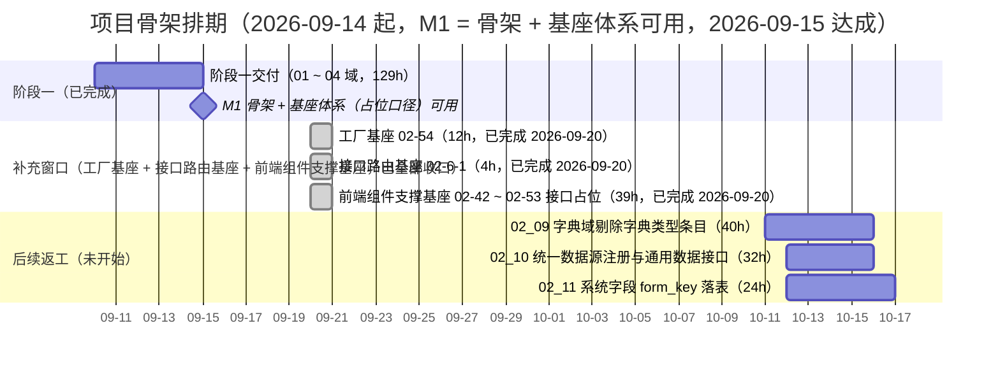

# 项目骨架计划

[文档首页](../../../文档首页.md) › 项目骨架计划　|　[任务基线 →](../任务/02_后端基座/02_后端基座.md)　[需求基线 →](../需求/00_需求_项目骨架.md)

## 1. 计划说明 

- **排期对象**：阶段一 75 条需求对应任务——域 01 工程骨架 8 项、域 02 后端基座 59 项（6 个子域，嵌套子任务并入直属父任务）、域 03 后端基础能力 5 项、域 04 CI 与阶段验收 5 项。
- **顺序口径**：基座先行——core 横切 → 模块基类 → 机制底座 → 根基类与集合体系 → 跨阶段基座 → 域 03 后端基础能力 → 域 04 验收收口。
- **排期口径**：自 2026-09-14 起排，实际于 2026-09-15 全部完成（M1 基线 2026-09-28，提前 13 天）。
- **工时**：已完成 368h；剩余 96h；阶段合计 464h。
- **里程碑锚点**：M1 = 骨架 + 基座体系（占位口径）可用（2026-09-15 已达成）。
- **负责人**：minjian（兼职，单人）。

## 2. 已完成任务（2026-09-10 ~ 2026-10-26；2026-10-05 补 `03-1-1`，2026-10-21 补 `02_14`，2026-10-26 补 `04_05`） 

| 编号 | 任务 | 工时（重估） | 完成日期 | 任务文件 | 偏差与遗留 |
| --- | --- | --- | --- | --- | --- |
| 01_01 | monorepo 仓库根骨架 | 3h | 2026-09-10 | [01_01](../任务/01_工程骨架/01_工程骨架_01_monorepo仓库骨架/01_工程骨架_01_monorepo仓库骨架.md) | 无 |
| 01_02 | backend 工程初始化 | 3h | 2026-09-10 | [01_02](../任务/01_工程骨架/01_工程骨架_02_backend工程初始化/01_工程骨架_02_backend工程初始化.md) | 无 |
| 01_03 | backend 分层目录与职责 | 21h | 2026-09-10 | [01_03](../任务/01_工程骨架/01_工程骨架_03_backend分层目录与职责/01_工程骨架_03_backend分层目录与职责.md) | 无 |
| 01_04 | apps/desktop 工程初始化 | 15h | 2026-09-10 | [01_04](../任务/01_工程骨架/01_工程骨架_04_frontend工程初始化/01_工程骨架_04_frontend工程初始化.md) | 无 |
| 01_05 | frontend-mobile 工程初始化 | 2h | 2026-09-10 | [01_05](../任务/01_工程骨架/01_工程骨架_05_frontend-mobile工程初始化/01_工程骨架_05_frontend-mobile工程初始化.md) | 无 |
| 01_06 | 依赖锁定与 Python 3.14 兼容验证 | 3h | 2026-09-10 | [01_06](../任务/01_工程骨架/01_工程骨架_06_依赖锁定与Python3.14兼容验证/01_工程骨架_06_依赖锁定与Python3.14兼容验证.md) | 无 |
| 01_07 | 命名收口（目录 / 包名 / 工具脚本名下划线） | 8h | 2026-10-25 | [01_07](../任务/01_工程骨架/01_工程骨架_07_命名收口目录与包名下划线/01_工程骨架_07_命名收口目录与包名下划线.md) | 运行时登记标识已由 07C `03_03` 收口；剩余字段控件键 / 业务动作码 / 自建图标码由 `01_08` 承接 |
| 01_08 | 登记标识二期（字段控件语义键 / 业务码与动作码 / 自建图标码） | 12h | 2026-10-25 | [01_08](../任务/01_工程骨架/01_工程骨架_08_登记标识二期控件键与业务码形态/01_工程骨架_08_登记标识二期控件键与业务码形态.md) | 全量覆盖率 99.64%（变更模块 100%）；剩余 126 行缺口为存量（集成用例跳过 / 空 `__all__`），另立任务处置；启动钩子预导入问题已修复 |
| 02_01 | 根基类与集合体系 | 1h | 2026-09-13 | [02_01](../任务/02_后端基座/02_后端基座_01_根基类与集合体系/02_后端基座_01_根基类与集合体系.md) | 无 |
| 02_02 | 模块基类 | 18h | 2026-09-13 | [02_02](../任务/02_后端基座/02_后端基座_02_模块基类/02_后端基座_02_模块基类.md) | 无 |
| 02_03 | core 横切基座（含扩展 11 项；工时口径含嵌套 14 验证码渠道扩展基座与嵌套 15 工厂基类） | 33h | 2026-09-20 | [02_03](../任务/02_后端基座/02_后端基座_03_core横切基座/02_后端基座_03_core横切基座.md) | 无 |
| 02_05 | 机制底座 | 7h | 2026-09-13 | [02_05](../任务/02_后端基座/02_后端基座_05_机制底座/02_后端基座_05_机制底座.md) | 偏差：`EngineFactory` 补 `drop(db_key)`（已回写 02-5-1 设计） |
| 02_06 | 接口层基座 | 4h | 2026-09-20 | [02_06](../任务/02_后端基座/02_后端基座_06_接口层基座/02_后端基座_06_接口层基座.md) | 无 |
| 02_04 | 跨阶段基座（含嵌套 27 字典真实取数与缓存、嵌套 28 选项集注册与校验基座） | 110h | 2026-10-21 | [02_04](../任务/02_后端基座/02_后端基座_04_跨阶段基座/02_后端基座_04_跨阶段基座.md) | 无 |
| 02_07 | 字典系统字段口径收口（返工） | 20h | 2026-10-10 | [02_07](../任务/02_后端基座/02_后端基座_07_字典系统字段口径收口/02_后端基座_07_字典系统字段口径收口.md) | 遗留：三库真库实测与缓存版本 bump 随部署窗口 |
| 02_08 | 字典系统字段命名收口（返工） | 12h | 2026-10-10 | [02_08](../任务/02_后端基座/02_后端基座_08_字典系统字段命名收口/02_后端基座_08_字典系统字段命名收口.md) | 遗留：三库真库实测随部署窗口、i18n 附表承载列保留既有命名 |
| 02_12 | 数据源注册与通用接口契约（`GET /api/v1/data-sources` + `@bms/api_types`） | 8h | 2026-10-12 | [02_12](../任务/02_后端基座/02_后端基座_12_数据源注册与通用接口契约/02_后端基座_12_数据源注册与通用接口契约.md) | 遗留：列表包装形状变更的前端 `permissionMeta` 改指 `/api/v1/data-sources` 归 `02_13` |
| 02_13 | 前端通用页面路由（`form_key` → 页面 + 数据源接入 + `dictKey → dataSourceKey`） | 16h | 2026-10-12 | [02_13](../任务/02_后端基座/02_后端基座_13_前端通用页面路由/02_后端基座_13_前端通用页面路由.md) | 遗留：平台表单页仅接线示范（`role` / `user`），其余模块页与产品仓随各自任务迁入 |
| 02_14 | 字典字段绑定 ID 与字段类型更名（口径返工） | 24h | 2026-10-21 | [02_14](../任务/02_后端基座/02_后端基座_14_字典字段绑定ID与字段类型更名/02_后端基座_14_字典字段绑定ID与字段类型更名.md) | 偏差：迁移脚本取消（无存量数据，删库重建）；遗留：前端 `06_09` 同版本发布 |
| 02-13-1 | 表单标识清单接口（`GET /api/v1/form-keys`） | 4h | 2026-10-12 | [02-13-1](../任务/02_后端基座/02_后端基座_13_前端通用页面路由/02_后端基座_13_前端通用页面路由_01_表单标识清单接口/02_后端基座_13_前端通用页面路由_01_表单标识清单接口.md) | 遗留：端点只读不落表（运营态维护如需要另立） |
| 03_01 | 配置管理 | 3h | 2026-09-14 | [03_01](../任务/03_后端基础能力/03_后端基础能力_01_配置管理/03_后端基础能力_01_配置管理.md) | 无 |
| 03_02 | 日志体系 | 3h | 2026-09-14 | [03_02](../任务/03_后端基础能力/03_后端基础能力_02_日志体系/03_后端基础能力_02_日志体系.md) | 无 |
| 03_03 | 健康检查 | 2h | 2026-09-14 | [03_03](../任务/03_后端基础能力/03_后端基础能力_03_健康检查/03_后端基础能力_03_健康检查.md) | 无 |
| 03_04 | Redis 基础能力统一 | 16h | 2026-10-09 | [03_04](../任务/03_后端基础能力/03_后端基础能力_04_Redis基础能力统一/03_后端基础能力_04_Redis基础能力统一.md) | 偏差：dev 三域缓存保留 `memory`（可降级域，便于本地无 Redis 运行）；遗留：基类清单登记（守卫未覆盖 `bms_core/redis/`）、本地脚本自动拉起、限流… |
| 04_01 | CI 流水线激活 | 3h | 2026-09-14 | [04_01](../任务/04_CI与阶段验收/04_CI与阶段验收_01_CI流水线激活/04_CI与阶段验收_01_CI流水线激活.md) | 无 |
| 04_02 | 三库集成与流水线收口（占位） | 1h | 2026-09-15 | [04_02](../任务/04_CI与阶段验收/04_CI与阶段验收_02_三库集成与流水线收口/04_CI与阶段验收_02_三库集成与流水线收口.md) | 无 |
| 04_03 | M1 验收门禁核对 | 2h | 2026-09-15 | [04_03](../任务/04_CI与阶段验收/04_CI与阶段验收_03_阶段验收门禁核对/04_CI与阶段验收_03_阶段验收门禁核对.md) | 无 |
| 04_04 | 测试报告与 README（阶段一收口） | 2h | 2026-09-15 | [04_04](../任务/04_CI与阶段验收/04_CI与阶段验收_04_测试报告与README/04_CI与阶段验收_04_测试报告与README.md) | 无 |
| 02-3-15 | 工厂基类（后端工厂纳入基类体系） | 12h | 2026-09-20 | [02-3-15](../任务/02_后端基座/02_后端基座_03_core横切基座/02_后端基座_03_core横切基座_15_工厂基类/02_后端基座_03_core横切基座_15_工厂基类.md) | 无 |
| 02-6-1 | 接口路由基座 | 4h | 2026-09-20 | [02-6-1](../任务/02_后端基座/02_后端基座_06_接口层基座/02_后端基座_06_接口层基座_01_接口路由基座/02_后端基座_06_接口层基座_01_接口路由基座.md) | 无 |
| 02-4-23 | 用户偏好基座 | 2h | 2026-09-20 | [02-4-23](../任务/02_后端基座/02_后端基座_04_跨阶段基座/02_后端基座_04_跨阶段基座_23_用户偏好基座/02_后端基座_04_跨阶段基座_23_用户偏好基座.md) | 无 |
| 02-4-20 | 列表查询与偏好契约基座 | 4h | 2026-09-20 | [02-4-20](../任务/02_后端基座/02_后端基座_04_跨阶段基座/02_后端基座_04_跨阶段基座_20_列表查询与偏好契约基座/02_后端基座_04_跨阶段基座_20_列表查询与偏好契约基座.md) | 无 |
| 02-4-19 | 通知中心接口契约基座 | 3h | 2026-09-20 | [02-4-19](../任务/02_后端基座/02_后端基座_04_跨阶段基座/02_后端基座_04_跨阶段基座_19_通知中心接口契约基座/02_后端基座_04_跨阶段基座_19_通知中心接口契约基座.md) | 偏差：Kiwi 用例号为 812（平台预估 782 已被自动导入用例占用，按《AI开发规范》「编号以平台自增主键为准、既有编号不得复用」取登记返回值） |
| 02-4-22 | AI 对话基座 | 4h | 2026-09-20 | [02-4-22](../任务/02_后端基座/02_后端基座_04_跨阶段基座/02_后端基座_04_跨阶段基座_22_AI对话基座/02_后端基座_04_跨阶段基座_22_AI对话基座.md) | 无 |
| 02-4-21 | 全文检索查询契约基座 | 2h | 2026-09-20 | [02-4-21](../任务/02_后端基座/02_后端基座_04_跨阶段基座/02_后端基座_04_跨阶段基座_21_全文检索查询契约基座/02_后端基座_04_跨阶段基座_21_全文检索查询契约基座.md) | 偏差：代码落点由「扩展 `02-19` 检索域」改为新建独立 `app/globalsearch/` 域（三契约）、加 `domains()` 与错误码 `10101`~1010… |
| 02-4-16 | 组织主数据查询基座 | 4h | 2026-09-20 | [02-4-16](../任务/02_后端基座/02_后端基座_04_跨阶段基座/02_后端基座_04_跨阶段基座_16_组织主数据查询基座/02_后端基座_04_跨阶段基座_16_组织主数据查询基座.md) | 无 |
| 02-4-17 | 字典取数与缓存契约基座 | 4h | 2026-09-20 | [02-4-17](../任务/02_后端基座/02_后端基座_04_跨阶段基座/02_后端基座_04_跨阶段基座_17_字典取数与缓存契约基座/02_后端基座_04_跨阶段基座_17_字典取数与缓存契约基座.md) | 无 |
| 02-4-18 | 对象存储扩展基座 | 3h | 2026-09-20 | [02-4-18](../任务/02_后端基座/02_后端基座_04_跨阶段基座/02_后端基座_04_跨阶段基座_18_对象存储扩展基座/02_后端基座_04_跨阶段基座_18_对象存储扩展基座.md) | 偏差：需求 02-45 原文 `initiate(size, sha256, mime)` 未含目标对象 key，按 S3 / MinIO 语义取「入参含 key」并回写需求注块 |
| 02-3-14 | 验证码渠道扩展基座（滑块 / 短信） | 4h | 2026-09-20 | [02-3-14](../任务/02_后端基座/02_后端基座_03_core横切基座/02_后端基座_03_core横切基座_14_验证码渠道扩展基座/02_后端基座_03_core横切基座_14_验证码渠道扩展基座.md) | 偏差：需求 02-42 原文「新增验证码专用错误码段位」经冲突报备后取认证段内子段 `201xx`（与原「新开段位基」选项不同，见详细设计 §6 / §15） |
| 02-4-24 | 租户自助与品牌基座 | 3h | 2026-09-20 | [02-4-24](../任务/02_后端基座/02_后端基座_04_跨阶段基座/02_后端基座_04_跨阶段基座_24_租户自助与品牌基座/02_后端基座_04_跨阶段基座_24_租户自助与品牌基座.md) | 无 |
| 02-4-25 | 打印模板与导出 PDF 基座 | 3h | 2026-09-20 | [02-4-25](../任务/02_后端基座/02_后端基座_04_跨阶段基座/02_后端基座_04_跨阶段基座_25_打印模板与导出PDF基座/02_后端基座_04_跨阶段基座_25_打印模板与导出PDF基座.md) | 无 |
| 02-4-26 | 自定义图标与代码校验基座 | 3h | 2026-09-20 | [02-4-26](../任务/02_后端基座/02_后端基座_04_跨阶段基座/02_后端基座_04_跨阶段基座_26_自定义图标与代码校验基座/02_后端基座_04_跨阶段基座_26_自定义图标与代码校验基座.md) | 无 |
| 02-4-28 | [选项集注册与校验基座](../任务/02_后端基座/02_后端基座_04_跨阶段基座/02_后端基座_04_跨阶段基座_28_选项集注册与校验基座/02_后端基座_04_跨阶段基座_28_选项集注册与校验基座.md) | 4h | 2026-10-21 | [02-4-28](../任务/02_后端基座/02_后端基座_04_跨阶段基座/02_后端基座_04_跨阶段基座_28_选项集注册与校验基座/02_后端基座_04_跨阶段基座_28_选项集注册与校验基座.md) | 遗留：内建平台选项集条目、严格命名空间校验（接 `ModuleRegistry` / `ProductRegistry`）、`optionSetKey` 下发与服务端动态校验、导入… |

| 04_05 | [覆盖率缺口与测试稳定性收口（需求 `04-5`）](../任务/04_CI与阶段验收/04_CI与阶段验收_05_覆盖率缺口与测试稳定性收口/04_CI与阶段验收_05_覆盖率缺口与测试稳定性收口.md) | 16h | 2026-10-26 | [04_05](../任务/04_CI与阶段验收/04_CI与阶段验收_05_覆盖率缺口与测试稳定性收口/04_CI与阶段验收_05_覆盖率缺口与测试稳定性收口.md) | 偏差：工程级失败实测 6 处 + 1 例全量红（原记 4 例）；全量覆盖率 99.64% → 100%（772 文件），覆盖率产物改落 `.cache/coverage/`；遗留：1 例并行偶发 401（`test_menu_metadata`）另立小任务 |

## 3. 剩余任务排期（自 2026-09-14） 

| 编号 | 任务 | 状态 | 工时 | 依赖 | 排期窗口 | 备注 | 偏差与遗留 |
| --- | --- | --- | --- | --- | --- | --- | --- |
| 02_09 | [字典域剔除字典类型条目](../任务/02_后端基座/02_后端基座_09_字典域剔除字典类型条目/02_后端基座_09_字典域剔除字典类型条目.md)（返工） | 部分完成 | 40h | 02_08、02-4-27（已交付） | 2026-10-11 ~ 2026-10-16 | 2026-10-11 追加 | 遗留：三库真库实测（待验，随部署窗口） |
| 02_10 | [统一数据源注册与通用数据接口](../任务/02_后端基座/02_后端基座_10_统一数据源注册与通用数据接口/02_后端基座_10_统一数据源注册与通用数据接口.md) | 部分完成 | 32h | 02_09（已交付） | 2026-10-12 ~ 2026-10-16 | 2026-10-11 立项（需求 02-57）：把「字典数据源登记」泛化为统一数据源注册（`dict`/`form` 类型）+ 三层通用数据… | 遗留：三库真库实测（待验，随部署窗口） |
| 02_11 | [系统字段 `form_key` 落表（表文件 / 模型 / 迁移）](../任务/02_后端基座/02_后端基座_11_系统字段form_key落表/02_后端基座_11_系统字段form_key落表.md) | 部分完成 | 24h | 02_09（已交付） | 2026-10-12 ~ 2026-10-17 | 2026-10-11 立项（需求 02-57）：全仓数据表逐表落 `form_key`（表单 4 项 / 字典 5 项）+ 模型 + 迁移… | 遗留：产品仓（mdm / biz / cw）表文件与模型同步（另立产品仓任务） |

### 3.1 后续阶段待办（不占本阶段日期） 

| 待办 | 后续阶段 | 说明 |
| --- | --- | --- |
| **重验证层激活路线（分档开关与顺序）** | P3 随容器化部署阶段；P4 随前端组件库（`e2e`）与阶段二 后端基座与服务化地基（`db`） | 2026-09-15 就绪评估结论：开关由单文件 `deploy/ci/verify-enabled` 改为分档文件 deploy/ci/… |
| 数据访问真实实现（引擎 / 会话 / 四库方言 / 读写分离） | 阶段二 后端基座与服务化地基 | 占位接口填实现，首次落库时落地 |
| 排序契约真实实现（DB 侧 ORDER BY 白名单拼接 / 四库 NULLS 口径 / 排序字段索引 / 分页限深与游标键 / 列表筛选） | 阶段二 后端基座与服务化地基（DB 侧排序）· 列表接口阶段（限深与筛选） | `_apply_sort` 钩子与 `sortable_fields` 白名单已就位、内存排序已生效 |
| 三库拓扑 / 平台库表 / 批量迁移 / 租户隔离实测 | 阶段二 后端基座与服务化地基 | 占位声明填实现并实测（含达梦方言） |
| 真实 Alembic 迁移与租户库初始化 | 阶段二 后端基座与服务化地基 | `alembic/env.py` 在线分支、`versions/` 迁移与种子、`ops` 脚本实执行（批量迁移 / 新租户初始化幂等） |
| 多租户引擎 LRU / 连接预算 / 实例并发隔离实测 | 阶段二 后端基座与服务化地基 | `EngineRegistry` 占位填实现并实测（LRU 阈值、连接预算、进程内锁 + Redis SETNX） |
| 租户解析接入 token 与全局中间件 | 阶段二 后端基座与服务化地基（全局中间件）· 认证阶段（token 兜底） | token `tenant_id` 兜底、全局租户中间件（豁免路径）、会话 / 缓存租户前缀 |
| 模块注册落库与接库校验 | 阶段二 后端基座与服务化地基 | `sys_module` 落表、启动 / CI 接库查重（结构声明与占位校验已就位） |
| 租户模块开关 `sys_tenant_module` | 租户管理阶段 | 租户-模块关系表（平台库）：开通勾选与启停、菜单 / 接口联动 |
| 平台接口鉴权（`platform:manage`） | 认证 / RBAC 阶段 | `GET /api/v1/modules` 等平台接口接入权限码校验（当前暂不鉴权） |
| 错误码段扩容（3 位） | 模块数接近 90 时 | 放宽 `errcode_segment` 校验为 3 位（`100` 起）、错误码顺延至 7 位 |
| Allure 结果导入 Kiwi TCMS（接线） | **已完成（2026-09-15）** | 口径已接线（`deploy/ci/verify/report` 档，见04-01 实施 02）：结果导入独立产品「BMS 自动化用例（CI）… |
| 三库真实建库 / 迁移 / 集成用例与达梦方言实测（软删除复合唯一索引 NULL 语义、迁移 DDL、schema 前缀与大小写、类型映射） | 阶段二 后端基座与服务化地基 | `ops/test_db.py` 的 `create` / `migrate` / `drop` 填实现 + alembic/env.py… |
| 三库真库集成测试（MySQL / PostgreSQL / 达梦） | 阶段二 后端基座与服务化地基 | 重验证层三库 job 激活（`deploy/ci/verify/db` 档） |
| Redis 集成用例（真实 Redis / Lua / WATCH / 版本号；分布式锁 SETNX 竞争 / 令牌误放防护 / TTL 到期；验证码 Redis 存取与 `verify` 单次失效；健康检查 `/readyz` 全就绪） | 阶段二 后端基座与服务化地基 | `BMS_TEST_REDIS_URL` 注入，随 04_02 重验证层执行（01-3-3 已实测通过，2 条 |
| WorkerId 自动注册（Redis） | 容器化部署阶段 | 基于 Redis 自动注册全局唯一 WorkerId（动态扩容），替代 `BMS_APP__WORKER_ID` 配置注入（旧名 BMS_… |
| 认证 / 权限错误码实现与测试 | 认证 / RBAC 阶段 | `AuthError`（20001,401）/ `PermissionError`（30001,403）码位已建 |
| 安全原语真实实现与依赖注入 | 认证阶段 | `BaseSecurity` 原语（密码哈希 bcrypt/argon2、JWT 双 token、会话黑名单）填实现并接入依赖注入 |
| 缓存 Region 分域基座 | 通用能力阶段 | 接 dogpile Region 分域 + 全局版本号 + 三防（`CacheRegion` 契约已就位） |
| 链路追踪与 OpenTelemetry 接入 | 分布式与监控阶段 | `trace_id` 入站生成 / 透传（`X-Trace-Id`）、otel-collector + Jaeger、`trace_id`/… |
| Prometheus 指标接入（`/metrics` 端点与采集口径） | 分布式与监控阶段 | 真实 prometheus-client 采集端点、标签维度与分位、Grafana 面板 |
| 数据范围注入基座 | RBAC 阶段 | `DataScope` 契约与 `BaseRepository._apply_data_scope` 钩子已就位 |
| 分片路由基座 | 分布式与监控阶段 | 按月分表落地 |
| 事件发布 / 消费基座 | 系统集成与消息阶段 | 统一发布接口 + 消费基类（分区有序） |
| Celery 任务基座 | 通用能力阶段 | `sys_task` 调度基类 + 执行记录 |
| **系统字段驱动的通用能力（7 项，待立项）** | 通用能力阶段（阶段八） | 2026-10-10 登记（不排期、不占本阶段日期） |
| ORM 审计捕获基座 | 通用能力阶段 | ORM 事件捕获 + 分区有序消费（哈希链） |
| 数据脱敏真实实现（掩码模板与策略分派 / `reveal` 解密 / 序列化接入 / 嵌套模型掩码） | 六 认证与安全 | 需求 02-29 |
| `data:plain` 真实权限查询与 RBAC 主体链 | 七 RBAC | 需求 02-24 |
| 权限双轨真实实现（入口授权 + 权限码 + 字段）+ 替换 `NullPermissionChecker` | 七 RBAC | 需求 02-24 |
| 导出侧脱敏（列表导出 / 导入模板） | 导入导出阶段 | 需求 02-29 |
| AI 交互落库前掩码 | 十九 AI 能力 | 需求 02-29 |
| 分布式锁真实实现（Redis SETNX + TTL / Lua 令牌比对释放 / `wait` 轮询 / 看门狗续租 / Redis 短超时降级） | 八 通用能力 | 需求 02-30 |
| 分布式锁消费方接入（幂等去重与防重放 / beat 防重 / 引擎创建防重 / 表单定制 DDL 每租户串行） | 02-3-10（本阶段）· 通用能力与部署阶段 · 阶段二 后端基座与服务化地基 · 表单定制阶段 | 均按 02-3-6 契约取用 `BaseDistributedLock` + `build_lock_key` |
| 验证码与密码策略真实实现（Pillow 出图经线程池 / Redis 存取 `bms:global:captcha:{uuid}` / `verify` 单次失效 / sys_config 策略规则 / `pwd_history` 比对 / 90 天有效期） | 六 认证与安全 | 需求 02-31 |
| 降级与熔断真实实现（降级矩阵按依赖配置化与动作执行通道 / RocketMQ 降级时段标记与恢复补发 / 熔断失败计数窗口与阈值 / 半开探测 / 跨实例共享计数 / 告警联动） | 性能与安全 · 分布式与监控 | 需求 02-32 |
| 限流 / 幂等 / 防重放真实实现（slowapi + Redis 后端与 IP / 用户 / client 档位、Redis 故障降级 memory 后端、配额告警与 `sys_tenant_quota` 联动 / SETNX 前置拦截 + 首次结果缓存 + 幂等键唯一约束兜底 / nonce Redis 去重与 `/api/open` ingress 接入） | 性能与安全 · 开放接口 · 阶段二 后端基座与服务化地基 | 需求 02-25 |
| 探针结果缓存与探测频率限流、失败告警联动 | 可观测性 / 运维 | 需求 02-39 |
| 开放接口 OAuth2 服务端 / scope 真实实现（authlib OIDC Provider 授权码流程 + Client Credentials 自签 JWT、scope 分配 / 回收与写接口显式授予、独立撤销黑名单、`sys_open_log` 调用审计；`/api/open` 路由与 IP 白名单 / 按 client 限流） | 系统集成 · 认证阶段 · 阶段二 后端基座与服务化地基 | 需求 02-41 |
| 文件存储真实实现（MinIO / 本地文件系统、私有桶 `bms-files`、按租户前缀隔离、预签名 URL；分片上传与断点续传、类型白名单与大小上限、SHA256 校验、租户存储配额、孤儿分片回收） | 文件管理阶段 · 多租户路由 · 部署与运维 | 需求 02-17 |
| 分片上传与秒传真实实现（MinIO 组合对象 / 本地分片目录与临时分片、秒传判定索引、上传会话持久化与分片状态机、断点续传分片状态、孤儿分片回收、类型与大小上限、租户配额联动、分片直传预签名口径） | 文件管理阶段 · 任务调度 · 多租户路由 | 需求 02-45 |
| 打印与 PDF 导出真实实现（PDF 渲染引擎与模板渲染选型、打印模板落库与模板设计器、产物真实落对象存储与限时预签名取址、产物命名 / 保留期 / 清理、批量超阈值转后台任务与任务状态复查、打印 / 导出留痕审计） | 通用能力阶段 · 表单定制阶段 · 文件管理阶段 · 任务调度 · 审计阶段 | 需求 02-52 |
| LLM 适配真实实现（外部 API DeepSeek / Qwen 与私有化端点 Ollama / vLLM、`sys_ai_provider` 端点与模型配置、API key Secret、超时重试熔断；RAG 管线与八项 AI 能力、`ai_chat_log` 交互审计、安全闸门） | AI 阶段（十七） | 需求 02-18 |
| 全文检索真实实现（ElasticSearch 8.x 索引与映射、查询 DSL / 高亮、别名切换；事件同步管线与索引重建；ES 故障降级库模糊查询；租户隔离与数据权限过滤落地） | 全文检索阶段（十六） | 需求 02-19 |
| 通知渠道真实实现（站内信落库 `sys_notification` + 实时推送、aiosmtplib 邮件、阿里 / 腾讯短信；模板与发送记录 `sys_mail_template` / `sys_sms_template` / `sys_mail_log` / `sys_sms_log`；渠道偏好过滤与免打扰时段；短信渠道故障降级） | 通知公告阶段 · 运维 | 需求 02-20 |
| 实时推送真实实现（python-socketio 服务端与握手鉴权、Redis 连接注册表、RedisManager 跨实例广播、事件路由消费、断线恢复、连接数指标） | 实时推送阶段 · 可观测性 | 需求 02-21 |
| 出站集成真实实现（httpx 统一封装与超时 / 重试 / 熔断、连接池 / 代理；Webhook 签名 `sha256(secret, body)` 与指数退避重试、`sys_webhook_log` 失败记录、事件总线异步推送） | 系统集成阶段 | 需求 02-22 |
| 工作流引擎真实实现（SpiffWorkflow + BPMN 2.0 解析、同步引擎线程池运行；`wf_process` / `wf_instance` / `wf_task` / `wf_record` 落库与版本管理、会签 / 或签、驳回退回、待办 / 已办查询与待办推送） | 工作流阶段 | 需求 02-23 |
| IdP / 会话存储真实实现（authlib OIDC / CAS、企业微信 / 钉钉免登、JIT 建号 `sys_user_identity`；`sys_session` + Redis 会话标记 `bms:{租户}:sess:{session_id}`、强制踢出、多端会话上限） | 认证阶段 | 需求 02-27 |
| 数据查询提供者真实实现（报表数据集 `rpt_dataset` SQL 建模 + 只读从库 + 白名单 + 超时 / 限流 / 慢查询；字典高级查询 provider；AI 问数 NL2SQL 白名单） | 报表 BI / 表单定制 / AI 阶段 | 需求 02-28 |
| 导入导出真实实现（openpyxl 模板下载 / 上传解析 / 校验预览 / 批量入库幂等、导出流式分块与脱敏、大数据量分页拉取；模板 / 结果文件存取） | 通用能力阶段 | 需求 02-33 |
| 审计哈希链真实实现（SHA256 链计算与跨月衔接、ORM 捕获落 `sys_data_audit_log`、RocketMQ 分区有序消费、链校验巡检与归档前强制校验、留存销毁） | 审计哈希链阶段 · 可观测性 · 归档阶段 | 需求 02-34 |
| 归档策略真实实现（`sys_archive_policy` / `sys_archive_log`、Celery 调度、热表超阈值 → 链校验 → 迁 `bms_archive`、在线 / 归档查询路由、冷化 MinIO 与物理清理、回收站） | 归档管理阶段 · 数据访问与分片 · 任务调度 | 需求 02-35 |
| 字段类型注册表真实实现（各字段类型校验 / 渲染元数据 / 四库类型映射、动态 DDL `ext_*`、停用不删列、分片表禁自建字段） | 表单定制阶段 · 数据访问与分片 | 需求 02-36 |
| 选项集注册与校验基座真实装载与接入（内建平台选项集条目、严格命名空间校验接 `ModuleRegistry` / `ProductRegistry`、表单元数据 `optionSetKey` 下发、服务端动态校验接入、导入导出反查） | 表单定制阶段 | 需求 02-58 |
| 表单定制字段属性层（`optionSetKey` 承载位、禁止自由录入选项、40408 冲突校验、随布局元数据下发） | 表单定制阶段（阶段八 通用能力） | 需求 02-58 / 06-9 |
| 国际化翻译真实实现（`sys_i18n_message` 语言包 + Redis 缓存下发、语言清单动态扩展 `sys_i18n_locale`、Babel 开发期提取、i18n 附表查询与回退、`{主表}_i18n` 业务文案、用户 locale / 时区偏好） | 国际化阶段 · 前端组件体系 | 需求 02-37 |
| 首页工作台卡片真实实现（`sys_dashboard_card` 双轨制、`sys_dashboard_template` 三级模板回退、布局解析接口与 Redis 缓存、内置卡数据转发、数据集卡取数、前端 gridstack 渲染） | 首页工作台阶段 · 报表 BI · 前端组件体系 | 需求 02-38 |
| 核心模块覆盖率 ≥ 门槛接入（auth / rbac / wf / audit 等核心模块路径随认证 / RBAC 阶段确定） | 认证 / RBAC 阶段 | 骨架期整体门禁 已生效 |
| 前端覆盖率全量 `src/` 采集扩面（阈值不变，统计范围扩大） | 阶段四 前端组件库 | 骨架期统计「被用例导入的文件」 |
| 前端各件业务 REST 端点（权限配置 CRUD / 审批流实例与定义 CRUD / 表单布局元数据与自建字段 DDL / 报表与大屏定义 CRUD 与播放取数 / 审计差异查询 / 文件预览生成 / 导入导出端点 / 国际化端点 / 字典 CRUD 等） | 对应阶段（七 RBAC / 八 通用能力 / 九 工作流 / 十六 报表 BI） | 按《AI开发规范》§3.1「明确属后续阶段内部实现的不立项」，归对应阶段并在该阶段需求基线建立时补接口契约 |
| 用户偏好真实实现（`sys_user_preference` 落库 upsert + Redis 缓存 `bms:{tenant}:pref:{user_id}` 先写库后删缓存 + key 白名单 + 大小 / 数量校验 + 全量 / 批量接口 + 操作日志） | 通用能力阶段 | 需求 02-50 |
| 列表查询与偏好真实实现（DB 侧 WHERE 拼接与筛选白名单防注入 / 字典高级查询执行引擎 / 列表偏好与查询方案 `sys_query_scheme` 落库 / `query:scheme` 权限码 / 三级作用域） | 列表接口 · 表单定制 · 通用能力 · RBAC 阶段 | 需求 02-47 |
| 通知中心真实实现（`sys_notification` 取数与落库 / 查看即已读 / 批量已读 / 删除 / `notification.new` 推送触发 / 渠道偏好过滤与免打扰 / 按 locale 渲染 / 按用户加锁与幂等） | 通知公告阶段 | 需求 02-46 |
| AI 对话真实实现（流式传输 SSE / WebSocket、会话投影查询与消息分页、确认撤销执行与审计落库、`sys_config` 读取 `ai.auto_execute` / `ai.auto_approve`、prompt 注入防护与 AI 接口限流 / 预算、`ai_chat_log` 建表与按月分片） | AI 阶段（十七） | 需求 02-49 |
| 组织主数据真实实现（~~`sys_user` / `sys_post` / `sys_dept`~~ → mdm 组织域：部门 / 岗位 / 用户-岗位关联查询与分页 / 关键字命中列 / 部门子树展开 / 数据范围过滤（02-13）/ 字段脱敏（02-29）/ 权限码 `org:query` / 错误码真实抛错分支） | **已迁 mdm（2026-10-03）** | 需求 02-43 |
| 字典真实取数与缓存（`sys_dict_type` / `sys_dict_item` / `_i18n` 查询、关键字命中列、级联展开、按值子集、探针截断；Redis 读写与三防、`INCR` 版本键、L1 双 Region 与版本惰性比对；写路径删 key + 版本递增；后端翻译缺失 values 批量 IN 回填；权限码 `dict:manage` / `dict:query-scheme` / 错误码真实抛错分支） | **已完成（2026-09-21 · 补充六）** | 需求 02-56（补充六 · 真实实现）挂 `02_04` 嵌套子任务 `02-4-27`（Kiwi 963）：字典六表与 Alembic… |
| 验证码渠道真实实现（Pillow 图形码出图经线程池 / 滑块背景图与缺口生成 / 轨迹相似度与人类行为判定 / 校验后单次失效 / 短信模板渲染与阿里云·腾讯云下发 / Redis 冷却与频次计数 / 连续失败计数与「连续失败 N 次强制」/ `sys_config` 场景策略按租户覆盖 / 手机号脱敏改经脱敏基座 / 渠道不可用降级） | 六 认证与安全（短信模板与下发归通知公告阶段） | 需求 02-42 |
| 租户自助真实实现（用户与租户关系取数 / 租户列表与角色名 / 品牌信息来源（租户配置与登录页背景）/ 切换结果经令牌重发或会话内生效、旧租户会话标记失效 / 平台超管租户管理（开通 / 停用 / 配额 / 域名注册与批量迁移）） | RBAC 阶段 · 认证阶段 · 租户管理阶段 | 需求 02-51 |
| 图标与代码校验真实实现（`sys_icon` / `sys_icon_i18n` 建表与 CRUD upsert、图标键唯一约束兜底、状态启停与清单缓存版本失效；SVG 上传类型白名单与内容清洗（移除脚本 / 事件属性 / 外链）；删除引用检查（被菜单 / 卡片引用先解除或停用）；SQL 只读语句白名单与只读从库执行、参数化防注入、超时中断、字段声明比对、结果行上限截断；表达式语法 / 字段 / 变量语义校验与三场景同源；权限码 `icon:manage` / `rpt:design` / `role:grant` / `wf:define`；执行侧故障码位） | 通用能力阶段 · 文件管理阶段 · 菜单管理阶段 · 报表 BI 阶段 · RBAC / 工作流阶段 | 需求 02-53 |
| 验证码渠道 / 组织主数据 / 分片秒传 / 通知中心 / 列表查询与偏好 / 全文检索查询 / AI 对话 / 用户偏好 / 租户自助 / 打印模板 / 图标与代码校验 真实实现 | 六 认证与安全 / 七 RBAC / 八 通用能力 / 九 工作流 / 十八 全文检索 / 十九 AI 能力等 | 需求 02-42 ~ 02-53 接口占位已随阶段一补做窗口落地 |
| 接口路由基座真实实现（登录态依赖 / 权限依赖接入 / 路由级鉴权） | 认证 / RBAC 阶段 | 需求 02-55 |
| **本地预检提速（Windows 侧）** | 待立项（工具治理） | 2026-10-16 登记（不排期、不占本阶段日期） |

## 4. 排期甘特图 

## 5. M1 验收门禁 

门禁定义与逐项核对见 [本计划 §5 M1 验收门禁](#accept)（骨架三项 + 基座六项 + 验收留痕，共 10 个验收点）；**逐项结论与证据索引**见该表「证据索引」列与 [04-3 实施记录 §5](../任务/04_CI与阶段验收/04_CI与阶段验收_03_阶段验收门禁核对/实施/03_实施_01_阶段验收门禁核对.md#verify)，阶段汇总见《[项目骨架阶段测试报告](../01_测试报告_项目骨架.md)》（**2026-09-15：10 项全部达标**）。本计划下的达成路径：

| 验收点 | 对应任务 | 达成路径 |
| --- | --- | --- |
| 本地起服务 | 01_01 ~ 01_06、[03_01](../任务/03_后端基础能力/03_后端基础能力_01_配置管理/03_后端基础能力_01_配置管理.md) | 三工程骨架已就位（2026-09-10）；配置管理已落地（03_01，2026-09-14），可按环境启动 |
| 健康检查正常 | [03_03](../任务/03_后端基础能力/03_后端基础能力_03_健康检查/03_后端基础能力_03_健康检查.md) | 已完成（2026-09-14）：`/healthz` 存活 200；`/readyz` 全就绪 200 / 依赖不可达 503（`redis` / `database` 真实探针），启动未完成态 503 |
| CI 流水线激活通过 | 04_01、04_02 | 04_01 已完成（2026-09-14）：冒烟层 10 个 job 全绿（含 pyright、模块注册清单校验、双端 lint+test 与覆盖率门禁），流水线 170 总时长 49 秒；04_02 已完成（2026-09-15）：新增常跑 `integration-plan`（三方言计划校验），三库真库 job 换 `ci-backend:py314` 并登记激活前置，流水线 174 全绿 50 秒；重验证层就绪项按开关守卫标注（未就绪项前置见 §3.1） |
| 基座继承链就位 | 02_01、02_02、02_03 | 02_01 / 02_02 / 02_03 均已完成（02_03 于 2026-09-14 完成，含扩展嵌套 05 ~ 13）——基类清单与代码一致、继承约定可核对 |
| 机制底座接口齐备（占位可跑） | 02_05 | 已完成（2026-09-13）：数据访问 / 多租户拓扑 / 模块注册接口就位、依赖注入可解析、占位返回固定 / 批量数据 |
| 异常体系生效 | 02_03 | 已完成（2026-09-14）：`BizError` 与统一响应落地，临时处理器移除 |
| 配置 / 安全 / 日志基座结构就位 | 02_03、03_01、03_02 | 02_03 结构声明已交付（配置 / 安全 / 日志基座）；配置真实读取已由 03_01 落地（2026-09-14）、日志真实实现已由 03_02 落地（2026-09-14，含请求日志中间件），登记均已回填 |
| 跨阶段基座登记齐备 | 02_04 | 已完成（2026-09-14）：六类契约骨架 + 补充扩展基座（02-17 ~ 02-41）接口占位 + 架构 §8 / 基类清单登记；回补窗口见计划 §3.1。**补充三（02-42 ~ 02-53）登记已随补做窗口全部回写（含 02-4-26，2026-09-20 收口）** |
| 补充扩展基座接口占位齐备 | 02_02、02_03、02_04 | 02_02 排序契约已完成（2026-09-13）；02_03 扩展 05 ~ 13 已完成（2026-09-14，需求 02-24~02-26、02-29~02-32、02-39、02-41）；02_04 扩展 01 ~ 15 已完成（2026-09-14）——依赖注入可解析、应用可启动、无真实实现。**补充四（02-54 工厂基类）已完成（2026-09-20，Kiwi 778）**；**补充五（02-55 接口路由基座，挂 02_06）已完成（2026-09-20，Kiwi 779）**；**补充六（02-56 字典真实取数与缓存，挂 02_04 嵌套 02-4-27）已完成（2026-09-21，Kiwi 963）——首个「真实实现」补充项（非占位）：迁移 / 种子 / 取数与翻译 / 内存与 Redis 缓存 / 高级查询四接口 / 写路径；三库真库与真实 Redis 集成归阶段二窗口**；**补充三（02-42 ~ 02-53，前端组件支撑基座）随阶段一补做窗口全部交付：02-4-23 用户偏好基座（Kiwi 780）、02-4-20 列表查询与偏好契约基座（Kiwi 781）、02-4-19 通知中心接口契约基座（Kiwi 812）、02-4-22 AI 对话基座（Kiwi 820）、02-4-21 全文检索查询契约基座（Kiwi 821）、02-4-16 组织主数据查询基座（Kiwi 843）、02-4-17 字典取数与缓存契约基座（Kiwi 844）、02-4-18 对象存储扩展基座（Kiwi 845）、02-3-14 验证码渠道扩展基座（Kiwi 879）、02-4-24 租户自助与品牌基座（Kiwi 891）、02-4-25 打印模板与导出 PDF 基座（Kiwi 906）与 02-4-26 自定义图标与代码校验基座（Kiwi 927）均已完成（2026-09-20），本门禁项无剩余** |
| 验收留痕齐备 | 04_03、04_04 | **达标**（2026-09-15）：门禁 10 项结论与证据索引已落（见《[本计划 §5 M1 验收门禁](#accept)》与 [04-3 实施记录 §5](../任务/04_CI与阶段验收/04_CI与阶段验收_03_阶段验收门禁核对/实施/03_实施_01_阶段验收门禁核对.md#verify)）；[阶段测试报告](../01_测试报告_项目骨架.md)（四章节 + 复盘 + 附录）与四份 README 同步完成 |

**里程碑对照**（《总体项目规划》「里程碑」节）：

| 里程碑 | 基线 | 本计划预计 | 说明 |
| --- | --- | --- | --- |
| M1 骨架 + 基座体系（占位口径）可用 | 2026-09-28 | **2026-09-15 已达成** | 骨架三项 + 基座体系六项 + 验收留痕，共 10 个验收点全部达标 |
| M2 后端基座（真实实现）可用 | — | 随阶段二交付 | 数据访问落库 / Alembic 迁移与租户库初始化 / 多租户拓扑实测 / 模块注册与 `BaseModel` 落库 / 排序 DB 侧 / 三库真库实测（范围见 §3.1） |
| M3 后端插件化可用 · M4 组件库可用 | — | 随阶段三 / 四交付 | 见《总体项目规划》「里程碑」节 |

## 6. 风险与对策 

| 风险 | 影响 | 对策 |
| --- | --- | --- |
| 占位实现「能跑不报错」要求被弱化 | 上层链路无法先跑通，占位失去意义 | 占位契约用例护栏：依赖注入可解析、应用可启动、固定 / 批量数据可断言；`pytest` 门禁覆盖 |
| 机制类实现推迟到后续阶段 | 后续阶段需回填实现并补实测（三库 / 达梦 / 租户隔离） | 本阶段在计划「后续阶段待办」表逐条登记，实施时在该阶段计划登记窗口；需求文本保留实现要点 |
| `BaseModel` 四库类型映射与实际落库差异 | 后续落库返工 | 映射表随需求固化并在模型注释标注；达梦按 Oracle 兼容口径实测 |
| 基座与上层能力边界模糊（配置 / 日志） | 两处重复实现 | 明确「基座只落结构与占位、真实读取由 03 域落地并回填登记」；在需求 02-10 / 02-11 与 03-1 / 03-2 互相引用 |
| CI 基础镜像 push 报 `blob unknown` | 镜像推送降级 best-effort | 单 runner 本机镜像已可用，不阻塞冒烟层；继续排查 registry 后恢复强制推送 |
| 重验证层部分 job 未就绪（E2E 用例、Trivy 外网、三库真库） | 重验证层不完整 | 以分档文件 `deploy/ci/verify/{contract,defect,report,image,e2e,db}` 守卫、逐档就绪开启；P1 + P2（契约快照 / 缺陷上报 / 归档导入）已开，P3 `image` 与 P4 `e2e`·`db` 前置见 §3.1 |
| 已完成任务追加嵌套子任务（重开） | 计划口径与已完成记录错位 | 父任务状态改「部分完成」并移回剩余排期，工时按合计回写；新增嵌套子任务按「接口占位」口径逐条估（2 ~ 4h） |
| 单人兼职投入不稳 | 里程碑延期 | 串行保守排期 + 缓冲；必要时先保基座体系核心（异常体系 → 模块基类 → 业务对接层占位） |

> 本文档依《文档生成规范》编写
